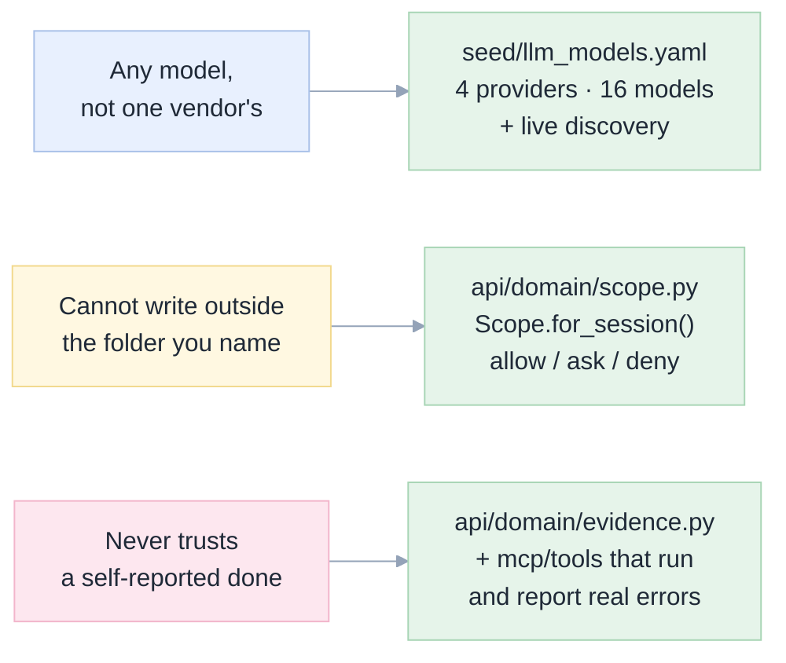

# 02. Grounded assessment: what is actually in this repository

[Index](README.md) · prev: [01 Five whys](01-five-whys.md) · next: [03 Requirements](03-requirements.md)

Every count below was produced by a command in this section, run in this repository on 8 November 2026.
A number without a command is a rumour ([P1](01-five-whys.md#p1-a-number-without-its-regeneration-command-is-a-rumour)),
so the commands are printed rather than summarised.

---

## 1. Size and shape

```bash
find apps/coding-agent/api -name '*.py' -not -path '*__pycache__*' | wc -l        # 90 files
find apps/coding-agent/api -name '*.py' -not -path '*__pycache__*' \
  -not -name 'test_*' | xargs wc -l | tail -1                                     # 12,974 lines
cat apps/coding-agent/tests/*.py | wc -l                                          # 5,419 lines
find apps/coding-agent/web/src -name '*.ts' -o -name '*.tsx' | grep -v '\.test\.' | wc -l  # 105
find apps/coding-agent/web/src -name '*.ts' -o -name '*.tsx' | grep -v '\.test\.' \
  | xargs wc -l | tail -1                                                         # 14,479 lines
find . -name '*.md' -not -path './apps/coding-agent/web/node_modules/*' \
  -not -path './.git/*' | wc -l                                                   # 138 documents
```

| Surface | Files | Lines | What it is |
|---|---|---|---|
| `apps/coding-agent/api` | 90 `.py` | 12,974 | FastAPI host: domain, ports, adapters, routers, services |
| `apps/coding-agent/tests` | 26 `.py` | 5,419 | 466 collected tests |
| `apps/coding-agent/web/src` | 105 `.ts`/`.tsx` | 14,479 | React 19 + CodeMirror 6 app |
| `apps/coding-agent/web/src/**/*.test.ts*` | 46 files | 509 tests | domain functions, components, the shell |
| `apps/coding-agent/web/scripts` | 56 `.mjs` | — | Playwright scenes and audits |
| `mcp/databricks_notebook_mcp.py` | 1 | 987 | the tool server: 28 tools, 20 in the core profile |
| `exams/` | 5 `.py` + 11 missions | 1,077 | seed → run → grade, on a live workspace |
| `exams/results/` | 174 `.json` | — | every saved run, plus the rejected ones |
| `docs/` + `specs/` | 109 `.md` (11 + 98) | 22,319 | the documentation the site renders |
| `docs/` + `specs/` screenshots | 286 `.png` | — | captured from a live app |

**The asymmetry that motivates this work:** 27,453 lines of shipped code and 138 markdown documents
against a front door that is one 10 KB README written in the voice of a lab report
([01 §4](01-five-whys.md)). The repository is not short of substance; it is short of an entrance.

---

## 2. What the front door says today

The current `README.md`, by section, in order:

| # | Section | Audience it serves |
|---|---|---|
| 1 | "One sentence: you can get most of what Genie Code does…" | a reader who already knows what Genie Code is |
| 2 | Five badges | a reader who already believes |
| 3 | "Start here" table of 9 links | someone who has decided to invest an hour |
| 4 | Headline results, two tables, one chart | a reviewer, not a buyer |
| 5 | "The six findings that matter most" | the study's own audience |
| 6 | Quick start: three shell commands + `DATABRICKS_HOST` | an engineer with a local shell |
| 7 | "What is in this repository" | an engineer reading the tree |
| 8 | Exams explained, limits, safety, reproduction | the study's own audience |

Nothing above the fold shows **the product**. There is no screenshot of `apps/coding-agent`, no
statement of what it does that Genie Code does not, no licence, no author. A reader who wants to
*evaluate the app* has to reach section 7 and then leave the page.

---

## 3. What the product actually is, in the repository's own terms

Read from `apps/coding-agent/app.yaml`, `api/routers/api.py`, `api/domain/scope.py`, `seed/llm_models.yaml`
and `web/src/domain/layout.ts` — not from the README.

| Capability | Where it is implemented | Count |
|---|---|---|
| HTTP API | `api/routers/*.py` | 37 + 11 + 6 + 2 = **56 routes** |
| Model catalogue | `seed/llm_models.yaml` | **4 providers, 16 models**, seeds + live discovery |
| Credentials | `api/adapters/llm/vault` | envelope-encrypted keys in Lakebase (AES-256-GCM) |
| Tools the agent may call | `tools/databricks_notebook_mcp.py` | **28 tools**, 20 in the core profile |
| The write fence | `api/domain/scope.py` | every target classified `allow` / `ask` / `deny` |
| Evidence rule | `api/domain/evidence.py` | a requirement is *verified* only by a tool call that happened |
| Layout algebra | `web/src/domain/layout.ts` | `CENTRE_MIN = 480`, four zones, one `columns()` |
| Agent transport | `api/adapters/acp/` | Agent Client Protocol over stdio, one subprocess per session |

The three claims the site will make are therefore not marketing positions; each maps to a file:



---

## 4. What the evidence is worth, and where it stops

| Claim | Number | Source of truth | Caveat the site must print |
|---|---|---|---|
| Same tools, two models | 39% vs 86% ([CL-3](12-claims-ledger.md)) | `exams/results/v5_gptoss`, `v5_gemini` | one run each, 8 tasks |
| Engineering rescues a weak model | 19% → 94% ([CL-4](12-claims-ledger.md)) | `v2`, `v3`, `v4_gptoss` | one run each; the ladder was tuned on these tasks |
| A strong model needs less | 100% on held-out, V1 ([CL-5](12-claims-ledger.md)) | `heldout_v1_gemini` | 3 tasks only |
| Repeatability | ±2.6 points ([CL-6](12-claims-ledger.md)) | `v4_gptoss`, `_t2`, `_t3` | one setup, three runs |
| Cost | tokens, not money ([CL-7](12-claims-ledger.md)) | `tokens` field per run | no Genie Code usage data exists |

The repository already says all of this (`docs/06`, `docs/07`). The site's job is to put the number and
the caveat **in the same card** ([P3](01-five-whys.md#p3-two-glances-about-the-same-thing-cannot-share-a-slot)),
not to omit the caveat because it is inconvenient.

---

## 5. Defects in the front door that this work must fix

Found by reading the README against the repository. Each is a requirement's reason to exist.

| # | Defect | Evidence | Fixed by |
|---|---|---|---|
| F1 | **No licence file.** The repository has no `LICENSE`; `pyproject.toml` declares no licence field either. "Can my employer use this?" is unanswerable. | `ls LICENSE*` → no match | `[PG-12]` |
| F2 | **No screenshot of the product in the README.** 286 PNGs exist in `specs/` and `docs/`; the only images in the README are four shields.io badges. | `grep -o '!\[[^]]*\]([^)]*)' README.md` → four badge URLs, no `.png` from the repo | `[PG-3]` |
| F3 | **No author section.** A reader cannot tell who built this or how to reach them. | README has no "about" section | `[PG-13]` |
| F4 | **The model claim is buried.** The single most important differentiator — you choose the model — is finding #2 in a list of six. | README §Headline | `[PG-2]` |
| F5 | **Tables drift by hand.** `docs/06` is regenerated by `inject_tables.py`; a page that restated it would be a third copy. | `exams/inject_tables.py` | `[PG-9]`, `[D1]` |
| F6 | **Two names for one thing.** The README says "EdgeGenie" zero times and "coding agent" four times; the app's own title is **OpenGenie** (`main.py: FastAPI(title="OpenGenie")`). | `grep -ci edgenie README.md` → 0 | `[PG-1]` |
| F7 | **The tutorial's screenshots are images of text**, not of the web UI (SSO blocked capture, stated in `docs/tutorial.md`). A page that presents them as UI photos would be lying. | `docs/tutorial.md` note | `[PG-17]` |

F6 is the one that matters most for a public page: a visitor must be told that *OpenGenie is the app*,
and that the study is how it was chosen. Two names, one product, stated once.

---

## 6. What the site must not do

Stated as a negative, because the temptation is real:

- **Not restate `docs/06`.** It renders it and links it ([D1](07-architecture.md#d1-the-docs-are-the-source-of-truth)).
- **Not claim a cost saving.** The repository never measured money ([P6](01-five-whys.md#p6-cost-is-the-readers-question-so-it-gets-an-honest-answer-not-a-number)).
- **Not present the tutorial's rendered images as screenshots of the UI** (F7).
- **Not show a "live demo" control**, because there is no hosted demo ([P4](01-five-whys.md#p4-a-control-that-cannot-act-must-not-be-shown)).
- **Not invent a benchmark.** Every score is a task the repository graded.
