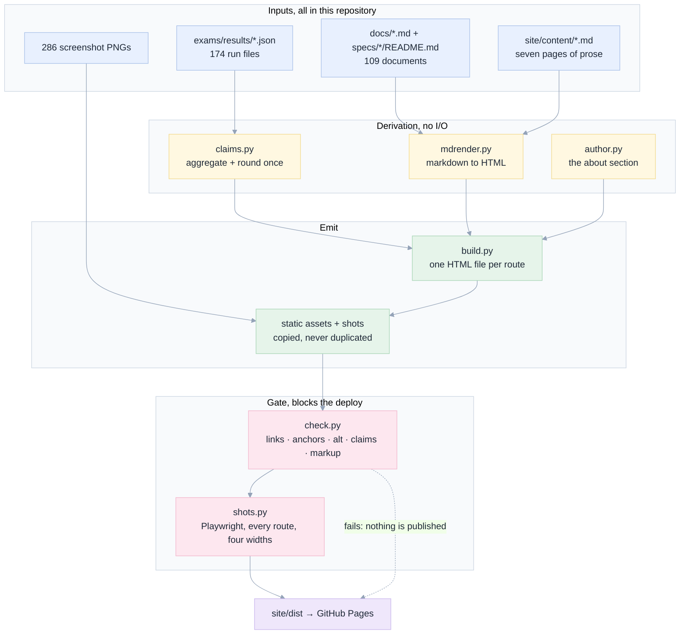
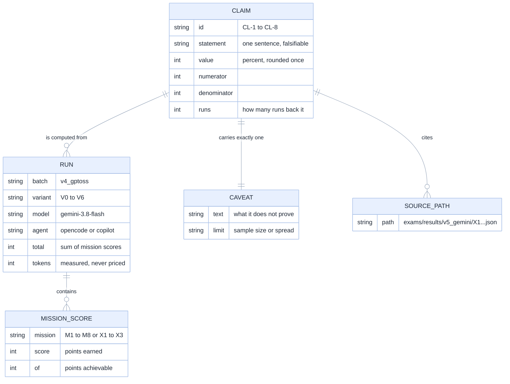
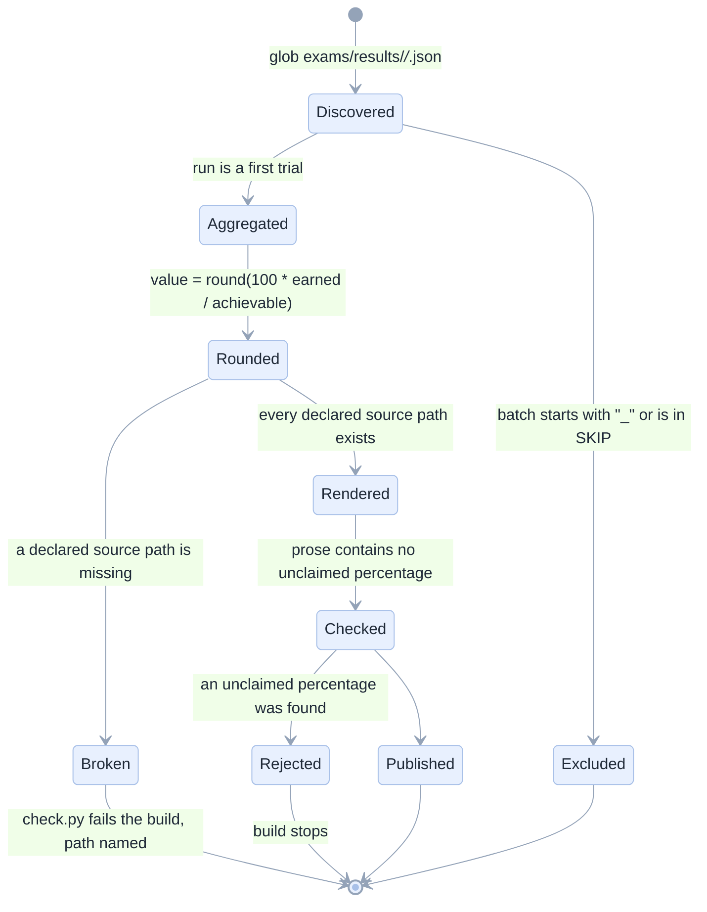
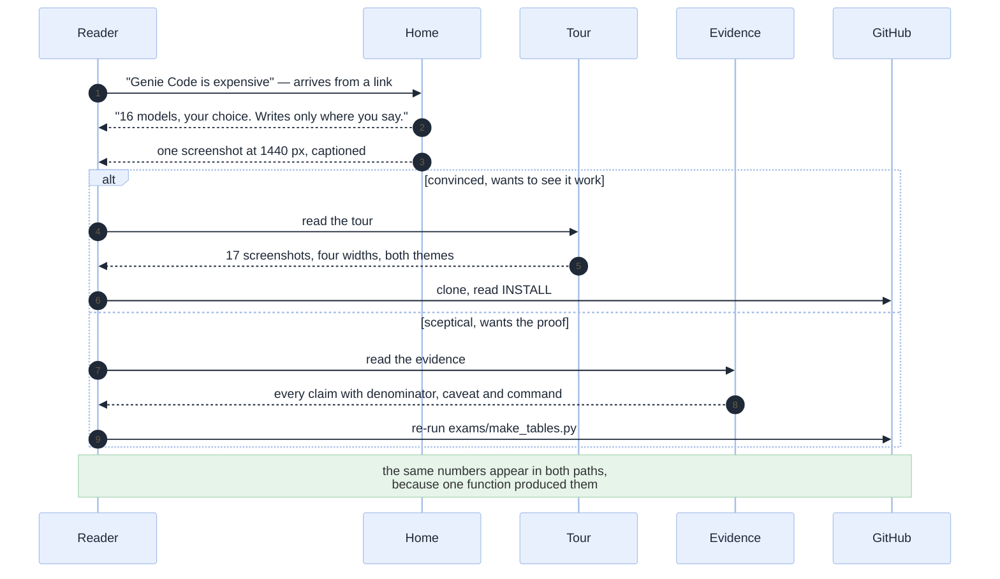
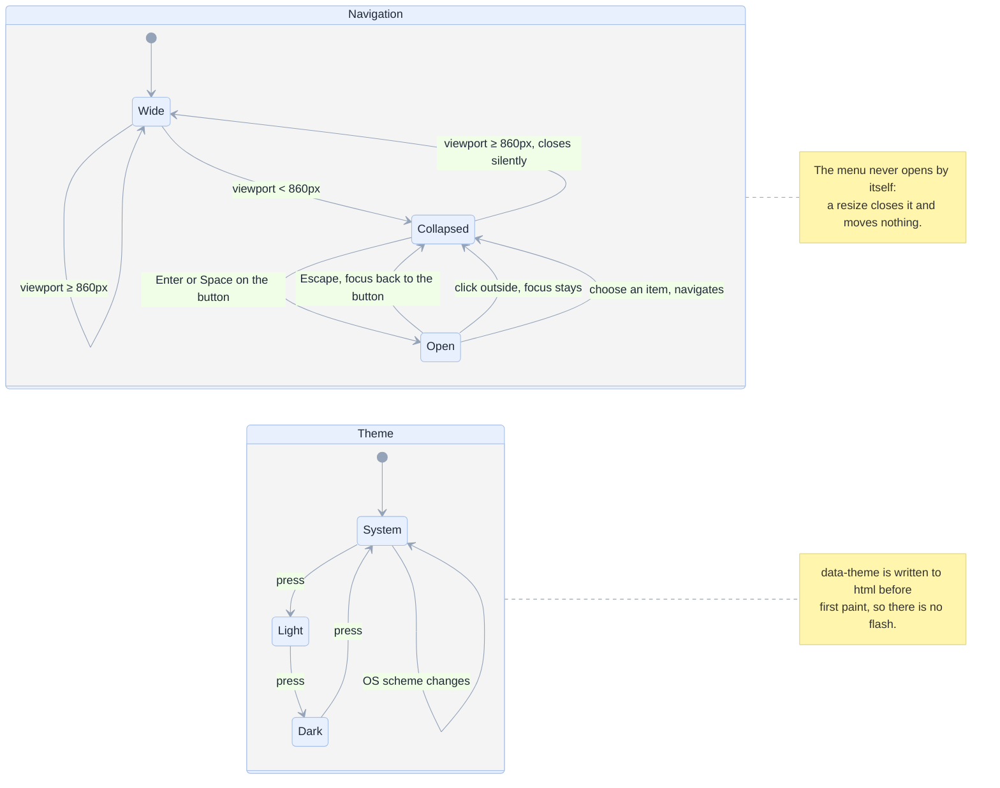
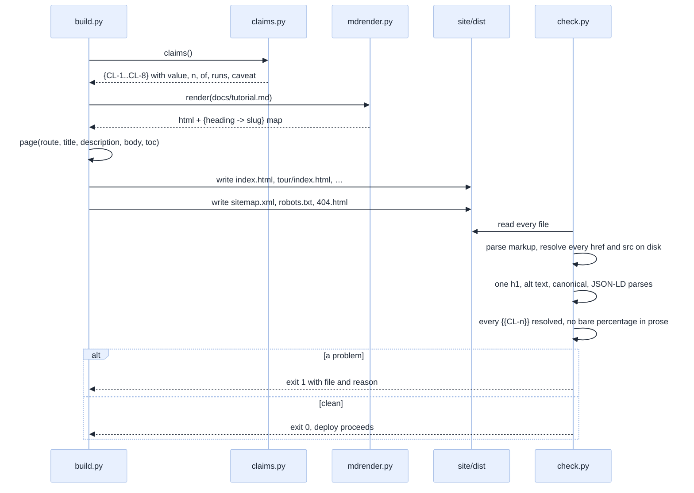
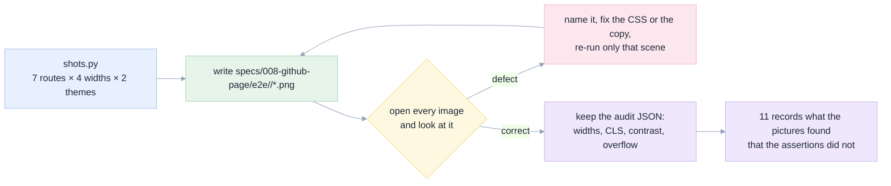
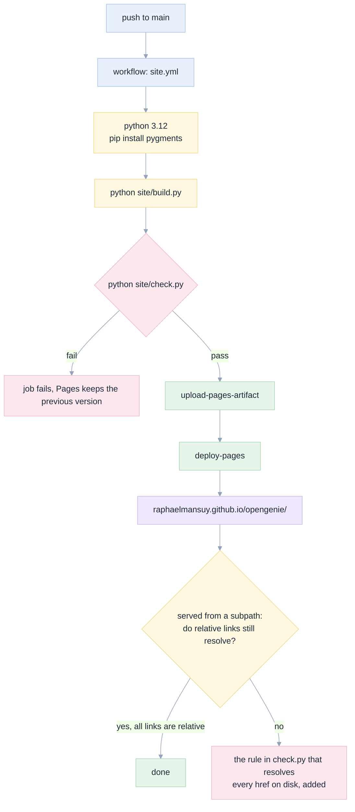
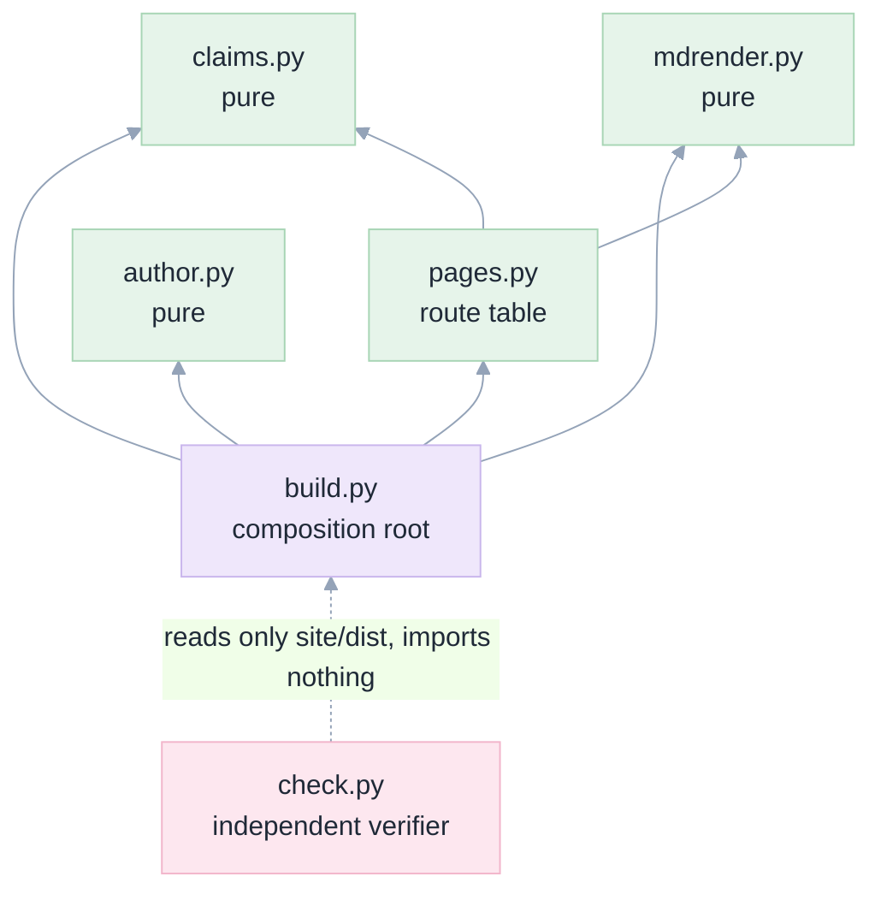

# 05. Diagrams (Mermaid)

[Index](README.md) · prev: [04 Wireframes](04-wireframes.md) · next: [06 Lenses](06-lenses.md)

Mermaid for the things that change over time or have cardinality: build order, states, data model,
sequences. ASCII for geometry, in [04](04-wireframes.md). That split is deliberate — a sequence diagram
drawn in ASCII is unreadable, and a pixel grid drawn in Mermaid is wrong.

Every diagram below is parsed by the repository's own verifier before it ships:

```bash
NODE_PATH=/tmp/mmd/node_modules node apps/coding-agent/web/scripts/verify-spec-mermaid.mjs \
  specs/008-github-page
```

---

## 1. The build pipeline, in order

The order is the requirement: nothing is rendered before its inputs are resolved, and nothing is
deployed before it passes the checker.



---

## 2. What a claim is made of, and where each part comes from

The data model of the one entity that matters (`[CPT-1]`).



---

## 3. The claim's lifecycle, from result file to rendered card

This is a state machine over *the build*, not over the page: a claim that cannot be derived must not
reach the HTML (`[CPT-4]`).



---

## 4. A reader's first ninety seconds

The journey the page is designed around ([01](01-five-whys.md)). Every arrow must be one click.



---

## 5. The navigation state machine

`[NAV-3]`, `[NAV-4]`. Two independent machines that must not interfere: the menu is about width, the
theme is about preference.



---

## 6. A page render, in sequence

Where a broken link is caught, and why it is caught at build time rather than by a reader.



---

## 7. The screenshot inspection loop

`[PG-14]`, and the reason [11](11-outcome.md) can say a picture was looked at.



---

## 8. Deployment, and what happens when it is wrong

`[NAV-1]` is the reason the same artefact can be served from three places.



---

## 9. Module dependencies, and why there is no cycle

The SOLID rule for a static site is the same as for an app: dependencies point one way, and the domain
knows nothing about the output (`[D2](07-architecture.md#d2-dependencies-point-one-way)`).



`check.py` deliberately imports nothing from the build: a verifier that shares code with the thing it
verifies cannot catch that code's mistakes.
