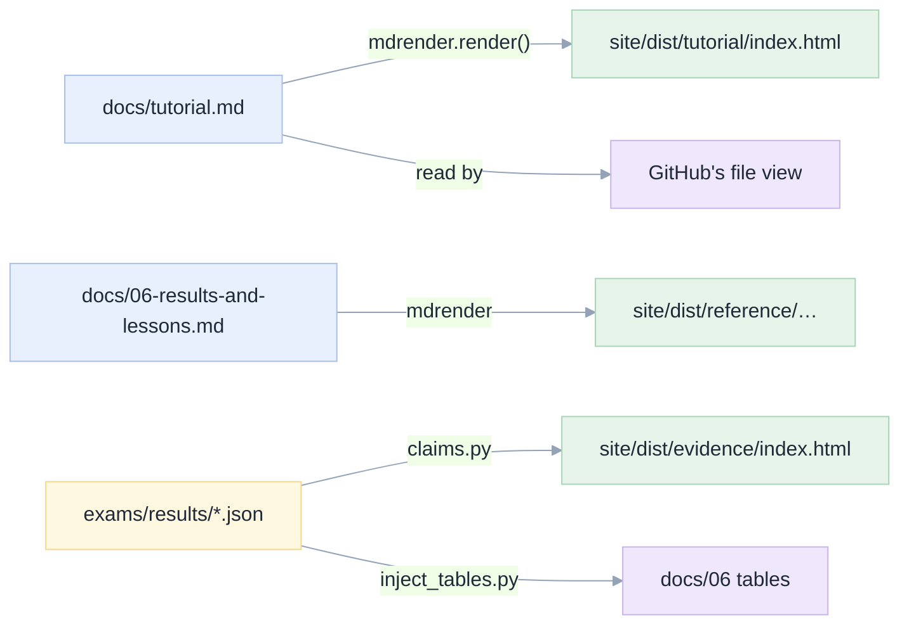

# 07. Architecture

[Index](README.md) · prev: [06 Lenses](06-lenses.md) · next: [08 Implementation plan](08-implementation-plan.md)

Where each rule lives, and why there rather than somewhere else. The pattern is the one
[001](../001-databricks-coding-agents/02-architecture.md) uses for the app: **pure functions in the
middle, one composition root at the edge, and an independent verifier outside both.**

---

## The shape

```
site/
  build.py            the composition root. Imports the four modules below, writes every file.
  pages.py            the route table: (route, title, description, body-fn, nav-key, toc)
  claims.py           pure. Reads exams/results, returns the eight claims. No HTML.
  mdrender.py         pure. Markdown → HTML, plus the heading→slug map.
  author.py           pure. The about section, as one function returning HTML.
  check.py            the verifier. Imports nothing from site/. Reads site/dist only.
  shots.py            Playwright. Screenshots and audits the built site.
  content/*.md        the prose of the first-party pages (home, tour, evidence, install, about).
  static/             site.css, site.js, icons, author and project images, vendored mermaid.
  dist/               output. Git-ignored; CI rebuilds it.
```

Four modules, one of them an entry point, and **no module imports another except through `build.py`**.

---

## D1. The docs are the source of truth

`docs/tutorial.md`, `docs/01..07`, `specs/*/README.md` are already written, already cross-linked, and
already checked by `web/scripts/verify-spec-links.mjs`. The site **renders** them.



Consequence: **one edit point per fact.** A figure appears in `docs/06` (generated by
`inject_tables.py`) and on `/evidence/` (generated by `claims.py`) because **both read the same JSON** —
not because one was copied from the other. `[PG-9]` enforces that no third copy exists.

The trade-off accepted: a doc's internal links (`../README.md`) do not resolve inside the site, so
`mdrender` rewrites them to the repository's GitHub URL. That is a `REWRITE` table, listed in one place
in `mdrender.py`, and `check.py` fails on a rewritten link whose target does not exist in the repo.

---

## D2. Dependencies point one way

`build.py` imports `pages`, `claims`, `mdrender`, `author`. None of those imports `build`. `check.py`
imports **nothing** from `site/`. That last rule is the important one: a verifier that shares code with
the thing it verifies cannot catch that code's mistakes — it would "verify" that `page()` produces what
`page()` produces.

```
        build.py
       ╱   │   ╲   ╲
 pages  claims mdrender author      ← pure, no I/O except read
       ╲   │   ╱   ╱
        (data)                      ← strings and dicts

  check.py  ──reads──►  dist/        ← no import from site/ at all
```

---

## D3. Python and no framework

The site is 8 routes and ~1,000 lines of prose. A framework would add `node_modules` (the app already
has 700 packages; the site should not inherit them), a build step, and a lockfile to audit.

| Chosen | Rejected | Why |
|---|---|---|
| Python 3.12 + Pygments | Vite + React | The output is static HTML; there is no interactivity to manage |
| Vendored `mermaid.min.js` (3.4 MB, one page uses it) | A CDN `<script>` | `PF-4`: a build that needs the network is a build that fails offline |
| `site.css`, one file, ~900 lines | Tailwind | Tailwind's value is component churn; this is 8 pages |
| `site.js`, one file, ~120 lines | Alpine, htmx | Theme, menu, copy buttons, Mermaid init. That is the whole list |

The single accepted cost: Pygments must be installed to build. It is in `requirements-site.txt`, one
line, and CI installs it.

---

## D4. One source per fact: the claims registry

`claims.py` is the only place a number is computed (`[CPT-1]`). Its contract:

```python
@dataclass(frozen=True)
class Claim:
    id: str            # "CL-3"
    statement: str     # one falsifiable sentence
    value: int         # percent, rounded once
    numerator: int     # 130
    denominator: int   # 152
    runs: int          # 1
    tasks: str         # "8 development tasks (M1-M8)"
    caveat: str        # what it does not prove
    sources: list[str] # paths that must exist
```

Three rules it enforces, each because of a defect found while writing this:

1. **The denominator is the perfect run's total, per mission.** A failed run's grader returns early, so
   its own `total` is smaller. Comparing `143/152` with `60/63` would be comparing two different exams.
   The rule is copied from `exams/make_tables.py:full_totals`, including its comment.
2. **Rejected batches are excluded by the same predicate.** `_`-prefixed, plus the three names in the
   repository's `SKIP` set. If the site used a different skip rule from the docs, they would disagree.
3. **Rounding happens once, at render.** `round(100 * n / of)`. A template that formats a float and a
   table that rounds an int produce `94%` and `94.0%` for one fact.

---

## D5. One page function

Every route goes through `page(...)`, which owns:

- the `<head>`: title, description, canonical, OG, Twitter, JSON-LD, favicon, manifest;
- the header, with `aria-current` computed from the route key (`[NAV-2]`);
- the contents rail, from the heading list `mdrender` returned (`[NAV-6]`);
- the previous/next band, from the route order in `pages.py` (`[NAV-7]`);
- the footer, including the licence and the commit stamp (`[PG-10]`, `[PG-12]`).

A route supplies a title, a description, a body and a nav key. Nothing else. A missing canonical tag is
then impossible for seven independent reasons, because there is one place it could be missing.

---

## D6. The palette is the app's palette

`site/static/site.css` starts from the app's tokens (`apps/coding-agent/web/src/styles.css:11-60`) —
`--bg: #faf9f7`, `--surface: #ffffff`, `--ink: #1c1b19`, `--blue-600: #4b5bd6` — and restates them in
the site's own file. That is a **deliberate** duplication of nine values, because two deployables with a
shared stylesheet would need a package, and the site must build with `python3` alone.

The duplication is bounded and tested: `check.py` asserts that each shared token in `site.css` has the
same value as in the app's stylesheet, so the two cannot silently diverge.

```css
/* site/static/site.css — the shared nine, checked against the app */
--bg: #faf9f7;  --surface: #ffffff;  --surface-2: #f6f5f2;
--line: #e9e7e2;  --ink: #1c1b19;  --ink-2: #57544e;
--ink-3: #6b6760;  --blue-600: #4b5bd6;  --radius: 10px;
```

---

## D7. SOLID, read literally

The acronym is over-applied, so here is what each letter means for this codebase and what it forbids.

| Letter | Here | What it forbids |
|---|---|---|
| **S**ingle responsibility | `claims.py` computes; `mdrender.py` renders; `build.py` writes; `check.py` verifies | A helper in `build.py` that also formats a number |
| **O**pen/closed | A new page is one entry in `pages.ROUTES` and one content file | Editing `page()` to add a route |
| **L**iskov | Every body function returns the same shape: `(title, description, body_html, toc)` | A page that returns raw HTML with its own header |
| **I**nterface segregation | `mdrender.render()` returns text; `mdrender.headings()` returns the TOC. A caller that wants only the TOC does not pay for the HTML | One `render_everything()` |
| **D**ependency inversion | `build.py` receives the claim set as a parameter; it does not import and call a global | `claims.compute()` called deep inside a template |

The test of all five: adding `/changelog/` should touch `pages.py` and `content/changelog.md`, and
nothing else. [10 §S6](10-e2e-plan.md) asserts that.

---

## D8. The verifier, and what it can and cannot see

`check.py` answers only questions that are decidable from the output:

| It checks | It cannot check |
|---|---|
| Every `href`/`src` resolves on disk | That the prose is true |
| One `h1`, ordered headings | That the ordering reads well |
| Every `img` has meaningful `alt` | That the `alt` is accurate |
| Markup is balanced | That the layout looks right |
| `sitemap.xml` lists every route | That a search engine will index it |
| Every `{{CL-n}}` resolved | That the claim is the right one |
| JSON-LD parses as JSON | That a crawler accepts the schema |
| No bare percentage in prose | That the percentage is the interesting one |

The last column is the point of [10](10-e2e-plan.md): a machine cannot see whether a page is *good*, so a
person looks at every screenshot. The two together are the quality bar; either alone is a false
assurance.
