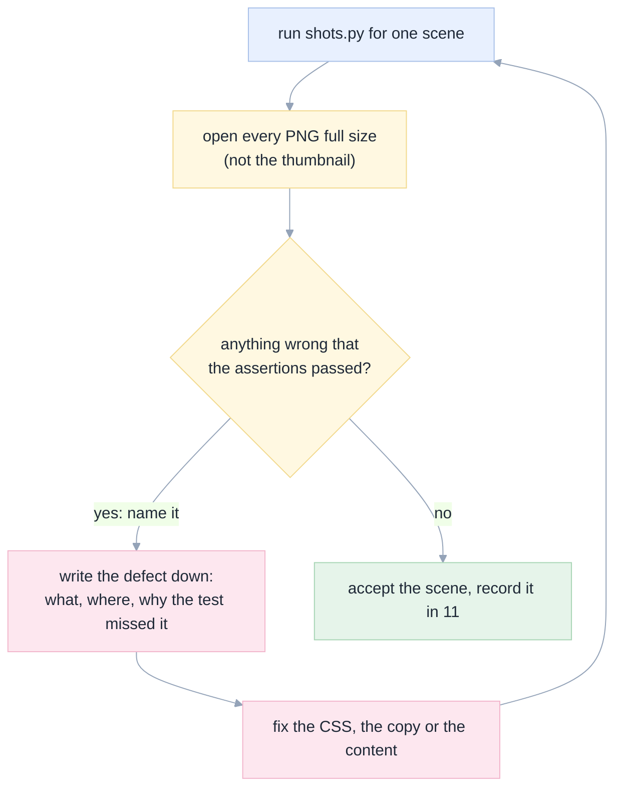

# 10. E2E plan: ten scenes, every screenshot inspected

[Index](README.md) · prev: [09 Edge cases](09-edge-cases.md) · next: [11 Outcome](11-outcome.md)

The rule this follows is the repository's own, from [006 §5](../006-databricks/14-genie-code-gap-analysis.md)
and [007 §outcome](../007-ux-ui-improve/11-outcome.md): **a screenshot that has not been looked at is not
evidence.** An assertion can prove a thing exists; only an eye can say whether it is right.

---

## Where the pictures live

```
specs/008-github-page/e2e/
  home/            1440 1100 860 390, light and dark, plus the crop
  tour/            1440 390
  tutorial/        1440 390
  evidence/        1440 390, plus a claim-card crop
  install/         1440 390
  reference/       1440 390
  about/           1440 390
  states/          menu open, three theme states, no-JS, no-images, 404
  audit.json       contrast, targets, CLS, overflow, byte weight, per route
```

Naming: `<route>-<width>[-<variant>].png`, so a file sorts into its route and a reader can tell its
conditions from its name alone (`[PG-14]`).

---

## The ten scenes

| id | Scene | Widths | What it asserts before the picture |
|---|---|---|---|
| `S1` | Every route loads from a **subpath** server (simulating Pages) | 1440 | 200, one `h1`, the title matches, no console error |
| `S2` | The home page's first two viewports | 1440 | The screenshot `` is above 2× the viewport height; three claim links resolve; one `.btn-primary` |
| `S3` | `/evidence/` — every claim card | 1440 | 8 cards; each has a value, a denominator, a run count, a non-empty caveat and ≥1 source link |
| `S4` | `/about/` | 1440 | The portrait loads with real dimensions; LinkedIn, GitHub and the repo links resolve |
| `S5` | Navigation, both ways | 1440 | Every route links to the other six; `aria-current` appears exactly once per page; skip link is the first tab stop |
| `S6` | The docs are rendered, not retyped | 1440 | The tutorial's anchor set equals `docs/tutorial.md`'s heading slugs; a sample paragraph matches the source byte for byte |
| `S7` | Accessibility and width | 1440, 1100, 860, 390 | Contrast from painted colours; targets ≥24 px; no horizontal overflow; CLS < 0.02; 200% zoom |
| `S8` | Degraded modes | 1440 | JS off: content, order and links intact, Mermaid shows its source. Images blocked: every `alt` readable |
| `S9` | Determinism and weight | — | Two builds identical except the stamp; each page under 400 KB; total under 6 MB excluding PNGs |
| `S10` | The 404 and the deploy contract | 1440 | `404.html` at the artifact root; `sitemap.xml` lists 8 routes; `robots.txt` points at it; the footer's commit matches the build |

---

## The inspection loop

This is the part that produced the findings in [11](11-outcome.md), and it is a loop, not a gate.



### What "open it and look" means here

A checklist, because "look at it" is not an instruction:

| Look for | Why it is on the list |
|---|---|
| The first line of text | Does the page say what it is before anything else? |
| The first screen's **bottom edge** | Is there a reason to scroll, visible? |
| Text over a coloured or gradient background | Contrast is worst there, and the audit samples the painted colour, not the declared one |
| The longest word in a heading at 390 px | It is the first thing to overflow |
| Every table at 390 px | Tables are the most common cause of horizontal scroll |
| A screenshot's caption, read alone | It must identify the image without the image |
| The space between two sections | Uneven spacing reads as a mistake, not as rhythm |
| The footer's commit | A stale stamp is the only visible sign of a stale deploy |
| Both themes, side by side | A colour pair that works in light can fail in dark |
| The nav at 861 px and 859 px | One pixel either side of a breakpoint is where layout bugs live |

### What the assertions cannot see, and therefore always needs an eye

- Whether the hero's claim is *the right claim*.
- Whether a caption describes the image above it.
- Whether two sections say the same thing in different words.
- Whether the page's density is appropriate — too airy reads as empty, too dense reads as a wall.
- Whether the author section reads as a person or as a press release.

---

## Pass criteria

A scene passes when **all** of the following hold. Any one failure fails the scene.

| Criterion | Threshold | Where |
|---|---|---|
| Every assertion in the scene | 100% | `shots.py` exit code |
| Contrast, body text | ≥ 4.5:1 in both themes | `audit.json` |
| Contrast, large text and UI | ≥ 3:1 in both themes | `audit.json` |
| Target size | ≥ 24×24 px; primary ≥ 44×44 | `audit.json` |
| Horizontal overflow | none at 320, 390, 860, 1100, 1440 | `audit.json` |
| CLS | < 0.02 | `audit.json` |
| Page weight (HTML+CSS+JS) | < 400 KB per page | `audit.json` |
| Broken links | 0 | `check.py` |
| Images without meaningful `alt` | 0 | `check.py` |
| Defects found by looking | 0 open | [11](11-outcome.md#what-the-screenshots-found-that-the-assertions-did-not) |

---

## Re-running

```bash
python3 site/build.py
python3 site/check.py
python3 site/tests/test_claims.py

cd site && python3 -m http.server 8130 --directory dist &
python3 site/shots.py --scene S1 --scene S2          # one scene
python3 site/shots.py --all                          # everything, then look at them
```

The audit writes `specs/008-github-page/e2e/audit.json`; the screenshots are committed. A scene that is
re-run overwrites its own folder only, so an untouched scene's evidence keeps its original date.
