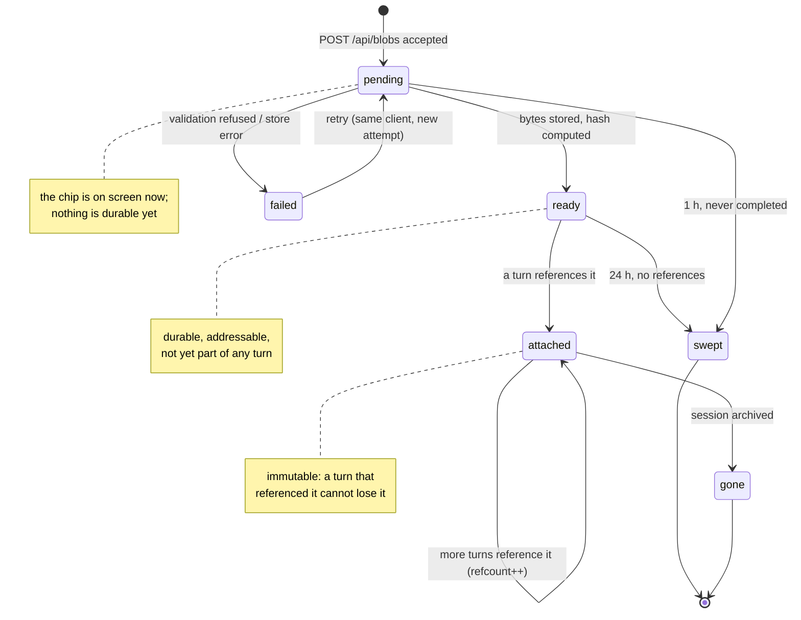
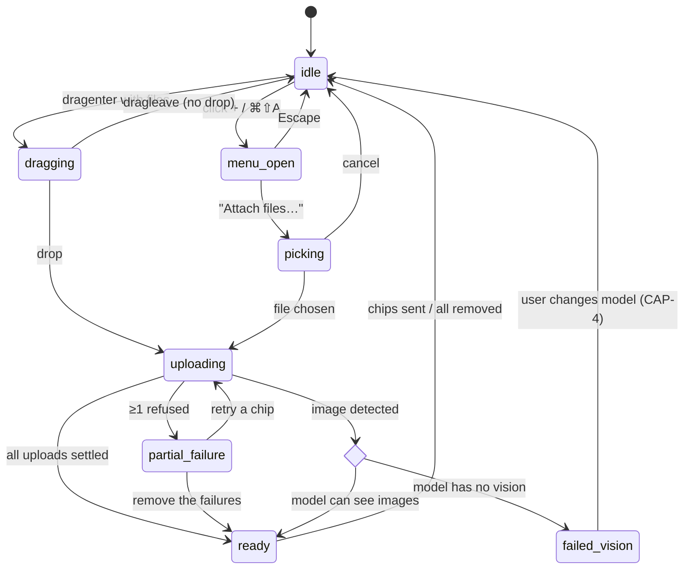
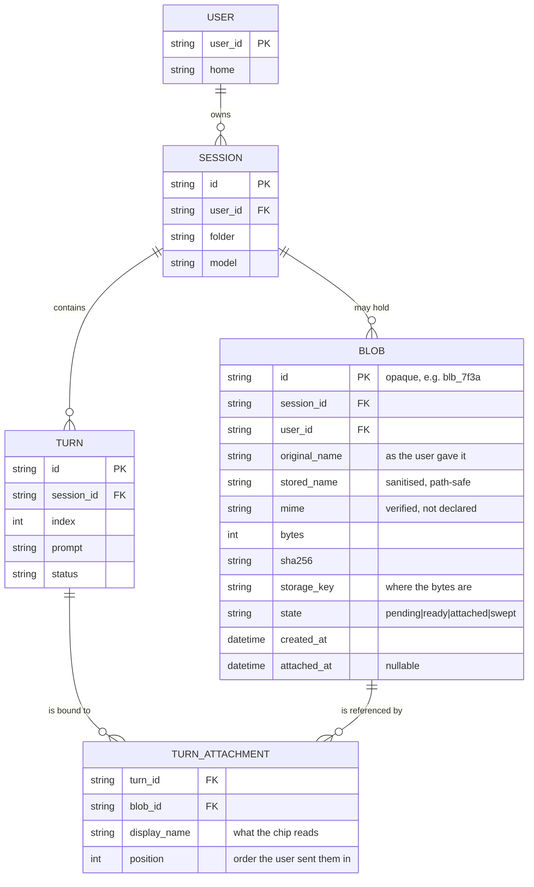
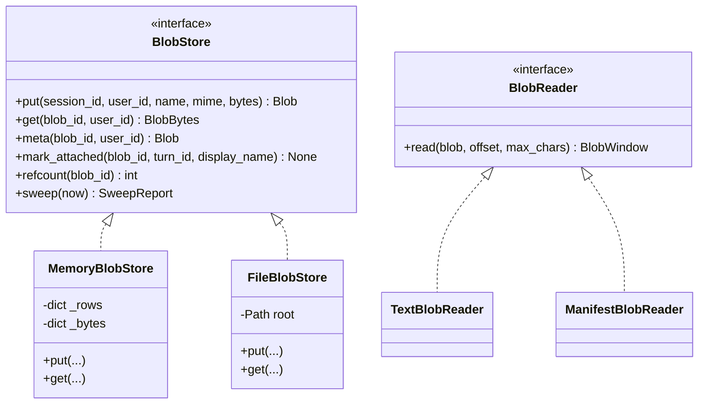
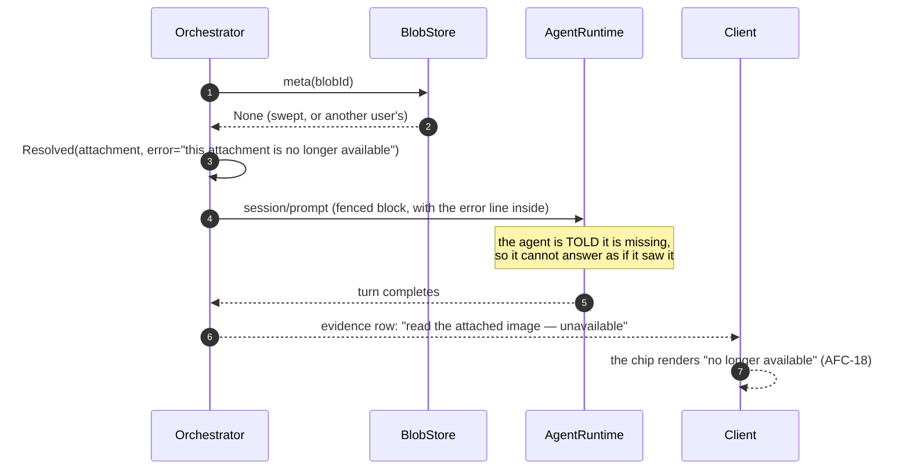

# 05. Diagrams (Mermaid)

**The dynamics and the data model.** Wireframes are in [04](./04-wireframes.md); this file is what moves
and what is stored.

Spec [009](./README.md) · requirements [03](./03-requirements.md) · architecture [07](./07-architecture.md)

---

## 1. Sequence — paste, upload, send, resolve

The whole feature in one picture. Every arrow is a decision the plan has to implement.

```mermaid
sequenceDiagram
    autonumber
    actor U as User
    participant C as Composer (React)
    participant S as API (FastAPI)
    participant B as BlobStore
    participant O as Orchestrator
    participant R as AgentRuntime (ACP)
    participant T as ToolServer (MCP)

    U->>C: ⌘V with image on clipboard
    C->>C: clipboardData.files.length > 0 → preventDefault
    C-->>U: chip appears instantly, state = pending
    Note over C: no await before the chip exists — P8

    C->>S: POST /api/blobs (base64 or multipart)
    S->>S: validate size, magic bytes, MIME, name (SEC-3, AFC-4)
    alt invalid
        S-->>C: 422 {reason: "report.pdf is 12.4 MB; the limit is 8 MB"}
        C-->>U: chip state = failed, sentence shown, retry offered
    else valid
        S->>B: put(bytes, meta) → blobId
        B-->>S: blobId, sha256
        S-->>C: 201 {blobId, name, mime, bytes, thumbUrl}
        C-->>U: chip state = ready, thumbnail
    end

    U->>C: types text, presses Enter
    C->>S: POST /sessions/{sid}/messages {text, attachments:[{kind:"blob", ref:blobId}, …]}
    S->>O: submit(...)
    O->>O: ctx.parse() — 6 kinds now, blob included (AFC-5)
    O->>B: get(blobId) for each blob
    B-->>O: bytes + meta
    O->>O: ctx.render() fences each item as DATA (AFC-9)
    Note over O: image → manifest + description block, never base64
    O->>R: session/prompt {type:"text", text: fenced}
    R->>T: dbx_read_blob(blobId) when it needs more (AFC-14)
    T-->>R: paged text / manifest
    R-->>O: events → transcript
    O-->>C: SSE: turn.completed with evidence rows
    C-->>U: chips in transcript + evidence block
```

**Three things the picture makes unavoidable:**

1. The chip exists before the network does. Any design that awaits the upload first fails
   [P8](./01-five-whys.md).
2. Validation happens **twice** — client (fast refusal, [AFC-4](./03-requirements.md)) and server
   (authoritative, [SEC-3](./03-requirements.md)). The client check is a courtesy; the server check is the
   rule.
3. The model never receives base64. It receives text plus a reference, and reads bytes through a tool.

---

## 2. Sequence — writing a blob into the workspace (the fence)

Attaching and *saving* are different actions ([SEC-2](./03-requirements.md)). This is the second one.

```mermaid
sequenceDiagram
    autonumber
    actor U as User
    participant C as Composer
    participant S as API
    participant F as scope.check_path
    participant A as approval
    participant W as Databricks Workspace

    U->>C: click "Save to folder" on a chip
    C->>S: POST /workspace/fence {path, version}
    S->>F: check_path(scope, path)
    alt inside the session folder
        F-->>S: ALLOW
        S-->>C: {verdict:"allow"}
        C->>S: POST /api/blobs/{id}/materialise {folder}
    else outside
        F-->>S: ASK (reason: "outside /Users/me/agent_scratch")
        S-->>C: {verdict:"ask", reason, approval}
        C-->>U: the ask banner, exactly as for Save
        U->>C: Allow once
        C->>S: POST /api/blobs/{id}/materialise {folder, approval}
    end
    S->>S: verify approval bound to path+version
    S->>W: import_content(path, bytes, "AUTO")
    W-->>S: 200
    S-->>C: 201 {path}
    C-->>U: chip now says "in folder"; attachment kind becomes "file"
```

This reuses `workspace_save`'s exact order — fence, approval, write, record — because
[P3](./01-five-whys.md) says a blob is not a special case of the fence, it is a caller of it.

---

## 3. State — a blob's lifecycle



The invariant that makes this safe: **`attached` is terminal for content.** A blob referenced by any turn
is never swept, never re-encoded, never overwritten. Its bytes may be garbage-collected only when the
whole session is archived ([BLB-3](./03-requirements.md)).

---

## 4. State — the composer's attach surface

The control's own states, which [CAP-2](./03-requirements.md) and [CAP-3](./03-requirements.md) require.



`vision_check` is a *client-side* refusal at the moment of attach, which is what
[CAP-2](./03-requirements.md) means by "refused at the picker, not after upload".

---

## 5. Entity–relationship — the blob model



### Why a join table and not a column on `turn`

A turn already stores its attachments as `[{kind, ref, name}]` JSON (`Turn.attachments`). A blob is the
same shape — `{kind:"blob", ref:blobId, name}` — so **the turn needs no schema change at all**. The join
table exists only to answer the one question the JSON cannot answer efficiently: *"which blobs are still
referenced?"* — which is what the sweeper asks on every pass ([BLB-3](./03-requirements.md)).

| Question | Answered by | Why not the other |
|---|---|---|
| What was attached to turn 3? | `turn.attachments` JSON | already there, already replayed |
| Is blob X safe to sweep? | `TURN_ATTACHMENT` count | a JSON scan per blob is O(turns) |
| What did the user call it? | `TURN_ATTACHMENT.display_name` | the same bytes can be attached twice with different names |
| What is its MIME, really? | `BLOB.mime` | verified once, at upload |

---

## 6. Flowchart — the validation decision, in the order it runs

The order matters: the cheapest check that can refuse is first, so a 2 GB body is never parsed as JSON.

```mermaid
flowchart TD
    A[bytes arrive] --> B{Content-Length ≤ cap?}
    B -->|no| R1[413: names the limit and the size]
    B -->|yes| C{magic bytes match<br/>a known family?}
    C -->|no| R2[422: "not a file type we can read"]
    C -->|yes| D{declared MIME ==<br/>detected MIME?}
    D -->|no| R3[422: "looks like image/png,<br/>says text/plain"]
    D -->|yes| E{name sanitises to<br/>something legal?}
    E -->|no| R4[422: "the name has characters<br/>a workspace path cannot hold"]
    E -->|yes| F{zero bytes, or<br/>whitespace only?}
    F -->|yes| R5[422: "the file is empty"]
    F -->|no| G{model can consume<br/>this family?}
    G -->|no| R6[422: names the model,<br/>offers the fix]
    G -->|yes| H{Σ attachments ≤ 6?}
    H -->|no| R7[422: "at most 6 per message"]
    H -->|yes| OK[store → 201 blobId]

    style R1 fill:#fdecf1,stroke:#a33a5c
    style R2 fill:#fdecf1,stroke:#a33a5c
    style R3 fill:#fdecf1,stroke:#a33a5c
    style R4 fill:#fdecf1,stroke:#a33a5c
    style R5 fill:#fdecf1,stroke:#a33a5c
    style R6 fill:#fdecf1,stroke:#a33a5c
    style R7 fill:#fdecf1,stroke:#a33a5c
    style OK fill:#e4f4f2,stroke:#14655f
```

Every red node is a row in the copy register ([09](./09-edge-cases.md#the-copy-register)) and a case in
[AFC-16](./03-requirements.md).

---

## 7. Class — the ports and their implementations (SOLID)

The whole backend design, as types. Nothing here is a class hierarchy for its own sake: each interface
exists because there is a second implementation *today* (memory) or a named future one.



| Principle | Where it shows |
|---|---|
| **S**ingle responsibility | `BlobStore` stores; `BlobReader` decides what a *read* means for a type; the router validates |
| **O**pen/closed | A new blob family is a new `BlobReader`, registered once — no branch edited in `resolve()` |
| **L**iskov | Both stores satisfy the same tests, run against both (`test_blobs.py` parametrises) |
| **I**nterface segregation | `BlobReader` has one method; nothing that only stores has to know how to read |
| **D**ependency inversion | `ctx_service.resolve` takes a `BlobReader` map, not a concrete reader |

---

## 8. Sequence — the failure that must not be silent



This is [AFC-15](./03-requirements.md) and [AFC-18](./03-requirements.md) as one picture: the failure is
visible to the *model*, in the *evidence*, and in the *chip*, in that order of importance.
