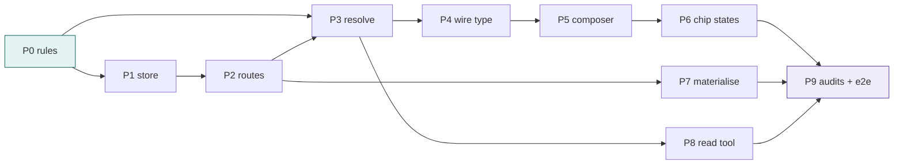

# 08. Implementation plan

**Phases, files, tests, order, acceptance.** Each phase is independently shippable and independently
testable; none leaves the app in a state where an existing feature is worse.

Spec [009](./README.md) · decisions [07](./07-architecture.md) · edge cases [09](./09-edge-cases.md) ·
e2e [10](./10-e2e-plan.md)

---

## Order, and why this order

```
P0  pure rules          ── no I/O, no UI ──────────▶ the contract exists before anything can violate it
P1  store + adapters    ── memory first ───────────▶ the port is proven by its cheapest implementation
P2  routes              ── upload, read, thumb ────▶ the API is usable with curl before any component
P3  resolve a blob      ── one branch in context ──▶ the model can receive an attachment
P4  the wire type       ── one kind, one event ────▶ the client and server agree
P5  composer            ── paste, drop, picker ────▶ the feature is reachable by a human
P6  chip states         ── four states, memoised ──▶ the feature is honest
P7  materialise         ── fence + approval ───────▶ the feature is safe
P8  the read tool       ── dbx_read_blob ──────────▶ the agent can page a blob
P9  audits + e2e        ── the loop ───────────────▶ the feature is proven
```

The inversion worth noting: **the UI comes fifth, not first.** Every earlier phase is verifiable without a
browser, which is what makes the later browser work a matter of layout rather than of correctness.

---

## P0 — Pure rules

**Files**

| File | Change |
|---|---|
| `api/domain/blob.py` | **new** — `Blob`, `BlobSpec`, `BlobError`, `validate`, `detect_mime`, `sanitise_name`, `MAX_*`, `CAPABILITY`, `REFUSALS` |
| `api/domain/blob_test.py` → `tests/test_blob_rules.py` | **new** — ~45 cases |

**The contract**

```python
@dataclass(frozen=True, slots=True)
class BlobSpec:
    original_name: str
    stored_name: str      # path-safe, deterministic
    mime: str             # verified
    bytes_len: int
    sha256: str

def validate(name: str, declared: str, raw: bytes, *, model_sees_images: bool) -> BlobSpec:
    """Raises BlobRefusal(reason, code) — the reason is the user-facing sentence."""
```

**Acceptance**

- `validate` is pure: no import from `services`, `adapters`, `time`, or `os` (asserted with `ast`).
- 45 cases pass, including: every magic-byte family, a polyglot (PNG header + ZIP body), a text file with a
  `.png` name, a name with `..`, a name with `\x00`, a zero-byte file, an 8 MB + 1 byte file, and every
  capability refusal.
- Every refusal's sentence appears in `REFUSALS` and contains the limit and the observed value
  ([AFC-16](./03-requirements.md)).

---

## P1 — The store

**Files**

| File | Change |
|---|---|
| `api/ports/__init__.py` | + `BlobStore`, `BlobReader` protocols |
| `api/adapters/blob/__init__.py` | **new** |
| `api/adapters/blob/memory.py` | **new** — dict of rows + dict of bytes |
| `api/adapters/blob/files.py` | **new** — `$TMP/agent-blobs/<session>/<id>` with 0600 |
| `tests/test_blobs.py` | **new** — contract test, parametrised over both stores |

**The contract test** is a single module-level list of behaviours, run against both implementations, so
Liskov is enforced rather than asserted in prose:

```python
@pytest.fixture(params=["memory", "files"])
def store(request): ...

def test_put_then_get_roundtrips(store): ...
def test_get_other_users_blob_raises_not_found(store): ...   # BLB-4
def test_sweep_respects_refcount(store): ...                 # V3
def test_put_is_idempotent_on_same_sha(store): ...           # same bytes twice → one row
```

**Acceptance**

- Both stores pass every test in the module; no test is skipped for either.
- `get` for another user's blob raises `LookupError` (mapped to 404, not 403).
- `sweep(now)` deletes a `pending` blob older than 1 h and a `ready` blob older than 24 h, and **never**
  one with a refcount > 0.

---

## P2 — Routes

**Files**

| File | Change |
|---|---|
| `api/routers/api.py` | + `POST /api/blobs`, `GET /api/blobs/{id}`, `POST /api/blobs/{id}/materialise` |
| `api/services/blobs.py` | **new** — `put`, `bytes_for`, `meta`, `materialise` |
| `api/main.py` | wire the store into `app.state` |
| `tests/test_api.py` | + ~14 route cases |

**Routes**

| Method | Path | Body / query | Returns |
|---|---|---|---|
| POST | `/api/blobs` | `{sessionId, name, mime, content(base64)}` | `201 {blobId, name, mime, bytes, thumbUrl}` |
| GET | `/api/blobs/{id}` | `?thumb=1` | bytes, `Content-Disposition` per [SEC-4](./03-requirements.md) |
| POST | `/api/blobs/{id}/materialise` | `{folder, approval?}` | `201 {path}` |

**Acceptance**

- A 9 MB body is refused by Pydantic's `max_length` **before** the handler (asserted by timing: < 10 ms).
- A PNG whose declared type is `text/plain` is refused with the detected-vs-declared sentence.
- `GET` on another user's id is 404, and the response has no `X-Blob-Owner` or similar leak.
- `materialise` outside the folder returns `{fence:"ask", approval}` and the file is **not** written.

---

## P3 — Resolve a blob into the prompt

**Files**

| File | Change |
|---|---|
| `api/domain/context.py` | `KINDS` + `"blob"`; `parse` validates `^blb_[0-9a-f]{12}$` |
| `api/services/context.py` | one branch: `if a.kind == "blob": return reader.read(...)` |
| `api/services/blobs.py` | `READERS` map: image → manifest, text → paged text, pdf → extracted text |
| `tests/test_binding.py` | + blob cases |

**Acceptance**

- A turn with a `blob` attachment produces a prompt containing the manifest, **not** base64
  (asserted: the prompt has no `/9j/` and no `iVBORw0KGgo`).
- A missing blob produces a `Resolved(error=...)` and the turn still runs ([AFC-15](./03-requirements.md)).
- `MAX_ATTACHMENTS` counts blobs and references together ([AFC-5](./03-requirements.md)).

---

## P4 — The wire type and the event

**Files**

| File | Change |
|---|---|
| `web/src/domain/events.ts` | `Attachment.kind` + `"blob"`; `EventType` + `"blob.attached"` |
| `api/domain/events.py` | same two changes |
| `api/domain/context.py` | the kind, above |
| `tests/test_event_parity.py` | unchanged — it must still pass, which is the point |
| `web/src/domain/events.test.ts` | + the new type is in both lists |

**Acceptance**

- `test_event_parity.py` passes without modification (the lists are compared, not enumerated).
- The reducer handles `blob.attached` idempotently (a replayed event does not duplicate a chip).

---

## P5 — The composer surface

**Files**

| File | Change |
|---|---|
| `web/src/components/Composer.tsx` | `+` button, `onPaste`, `onDragOver`/`onDrop`, the menu |
| `web/src/components/AttachMenu.tsx` | **new** — 3 rows, keyboard navigable |
| `web/src/hooks/useBlobUpload.ts` | **new** — the state machine, no fetch policy |
| `web/src/domain/blob.ts` | **new** — the courtesy validation, copy from `REFUSALS` |
| `web/src/api/client.ts` | + `uploadBlob`, `blobUrl`, `materialiseBlob` |
| `web/src/components/Composer.test.tsx` | + ~12 cases |

**Acceptance**

- Paste with files: one chip appears before any `await` (asserted with a fake clock: chip present at t=0ms).
- Paste with text only: the text appends and no chip appears.
- The `+` menu is reachable by Tab, opened by Enter, closed by Escape with focus returned.
- The composer's height at rest is unchanged at 1440/1180/900/760 ([V4](./06-lenses.md#the-vetoes-collected)).

---

## P6 — The chip, in four states

**Files**

| File | Change |
|---|---|
| `web/src/components/Chip.tsx` | **new**, extracted from Composer; four states; `memo` |
| `web/src/styles.css` | `.ctx-chip.is-pending/.is-failed`, thumbnail, 24 px remove target |
| `web/src/components/Chip.test.tsx` | **new** — ~8 cases |

**Acceptance**

- `failed` renders the word "failed" (not only a colour) and a retry control ([AFC-17](./03-requirements.md)).
- `pending` renders no remove control ([06 §UX](./06-lenses.md#4-ux-designer)).
- Every visual state passes the a11y audit (contrast ≥ 4.5:1, target ≥ 24×24).

---

## P7 — Materialise through the fence

**Files**

| File | Change |
|---|---|
| `api/routers/api.py` | `blob_materialise` (the six steps in [D5](./07-architecture.md#d5-a-blob-is-written-inside-the-fence-or-not-at-all)) |
| `web/src/components/Chip.tsx` | the "Save to folder" action and its approval path |
| `tests/test_api.py` | + the three fence verdicts, and the approval replay case |

**Acceptance**

- Inside the folder: writes with no approval.
- Outside: returns the ask payload and writes nothing until the approval is verified.
- A replayed approval for a different path is refused.

---

## P8 — The read tool

**Files**

| File | Change |
|---|---|
| `mcp/databricks_notebook_mcp.py` | + `dbx_read_blob(blob_id, offset, max_chars)` |
| `api/services/orchestrator.py` | `TOOL_COUNT_CORE` 19 → 20 |
| `mcp/test_mcp.py` | + cases |

**Acceptance**

- Text family: paged window with `next_offset`, exactly like `dbx_read_notebook`.
- Binary family: a manifest and a sentence saying bytes are not inlined, naming what to do instead.
- The tool count constant matches the number of registered tools (a test already exists for this).

---

## P9 — Audits, e2e, and the loop

**Files**

| File | Change |
|---|---|
| `web/scripts/attach-e2e.mjs` | **new** — the scenes in [10](./10-e2e-plan.md) |
| `specs/009-attach-file-clipboard-support/e2e/screenshots/` | the images |
| `specs/009-attach-file-clipboard-support/11-outcome.md` | what the screenshots changed |

**Acceptance**

- Every scene in [10](./10-e2e-plan.md) passes.
- `a11y-audit` 0, `overflow-audit` 0 at three widths, `cls-audit` ≤ baseline.
- `pytest` and `vitest` green, `tsc` clean.
- Each screenshot inspected; the inspection notes record what was changed as a result.

---

## Dependency graph



`P0` is the only node with no dependencies: it is where the contract is settled. `P9` is the only node that
cannot start until everything else is done, by construction.

---

## What could go wrong, per phase

| Phase | Most likely failure | Detected by |
|---|---|---|
| P0 | The magic-byte table misses a real JPEG variant | a fixture set of 12 real files |
| P1 | The file store writes outside its root | a test with `../` in the key |
| P2 | Pydantic reads the body before refusing it | a timing assertion |
| P3 | The blob branch returns base64 | the "no `/9j/` in prompt" assertion |
| P4 | `events.ts` and `events.py` drift | `test_event_parity.py` |
| P5 | `preventDefault` on every paste | a text-paste test |
| P6 | The `failed` state is colour-only | the a11y audit |
| P7 | The fence is bypassed by the blob route | a test that flips `check_path` to always-deny |
| P8 | The tool inlines bytes | an assertion on the returned manifest |
| P9 | A screenshot shows a defect the tests missed | the inspection loop, which is why it exists |

---

## Effort, honestly

| Phase | New lines (est.) | Tests | Risk |
|---|---|---|---|
| P0 | 260 | 45 | low — pure |
| P1 | 180 | 22 | low |
| P2 | 190 | 14 | medium — the fence |
| P3 | 70 | 8 | medium — the prompt |
| P4 | 30 | 4 | low |
| P5 | 300 | 12 | **high** — paste semantics |
| P6 | 140 | 8 | medium — visual |
| P7 | 90 | 6 | **high** — security |
| P8 | 70 | 5 | low |
| P9 | 500 (script) | 9 scenes | medium |

Total ≈ 1,830 new lines of implementation, ~124 new tests, 9 e2e scenes. The two high-risk phases are high
because they are where a mistake is silent: a paste that swallows text, and a write that skips the fence.

---

## Definition of done

A checklist, so "done" is not an opinion:

- [ ] Every `AFC-*`, `BLB-*`, `CAP-*`, `SEC-*` id in [03](./03-requirements.md) has a passing test
- [ ] Every `[E-*]` in [09](./09-edge-cases.md) has a passing test
- [ ] Every `[S*]` scene in [10](./10-e2e-plan.md) passes and its screenshot was inspected
- [ ] `pytest` 465 → ~590, `vitest` 512 → ~560, `tsc` clean
- [ ] a11y 0, overflow 0 at 1480/1180/900, CLS ≤ 0.0292
- [ ] No `data:` URL of user content in the DOM
- [ ] No base64 in any prompt (asserted)
- [ ] The composer's resting height is unchanged at four widths
- [ ] [11-outcome](./11-outcome.md) says what the screenshots changed
