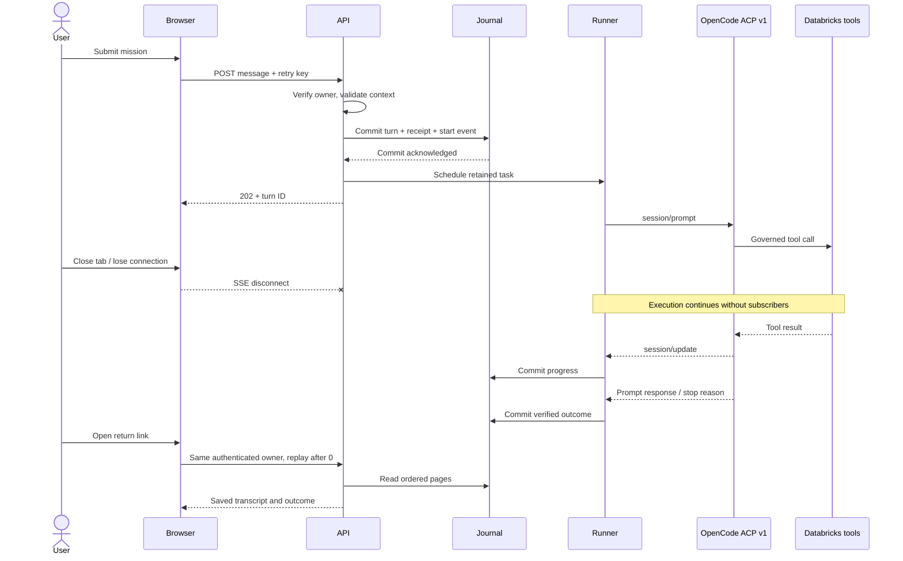
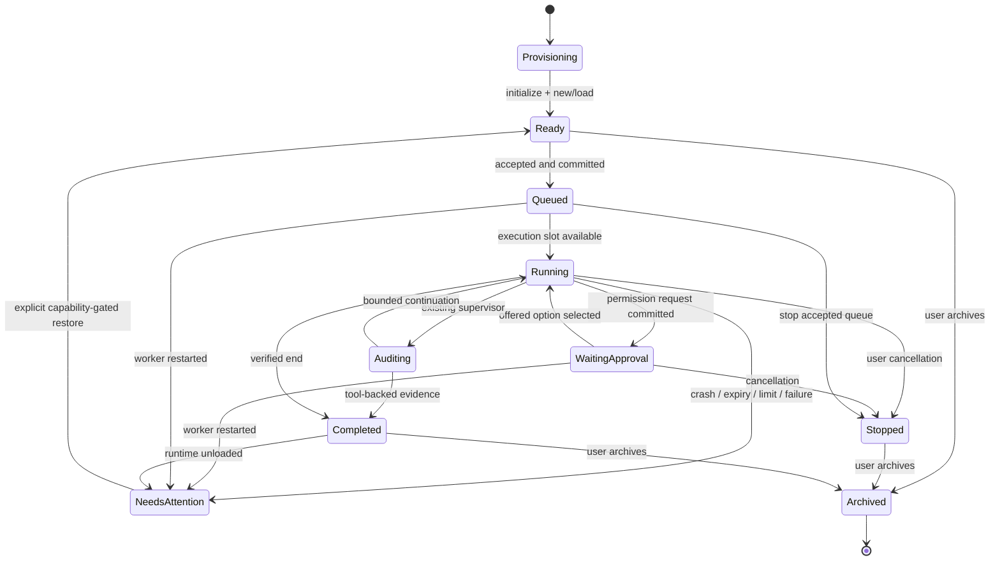
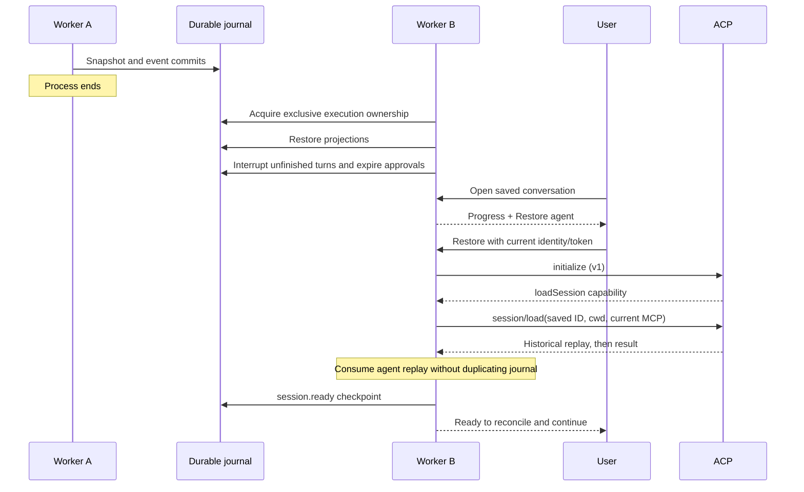

# Execution ownership and lifecycle

Context: [five WHYs](README.md), [protocol facts](02-opencode-acp.md). Contracts: [storage/API](04-persistence-api.md), [edge cases](07-edge-cases-tests.md).

The application server owns active tasks and ACP permission futures. The journal owns accepted work and replayable observations. The browser owns neither. One application worker per journal is an explicit invariant enforced by a SQLite process lock or a Postgres advisory lock. Global execution slots bound concurrent active turns; each session serializes submissions and permission decisions.

This is the conceptual mission state machine. Existing `SessionStatus` and `TurnStatus` remain the source enums; `requires_resume` distinguishes recovery from a normal blocked tool turn. `execution.state` provides the history summary. Connection state is separate: connecting/live/reconnecting/offline never transitions a mission into stopped.

## Failure boundaries

- Disconnecting a viewer unsubscribes only that viewer.
- Losing a worker interrupts uncertain active and queued work. It cannot prove an external operation did not complete.
- Losing journal writes closes the agent; there is no volatile fallback for accepted durable work.
- Losing the Postgres owner connection fences further commits. A new owner may start only after the database releases the old advisory lock.
- Expired permissions are never replayed as approvals. New requests must use new random IDs.
- Loading an agent does not rerun the interrupted prompt. Follow-up instructions are explicit user actions.
- An already-submitted Databricks job or SQL request can outlive the ACP process. Recovery requires checking its actual state.

The deployment remains a single execution owner. Distributed worker leases, an outbox and automatic reconciliation of every Databricks operation would be a different scheduler architecture; they are not implied by using Postgres. See [rollout limits](08-operations.md).
