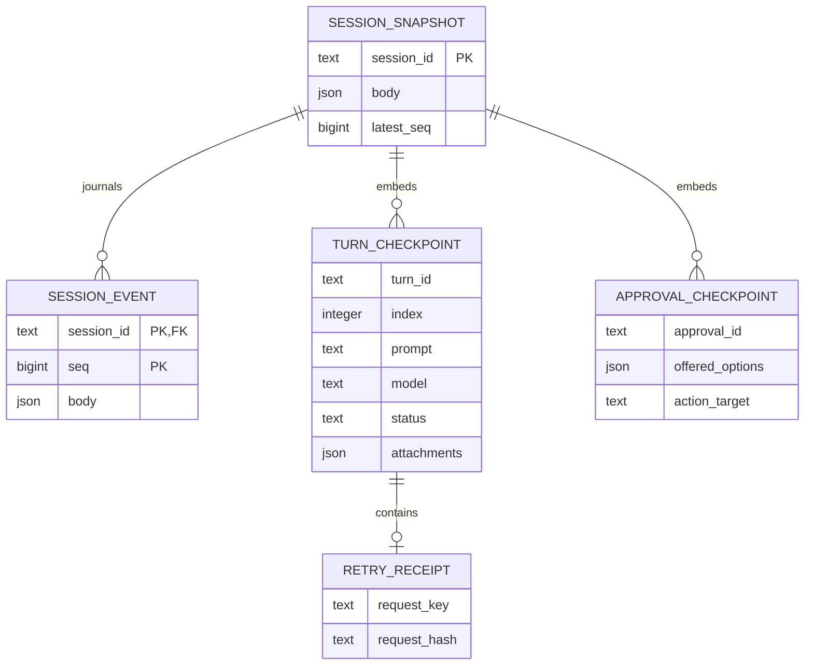

# Persistence and HTTP contracts

Depends on [architecture](03-architecture.md) and [ACP identity](02-opencode-acp.md). Used by [UI](05-ux-ui.md), [implementation](06-implementation-plan.md), [tests](07-edge-cases-tests.md).

## Grain and E/R model

One snapshot row represents one application session; one event row represents one ordered observation within that session. A snapshot embeds ordered turns and their retry receipts. No analytic aggregate is computed here.

`TURN_CHECKPOINT`, `RETRY_RECEIPT`, and `APPROVAL_CHECKPOINT` are logical embedded records, not separately normalized SQL tables. The existing 200-turn session bound keeps retry lookup bounded. This avoids maintaining a second independently mutable projection of turns. Event bodies retain timestamp, actor, turn ID and normalized tool/message payloads.

## Commit and ownership

`commit(event, snapshot)` allocates a monotonically increasing per-session sequence, saves both values in one transaction, then publishes an in-process wakeup. A failed commit cannot produce a successful message acceptance. Snapshot version 1 is explicit; unknown versions fail startup. SQLite uses WAL and synchronous FULL, a private journal file, and an exclusive owner file lock. Postgres updates `latest_seq` and inserts the event inside one transaction; a dedicated connection holds an advisory lock for the server lifetime. The same existing migration runner applies [004_session_journal.sql](../../apps/coding-agent/api/adapters/llm/store/migrations/004_session_journal.sql).

A new message is serialized under a per-session lock. A receipt consists of the caller’s retry key and a SHA-256 hash of the validated message body. Same key and same body return the original turn; same key and different body return 409. A request can be accepted even if its HTTP response is lost; retrying with the original key resolves that ambiguity.

Snapshots whitelist session state, turns/context, tool evidence, agent session ID/cwd, and offered permissions. They exclude forwarded access tokens, provider credentials, private credential paths, and arbitrary runtime `extra`. Prompts use the existing redaction function. Tool output and attached workspace context may contain sensitive business data: restrict the journal’s database role/filesystem access and apply workspace retention policy. Application journals are not Unity Catalog tables and do not replace Unity Catalog authorization.

## Endpoints

All `/api/sessions/{sid}/*` and `/api/approvals/{sid}/*` routes require the stored owner. Unknown and foreign sessions both return 404.

| Endpoint | Result |
|---|---|
| `POST /api/sessions/{sid}/messages` | 202 after commit; bounded retry key; queues behind foreground work |
| `GET /api/sessions` | Owner’s history plus `requiresResume` and `execution` summary |
| `GET /api/sessions/{sid}` | Session metadata, turn checkpoints, fence, execution summary |
| `GET /api/sessions/{sid}/events?after=N&limit=M` | Ordered finite page, `nextAfter`, `hasMore`; 1–2000 rows, nonnegative cursor |
| `GET /api/sessions/{sid}/stream?after=N` | Ordered SSE journal replay and live catch-up; highest query/header cursor wins; cursor ahead of journal returns 409 |
| `POST /api/sessions/{sid}/cancel` | 202; cancels accepted queue and asks active ACP work to stop |
| `POST /api/sessions/{sid}/resume` | Restores the recorded agent with fresh current credentials; no interrupted prompt is replayed |
| `POST /api/approvals/{sid}/{approvalId}` | Validates offered option kind and owner, commits decision, then releases permission future; stale decision returns 409 |
| `DELETE /api/sessions/{sid}` | Stops resources and marks archived; audit history remains owner-readable |
| `GET /api/ready` | Checks journal access; reports degraded storage as 503 |

## Replay

A subscription is registered before backlog reading. The queue is a wakeup, never the authoritative event payload. Stream delivery always reads the journal after its last emitted sequence, in pages. On overflow, a wakeup forces catch-up. A fresh browser reconstructs from zero; a reconnect within the same page resumes from its in-memory cursor. The reducer ignores unknown events for forward compatibility and deduplicates sequence IDs at the stream boundary.

See [test matrix](07-edge-cases-tests.md) for concurrency, overflow, restart, isolation and storage failures, and [operations](08-operations.md) for persistent-storage requirements.
