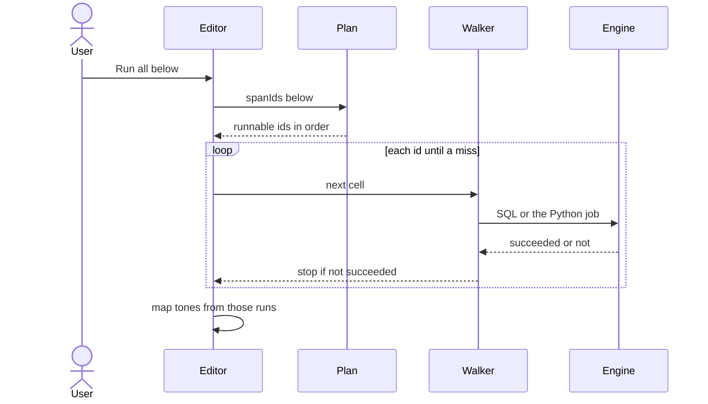
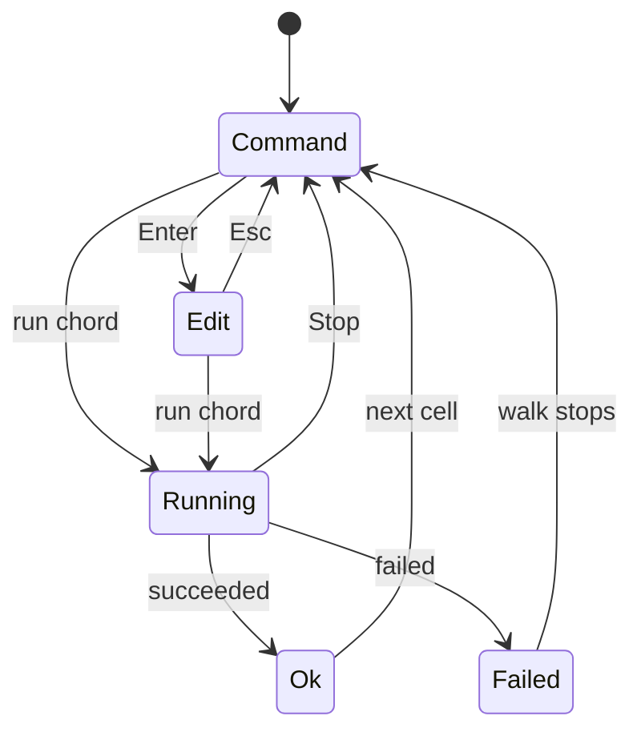
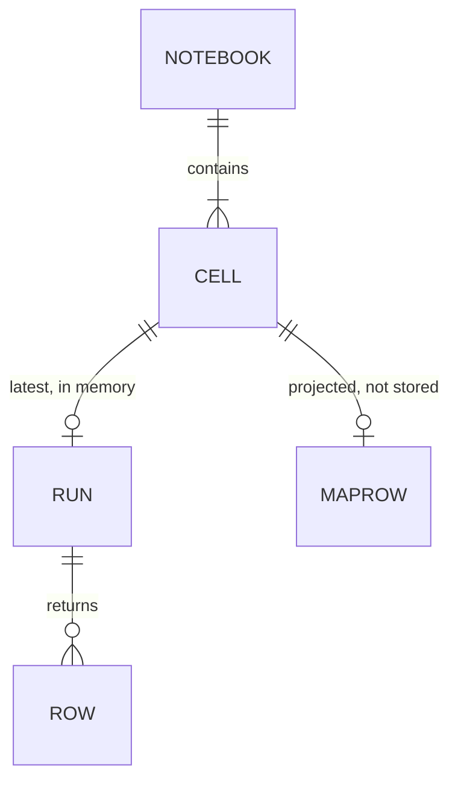

# 05. Diagrams

[Index](README.md) · principles [01](01-five-whys.md) · decisions [07](07-architecture.md)

## A span run

Above, below, all, and a multi-selection are the same walk. [NB-2](03-requirements.md), [D4](07-architecture.md#d4).

## Modes, and a run

Command and edit are where the caret is. A run's tone is a separate state on the cell, which is what
the map paints. [P2](01-five-whys.md#p2-two-modes-and-they-do-not-share-a-letter), [P6](01-five-whys.md#p6-the-map-is-a-projection-not-a-second-model).

## What a cell is

A run is not stored in the notebook file. It lives with the editor session, keyed by cell id, so a
reorder keeps the result. [D1](07-architecture.md#d1).

