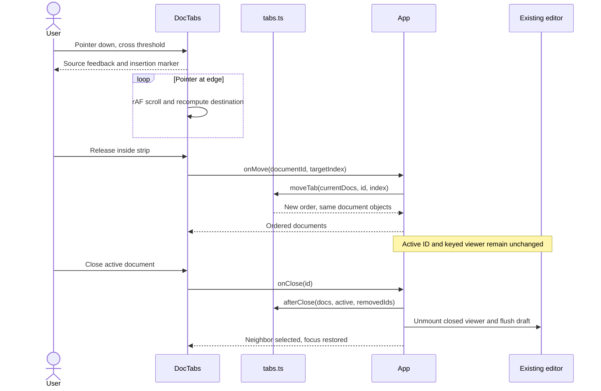
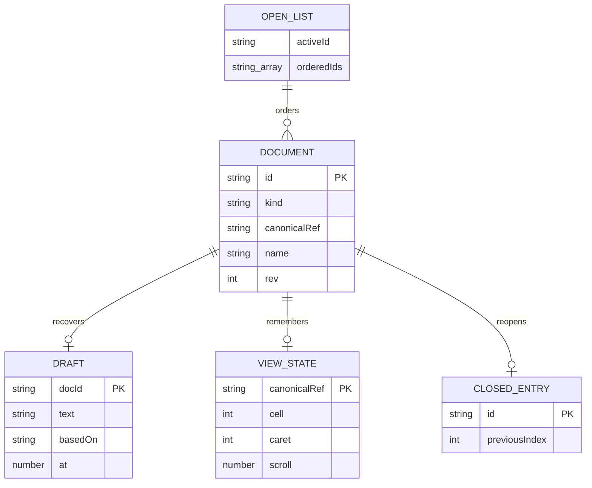
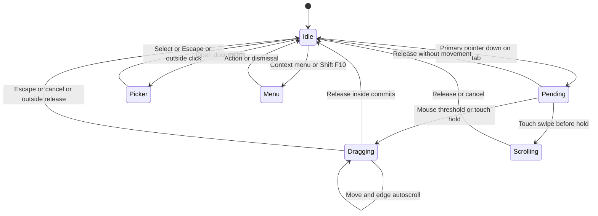

# Architecture grounded in code

Related: [requirements](01-requirements.md), [interaction](02-interaction-design.md), [plan](04-implementation-plan.md), [tests](05-test-matrix.md).

## Existing seams

- [App.tsx](../../apps/coding-agent/web/src/App.tsx): `docs`, `view`, `openDoc`, `closeDoc`, `selectTab`, route and focus binding. Agent refresh increments `rev`; ordering must preserve those objects.
- [DocTabs.tsx](../../apps/coding-agent/web/src/components/DocTabs.tsx): original active reveal and hidden badge; lacks reorder callback and resize/scroll-driven measurement.
- [docs.ts](../../apps/coding-agent/web/src/domain/docs.ts): canonical ID derives from kind plus canonical path; order is never identity.
- [EditorSurface.tsx](../../apps/coding-agent/web/src/components/EditorSurface.tsx): dirty buffer, save fence and drafts. Reorder must not change viewer keys.
- [drafts.ts](../../apps/coding-agent/web/src/domain/drafts.ts) and [viewstate.ts](../../apps/coding-agent/web/src/domain/viewstate.ts): existing local recovery and caret/scroll records; no schema change.
- [keys.ts](../../apps/coding-agent/web/src/domain/keys.ts): global command registry and shortcut sheet. Reopen belongs here; strip-specific gestures stay local.

These observations concern the named document-management sections, not every line of the entire application.

## Responsibility boundaries

The pointer lifecycle is isolated in [useTabDrag.ts](../../apps/coding-agent/web/src/hooks/useTabDrag.ts); its [lifecycle tests](../../apps/coding-agent/web/src/hooks/useTabDrag.test.ts) cover cleanup on unmount, blur and source removal. Pure [tabs.ts](../../apps/coding-agent/web/src/domain/tabs.ts) owns index movement, adjacent close selection and collision-free DOM identity. DocTabs owns geometry and transient gesture/popover state. App owns open/closed metadata, selected document and assistant context. EditorSurface owns buffer/draft lifecycle. Commands depend on callbacks rather than API or storage implementations. No service layer or third-party drag library is needed.

## Data model

The existing `Draft.docId` field stores the canonical workspace path (`Document.ref`), despite its name; it is not the kind-prefixed `Document.id`. Tables have no editable draft.

Conceptual ER only: these are existing memory/local browser records, not proposed SQL tables. One document may have zero or one draft and one view record. One ordered list contains each open ID once; recently closed metadata is bounded and excludes content.

## Gesture state

Privacy and authority: [working-set recovery](07-ux-refinement.md) stores bounded kind/reference/order/selection metadata in account/workspace-scoped sessionStorage. Closing the browser tab ends this recovery scope; document content remains in the separate existing draft mechanism. No new backend writes, SQL, analytics payloads, or credentials. Existing workspace read/save and Unity Catalog checks remain authoritative. Loading/permission errors are viewer states and must not break tab navigation.
