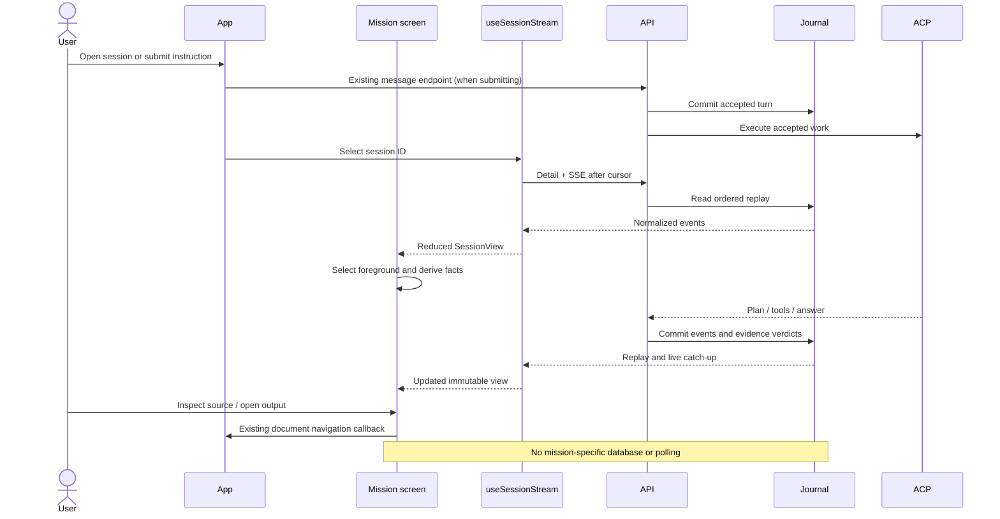
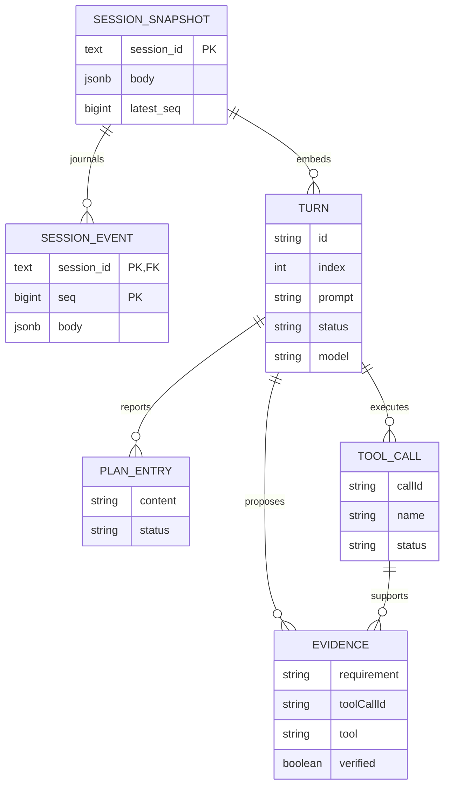
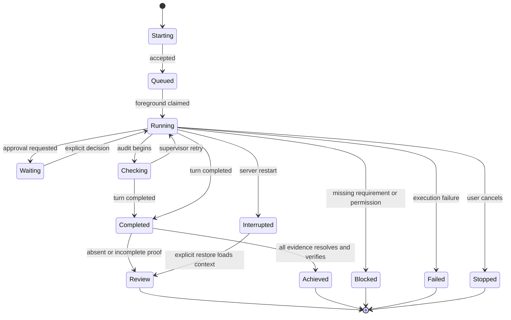
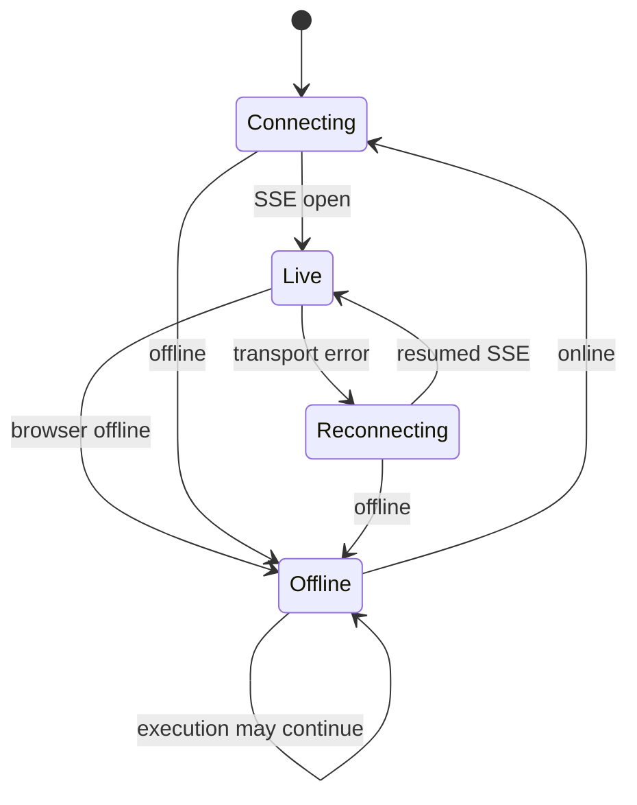

# Architecture and data contract

[Code evidence](02-code-and-lenses.md), [requirements](01-product.md), [design](03-ux-ui.md), [implementation](05-implementation-plan.md), [test risks](06-edge-cases-tests.md).

## Pure read model

`currentMission(session)` selects the running/auditing turn first, then the earliest queued turn if there is no foreground, otherwise the latest terminal turn. `missionView(session, selectedTurn, conn)` returns state, title, plan counts, successful/failed tool counts, verified evidence/source resolution and per-turn artifacts. An explicitly selected historical turn ignores current approvals/recovery. No view method mutates a turn.

Achievement requires `turn.status === completed`, at least one evidence row and every row both server-verified and resolved to a completed call of the reported tool name. A plan of all completed entries alone is insufficient. Failure of an earlier tool remains visible even when later successful calls prove all requirements. All counts have **one selected turn** as grain.

## Sequence

## E/R and grain

Physical schema has two tables. `TURN`, `TOOL_CALL`, `PLAN_ENTRY` and `EVIDENCE` below are logical embedded/replayed structures, not new SQL tables. One snapshot is one session; one event is one `(session_id, seq)`; one mission is one turn. Evidence references a call within that turn; no cross-turn proof joins.

No SQL is issued and no columns are guessed. Existing owner and Unity Catalog boundaries remain server-controlled. The UI cannot bypass a 403/404 by probing alternate sources.

## Execution state

`Achieved` and `Review` are presentation substates of completed, not new server enum values. Restore does not actually change an interrupted turn into completed: Review in the diagram means the user reviews saved work, while the turn retains interrupted status.

## Observation state

Observation wraps the current state with last-known wording; it never rewrites execution. Snapshot hydration can precede full replay, so absent plan/proof is represented as unavailable until events arrive. The existing stream batches at 40ms and deduplicates seq. Projection is linear in selected-turn entries/calls/evidence and uses a call-ID map for evidence lookup; no expensive cross-session work.
