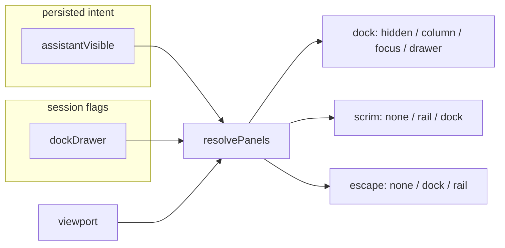
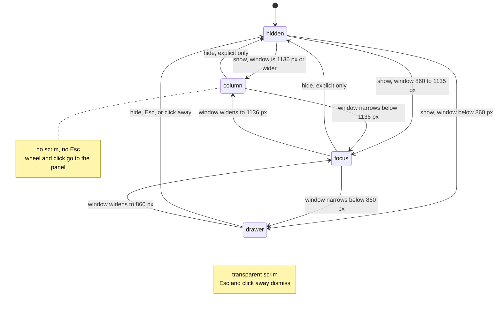
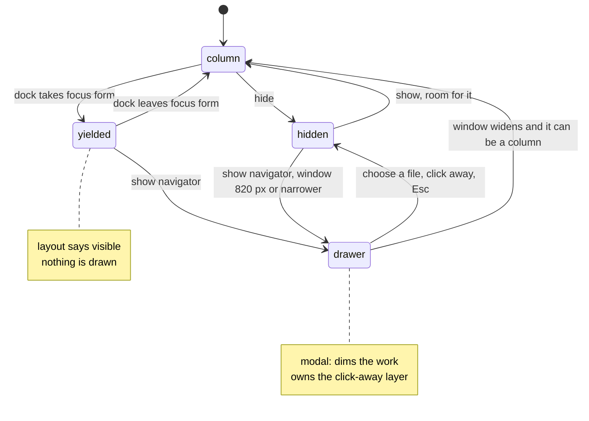
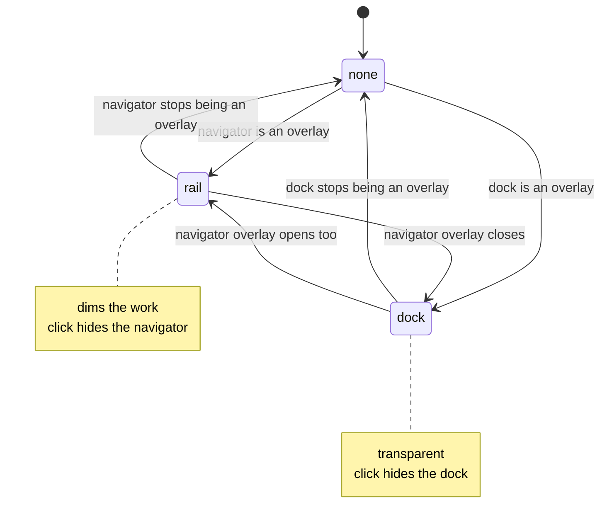
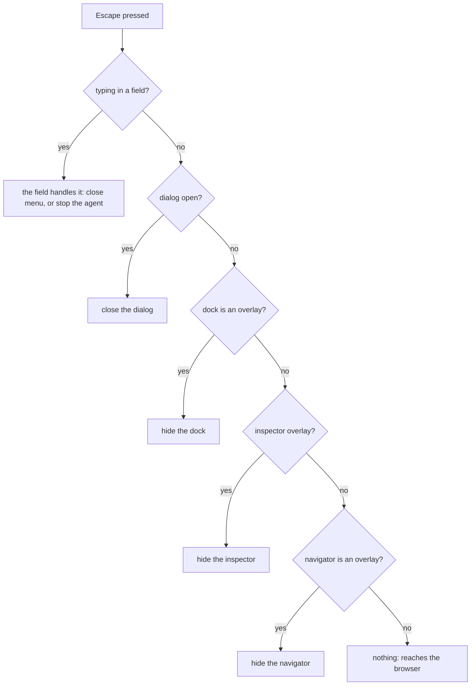
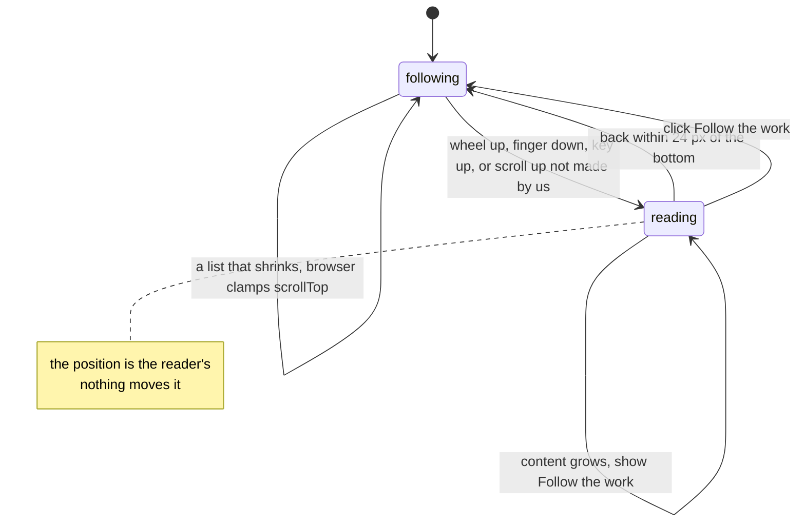
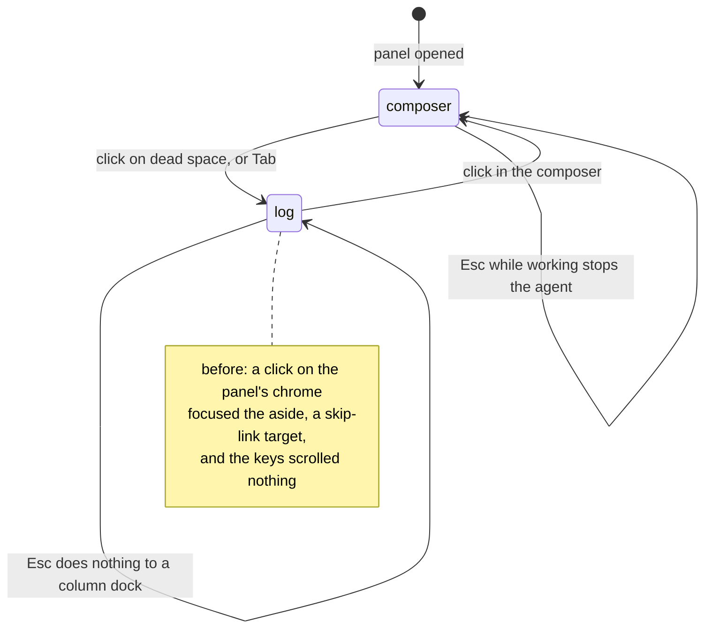

# 012 — Panel focus and pointer interaction

> Report: *"I cannot get focus to the right session panel to scroll. When the panel is working I
> cannot scroll; I click to have focus and the panel is closed."*

Scope: `apps/coding-agent/web` — the shell's three zones (navigator, inspector, assistant dock) and
the dock's own scroll and focus. Code: `src/domain/panels.ts`, `src/domain/follow.ts`,
`src/hooks/useFollowScroll.ts`, `src/App.tsx`, `src/components/AssistantDock.tsx`.
Tests: `panels.test.ts`, `follow.test.ts`, `scripts/dock-focus-e2e.mjs`, `scripts/dock-matrix.mjs`.

## 1. The finding in one paragraph

There were **three independent defects** that read as one: *"the panel will not take the pointer"*.

| # | What the user saw | Root cause |
|---|---|---|
| **A** | Click on the panel → the panel closes. Wheel does nothing. | `dockDrawer` ("the user asked for the overlay form") was set to `true` while the dock was a **column**. App then drew the click-away layer (`.drawer-scrim`, `position: fixed; inset: 52px 0 0`) over the **whole window**. The layer, not the panel, was under the pointer: it swallowed the wheel and its `onClick` hid the dock. |
| **B** | Scrolls up a little while the agent works → snapped back to the bottom. | "Pinned" meant *within 80 px of the bottom at the last scroll event*. A wheel notch or a trackpad flick is less than 80 px, so the reader was still "pinned" and the next streamed token took the position back. |
| **C** | Click the panel "to give it focus" → ↑ ↓ PageUp Space scroll nothing; Escape hides it. | Focus landed on the `<aside tabindex=-1>` (a skip-link target), never on the scroll region, which was not focusable. And `Escape` was bound to the *flag*, so it hid a dock that had a column. The wheel over the header, the status card or the composer chrome scrolled nothing either: those are not scrollable and the page is not. |

Reproduction (before): `MISSION_EVENT_DELAY=0.25 node scripts/dock-focus-e2e.mjs` against the original
`App.tsx` fails at least 20 checks before it aborts, among them `no click-away layer exists over the window — scrims=1` and
`a click inside the panel does not close it`. After: all pass.

## 2. Why it happened: two state variables that are only true in one placement

`layout.assistantVisible` is the user's **intent** and survives a reload. `dockDrawer` and `drawer`
are **session flags** that mean "I asked for the overlay form". They are meaningful in exactly one
placement each. The code read them everywhere.



The rule that fixes the class, not the instance: **a session flag is read only through
`resolvePanels`, which ignores it unless its panel is an overlay.** A stale flag can then be wrong
about the past, never about the screen.

## 3. State machines

### 3.1 Dock placement

Four placements. `column` and `focus` are grid tracks; only `drawer` is a fixed overlay.



Corrected edge: `focus --> hidden` only by the user's explicit hide (toggle, ⌘J, the panel's own
button). **Escape never leaves `column` or `focus`.**

Before the fix there was a fifth, unnamed, illegal state — `column` **with** `dockDrawer = true` —
reached by: ⌘J, the top-bar toggle or the **Chat** edge handle while the dock was hidden at ≥ 1136 px;
`reveal()` (sending from the centre composer); `focusCell`, `promptCell`; or widening the window past
1136 px with the focus form open. Every one of those set the flag in the same batch that turned the
dock into a column.

### 3.2 Navigator placement



Second illegal state, same family: `drawer = "rail"` left set after the focus dock closed. The
navigator became a column again but the **dimming** layer stayed over the whole window.

### 3.3 The click-away layer is derived, not stored



`scrim = f(dock, rail)` — there is no state to forget to clear.

### 3.4 Escape

`escapeTarget` in `domain/keys.ts` already orders *dialog → popover → drawer → edit → stop-agent*. The
shell's `stop` handler is the *drawer* step. It now answers to `panels.escape`:



### 3.5 The log: following and reading



Intent (wheel, touch, key) is counted **before** any scroll event is measured, because the stream may
append between the user's gesture and the browser's scroll event. The old dead zone was 80 px; it is
now `REPIN_PX = 24`, and moving up is leaving whatever the distance.

### 3.6 Where keyboard focus is, and what the keys do



### 3.7 Where the pointer lands

| Pointer over | Click | Wheel |
|---|---|---|
| the log | focuses the log (text stays selectable) | scrolls the log |
| header, status card, pin line, composer chrome | focuses the log | **forwarded** to the log (new) |
| a button, input, menu, resize handle | the control keeps it | the control's own list if it scrolls, else forwarded |
| a dock that is a **column**, anywhere | the panel | the panel — no layer over it |
| the click-away layer (overlay forms only) | hides that overlay | nothing: it is outside the panel |

## 4. Contradictions found, and the fix for each

| ID | Contradiction | Evidence | Fix |
|---|---|---|---|
| **C1** | The dock has a column **and** a click-away layer. | `dock-focus-e2e` §1: `scrims=1`, centre of the panel hits `div.drawer-scrim` at 1150–2000 px. | `scrim` is derived from placement (`panels.scrim`). |
| **C2** | The navigator is a column **and** a dimming layer is drawn. | §5: close the focus dock with the navigator drawer open. | Same: flag ignored unless the navigator is an overlay. |
| **C3** | Escape hides a dock that is a column (the focus form, or any width after ⌘J), even mid-run. | Matrix I4: 860–1135 px. | `panels.escape` is `dock` only for the overlay. |
| **C4** | A scroll up of less than 80 px is "still following". | §2: `1297 → 1237 → 1316 → 1400`. | `domain/follow.ts`: intent first; threshold 24; direction decides. |
| **C5** | The log scrolls but is not focusable; the focusable thing (`aside`) does not scroll. | after a click: `active = aside#dock`, PageUp scrolls nothing. | `tabIndex=0` on the log; a click on dead space focuses it. |
| **C6** | Hovering the status card or header: wheel scrolls nothing. | §3. | `forwardWheel` on the panel. |
| **C7** | The code comment says the dock never gets a scrim; the code gave it one. | `App.tsx` "Only the NAVIGATOR drawer gets a scrim" vs `dockDrawer && !focusDock`. | The dock's layer exists for the **overlay** form only, as the CSS comment always said. |

Decision recorded: the inspector's **drawer** still dismisses on Escape. It is a panel the user
summons over the work, it has no column to hide, and nothing in the report concerns it.

## 5. Invariants (all asserted)

1. **I1** A toggle that says *on* has its panel on screen, and the reverse.
2. **I2** The centre of every visible panel hit-tests to that panel: nothing covers it.
3. **I3** A click on dead space inside a visible panel never changes which panels are visible.
4. **I4** Escape never hides a panel that has a column.
5. **I5** A click-away layer exists only while an overlay is drawn, and then exactly one.
6. **I6** While the agent works, a scroll up by any amount stays where the reader put it.
7. **I7** The pointer anywhere on the dock scrolls the log; a click on its dead space focuses the log.

I1–I4 are `scripts/dock-matrix.mjs`: 13 widths × 8 layout combinations. I5 is `panels.test.ts`
(exhaustive over widths and flags). I6–I7 are `scripts/dock-focus-e2e.mjs` against the real server and
the fake streaming agent.

## 6. Running it

```
cd apps/coding-agent/web
npx vitest run src/domain/panels.test.ts src/domain/follow.test.ts
npm run build
npm run e2e:dock-focus      # the report, as assertions (~40 s)
npm run audit:panels        # the full matrix (~3 min); WIDTHS=700,1000,1500 to narrow it
```
