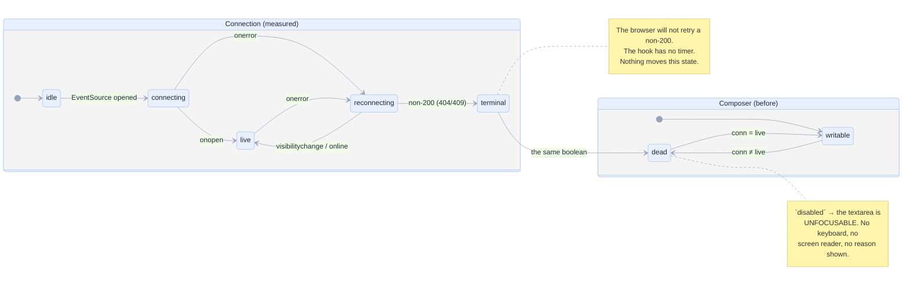
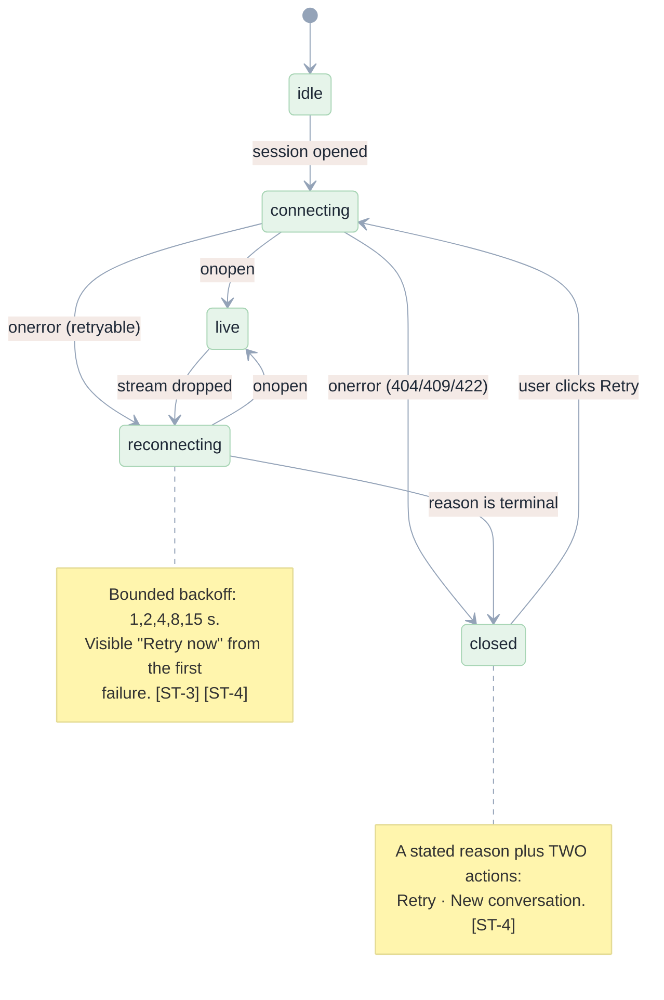
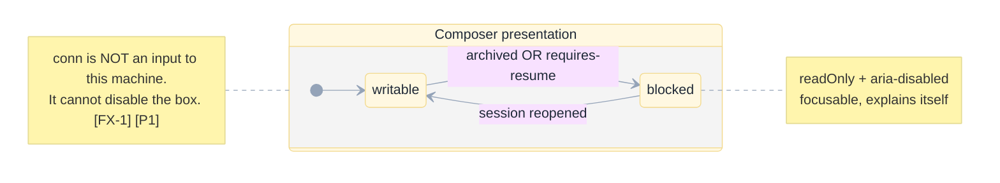
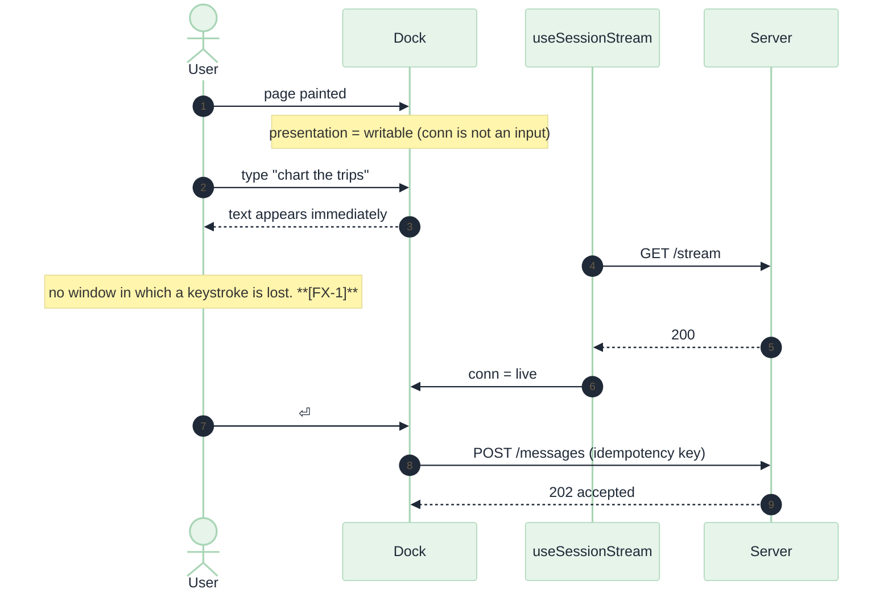
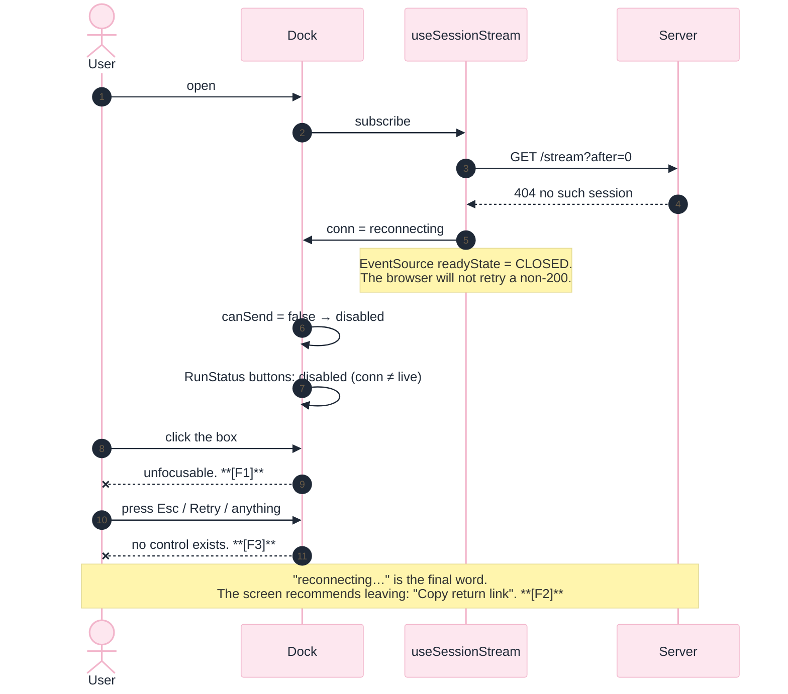
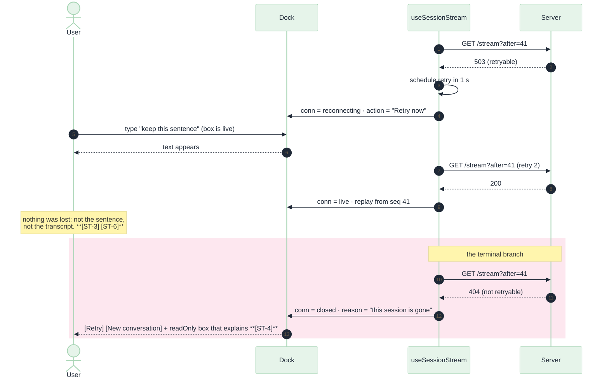
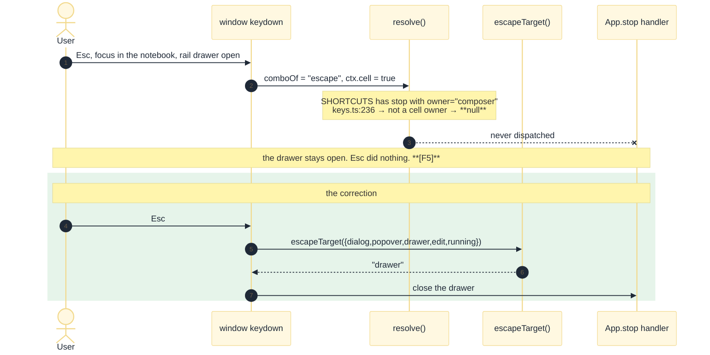
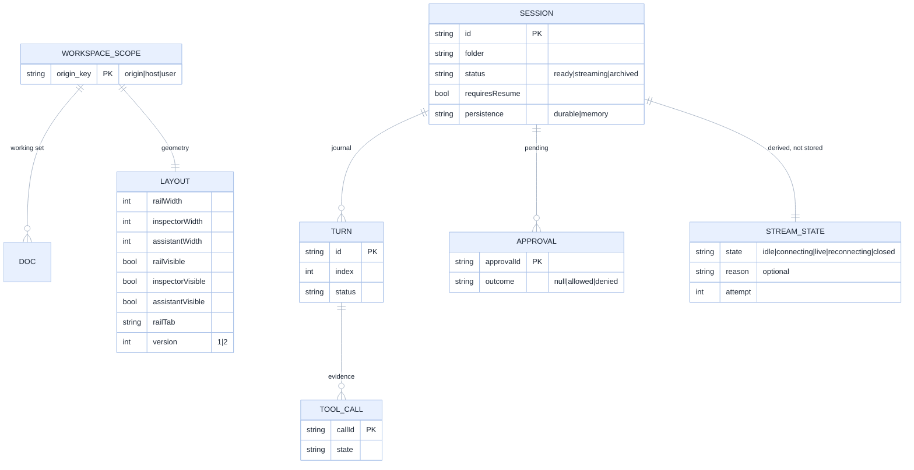
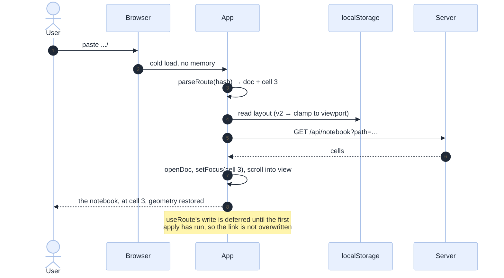

[Index](README.md) · prev: [04 Wireframes](04-wireframes.md) · next: [06 Lenses](06-lenses.md)

# 05 · Diagrams

Mermaid only, because these are state machines, sequences and data models rather than geometry. The
wireframes are ASCII in [04](04-wireframes.md).

---

## 1. The contradiction, drawn as two state machines that disagree

This is the whole finding in one picture. The **left** machine is what the connection actually does.
The **right** machine is what the composer believes. They are different machines, and the only
coupling between them is a single boolean.



**The incoherence, in one sentence:** the connection has a state the composer cannot escape, and the
composer has a state the connection cannot announce.

---

## 2. The corrected state machine

Three machines now, each with one job: the stream reports, the session stays writable, and a single
function decides what the box looks like.





---

## 3. Sequence: typing during `connecting` — before and after

```mermaid
%%{init: {'theme':'base','themeVariables':{'primaryColor':'#FDE7EF','primaryTextColor':'#1F2937','primaryBorderColor':'#F2B5CB','lineColor':'#94A3B8'}}}%%
sequenceDiagram
    autonumber
    actor U as User
    participant D as Dock
    participant H as useSessionStream
    participant S as Server

    U->>D: page painted, composer visible
    Note over H: conn = "idle"
    D->>D: canSend = false → textarea disabled
    U->>D: click + type "chart the trips"
    Note over D: a disabled field takes no focus<br/>keystrokes go to &lt;body&gt;
    U->>D: click again, type again
    D--xU: nothing. No error, no reason. **[F1]**
    H->>S: GET /stream (still connecting)
    S-->>H: 200 text/event-stream
    H->>D: conn = live
    D->>D: canSend = true
    Note over U,D: 205 ms too late. The sentence is gone.
```



---

## 4. Sequence: a refused stream, and the dead end it creates

Measured with `deadend-probe.mjs`. This is the screenshot's screen.



---

## 5. Sequence: the correction — bounded retry, then a stated exit



---

## 6. Sequence: Escape, as designed vs. as wired



---

## 7. E/R: where state actually lives

The reason the fix is contained: presentation state is derived, and the only persisted facts are the
four the app already versions.



`STREAM_STATE` is dashed-in on purpose: it is **derived** and must never be written to storage. The
defect began when a derived fact (the connection) was allowed to become a persisted-looking
permission (whether the box works).

---

## 8. Sequence: hard refresh with a cell deeplink

Measured PASS — recorded because it must stay passing ([LK-1], [LK-3]).


