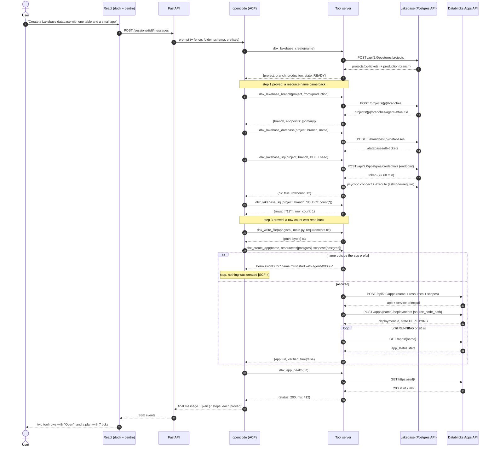
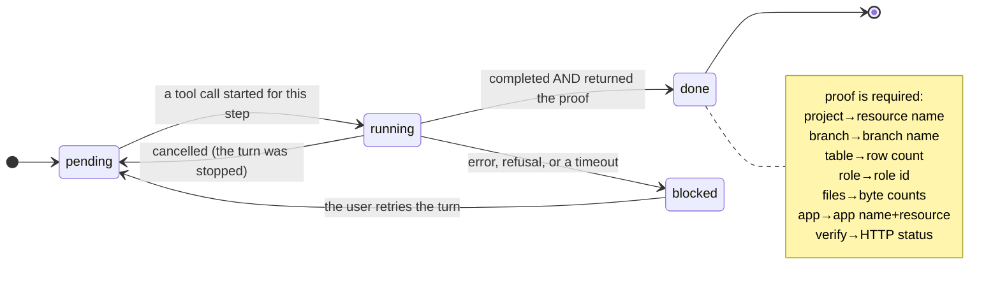
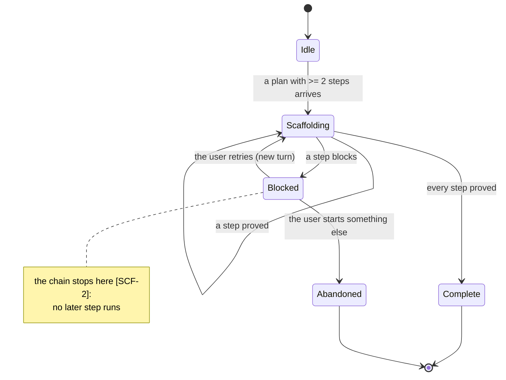
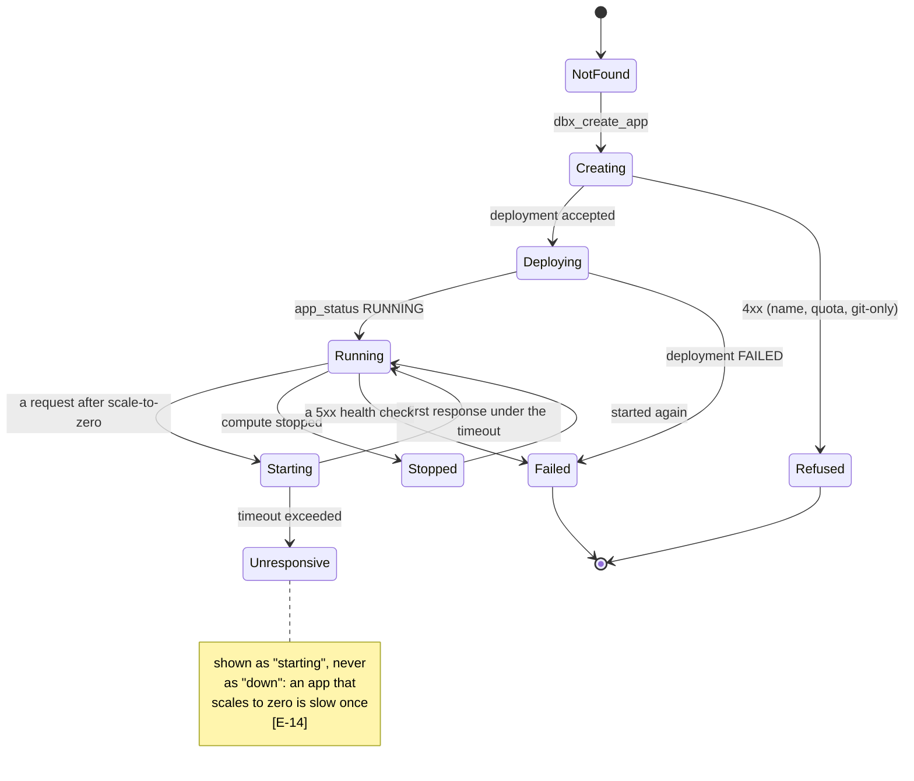
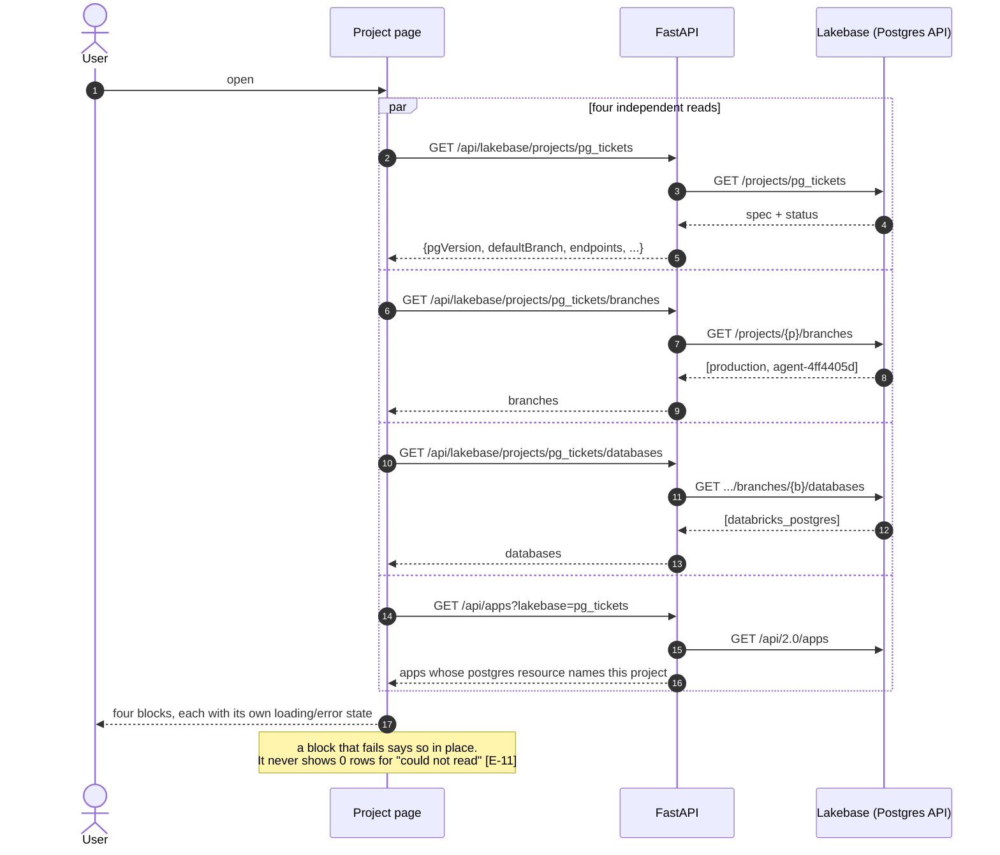
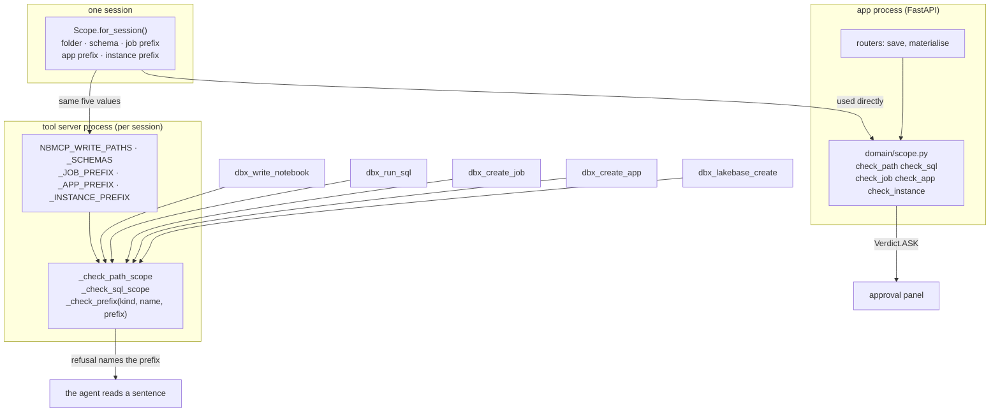
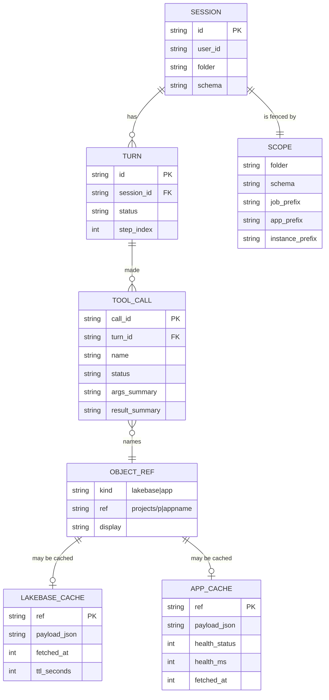
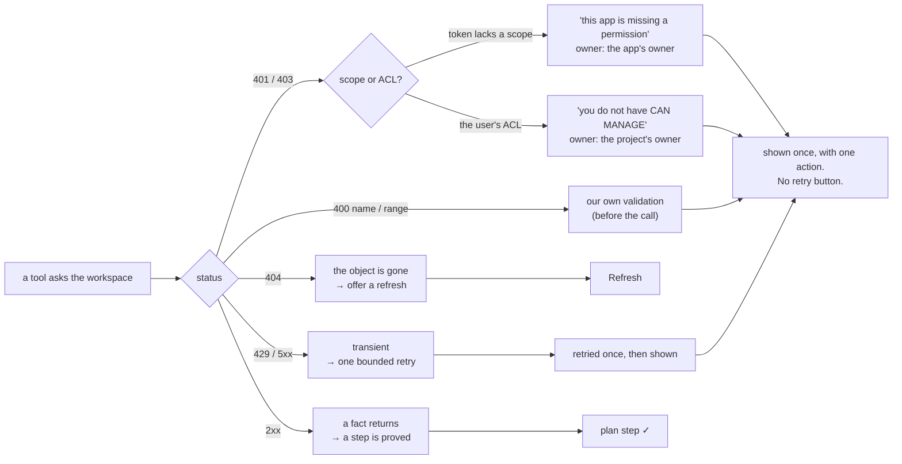

[Index](README.md) · prev: [04 Wireframes](04-wireframes.md) · next: [06 Lenses](06-lenses.md)

# 05 · Diagrams (Mermaid)

Behaviour over time, and the data the behaviour touches. Wireframes (`04`) show one state; these show
how a state is reached and what makes it change.

Every block below is parsed by the real Mermaid parser before this document is accepted:

```bash
cd /tmp && mkdir -p mmd && cd mmd && npm i mermaid jsdom
NODE_PATH=/tmp/mmd/node_modules node \
  apps/coding-agent/web/scripts/verify-spec-mermaid.mjs specs/013-improve-coding
```

---

## 1 · The scaffold, end to end

The sequence the card promises. Two properties are load-bearing and they are why this is a sequence
and not a list: **each step consumes the previous step's identity** (`[LB-5]`), and **a refusal stops
the chain** (`[SCF-2]`).



**What this replaces.** Today the same request produces: a create against
`/api/2.0/database/instances`, a `ModuleNotFoundError` on the first SQL, and `POST /apps {name}` with no
resource. `[F1] [F2] [F6]`

---

## 2 · The scaffold's step machine

One state per step, and one rule: a step can only be `done` with a proof. This is the model S6 draws
and the one `domain/scaffold.ts` computes — from tool calls the app actually received, not from the
agent's prose.





**The precedence that matters:** `Blocked` outranks `Scaffolding`. A plan whose step 3 failed is not
"still running" — and drawing it that way is how the previous UX hid a dead end ([012] found the same
class of bug in the dock's connection pill).

---

## 3 · The app's life, as the app can now observe it

The user's question is "is it working". The answer is an HTTP status, not a deployment state — a
distinction this repository learned when `SUCCEEDED` was mistaken for "serving this code".



---

## 4 · One read of a project page

What happens when the user opens `#/lakebase/projects/pg_tickets`. Four calls in parallel, because the
page is a summary and a slow field must not hold up the others; each failure is local to its own block
(`[UI-3]`).



---

## 5 · The write fence, now that it has two new concepts

The fence is one function per kind of target, and the tool server is a **separate process**, so the
policy reaches it as environment plus the same pure rules. `[SCF-4]` makes the four previously-uncalled
functions real; `[RB-5]` explains why the sharing is by value and not by import.



**The invariant** (asserted by `tests/test_tools_fence.py`): for each of the five kinds, a name inside
the prefix is allowed and a name outside it is refused, when the prefixes are **all different**. The
second half is the part today's code would fail: `dbx_create_app` compares against the instance prefix,
so an app named with the instance's prefix passes.

---

## 6 · The data model: what is stored, and what is only read

Nothing new is persisted for the two object kinds except a **cache with a TTL** and the session's
prefixes, which already exist. A project's and an app's truth lives in the workspace; the app is a
viewer. This is the `[E-R]` for the two new pages and their one durable addition.



**Why a cache at all, and why it must be disposable.** A project page makes four calls. The rail lists
projects and apps on every load. Re-reading both on every keystroke would be slow and would spend the
user's API quota; a 60-second TTL makes the page feel instant and the staleness bounded. Nothing is
lost when the cache is dropped, which is why the test for it asserts the page still works with an empty
cache.

---

## 7 · Where a refusal goes

The path a non-2xx takes, in the four places it can arise. `[UI-6]` is satisfied only when **one** of
the terminal boxes is reached — never two, and never a retry on the right-hand branch.



The distinction in the `P` branch is not cosmetic: `ScopeMissing` in
`api/adapters/databricks/http.py` exists because telling a user "you do not have access" when the *app*
was never granted a scope sends them to the wrong person to ask.
