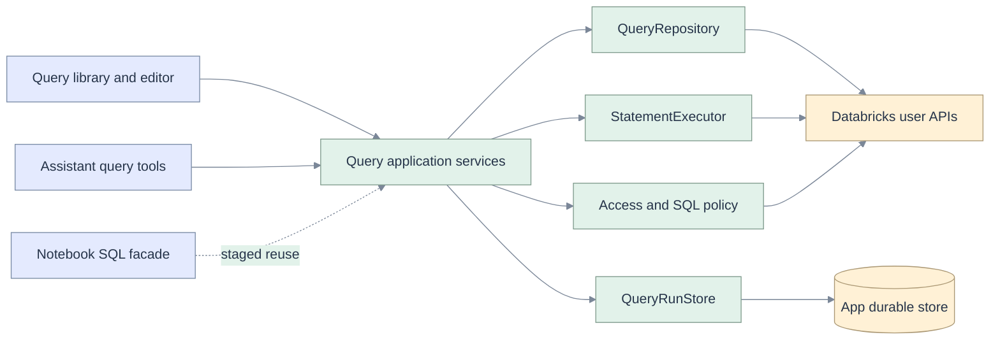

# Architecture, services and API contracts

[Index](README.md) · [Code seams](02-code-grounding.md) · [Requirements](03-requirements.md) · [Data](06-data-persistence.md) · [Sequences](07-sequences-statecharts.md) · [Delivery](10-implementation-plan.md)

## A single application path



Dependencies point inward: React depends on app DTOs; routers/tools depend on application services; services depend on domain functions and narrow ports. Databricks transport, database and test doubles implement ports. Provider responses do not become frontend state directly.

## Ports and ownership

| Port/service | Responsibilities | Explicit exclusions |
|---|---|---|
| QueryRepository | list page, get native Query, create copy; capability-gated update | Running SQL, browser draft lifecycle, implicit publish |
| QueryAccess | Resolve effective view/run/edit/manage and destination permissions using authorized platform APIs | Granting access or treating CAN VIEW as CAN RUN |
| WarehouseRepository | List usable warehouse metadata; validate explicit selection/context | Silent fallback when the chosen warehouse fails |
| StatementExecutor | submit once, status, cancel, chunk; translate statuses/errors | Automatic resubmit, policy decisions, persisting raw credentials |
| QueryRunStore | Durable attempts, idempotency reservation, owner-scoped reads, statement handles, monotonic updates | Shared result cache across users |
| QueryDraftStore | Private app snapshots and revision CAS; local browser recovery supplements this | Native Query autosave or publication |
| SqlPolicy | Parse/classify single statement; validate scope and typed bindings; fail closed | Regex proof of read-only SQL |
| QueryService / SqlRunService | Orchestrate access, snapshot, reservation, submit/reconcile and artifact events | Databricks HTTP details or UI rendering |

**DRY:** one canonical identity function, one SQL payload canonicalizer, one result decoder, one policy entry and one run lifecycle. Reuse `DbxHttp` after typed error enrichment. Notebook adapters can convert the new lossless result to legacy DTOs temporarily; do not fork submission behavior. Assistant tools use an authenticated internal service bridge bound to session user/workspace, following existing run-bridge patterns, not a second HTTP stack with an app credential.

**SOLID:** separate repository from executor (single responsibility); add native/alternate providers via ports (open/closed); run the same contract tests on fake and real adapters (substitution); separate read/access/update interfaces (interface segregation); inject ports into services and composition root (dependency inversion). Do not build a general plugin framework to add one asset type.

## Proposed OpenGenie endpoints

Paths below are **new application contracts**, not claims about Databricks endpoints. Use a dedicated `api/routers/sql.py`, mounted alongside the existing router.

| Method and path | Input | Output and key rules |
|---|---|---|
| GET `/api/sql/capabilities` | Current authenticated request | Per-operation flags with reason and evidence version; frontend never infers permission from flags alone. |
| GET `/api/sql/queries` | Opaque app cursor, pageSize ≤50 | Summaries, nextCursor, coverage and upstream order; strips query text from list DTOs. Bind cursor to workspace/principal/scan generation. |
| GET `/api/sql/queries/{id}` | Validated canonical native ID | Full supported text, context, opaque base version/fingerprint, access abilities, unsupported metadata warning. |
| POST `/api/sql/queries` | Own draft snapshot ID/revision, name, destination, operation key | 201 saved asset, 202 pending or uncertain operation; create/save copy only. Verify via GET before claiming durable creation. |
| PATCH `/api/sql/queries/{id}` | Exact supported changed fields and base revision | Gated. Reject when no authoritative conflict mechanism; no replace-all metadata and no automatic publish. |
| POST `/api/sql/drafts` | Explicit user text, optional origin ref, context | Own app snapshot ID/revision/hash; does not create a Databricks asset. Needed for AI snapshot context and offline recovery upload. |
| PATCH `/api/sql/drafts/{id}` | Expected app revision and changed buffer/context | App-store atomic CAS, 409 on stale revision; never overwrite another tab silently. |
| GET `/api/sql/warehouses` | Current identity | Accessible summaries and state; no tokens. Selection is shown before run. |
| POST `/api/sql/runs` | Immutable run input below; Idempotency-Key | 202 run handle or prior attempt for identical key/body. 409 for key/body mismatch; reject unsafe or unauthorized input before remote submit. |
| GET `/api/sql/runs` | Own cursor plus optional source ref | Own run metadata only; keyset pagination. |
| GET `/api/sql/runs/{runId}` | Own run ID | Known state, upstream statement handle, provenance and availability; recheck authorization for upstream fetch. |
| POST `/api/sql/runs/{runId}/cancel` | Own run ID, operation key | 202 cancel requested; terminal response only after reconciled observation. |
| GET `/api/sql/runs/{runId}/chunks/{index}` | Own run, validated index | Schema/ordinal row arrays, next index, bounds and truncation; fetches via constructed upstream path only. |
| GET `/api/sql/operations/{operationId}` | Own operation ID | Durable create/submit outcome for recovery without replaying a mutation. |

No baseline DELETE endpoint or ACL mutation endpoint. Native trash/restore and sharing use a deliberate handoff. [S5](01-databricks-assessment.md) documents those platform operations without making them mandatory baseline app scope.

## Run input and validation order

```json
{
  "source": {"kind": "query-draft", "id": "opaque-own-draft", "revision": 7},
  "scope": {"kind": "selection", "start": 0, "end": 23},
  "sourceHash": "server-verifiable-buffer-sha256",
  "warehouseId": "explicit-selected-id",
  "catalog": "user-selected-catalog",
  "schema": "user-selected-schema",
  "parameters": [{"name": "cutoff", "type": "DATE", "value": "2026-11-01"}],
  "rowLimit": 1000,
  "byteLimit": 4194304
}
```

`start`/`end` are zero-based UTF-16 offsets into the captured draft revision, matching the browser editor. Server slicing must convert to code-point/byte offsets deliberately and reject split surrogate pairs. Hash canonical UTF-8 bytes without newline normalization; record both full-buffer hash and executed-subset hash. Whole-document scope has no range. Multi-cursor execution is rejected. File/native sources resolve their own authorized snapshot, or first capture local edits as an own draft with origin provenance.

Validation order: authenticate request/workspace → validate sizes/IDs → resolve owner-authorized source revision and origin access → validate range/hash → parse exactly one permitted statement → resolve and validate parameter set/types → check effective asset run/warehouse/data access boundaries → reserve idempotency attempt transactionally → capture immutable input → submit once → persist handle/result observation → emit typed event. UC remains the authoritative data check during execution; preflight cannot prove it will succeed.

Read-only baseline accepts a documented grammar allow-list of SELECT/CTE-select, safe SHOW and DESCRIBE forms after dialect-aware parsing. Reject SQL scripting, mutation, unknown syntax, session control, dynamic SQL, EXPLAIN ANALYZE, and unverified user-defined/external functions. An approved parser/builtin policy corpus is a release gate. A SELECT alone does not prove that an external function has no side effects. Do not append `LIMIT` to user SQL; use execution result bounds and disclose they do not bound scan cost.

## Identity, retries and errors

Native calls use the current forwarded user token through shared identity/transport. No stored long-lived forwarded tokens, no service-principal fallback, no credential in durable rows, browser state, logs or events. A reconciler pauses on expired authorization and resumes only with renewed authorization from the same principal. A server restart with a known handle can recover later; without a handle it enters unknown outcome. It must not execute again.

GET/status/chunk may retry at most twice with jitter and Retry-After, within a request deadline; 401/403 stop immediately. POST create/execute never retries automatically after the request may have left the process. HTTP success with upstream FAILED/CANCELED is not query success. Errors are stable application codes with sanitized detail and correlation ID: `AUTH_EXPIRED`, `SCOPE_MISSING`, `ACCESS_DENIED`, `NOT_FOUND`, `UNSUPPORTED_ASSET`, `INVALID_SQL`, `INVALID_PARAMETER`, `CONFLICT`, `RATE_LIMITED`, `RESULT_EXPIRED`, `STORAGE_UNAVAILABLE`, `OUTCOME_UNKNOWN`, `UPSTREAM_UNAVAILABLE`. A 404 may conceal denied existence; UI uses “Unavailable or no longer accessible.”

An app operation key prevents duplicate app calls within its retention window. It cannot make the external POST and app database commit atomic. [State charts](07-sequences-statecharts.md) preserve that uncertainty; [EC-17–EC-22](09-edge-cases.md) test it.

## SQL-enabled dev follow-up

The [rc.2 implementation and qualification record](15-sql-enabled-release.md) adds encrypted Postgres SQL persistence through the existing Lakebase coordinator and enables independent-draft execution. Native stopped-warehouse startup, parameter/NULL rendering, cancellation, reload and actual server replacement now have live evidence. Native saved-Query permissions/create/update and the remaining target matrix stay gated. See the [current machine report](e2e/deployed-report.json) and [visual ledger](e2e/visual-inspection.md).
