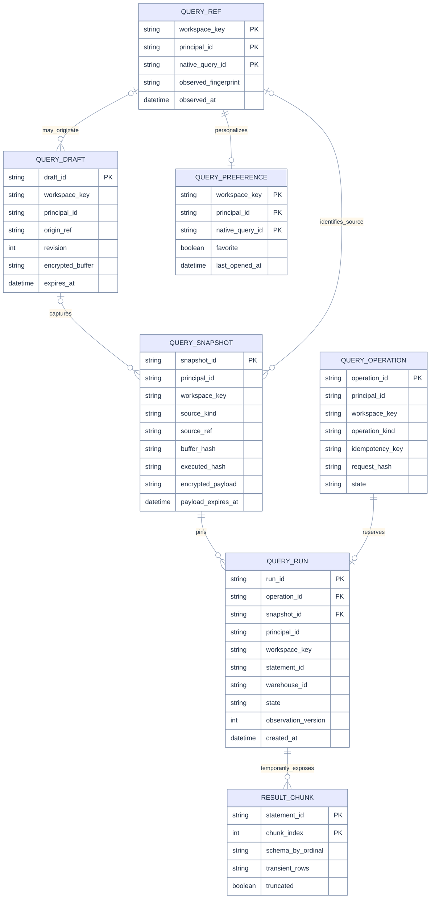

# Data model, entity grain and persistence

[Index](README.md) · [Requirements](03-requirements.md) · [Contracts](05-architecture-api.md) · [States](07-sequences-statecharts.md) · [Complexity](08-lenses-complexity.md) · [Tests](11-test-e2e-plan.md)

## Grain before storage or aggregation

| Entity | Grain | Authority |
|---|---|---|
| QueryRef | One native asset identity in one workspace, observed by one principal | Databricks for existence/ACL/content; app cache is advisory |
| QueryDraft | One principal's editable app buffer head with a CAS revision; immutable captures live in QuerySnapshot | OpenGenie; separate from native collaborative draft |
| QuerySnapshot | One immutable source/context/binding snapshot used by an attempt or AI context | OpenGenie; source may be native, file or draft |
| QueryOperation | One principal/workspace/operation-key reservation for a logical create or run | OpenGenie |
| QueryRun | One execution attempt, associated with at most one upstream statement handle | Upstream for execution facts; app for provenance/ownership |
| QueryPreference | One principal/workspace/native asset preference record | OpenGenie only |
| ResultChunk | One upstream statement's chunk ordinal, held transiently | Databricks |

Run metrics aggregate **one row per attempt**; retry clicks returning the same operation do not count as new attempts. Query-asset counts aggregate distinct native IDs per workspace and principal-visible scan, not execution rows. No user-data analytical SQL is authored or executed by this specification.

## Logical ER model

This is logical, not migration DDL. External native IDs have no database FK to Databricks. An app QueryRef row may be unknown until an asset is opened; absence must not block history for a deleted asset. ResultChunk is **not** a durable app table in R1. Associations are always principal/workspace scoped even where the diagram omits repeated tenant fields for readability. Physical FKs use composite tenant keys or equivalent service-enforced tenant checks; all access-path tests include mismatched ownership.

## Schema and indexes

Use the existing migration framework with new SQL-specific tables in the app schema; do not overload `session_snapshot`. Query runs have nullable chat/turn provenance, never a required session FK. Provide SQLite development and Postgres/Lakebase adapters plus the same contract suite. R1 follows the existing single-active-server deployment model; production startup refuses unsafe multiworker mode until a distributed lease implementation is delivered.

Required unique constraints: `(workspace_key, principal_id, operation_kind, idempotency_key)`; non-null `(workspace_key, principal_id, statement_id)` for known upstream handles; `(workspace_key, principal_id, native_query_id)` for preferences; `(workspace_key, principal_id, draft_id)` for draft heads. Draft updates atomically match the expected `revision` and increment it; captured QuerySnapshots retain the prior draft ID/revision plus exact source. Same operation key with different request hash is a conflict. Do not deduplicate different deliberate operations merely because their SQL hashes match.

Required B-tree indexes: own runs `(workspace_key, principal_id, created_at DESC, run_id DESC)`; source history `(workspace_key, principal_id, source_kind, source_ref, created_at DESC, run_id DESC)`; operations by expiry; pending runs by `(state, next_check_at)`; payloads/drafts by expiry. Source kind/ref are copied immutably into run metadata to support that index without joining payloads. Keyset cursors include a deterministic ID tiebreaker. Avoid joins to fetch huge snapshot bodies for history rows. Fields needed for predicates are typed columns; encrypted SQL/bindings are payloads, never indexed text.

## Lifecycle and durability

Reserve operation and snapshot before submission in one local transaction. Mark submitting durably before making the external POST. When a handle arrives, commit it and the first observation before acknowledging recoverability. A crash between remote acceptance and handle commit is irreducibly uncertain: recover as `submission_unknown`, not queued-for-retry. Worker ownership loss stops further mutation/dispatch; a replacement reconciles known handles with renewed user authorization. Reads do not enqueue new execution.

Native create follows the same operation reservation. A returned ID becomes `created` only after an authorized GET verifies the object. If verification fails transiently, retain `created_unverified` and its ID; never issue another create to compensate. No rollback deletes a possibly shared native asset.

Every state update uses an observation version/CAS. Terminal facts never regress because of an older poll response. Cancel intent is separate from observed execution state and survives browser close. A database failure before reservation blocks remote dispatch. A database failure after dispatch becomes an operational incident and uncertain outcome, not a retry instruction.

## Retention and confidentiality

These are proposed app defaults, configurable downward by workspace policy:

| Data | Default | Enforcement |
|---|---|---|
| Browser draft recovery | 7 days since edit, bounded at 5MiB per signed-in workspace/principal | IndexedDB; explicit opt-out; quota/error notices; clear on sign-out. Never store tokens or result rows. |
| App draft and encrypted SQL/binding snapshot | 7 days | Encrypt with app-managed key provider; principal-scoped reads; purge payload independently of metadata. Sensitive bindings omitted from recovery by default. |
| Own run/operation metadata | 30 days | Keep state, hashes, IDs and timings; expire private payload first. Source reopening after payload expiry reports unavailable. |
| Idempotency replay | 24 hours minimum | Operation key remains a tombstone through metadata retention; after replay window return expired-key conflict rather than executing again with that key. |
| Result rows | Memory only, bounded 60s cache at most | Own active view; current authorization required before fetch; clear on sign-out/principal/workspace change. No cross-user reuse. |
| Query summaries/preferences | Summaries 60s; own preferences until user removal/account cleanup | Revalidate on open; favorites never grant access or persist unreadable cached SQL. |

Browser storage is accessible to code running in that origin; encryption with a key stored alongside browser data would not make it private from that code. Keep sensitive parameter values out of drafts and ask again on rerun. App encryption must use the deployment key-management pattern after review; do not reuse or expose a user's forwarded token as an encryption key. If key/storage is unavailable, permit scratch editing but disable claims of durable recovery and disable durable execution dispatch.

Already delivered bytes cannot be retroactively revoked. On access loss, clear client/app caches and stop further retrieval; upstream Statement API remains authoritative for new result access. Do not claim that checking a saved Query ACL retroactively recomputes UC row filters on an old result.

## Result semantics

Use column **ordinal**, label, SQL type, nullable metadata and raw string-or-null cells. Preserve BIGINT/DECIMAL precision and distinguish NULL, empty string, literal `null`, zero and false. Duplicate labels are valid. Complex returned values are escaped text/JSON, never executable markup. A missing manifest or wrong row width is an upstream-protocol error, not an empty success. Preserve upstream `truncated` plus local row/byte/page bounds separately.

Execution status and result availability are separate: a successful execution may later have expired results. Display counts as returned/available rows, not total source-table rows. Current preview bounds and render windows are in [the complexity contract](08-lenses-complexity.md).

## SQL-enabled dev follow-up

The [rc.2 implementation and qualification record](15-sql-enabled-release.md) adds encrypted Postgres SQL persistence through the existing Lakebase coordinator and enables independent-draft execution. Native stopped-warehouse startup, parameter/NULL rendering, cancellation, reload and actual server replacement now have live evidence. Native saved-Query permissions/create/update and the remaining target matrix stay gated. See the [current machine report](e2e/deployed-report.json) and [visual ledger](e2e/visual-inspection.md).
