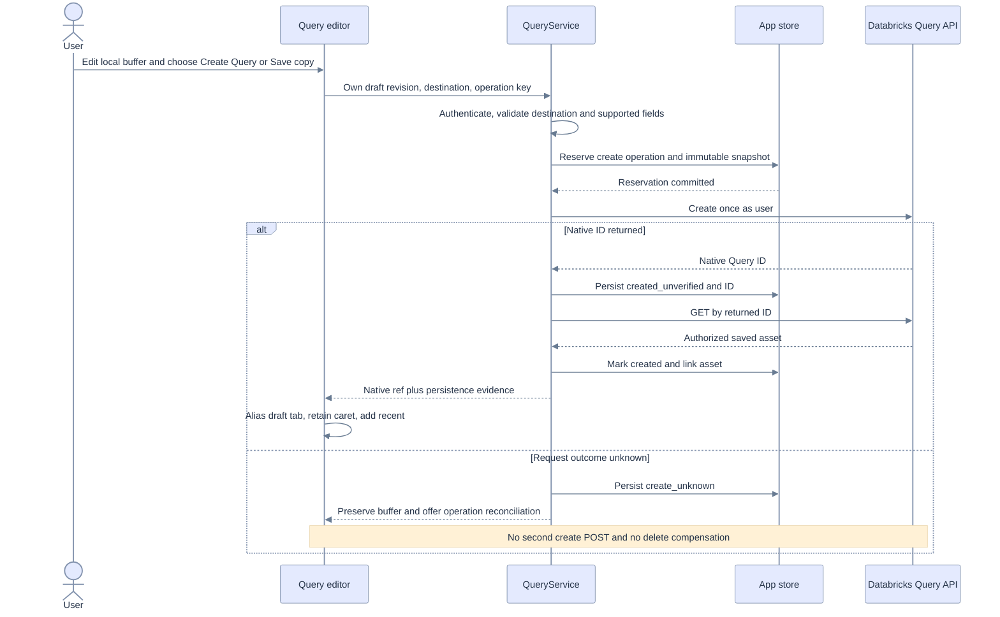
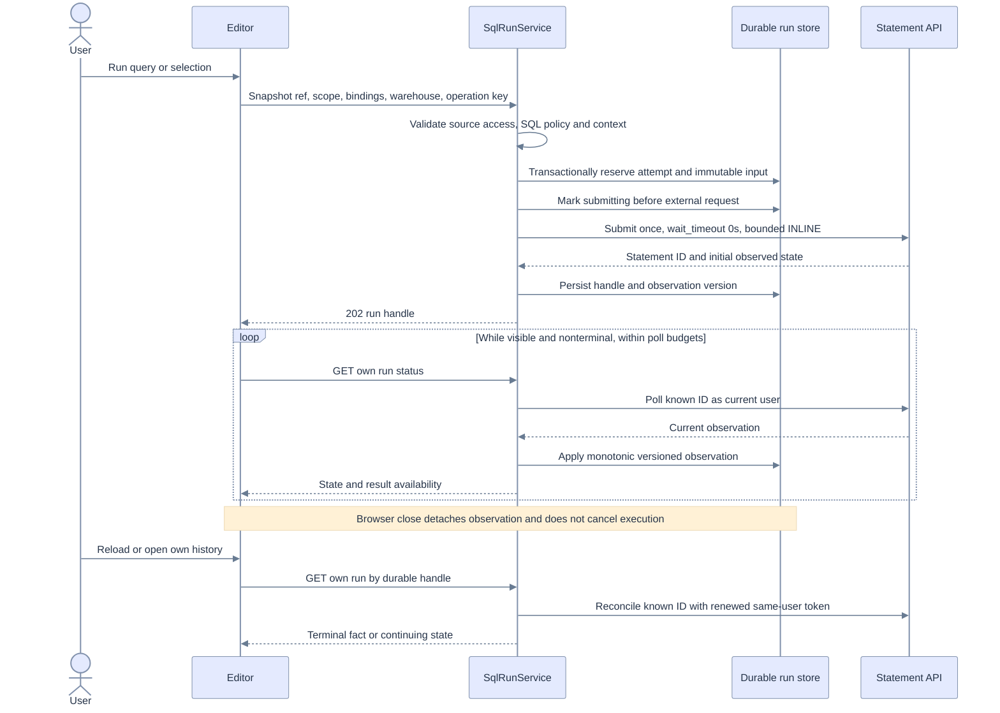
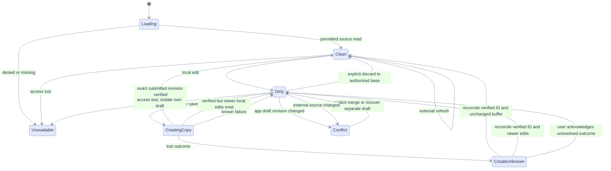
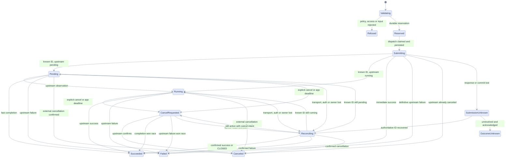
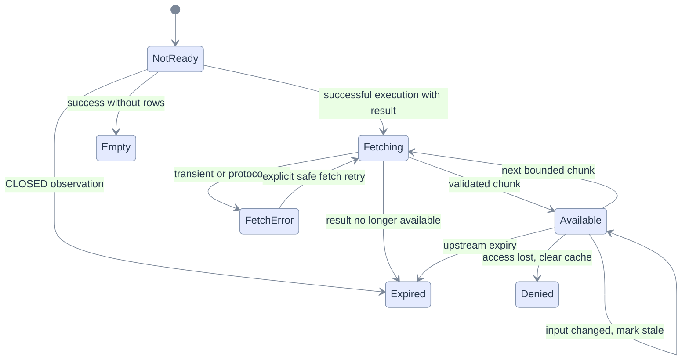

# Sequences, states and transition invariants

[Index](README.md) · [API](05-architecture-api.md) · [Data](06-data-persistence.md) · [Edges](09-edge-cases.md) · [Transition tests](11-test-e2e-plan.md)

Pastel fills use dark text and muted borders. Color is redundant with labels. Each chart describes a separate state dimension; do not encode document state, execution and result availability in one exponential enum.

## Sequence A — author, create copy and reopen

If the user edits again while create is in flight, only the submitted revision becomes saved. The newer buffer stays dirty against the returned native ref and offers another Save copy. Native external changes never overwrite a dirty app buffer.

## Sequence B — run, poll and reconnect

If a token expires, stop upstream polling and show Reconnect. An idle background owner cannot invent a fresh forwarded token. If submission response/handle persistence is lost, follow the unknown-outcome state below. A known statement continues remotely even if the server stops; durable provenance does not imply continuous server observation.

## State A — editor and persistence

Access loss removes cached remote content from the active view. An already-owned private draft may be exported only under app policy; it does not retain permission to rerun its origin. Unavailable is a view state, not permission to delete unsaved work silently.

## State B — execution attempt

`CLOSED` maps to execution succeeded with results expired. Unrecognized upstream state goes to Reconciling/protocol-error display; it is never coerced to success. There is no transition from SubmissionUnknown or OutcomeUnknown back to Submitting for the same operation. A deliberate new run is a new attempt/key after explicit acknowledgement. Local cancellation before dispatch can mark an attempt Canceled without calling Databricks; the reservation transaction must prove dispatch has not been claimed.

## State C — result availability

Staleness is a derived comparison of pinned inputs and current buffer/context, not a new execution state. A chunk-fetch failure does not turn a successful execution into Failed. An explicit rerun from Expired creates a fresh attempt after validation and may produce different data.

## Transition invariants

1. Every dispatch has a durable reservation and an immutable snapshot; every remote result attaches to its statement ID.
2. Same operation key/body returns the same attempt; changed body is a conflict.
3. At most one nonterminal active attempt per document/principal in R1; own history remains available independently of tabs.
4. Cancel intent never manufactures Canceled; terminal execution facts cannot regress under reordered polls.
5. Saving, executing, inspecting results and sending AI context are separate actions.
6. Closing/reloading/swapping tabs changes observation, not remote execution.
7. Unknown submission is never automatically replayed, even for apparently read-only SQL.
8. Source/result expiry and loss of authorization are independently visible.

Test these as reducer properties and fault-injection traces, then verify the observable paths through [T03–T15](11-test-e2e-plan.md).
