# Implementation plan grounded in the current code

[Index](README.md) · [Code evidence](02-code-grounding.md) · [Requirements](03-requirements.md) · [Architecture](05-architecture-api.md) · [Test plan](11-test-e2e-plan.md) · [Decisions](12-decisions-open-questions.md)

## Delivery order

This is the target delivery plan. The implemented slice and deviations from proposed file names are recorded in [14](14-implementation-outcome.md). File names marked **new** below describe the original plan. Respect the existing dirty working tree and coordinate with the panel changes; never reset or overwrite them. Recheck the evidence snapshot before coding. Ship small PRs with requirement IDs, failure behavior, tests and capability changes in each description.

```mermaid
%%{init: {'theme':'base','themeVariables':{'primaryColor':'#E4EAFE','primaryTextColor':'#263449','primaryBorderColor':'#8292AD','lineColor':'#7B8798','secondaryColor':'#E2F2EA','tertiaryColor':'#FFF1D6'}}}%%
flowchart LR
  P0[0 Verify native contracts] --> P1[1 Domain and persistence]
  P1 --> P2[2 Query adapters and services]
  P2 --> P3[3 Library and editor]
  P3 --> P4[4 Durable run and results UX]
  P4 --> P5[5 Assistant integration]
  P5 --> P6[6 E2E and pilot]
  P6 --> P7[7 Gated advanced parity]
  classDef baseline fill:#E2F2EA,stroke:#7F9A8C,color:#263449;
  classDef gate fill:#FFF1D6,stroke:#AA9773,color:#263449;
  class P1,P2,P3,P4,P5 baseline;
  class P0,P6,P7 gate;
```

## Work packages and exit criteria

| Phase | Concrete work and source seams | Deliverable / gate | Tests and requirements |
|---|---|---|---|
| P0 — native evidence | Run [SP-1–SP-7](12-decisions-open-questions.md) in an explicitly verified test workspace using user identity. Read actual responses and all pages. Record API/SDK versions, permissions and sanitized fixtures. No production dependencies or data. | Verified list/create/get/native-link, effective access lookup and parser choice. Unsupported capabilities return reasoned false flags. If create is not interoperable, release only explicitly labeled author/run pilot; do not claim native Query support complete. | T10/T18; SQ-07/SQ-12/SQ-19/SQ-23/SQ-24 |
| P1 — pure domain | **New** `api/domain/sqlquery.py`, `sqlrun.py`, `sqlpolicy.py`; narrow ports in `api/ports/`; frontend `domain/query.ts`, `queryrun.ts`; shared identity/DTO contracts. Reuse C1/C2/C14/C15. | Discriminated source refs, scope/hash, parameter, policy and state unions. App draft revision CAS. No network in domain. Approved grammar corpus fails closed. | T02/T03/T05/T07/T08; SQ-04/SQ-09/SQ-10/SQ-12 |
| P1b — durable store | **New** `api/adapters/durable/query_sqlite.py`, `query_postgres.py` and next unused migration in existing migration sequence. Use [data model](06-data-persistence.md); reuse C16 patterns. Check next migration number at implementation time. | Atomic reservation, tenant-safe indexes, payload encryption/expiry, key tombstones, observation CAS and startup ownership fence. Migrations additive and backward compatible. | T07/T09/T10/T15; SQ-06/SQ-11/SQ-16/SQ-22 |
| P2 — provider adapters | **New** `api/adapters/databricks/queries.py`, `statements.py`, `warehouses.py`, `query_access.py`. Enrich C12 error mapping for typed throttling. Share HTTP/auth; do not copy workspace overwrite or cell decoder. | Query page/get/create, explicit warehouse, status/chunk/cancel, lossless values, native capability profile and safe error categories. Contract tests use sanitized official-shaped fixtures. | T01/T04/T06/T08/T10–T12/T18; SQ-02/SQ-07/SQ-08/SQ-11/SQ-14/SQ-20 |
| P2b — application API | **New** `api/services/query_service.py`, `sqlrun_service.py`, `api/routers/sql.py`; wire into `api/main.py`. Current request principal is authoritative. Query run store independent of chat. | [Endpoint contracts](05-architecture-api.md), reservation before dispatch, immutable snapshots, native access checks, fail-closed storage, operations status and known-handle reconciliation. No mutation retry. | T04–T10/T15; SQ-07–SQ-13/SQ-16/SQ-20 |
| P3 — navigation and library | Extend `docs.ts`, `route.ts`, recents/working set, `App.tsx`, `Chrome.tsx`, palette and tree helpers; **new** `QueryLibrary.tsx`, `QueryLanding.tsx`, `api/queries.ts`. Inspect complete change targets before editing. Reuse C1–C6. | Query destination/routes; demand paging, coverage, honest local filters/favorites; unknown workspace kinds not coerced into Query. Back/Forward and browser refresh preserve view. | T01/T02/T16/T17; SQ-01–SQ-04/SQ-19/SQ-21 |
| P3b — authoring | **New** `QueryEditor.tsx`, `QueryToolbar.tsx`, query draft owner/hook; reuse EditorHost and existing document tabs/recovery. Add narrow `getSelection` adapter capability to `editor/host.ts` and CodeMirror implementation; no UI import of CodeMirror classes. | W2/W3, explicit create/save-copy, SQL scope label, dirty-close/recovery, snapshot revision and caret retention, accessible parameter form. | T03–T05/T14–T16; SQ-05–SQ-10/SQ-21 |
| P4 — execution and result UX | **New** `QueryRunPanel.tsx`, `QueryResults.tsx`, `QueryHistory.tsx`, query-run hook/reducer. Shared lossless domain result decoder; old notebook facade conversion remains explicit. | Run/cancel/reconcile/history UI; no auto-run on open/reload; per-document active attempt, stale output and result expiry; bounded accessible tables. | T06–T12/T15–T17; SQ-11–SQ-16/SQ-20–SQ-22 |
| P5 — AI integration | Extend `domain/context.py`, `services/context.py`, frontend attachment union, document actions and typed artifact events. Bridge query tools from packaged MCP entrypoint to shared services; test both app and standalone packaging. | Query refs/own snapshots/selection context, schema-grounded proposals, Open as query, local diff Apply, typed created Query events, explicit selected-result context. No auto-execution. | T10/T13/T15/T18; SQ-17–SQ-18 |
| P6 — qualification and pilot | Implement [test suites](11-test-e2e-plan.md), run browser matrix and authorization fixture matrix, record timing/memory, inspect screenshots. Add feature flags and support runbook. | All R1 SQ rows covered; every H edge tested; native interoperability evidence; approved residual risks; pilot under real user authorization; rollback preserves active runs. | T01–T18; all R1 requirements |
| P7 — advanced parity | Only after separate scope approval: atomic native update/publish, collaboration, multistatement session semantics, mutations, widgets, charts/export, Jobs/alerts/Git. | Each capability has its own provider contract, authorization/impact model, state charts and E2E. Existing-asset edits do not ship merely because PATCH exists. | SQ-23/SQ-24 and new extension requirements |

## DRY and SOLID implementation checks

1. Centralize `SourceRef`, identity, canonical payload hashing and result decoding. A title/path is never independently parsed into a native ID by toolbar, artifact or link code.
2. Query UI and assistant invoke the same QueryService/SqlRunService. Preserve `NBMCP_ALLOW_WRITES` on tool-facing create/update actions as an additional gate, not a replacement for service policy.
3. Share warehouse/access/statement adapters with notebook execution by introducing a compatibility facade. Keep notebook timeout/UI behavior stable initially; stage a deliberate follow-up for asynchronous notebook runs. Never silently change existing notebook NULL semantics without regression review.
4. Split query API routes from the existing 1,211-line router. Keep React rendering separate from run state transitions and storage. Prefer injected small protocols to a broad WorkspaceBrowser with dozens more methods.
5. Do not reimplement tabs, pane placement, theme, editor, errors, or diff/conflict presentation. Reuse these where semantics match and adapt where Query behavior differs.
6. Ports contract suites run against every adapter. Fake behavior must reflect unknown submit/cancel outcomes; a fake that returns immediate success for everything cannot qualify the system.

## Rollout and rollback

Flags: `sql_query_read`, `sql_query_create`, `sql_run`, `sql_query_ai`, and separately gated `sql_query_update`. Resolve server-side using deployment capability and current effective permissions; client flags are presentation only. Enable read/authoring internally, then create/run for pilot users with audit metadata and supported warehouses, then broaden after evidence review. No workspace or credential is taken from the supplied screenshots.

Rollback disables **new** dispatch/create while retaining draft export, own history, status reconciliation and authorized cancellation. Keep additive tables/migrations and native assets; no destructive migration or compensating deletes. Already running statements need explicit observation/cancel policy. Deployment changes must preserve operation keys and owner fencing; restarting must never resubmit unknown operations.

## Done means

R1 is done only when the complete baseline journey works through real native APIs under user authorization, all applicable requirements have test evidence, and no high-severity edge lacks a tested mitigation. Fixture-only success qualifies engineering development, not native interoperability. The [validation record](13-validation-record.md) separates original documentation checks from the [actual product evidence](14-implementation-outcome.md). Neither fixture success nor disabled gates establishes a complete native release.

## SQL-enabled dev follow-up

The [rc.2 implementation and qualification record](15-sql-enabled-release.md) adds encrypted Postgres SQL persistence through the existing Lakebase coordinator and enables independent-draft execution. Native stopped-warehouse startup, parameter/NULL rendering, cancellation, reload and actual server replacement now have live evidence. Native saved-Query permissions/create/update and the remaining target matrix stay gated. See the [current machine report](e2e/deployed-report.json) and [visual ledger](e2e/visual-inspection.md).
