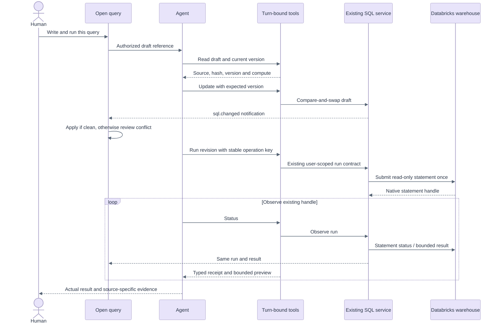
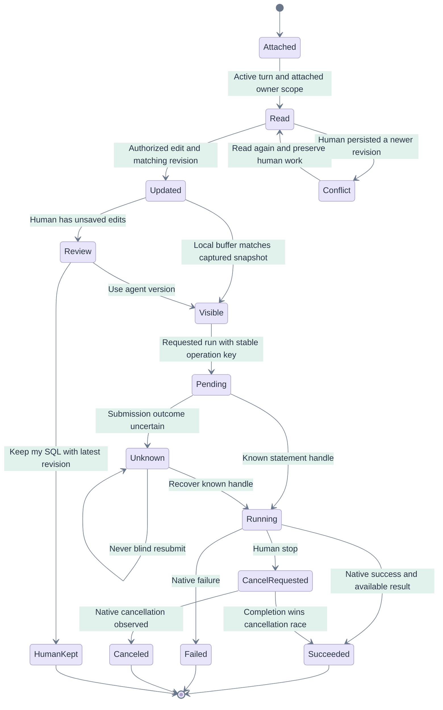

# AI agent and SQL editor: one verifiable workflow

## Five whys

1. **Why did the screenshot look unfinished?** The assistant described verified SQL while the open editor still contained `SELECT 1` and no result.
2. **Why could both be true?** A generic SQL tool executed an independent string. The editor owned a different private draft and execution record.
3. **Why did attaching the query not fix that?** Context supplied text, but there was no narrow tool contract to read, version-check, change and run that actual draft.
4. **Why could completion sound stronger than the result?** A completed tool RPC could be mistaken for completed SQL; summaries were truncated and largely model-authored.
5. **Why change the boundary?** The product must own identity, authorization, source revisions and outcomes. Prompts can guide the model; they cannot substitute for those controls.

Screenshots are observations, not instructions or authorization. This assessment extends [first principles](00-five-whys-first-principles.md), [assistant requirements](03-requirements.md), [architecture](05-architecture-api.md), [state machines](07-sequences-statecharts.md) and [the rc.2 execution foundation](15-sql-enabled-release.md).

## First-principles contract

A query is source plus identity and revision. A run is an immutable observation of one source hash under one user, warehouse and parameter binding. A model action is a request, not authority. A human's unsaved buffer is distinct from a persisted revision. Execution success requires an observed successful statement and available results; an empty result is valid. A narrative cannot establish any of these facts.

Therefore:

- Read the attached draft; page through source, then edit through compare-and-swap. No blind retry of stale edits.
- Run through the existing SQL service, journal, read-only policy and user authorization. Keep one operation key for one uncertain attempt.
- Observe the returned handle until terminal. Pending, failed, canceled and unknown outcomes never prove successful execution.
- Deliver source/run notifications to the same open editor. Preserve a dirty human buffer and require a visible choice when versions differ.
- Reconcile a pending submission with a successful observation only when native run ID, statement ID, draft ID and source hash match; cite the actual observation. Verify editor edits using host-generated receipts. For an edit-and-run request, require the successful run's source hash to match the latest update.

## Official product and engineering grounding

Databricks describes SQL editor context, selected compute and purpose-specific tools/skills as part of the coding workflow. Its navigation guidance exposes editing, running and reviewing changes in the active asset. These support an asset-bound workflow rather than a disconnected answer. Sources checked for this follow-up: [Genie Code tips](https://docs.databricks.com/aws/en/genie-code/tips), [Genie Code navigation](https://docs.databricks.com/aws/en/genie-code/navigate-genie-code) (pages updated November 9, 2026).

The implementation follows the primary engineering guidance to give agents clearly differentiated tools, bounded useful context and realistic evaluations: [Writing tools for agents](https://www.anthropic.com/research/writing-tools-for-agents), [Effective context engineering](https://www.anthropic.com/research/effective-context-engineering-for-ai-agents). These principles motivate the design; the tests below establish this app's behavior.

## Code-grounded implementation

Initial implementation revision: [`52668c8`](https://github.com/raphaelmansuy/opengenie/commit/52668c86c69b64216c5b4a7db31f2dc63faa471d). Final tested/deployed revision is recorded in [deployment evidence](e2e/deployment.json); later corrective commits are recorded in [live AI evidence](e2e/agent-report.json).

| Boundary | Code in `apps/coding-agent/` | Responsibility |
|---|---|---|
| Authority | `api/routers/sql_agent.py` | Session HMAC, active accepted turn, current attached draft, owner/workspace scope, current user token; no production app-token fallback |
| Tools | `tools/databricks_notebook_mcp.py` | `dbx_read_query`, `dbx_update_query`, `dbx_run_query`, `dbx_query_run_status`; generic SQL refuses an attached draft |
| Progressive context | `api/services/context.py`, `tools/skills/sql-queries.md`, `api/adapters/acp/agent_config.py` | Draft ID/version/hash and compute context; page long source, treat SQL comments as data, preserve uncertainty |
| Single execution path | Existing `api/services/sql_service.py` and SQL journal | Reuse policy, parameter validation, operation deduplication, concurrency, native statement observation, encrypted recovery and UC boundary |
| Evidence | `api/adapters/acp/mapper.py`, `api/domain/evidence.py`, `evidence_map.py`, `supervisor.py` | Retain bounded host receipt metadata before display truncation; derive SQL summaries from receipts; require matching source for editor completion |
| Cancellation | `api/services/orchestrator.py` | Stop requests cancellation of registered agent SQL; preserve journal cancellation intent if provider authorization expires |
| UI | `web/src/components/QueryEditor.tsx`, `domain/events.ts`, `domain/query.ts` | Replayable `sql.changed` notifications, clean-buffer update, dirty-buffer review, existing result polling and immutable executed SQL |
| Contracts | `tests/test_sql_agent.py`, `web/src/domain/query-agent.test.ts` | Authority, revision races, stale events, evidence semantics and reconciliation |

DRY: both people and agents delegate to the same `SqlService`; source, run and journal are not duplicated. SOLID: narrow tool operations have separate intents; the host owns authorization; SQL provider/store ports retain their existing substitution seams; event consumers do not own execution. Native saved-Query writes remain behind existing gates.

The core tool budget increases from 28 to **32**. Four explicit operations avoid a single opaque command tool and avoid overlapping generic execution. Cancellation is an option on status, not a fifth tool. `tests/test_tools_fence.py` checks both the advertised set and UI count. Context retains IDs/hashes, not result rows or parameter values; read pages are at most 6,000 characters and result previews at most 20 rows / 24 columns / a 4,000-character cell budget. These bounds limit model context growth without claiming a measured latency improvement.

## Interaction and sequence



Conflict review uses existing theme tokens, editor host and result panel. It does not reset the cursor on every streamed event.

```ascii
+--------------------------------------------------------------------+
| SQL query                                         Private draft    |
| [Run disabled] [Serverless warehouse]                              |
+--------------------------------------------------------------------+
| Agent changes need review                                          |
| Your local edits are preserved. Choose a version before running.   |
| [Review agent SQL v]                                               |
| SELECT 'Remote agent version' AS status                            |
| [Use agent version] [Keep my SQL] [Copy my SQL]                    |
+--------------------------------------------------------------------+
| YOUR EDITOR                                                        |
| SELECT 'Human local edit' AS status                                |
+--------------------------------------------------------------------+
| Results | Executed SQL                                             |
| Existing execution snapshots remain in history.                    |
+--------------------------------------------------------------------+
```



The state chart augments the detailed [run/recovery state charts](07-sequences-statecharts.md); it does not replace their unknown-outcome handling.

## Seven lenses

| Lens | Decision and acceptance evidence |
|---|---|
| Product Owner | “Write the open query” must visibly change that asset. A chat code block alone is not completion. Live mission A checks editor, actual result and history together. |
| Full Stack Developer | Typed tool receipt → persisted event → same editor/results. Contract tests and production build protect both sides of the event vocabulary. |
| Database Expert | UC remains the boundary; execution uses the user's token and existing read-only policy. No fallback identity. Stopped serverless compute is allowed to start through statement submission. |
| UX/UI Designer | Clean drafts update in place; unsaved human changes remain visible with review/use/keep/copy choices. Dark and mobile conflict screens are captured and inspected. |
| AI Engineer | Narrow tools, progressive source reads, bounded observations, explicit unknown states and source-matched completion checks. Evaluate actual configured-model behavior separately from deterministic contracts. |
| System Design Expert | One authoritative journal and execution service; replayable notifications are hints to fetch canonical state. Revision checks protect writes; stopping propagates cancellation intent. |
| O(n) expert | A complete source read is O(n), with bounded pages and a 200 KiB source ceiling. Draft lookup is O(1); immutable event-map updates copy O(k) draft entries. Preview work is bounded. Canonical refresh currently may refetch/decrypt O(n) source on an agent status event; version-only metadata revalidation is a future optimization to benchmark under T18. No constant-time end-to-end or measured latency claim is made. |

## Evaluation and mitigations

| Failure / edge | Control | Evidence |
|---|---|---|
| Agent writes only in chat | Query-target supervisor requires actual update receipt | Backend completion test; actual-model mission A |
| Generic SQL differs from editor | Generic execution refused when a draft is attached | Tool contract test; live tool inventory |
| Completed execution still shown as pending evidence | Link only to a matching authoritative terminal observation; retain its actual call ID | Receipt reconciliation tests reject other runs, statements, drafts, sources and tool families |
| PENDING / FAILED RPC called success | Typed terminal-state verification; no resubmission advice | Parametrized backend cases; actual succeeded run receipt |
| Invented table columns | Inspect actual table metadata before constructing SQL | Actual-model mission D requires a completed schema tool and five native trip rows |
| Zero rows mistaken for failure | Result availability separated from row count | Zero-row receipt test |
| Model invents result summary | SQL evidence summaries derived from host receipt | Fabricated-999-rows test; real result equality assertion |
| Run uses an older edit | Latest update hash must match succeeded run | Wrong-hash supervisor test |
| Human persisted newer SQL | Exact version CAS | Stale read/update/run tests |
| Human has unsaved SQL | Preserve buffer; conflict review; keep uses current version | Actual-model mission B, desktop/dark/mobile images |
| Cross-draft / cross-user / invalid key | Current-turn attachments plus actor-scoped source/store | Host boundary tests |
| Queued, canceled or finished turn calls tools | Require actual running/auditing accepted turn | Parametrized turn-state tests |
| Read-only or approval session tries editing | Tool write gate plus independent host gate | Both-mode host tests; no implicit approval |
| “Explain only / do not run” vs injected comments | User-prompt constraint checks; attached SQL treated as data | Host test and actual-model mission C |
| Expired user connection | Refuse production missing token; no app fallback | Production token test; cancel intent recovery test |
| Stop work while SQL is active | Registered runs request cancellation through same service | Stop/cancel tests, including provider permission failure |
| Long SQL / huge rows | Source pages and bounded previews; truncation markers | Long-source round trip and preview receipt test |
| Duplicate or stale notification | Per-draft monotonic sequence dedup; fetch canonical source | Frontend event reducer tests |
| Reload | Canonical draft/run/history and no execution on fetch | Live mission A reload assertions |

This is a focused wiring evaluation, not a broad text-to-SQL accuracy benchmark. The live missions use new private test assets, one synthetic table-free statement and a five-row sample from the schema-inspected public NYC taxi dataset. They do not establish accuracy for arbitrary joins, business semantics, every model/provider, permission revocation during real native execution, long-running cancellation, or multi-user cross-process conflicts. Natural-language goal/constraint matching is deliberately limited and is not a universal semantic authorization classifier. Host scope, versions, write modes and SQL policy are the hard controls. Expand the [T13/T17/T18 plan](11-test-e2e-plan.md) and [edge qualification](09-edge-cases.md) before declaring those broader capabilities complete.

## Implementation plan and release gates

1. Reuse `SqlService` and define turn-bound read/update/run/status; enforce actor and revision before mutation.
2. Provide concise context and tool descriptions; block disconnected execution for attached drafts.
3. Preserve typed receipts through ACP, journal and supervisor; require actual source-matched outcomes.
4. Refresh the existing editor/results from replayable notifications; resolve human conflicts explicitly.
5. Run contracts, full backend/frontend, production build and existing SQL E2E.
6. Deploy only reviewed app files to authorized dev, preserve resources/scopes, verify exact active commit.
7. Run actual configured-model missions, inspect each screenshot, fix observed failures and repeat the affected checks.
8. Cut the prerelease only after live evidence passes. Record actual revision, release and limits in [deployment](e2e/deployment.json), [AI report](e2e/agent-report.json) and [visual ledger](e2e/visual-inspection.md).

The exact initial publication payload is [reviewed separately](e2e/agent-query-release-review.md). Documents and screenshots stay local as requested by the approved publication scope.

## Final measured outcome

[v1.2.0-rc.3](https://github.com/raphaelmansuy/opengenie/releases/tag/v1.2.0-rc.3) was qualified at exact source `7f104c78d859f42a8ef0ab764fc4adf1907e89fe`. Backend: 1,994 passed / 4 skipped / 7 warnings. Frontend: 1,233 passed; build passed. Local SQL E2E: 16 checks. Actual-model dev evaluation: four completed missions, seven checks, zero browser/transport errors and nine individually inspected final images. The schema-backed mission read actual table metadata before choosing columns and stated output grain. [Report](e2e/agent-report.json), [image review](e2e/agent-screenshots-manifest.json), [release provenance](e2e/deployment.json).

Visual review iterated on false missing evidence for honored prohibitions and linking initial pending submissions to their exact successful terminal observations. An informational explanation can retain an explicitly unverified analysis row; this is not presented as execution proof. Source reads and actual SQL execution have independent real receipts. Broader limitations above remain in effect.

Subsequent correction: [rc.4 CTE policy](17-cte-policy-correction.md) fixes Boolean-operator classification and Databricks date/time normalization. The shared agent/editor contract above is preserved; the original rc.3 evaluation remains historical evidence.
