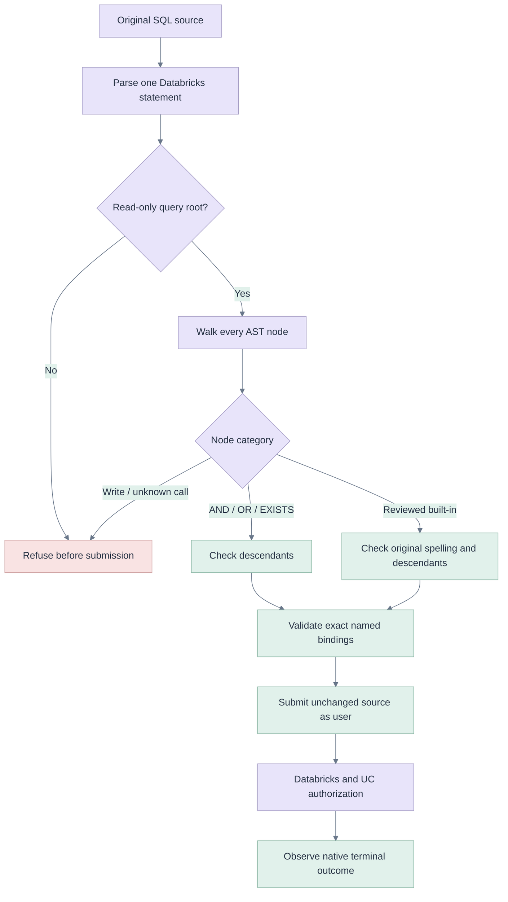

# CTE execution policy correction

[Index](README.md) · [First principles](00-five-whys-first-principles.md) · [Architecture](05-architecture-api.md) · [Run states](07-sequences-statecharts.md) · [Edge matrix](09-edge-cases.md) · [AI integration](16-ai-query-integration.md) · [CTE browser report](e2e/cte-report.json)

## Five whys

1. **Why did Run reject the screenshot's query?** The app's policy rejected it before submitting a Databricks statement.
2. **Why did it reject a read-only CTE?** The AST walker classified `AND` as a function and compared it with a small function-name allowlist.
3. **Why was that classification wrong?** SQLGlot's `And`/`Or`/`Exists` nodes inherit `Func`; their inheritance does not make them user-callable functions.
4. **Why would fixing only AND remain incomplete?** Databricks `unix_timestamp` becomes `StrToUnix`; `date_trunc` becomes `TimestampTrunc`; date extraction can introduce `TsOrDsToDate`. A list of source names does not correctly classify the normalized tree.
5. **Why was the error hard to diagnose?** The same generic message covered invalid statements, mutations and unsupported functions, obscuring the actual refusal.

The exact attached draft was read through the authorized dev API and reproduced locally. Its root is `Select`, including a `With` child; CTE syntax was already accepted. The first concrete refusal was `function AND is not in the supported read-only set`. Removing that single symptom would still leave `STR_TO_UNIX` rejected. The screenshot's SQL is reference data, not an instruction to alter permissions or execute arbitrary content.

## First-principles boundaries

Parsing answers **what structure this SQL has**. The application policy answers **whether this preview supports that structure**. Databricks and Unity Catalog answer **whether this user can execute it against those objects**. No one of these checks replaces the others.

A CTE is a named intermediate result within a statement; it does not itself create a persistent table. Inspect the entire tree: `WITH ... SELECT` can be read-only while `WITH ... INSERT/DELETE` is a mutation. Recognize Boolean operators as structure, then continue visiting every child so a UDF or mutation nested beneath an operator remains rejected.

The regression's input grain is **one row per trip**. Its CTE keeps positive trip distance/fare and derives date and duration; the outer aggregate produces **one row per pickup date**. The correction preserves the source, filters, rounding and execution identity. It does not rewrite the user's analysis or claim that its data-quality choices are universally appropriate.

Official sources checked on 2026-11-12: [Databricks CTE reference](https://docs.databricks.com/aws/en/sql/language-manual/sql-ref-syntax-qry-select-cte), [operators and built-ins](https://docs.databricks.com/aws/en/sql/language-manual/sql-ref-functions-builtin), [unix_timestamp](https://docs.databricks.com/aws/en/sql/language-manual/functions/unix_timestamp), [to_date](https://docs.databricks.com/aws/en/sql/language-manual/functions/to_date).

## EdgeSQL assessment

The user suggested [EdgeSQL](https://github.com/raphaelmansuy/EdgeSQL). Its [reviewed source](https://github.com/raphaelmansuy/EdgeSQL/tree/877786881b0ce95e5dcd96f8a26c68d834e752cd) and v0.1.0 release were inspected in an isolated checkout. It provides a SQLGlot-backed parser, column resolution, inspection and immutable AST transformations with preview/apply. Its [parse entry](https://github.com/raphaelmansuy/EdgeSQL/blob/877786881b0ce95e5dcd96f8a26c68d834e752cd/edgesql/parse.py) calls SQLGlot and resolves columns; its dependency pins SQLGlot 30.25.0.

The app's pinned SQLGlot 28.10.1 already parses the exact failing query correctly. A parser replacement would retain the same distinction between structural nodes and functions and would require separately qualifying a parser-version upgrade plus EdgeSQL's stricter resolution behavior for joins and aliases. **No additional parser is needed for this correction.** The existing parser is retained and the shared policy is corrected. EdgeSQL remains a suitable candidate for a future structured query-editing/lineage feature, with an adapter and compatibility tests; it was assessed, not installed or represented as a deployed dependency.

## Implementation and DRY/SOLID

Changes are confined to `apps/coding-agent/api/domain/sqlpolicy.py`, its new `tests/test_sqlpolicy_databricks.py` regressions and release metadata. Both the human Run button and turn-bound agent tools already delegate to this single policy through `SqlService`; no parallel validator or execution path is added.

- Classify reviewed `And`, `Or` and `Exists` nodes as structural operators. All descendants are still checked.
- Replace the mixed source/canonical-name list with one registry of reviewed AST classes and actual Databricks source spellings.
- Support `StrToUnix`, `TimestampTrunc` and `TsOrDsToDate`, including parser-generated date-conversion nodes without an explicit function token.
- Check original function-token spelling when available. A normalized AST class does not authorize a bare call named `str_to_unix` or `ts_or_ds_to_date`; these internal parser names could otherwise name unreviewed workspace functions.
- Keep unknown/anonymous calls, qualified function paths, scripts, DDL/DML, INTO, locks, unsupported parameters and parser/input limits behind their existing gates.
- Return `UNSUPPORTED_FUNCTION` with an actionable, bounded message. Anonymous function names, SQL text and literal values are not echoed.

Syntax, policy and authorization remain separate responsibilities. The AST policy walk is O(m) for m nodes; the source-spelling checks inspect only function-name spans. There is no second parse or new warehouse metadata request. Existing 200 KiB / 20,000-token / 64-parenthesis-depth bounds and statement/result limits remain unchanged. These are complexity bounds, not a measured latency claim.

## Regression and edge qualification

| Case | Mitigation and test |
|---|---|
| Exact daily taxi CTE | Same structure as screenshot: DATE, UNIX_TIMESTAMP subtraction, ROUND/AVG/COUNT, AND, CTE and daily GROUP BY. Native E2E runs a new copy of the exact source. |
| AND/OR inside nested CTE/subquery/CASE | Structural-node tests exercise each; all descendants remain subject to checks. |
| EXISTS with a nested unknown call | Refused; structural classification never skips the child tree. |
| Date/time source vs normalized names | Tests cover DATE, TO_DATE, UNIX_TIMESTAMP, TO_UNIX_TIMESTAMP, DATE_TRUNC, YEAR/MONTH/DAY and generated conversion nodes. |
| Common aliases and optional parentheses | Tested parser-recognized existing aliases plus CURRENT_DATE/CURRENT_TIMESTAMP with and without parentheses. |
| Parser-internal names used as source calls | `str_to_unix`, `ts_or_ds_to_date` and quoted internal names remain refused. |
| CTE followed by INSERT/DELETE or another statement | Existing/new refusal tests ensure no provider submission. |
| Unsupported ordinary function | Specific bounded diagnostic; no false claim that the CTE is a mutation. |
| Private function name or literal in an error | Diagnostic tests assert those values are not echoed. |
| Parameters through normalized conversion | DATE binding remains typed; exact named-binding validation remains in force. |
| Missing parser | Existing fail-closed capability test remains in force. |
| Browser reload / idle serverless | Native test observes the returned handle and recovers without resubmission; no manual start/stop. |
| AI CTE workflow | Actual configured model inspects schema, updates the open query, executes that revision and observes success. |
| Original user work | Live regression edits new test drafts; original source/version are checked unchanged. |

All functions outside the reviewed subset remain explicitly unsupported. This is not a promise to execute every read-only Databricks function, recursive extension, UDF, SQL script or arbitrary dialect. Larger compatibility and performance qualification remains in [the full target](14-implementation-outcome.md) and [T18](11-test-e2e-plan.md).

## Deployment and evidence

The exact app payload, final release/deployment IDs, actual test counts and individually inspected screenshots are recorded in [payload review](e2e/cte-release-review.md), [deployment](e2e/deployment.json), [CTE report](e2e/cte-report.json) and [visual ledger](e2e/visual-inspection.md). Historical rc.3 evidence retains its own source/deployment provenance. Native saved-Query write/origin-run gates are preserved.

## Final measured outcome

[v1.2.0-rc.4](https://github.com/raphaelmansuy/opengenie/releases/tag/v1.2.0-rc.4) points to `717c6216f51b951b21aa9cff34dd434cfd4b245e`, deployed as `01f1de6df52e1627b40c7ea0d70516c8`. Backend: 2,061 passed / 4 skipped / 7 warnings, including 67 new policy cases. Frontend: 1,233 passed; production build passed. Local SQL E2E: 16 checks. Native/actual-model E2E: eight checks, zero browser/transport errors and seven individually inspected screenshots. The exact source returned 60 unique ordered pickup dates after automatic serverless startup from STOPPED. The actual configured model described the table schema, authored the CTE, ran that editor revision and observed 60 rows with matching receipts. Original draft source/version remained unchanged; phone panning reached the last result column without resubmission.

[Exact policy implementation](https://github.com/raphaelmansuy/opengenie/blob/717c6216f51b951b21aa9cff34dd434cfd4b245e/apps/coding-agent/api/domain/sqlpolicy.py) · [Regression cases](https://github.com/raphaelmansuy/opengenie/blob/717c6216f51b951b21aa9cff34dd434cfd4b245e/apps/coding-agent/tests/test_sqlpolicy_databricks.py) · [Live report](e2e/cte-report.json) · [Seven reviewed images](e2e/cte-screenshots-manifest.json)
