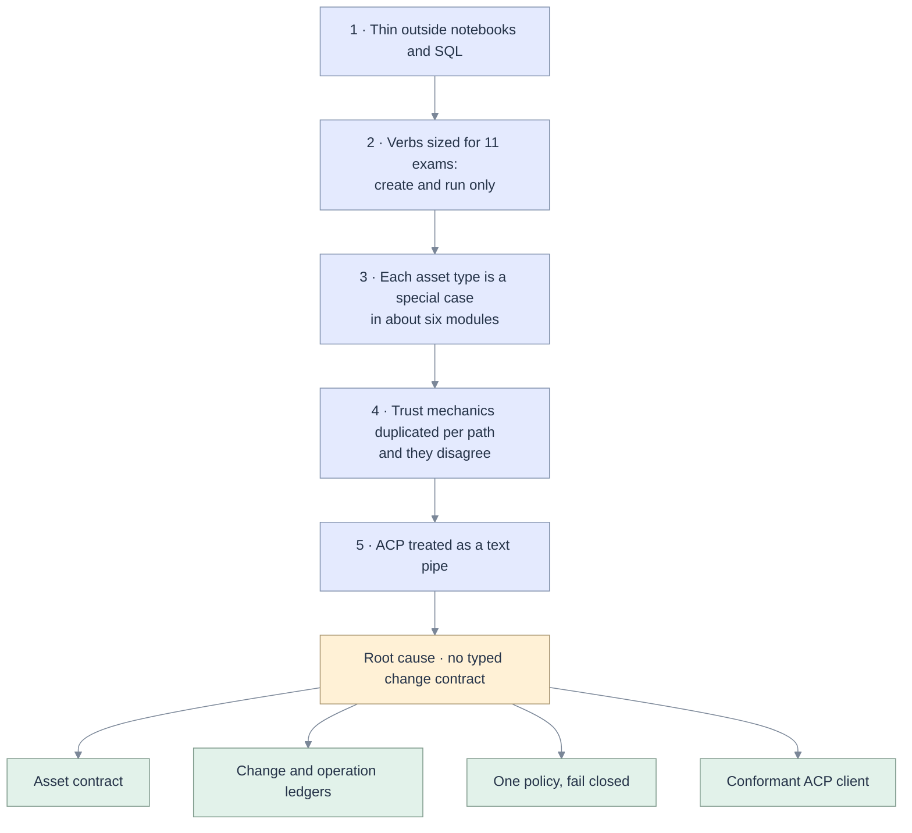

# 00 · Five whys and first principles

[Map](README.md) · next: [external assessment](01-genie-code-acp-assessment.md) · evidence: [code grounding](02-code-grounding.md) · consequences: [requirements](03-requirements.md)

## The problem OpenGenie solves

A data engineer does not want an answer. They want a **change to a governed data asset** (a notebook, a
query, a job, a pipeline, an app, a table) that is:

1. grounded in the real metadata of their workspace,
2. executed on real compute under an identity that Unity Catalog recognises,
3. proven by an observed result, not by the agent's word,
4. reviewable before it lands and reversible after,
5. produced by a model, and at a cost, that the team chose.

Genie Code delivers 1 and 2 natively and leaves 5 to Databricks
([assessment](01-genie-code-acp-assessment.md#a-genie-code-today)). OpenGenie's thesis
([README](../../README.md)) is to keep the workspace context, return the model and cost decisions, fence
writes on the server, and check "done" against what actually ran.

The app delivers that thesis today for **one notebook and ad-hoc SQL**. The goal of this spec is the
remaining distance to "the data engineering coding agent for Databricks": notebooks, ETL jobs, SQL
queries, pipelines and Databricks Apps, with the same guarantees on every one of them.

## Five whys

Each answer is a fact about this repository; the finding numbers resolve in
[02](02-code-grounding.md#findings-register).

**1. Why is OpenGenie not yet the data engineering agent for Databricks?**
Because outside notebook authoring and short SQL, the agent's work is thin, unreviewable or unavailable.
Jobs take notebook tasks only and cannot be changed, repaired or deleted; pipelines can only be listed;
apps can only be created; a notebook edit is a whole-document overwrite
([F-20](02-code-grounding.md#f-20), [F-22](02-code-grounding.md#f-22)). On an app deployment the
platform gives no user scope for Jobs or Pipelines at all, so the four Jobs tools are offered to the
model and can never succeed as the user ([F-18](02-code-grounding.md#f-18)).

**2. Why is the capability surface that narrow?**
Because it is one 1,104-line tool file whose verbs were sized to pass eleven exam missions, not to cover
an asset lifecycle. Every tool is "create" or "run"; there is no "read the definition", "change it in
place", "repair", "undo" or "clean up". Waiting is done inside the tool call, which collides with the
agent itself: the ETL skill tells the agent to wait 300 s, and the agent fails any tool call at 60 s,
leaving a run it cannot see ([F-19](02-code-grounding.md#f-19)).

**3. Why were lifecycle verbs not added?**
Because each asset type is a special case spread over about six places: a tool function, a fence rule,
an attachment kind, a context reader, a route and a viewer. Nothing says what an "asset" is. Adding
"pipeline" means editing all six and keeping them consistent by hand
([F-23](02-code-grounding.md#f-23), [F-35](02-code-grounding.md#f-35)).

**4. Why is a new verb expensive to add safely?**
Because the trust mechanics are implemented per path, more than once, and they disagree. There are three
SQL policies and two path fences. The one the agent actually passes through is the weakest: it allows
every write when the session has no schema and accepts `..` in a path
([F-01](02-code-grounding.md#f-01), [F-02](02-code-grounding.md#f-02), [F-05](02-code-grounding.md#f-05)).
Evidence is matched on a tool's display name, so a fabricated number passes
([F-07](02-code-grounding.md#f-07)). Each new verb multiplies an unverified surface.

**5. Why are the trust mechanics per path?**
Because the boundary between the agent and the app is treated as a text pipe. The ACP client advertises
no capabilities, reconstructs an approval from fields the protocol does not have, reads usage from the
wrong place, and drops commands, configuration, diffs and tool names
([F-10](02-code-grounding.md#f-10) to [F-16](02-code-grounding.md#f-16)). The app therefore never holds,
in structured form, *what the agent is about to change, to which revision of which asset, and what was
observed afterwards*.

### Root cause

> There is no single typed **change contract** between the agent and the workspace: a proposed change to
> an identified asset at a known revision, with a policy verdict, an approver, an execution identity and
> an observed result.

The fence, the approval, the evidence, the review screen, the undo and the cost meter are all projections
of that one missing value. Today each is rebuilt from strings.

## First principles

Derived from what must be true for a person to trust an agent with a governed asset. Each is testable,
and each names the requirement group it produces in [03](03-requirements.md).

| ID | Principle | Why it cannot be otherwise | Produces |
|---|---|---|---|
| **FP-1** | **Identity is the boundary.** The agent acts as the signed-in user. Where it cannot, the other identity is named, narrower, and consented to; and where no narrower identity exists, the agent does not act. | Unity Catalog decides access by identity. A fence only limits what is asked for. The app's own identity can read the key that protects every user's credentials. | [AG-30 to AG-39](03-requirements.md#c-capability-and-identity) |
| **FP-2** | **A change is a value.** Asset, base revision, operations, verdict, approver, result. Nothing is written without a base revision. | Without a base revision an overwrite cannot be told from a lost update. Without a stored value there is nothing to review, undo or audit. | [AG-10 to AG-17](03-requirements.md#b-changes) |
| **FP-3** | **Evidence is an observation.** A claim is verified only by a tool result the server holds, bound by call id, whose content supports the quoted value. | The most damaging failure measured in this repository is the confident wrong "done" ([docs/05](../../docs/05-exam-suite.md)). | [AG-50 to AG-55](03-requirements.md#e-evidence-evaluation-and-cost) |
| **FP-4** | **One policy, fail closed.** One path rule and one SQL rule, imported by every enforcement point. Empty scope means no writes. Unknown statement means refused. | Two implementations of a rule are two rules. The weaker one is the real one. | [AG-01 to AG-07](03-requirements.md#a-trust-boundary) |
| **FP-5** | **Work is polled, never blocked.** Every operation returns a handle within a bounded time. | A blocked call is indistinguishable from a dead agent: the pinned agent fails one at 60 s while the work continues unseen. And a delegated token expires in about an hour. | [AG-20 to AG-27](03-requirements.md#d-operations-and-long-running-work) |
| **FP-6** | **Speak the protocol as written.** Negotiate capabilities, map every defined update, ignore the unknown safely. | A private dialect is only tested against the fake that invented it ([F-10](02-code-grounding.md#f-10)). | [AG-40 to AG-47](03-requirements.md#f-acp-conformance) |
| **FP-7** | **Text from data is data.** A delimiter the data can forge is not a delimiter. | Notebooks, tables and tickets carry instructions (exam M8). | [AG-06](03-requirements.md#ag-06) |
| **FP-8** | **What the session creates, the session can account for.** Every created resource has a ledger row and a cleanup path. | A Lakebase instance or a scheduled job costs money after the conversation ends. | [AG-16](03-requirements.md#ag-16), [AG-17](03-requirements.md#ag-17) |
| **FP-9** | **The model is a setting and the cost is visible.** Tokens and money per turn, summed across supervisor passes, bounded by a budget. | Cost control is half of the product's reason to exist. | [AG-56 to AG-58](03-requirements.md#e-evidence-evaluation-and-cost) |
| **FP-10** | **Bounded work.** Every list is paged, every buffer capped, every per-event cost independent of history length. | A session is designed to run for hours and 200 turns. | [AG-60 to AG-66](03-requirements.md#g-scale) |
| **FP-11** | **Measure the product, not the kit.** The published score is produced through the same path a user's message takes. | The exams drive `opencode run` in a shell, not the app ([F-27](02-code-grounding.md#f-27)). | [AG-54](03-requirements.md#ag-54) |

## What follows, and what does not

**In scope.** The agent path of `apps/coding-agent`: the ACP client, the orchestrator, the tool server and
its policy, the session journal, and the assistant, mission and asset surfaces of the web app.

**A boundary the platform sets.** A Databricks App can act as its user on SQL, workspace objects,
catalogue reads, apps and Lakebase. It cannot on Jobs or Pipelines: no such user scope is offered to
apps ([14](14-live-investigation.md#workspace-facts)). FP-1 decides what follows. OpenGenie does not
borrow the app's identity to fill the gap. It defines jobs and pipelines as code for the user to deploy,
runs what SQL can express as the user, and observes the rest through system tables. A deployment whose
identity may call those APIs, such as a local one with a user token, uses them directly through the same
interface.

**Out of scope, with the reason.**

| Excluded | Reason |
|---|---|
| Inline autocomplete and single-line Quick Fix | Latency-bound editor features, not agent work. Stated as a Genie Code advantage in the [README](../../README.md). |
| Genie Ontology, business-term resolution | Untested here by the repository's own admission. A capability gap, not an agent defect. |
| Dashboards and MLflow surfaces | Listed for Genie Code in [01](01-genie-code-acp-assessment.md#a-genie-code-today). The asset contract in [05](05-architecture.md#the-asset-contract) admits them later without redesign. |
| Real-time co-editing | Owned by [spec 004](../004-crdt-collaboration/README.md). This spec only requires a base revision on every agent write. |
| Multi-worker scale-out | The journal is single-owner by design ([spec 010](../010-long-running/README.md)). [06](06-data-model.md#what-stays-single-owner) keeps the schema lease-ready and stops there. |
| Native saved-Query update and origin execution | Gated by [spec 013](../013-sql-query-support/README.md). This spec consumes its policy and service and does not reopen its gates. |

The order of work is set by the principles: trust first (FP-4, FP-6, FP-7), then the change contract
(FP-2), then operations (FP-5), then breadth (FP-1), then proof and cost (FP-3, FP-9), then scale
(FP-10). See the [implementation plan](10-implementation-plan.md).
