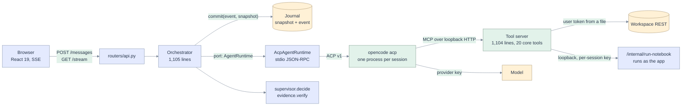
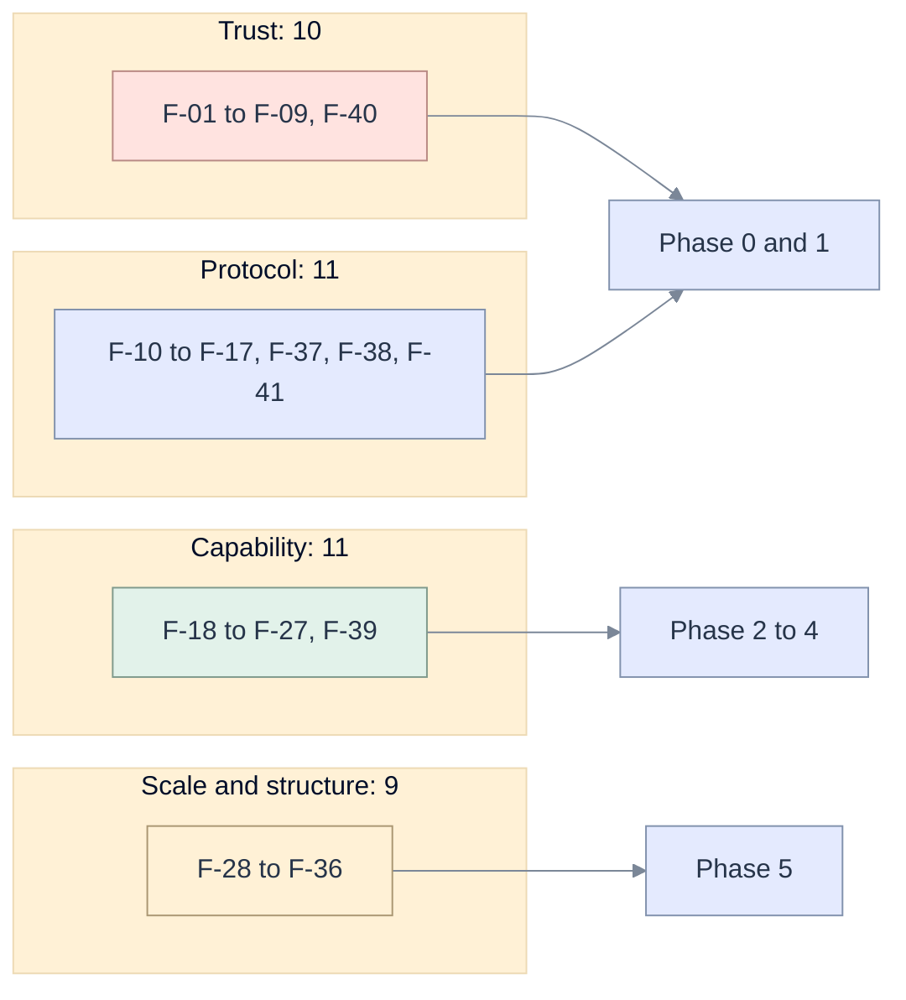

# 02 · Code grounding: how the agent works today, and what is wrong

[Map](README.md) · previous: [external assessment](01-genie-code-acp-assessment.md) · next: [requirements](03-requirements.md)

Every statement below was read in the working tree on 2026-11-13 (branch `main`, with uncommitted
spec 013 work present). Line numbers refer to that tree. "Probe" means the behaviour was executed, not
inferred; the commands and outputs are in the [validation record](13-validation-record.md#probes).
"Live" means it was then observed on the development workspace or from the pinned agent; the
observations, numbered `L-nn` and `A-nn`, are in [14](14-live-investigation.md). Where the live result
contradicted the first reading, the finding says "corrected".

## The agent path, as built

| Stage | What happens | Where |
|---|---|---|
| Create | Resolve the model, write `opencode.json` and `AGENTS.md` into a temp folder, start the tool server with the fence in its environment, spawn the agent, `initialize`, `session/new`. | [orchestrator.py][orch] `_provision`, [agent_config.py][cfg], [registry.py][reg], [runtime.py][rt] `start` |
| Prompt | Attachments are re-read with the user's token and rendered into one text block placed before the prompt. One `session/prompt` per turn. | [services/context.py][ctxsvc], [domain/context.py][ctx] `render`, [blocks.py][blk] |
| Stream | Each `session/update` is mapped to domain events. Every event is committed with a full session snapshot, then published. | [mapper.py][map], [orchestrator.py][orch] `_emit` |
| Settle | The supervisor extracts requirements from the prompt by regular expression, parses an evidence table from the answer, and decides done, continue, audit or blocked. Up to five continuations and two audits, each a new `session/prompt`. | [supervisor.py][sup], [evidence.py][evd] |
| Approve | A permission request from the agent becomes `approval.requested`. A save from the editor outside the fence needs a signed approval token. | [runtime.py][rt] `_on_permission`, [approval.py][apr] |
| Recover | On restart every unfinished turn is marked interrupted. Nothing is replayed. The user restores, and the agent's own session is loaded. | [orchestrator.py][orch] `restore`, `resume` |

What is already right, and must be preserved: turns owned by the server and journalled before they are
published; an owner check on every session route in one place ([main.py][main] line 214); a retry key on
message submission; no automatic replay after a restart; credentials referenced by variable, never
written to disk; a pure domain layer with tests; a deterministic fake agent for the interface.

## Capability coverage, from the tool file

Read from [databricks_notebook_mcp.py][tools]. "Core" is the profile the app starts (line 76).

| Asset | Discover | Read | Change | Run | Observe | Repair, undo, delete |
|---|---|---|---|---|---|---|
| Notebook | list | paged read, grep | **whole overwrite**, no base revision | job submit, 45 s wait | exit value, error tail | none |
| File | list | through the notebook reader | whole overwrite | no | no | none |
| Table | list, describe, search by walking | sample (full profile) | SQL in the fenced schema | `dbx_run_sql`, 50 s | first chunk of rows | none |
| SQL query (saved) | not in the tool server | no | no | no | no | none |
| Job | list is **not in core** | no definition read | create, notebook tasks only | run now | per-task state and error | no update, repair or delete |
| Pipeline | list, **not in core** | no | no | no | no | none |
| App | no | no | create and deploy | deploy only | no status or logs | none |
| Lakebase | no | status | create | SQL | rows | no delete |

## Findings register

Severity: **High** breaks a stated guarantee or blocks the goal; **Med** degrades it; **Low** is debt.
Each finding names the requirement that closes it in [03](03-requirements.md).

### Trust boundary

### F-01

**High · The agent's SQL fence allows every write when the session has no schema.** `_check_sql_scope`
returns "no error" when `WRITE_SCHEMAS` is empty ([tools][tools] line 215), and the registry passes an
empty string when the session has none ([registry.py][reg] line 58). `schema` is optional on session
creation ([api.py][api] line 41). **Probe P2:** `DROP TABLE main.prod.orders` is accepted. The working
agreement tells the model "none: do not create or alter tables", which is a request, not a fence.
Closes with [AG-01](03-requirements.md#ag-01).

### F-02

**High · The agent's path fence accepts `..`.** `_check_path_scope` is a `startswith` on the raw string
([tools][tools] line 242). **Probe P1:** `/Users/me/agent/../../other/secret_nb` is allowed. A session
folder of `/` becomes the prefix `/`, which matches everything ([registry.py][reg] line 59). Whether the
workspace API normalises such a path was not tested; the fence must not depend on it. The app's own
`scope._inside` rejects both, which is the proof that there are two rules. Closes with
[AG-02](03-requirements.md#ag-02).

### F-03

**High · Both child processes inherit the app's whole environment.** The agent is spawned with
`{**os.environ, ...}` ([runtime.py][rt] line 45) and so is the tool server ([registry.py][reg] line 52).
In a deployment that environment holds the key-encryption key, the Vertex service-account key and the
app's own service-principal credentials ([app.yaml][appyaml]). The orchestrator's docstring says the
child "receives exactly one provider key"; that is true of what is *added*, not of what is *present*.
Nothing reads the environment today because the agent's shell is denied, which makes
[F-04](#f-04) the only barrier. Closes with [AG-04](03-requirements.md#ag-04).

### F-04

**High · The agent's built-in tools are switched off by a deny list, against a floating agent version.**
Eleven tool names are denied ([agent_config.py][cfg] lines 31 and 166); anything not on the list is
allowed. The agent is installed from the range `^1.18.19` with no lockfile at the app root
([package.json][pkg] line 9), and the build script's fallback install names no version and only warns on
failure ([prepare-app.sh][prep] lines 15 to 16). The agent's documentation now describes a second
configuration format with different names and defaults
([01](01-genie-code-acp-assessment.md#c-opencode-as-the-acp-agent), label R). A renamed or new built-in
tool would be live inside the app's container on the next deploy. **Live (A-07, A-08, L-16):** with this
exact deny list the model on the pinned 1.18.19 can still call `skill` and `task`, the second of which
starts sub-agents; a deny-by-default configuration removes both and still lets the MCP tools work; and
the registry's current version is 1.19.5, which the caret range accepts. Closes with
[AG-03](03-requirements.md#ag-03).

### F-05

**Med · Three SQL policies and two path fences; the strongest is not on the agent's path.**
`domain/scope.py` classifies SQL by regular expression, and its `check_sql`, `check_job`, `check_app`
and `check_instance` have no caller in `api/` (only `check_path` is used). Its docstring says the tool
server "only receives requests that passed here"; it does not. `domain/sqlpolicy.py` is a fail-closed
parser policy used by the SQL editor. The agent's `dbx_run_sql` uses a third, regex-based rule in the
tool file. **Probe P8:** the app-side classifier calls `COPY INTO`, `REFRESH MATERIALIZED VIEW` and
`EXECUTE IMMEDIATE` reads. **Probe P2:** the tool-server rule lets `ALTER TABLE … RENAME TO` move a table
out of the fenced schema. Closes with [AG-05](03-requirements.md#ag-05).

### F-06

**Med · The attached-context fence can be closed by the data it contains.** `render` writes the path into
an attribute and the body between `<item>` tags without escaping ([context.py][ctx] lines 134 and 138),
and a workspace path may contain any printable character (line 25). **Probe P9:** a file whose name or
content contains `</attached-context>` produces three closing tags in one block. Closes with
[AG-06](03-requirements.md#ag-06).

### F-07

**Med · "Done means proven" checks that a tool of that name completed, not what it returned.** `verify`
matches a claim to a call by name and takes the *agent's* summary when it gives one
([evidence.py][evd] lines 161 to 186). **Probe P7:** a claim of "1,240,000 rows" is verified against a
call that returned 3. A refused write is returned by the tool as ordinary content
([tools][tools] lines 421 and 429), so the call is `completed` and can be cited as evidence of the write.
**Live (A-11):** the pinned agent reports a refusal returned as content as `completed`, and a refusal
raised by the tool as `failed`. Closes with [AG-50](03-requirements.md#ag-50),
[AG-51](03-requirements.md#ag-51).

### F-08

**High · Model-written Python can run as the app's service principal, which can read the app's
secrets.** When the user's token cannot submit a run, the tool server sends the notebook source to
`/internal/run-notebook`, which executes it as the app for administrators
([run_bridge.py][bridge], [internal.py][internal]). The result says `ran_as`, which is honest, but an
administrator's session that reads injected text is a route from data to code execution under the
app's identity. **Live (L-06):** that identity has `READ` on the secret scope holding the
key-encryption key and the Vertex key, and it is the database role for the tables of encrypted user
keys. An app has one service principal, which cannot be replaced or narrowed. One run of hostile code
is therefore enough to recover every user's stored provider key. Raised from Med. Closes with
[AG-34](03-requirements.md#ag-34).

### F-09

**Low · `/workspace/save` trusts a session id from the body.** The owner check matches only paths under
`/api/sessions` and `/api/approvals` ([main.py][main] line 214). `_save_scope` takes `sessionId` from the
request body ([api.py][api] lines 730 to 740) and `record_document_saved` appends to that session's
journal (line 844). The write itself uses the caller's own token, so no access is gained, but another
user's audit trail can be written to. Closes with [AG-07](03-requirements.md#ag-07).

### F-40

**Med · The agent's working folder and home are part of its prompt, and the app controls neither.** The
pinned agent loads skills, commands and instruction files from its home directory and from every
ancestor of its working folder. **Live (A-04):** the same two-tool turn used 20,598 tokens of context
from a folder under the developer's home, where it also advertised dozens of personal skills as
commands, and 5,414 from a folder outside it. The app passes its own `HOME` to the agent
([runtime.py][rt] line 45) and, when `APP_AGENT_CWD` is set, a folder it did not create
([orchestrator.py][orch] line 436). In a container this is benign today; on a developer's machine the
agent under test is not the agent that is deployed, and any file named `AGENTS.md` above the working
folder becomes an instruction. Closes with [AG-03](03-requirements.md#ag-03).

### ACP conformance

### F-10

**High · The approval card is built from fields ACP does not define.** `from_permission` reads `subject`,
`description` and a top-level `title` ([mapper.py][map] line 174). The protocol sends `toolCall`
([01](01-genie-code-acp-assessment.md#b-agent-client-protocol-v1), label V). **Probe P3:** a
spec-shaped request for `DROP TABLE main.prod.orders` renders as action "write", target "an object",
reason "the agent asked for permission", and no call id. The unit test and the fake agent use the same
private shape ([test_adapters.py][tadapt] line 94), so the suite is green. **Live (A-09, probe P13):**
the pinned agent's real request has exactly `sessionId`, `toolCall`, `options`; through the app's mapper
it has no call id and the same generic text. The arguments are not in the request at all: they arrive
on the tool-call update for the same id. Closes with [AG-41](03-requirements.md#ag-41).

### F-11

**Low · A human "deny" is sent as `cancelled`.** `approve` passes no option for a deny
([orchestrator.py][orch] line 1105) and the runtime answers `{"outcome": "cancelled"}`
([runtime.py][rt] line 494). The protocol reserves that outcome for a cancelled turn and offers
`reject_once` for a refusal. **Live (A-10):** the pinned agent treats the two identically, so nothing
observable changes today; it remains a protocol error that another agent may treat differently.
Lowered from Med. Closes with [AG-41](03-requirements.md#ag-41).

### F-12

**Med · Context use and cost never reach the user.** The mapper reads `update["usage"]`
([mapper.py][map] lines 162 to 163); the protocol puts `used`, `size` and `cost` at the top level.
**Probe P4:** a spec-shaped update yields no event. Separately, a turn's stored usage is that of the last
supervisor pass only: `_nudge` passes its own `usage` to `_settle`, which stores it
([orchestrator.py][orch] lines 996 and 1062), so a turn that was audited twice reports the tokens of its
third pass and not of the first two. **Live (A-06, probe P12):** the pinned agent sends
`{used: 20598, size: 1000000, cost: {amount: 0.0215, currency: "USD"}}`; the mapper returns nothing for
it. Closes with [AG-56](03-requirements.md#ag-56), [AG-57](03-requirements.md#ag-57).

### F-13

**Med · Half of the update vocabulary is dropped, and tool identity is a display string.**
`available_commands_update`, `current_mode_update`, `config_option_update`, `session_info_update` and
`user_message_chunk` map to nothing; a `diff` content block is flattened to a JSON string; `locations`
are ignored (**Probes P6, P6b**; [mapper.py][map] line 165). The tool name recorded for evidence is
`title or kind` (line 124). **Corrected by the live run (A-05):** the protocol defines `name` for this
purpose, but the pinned agent does not send it, so `title` is all there is. The rule is therefore
"`name` when present, else `title`", and evidence must not rest on either
([D5](12-decisions-open-questions.md#decisions)). Closes with
[AG-42](03-requirements.md#ag-42), [AG-43](03-requirements.md#ag-43), [AG-45](03-requirements.md#ag-45).

### F-14

**Low · An update without a status regresses the call to `running`.** ([mapper.py][map] line 130,
**Probe P5**.) The protocol makes every field but the id optional in an update. A late content-only
update after `completed` removes that call from the evidence set, because the supervisor filters on
`running`. Closes with [AG-42](03-requirements.md#ag-42).

### F-15

**Med · One over-limit line from the agent ends the session.** `readline` raises `ValueError` past the
16 MB limit; the loop only catches cancellation, so the reader dies and the channel closes. The
`len(line) > MAX_LINE` guard after it is unreachable ([jsonrpc.py][rpc] lines 114 to 117).
**Probe P10** reproduces it with a small limit. Closes with [AG-47](03-requirements.md#ag-47).

### F-16

**Low · Capabilities are assumed, not negotiated.** The client sends an `http` MCP server without reading
`mcpCapabilities.http` ([runtime.py][rt] line 125), restores with `session/load` and discards the replay
it just asked for (line 118) though `resume` exists, and advertises nothing beyond disabled `fs` and
`terminal` (line 87). Closes with [AG-40](03-requirements.md#ag-40), [AG-44](03-requirements.md#ag-44),
[AG-46](03-requirements.md#ag-46).

### F-17

**Low · Per-session runtime state is never released.** `close` pops the process, the prompt task and the
stderr task ([runtime.py][rt] line 196) and leaves `_capabilities`, `_turn_ends`, `_turn_ids`, `_stderr`
and `_by_agent`. `_approval_seq`, `pending_approval`, `take_permission_event` and
`_dispatch_notifications` have no effect or no caller. Closes with [AG-47](03-requirements.md#ag-47).

### F-37

**Low · Stop reasons other than `cancelled` are not distinguished.** `_settle` branches on cancelled and
on error; `max_tokens`, `max_turn_requests` and `refusal` fall through to the supervisor as if the agent
had finished ([orchestrator.py][orch] `_settle`). A truncated answer can then be audited, and a refusal
nudged. Closes with [AG-47](03-requirements.md#ag-47).

### F-38

**Med · After a person rejects a tool call, the supervisor tells the agent to carry on.** **Live
(A-10):** when a permission is rejected the pinned agent marks the call failed and ends the turn with
`end_turn` and no text. An empty answer is the supervisor's cue to continue
([supervisor.py][sup] `decide`), up to five times. **Probe P11:** with that exact input the verdict is
`continue` with "Continue the task from where you left off: finish the remaining work". The person who
said no is asked again. It is dormant today only because no tool is configured to ask; it becomes the
first thing a user meets once Review mode exists. Closes with [AG-18](03-requirements.md#ag-18).

### F-41

**Low · A failed call's error text is looked for in the wrong field.** The mapper reads `error` from
`rawInput` ([mapper.py][map] line 131). **Live (A-05, probe P11):** the pinned agent puts it in
`rawOutput.error`. The text survives only because it is also in `content`, so it is shown as a summary
and the event's `error` is empty. Closes with [AG-42](03-requirements.md#ag-42).

### Capability and product

### F-18

**High · On an app deployment the agent cannot run, or even read, a job or a pipeline as the user.**
The bundle requests the scopes `sql`, `files`, `model-serving`, `ai-gateway`, `genie`,
`workspace.workspace` and three catalogue reads ([databricks.yml][bundle]). The code's own comments
state that a user token cannot submit a run ([run_bridge.py][bridge]). **Corrected by the live
investigation (L-03, L-04, L-05):** this is not a missing grant. Databricks Apps offer no user scope
for the Jobs or Pipelines APIs at all, for reading or for writing. The live app does hold `apps` and
`postgres`, so four of the twenty core tools are unusable as the user (`dbx_run_notebook`,
`dbx_create_job`, `dbx_run_job`, `dbx_job_run_status`); with the bundle as written it would be eight
([F-39](#f-39)). All are advertised to the model regardless. What the forwarded token is actually
answered was not observed: the app was not started. Closes with [AG-31](03-requirements.md#ag-31),
[AG-38](03-requirements.md#ag-38), [AG-39](03-requirements.md#ag-39).

### F-19

**High · The ETL playbook instructs a wait that the agent cuts off, leaving a run nobody holds.** The
skill and the `dbx_create_job` reply both say `dbx_run_job(job_id, wait_seconds=300)`
([etl-pipelines.md][skill] line 7, [tools][tools] line 929). **Corrected by the live run (A-12):** the
first reading blamed the app's 180 s idle guard ([runtime.py][rt] line 22). The limit that binds is the
agent's own: it fails any MCP call at exactly 60 s with "Request timed out", emits nothing in between,
and the tool keeps running on the server. The run was launched, its id never reaches the model, and the
model's natural next step is to launch it again. The default waits are close to the limit too: 50 s
inside `dbx_run_sql` before any other call it makes ([tools][tools] line 443). Closes with
[AG-20](03-requirements.md#ag-20), [AG-21](03-requirements.md#ag-21), [AG-27](03-requirements.md#ag-27).

### F-20

**High · An agent edit is an unreviewed whole-document overwrite.** `dbx_write_notebook` replaces the
notebook with `overwrite=True` and no base revision ([tools][tools] lines 636 and 674). The editor's own
save path refuses exactly this ([api.py][api] `workspace_save`, 409 on a stale version). The browser
learns of the write afterwards and adopts it ([useFresh.ts][fresh]); there is no diff before apply, no
reject, no undo. For a 60-cell notebook the model must re-emit all 60 cells to change one. Closes with
[AG-10](03-requirements.md#ag-10) to [AG-14](03-requirements.md#ag-14), [AG-17](03-requirements.md#ag-17).

### F-21

**Med · `dbx_run_sql` loses long statements and misreports size.** It waits 50 s with
`on_wait_timeout: CONTINUE` ([tools][tools] line 443). If the statement is still running it returns the
state and no statement id (line 450), so the statement continues on the warehouse with no way to poll or
cancel it. `row_count` is the length of the first inline chunk (line 455), not the total. `_trim` cuts
the JSON at 6,000 characters mid-structure (line 131), which also defeats the result grid in
[mapper.py][map] `_table_of`. **Live (L-11):** the platform's response does carry `statement_id` in
every state, and `total_row_count` and `truncated` in its manifest. Closes with
[AG-20](03-requirements.md#ag-20),
[AG-25](03-requirements.md#ag-25), [AG-36](03-requirements.md#ag-36).

### F-22

**Med · Lifecycle verbs are missing for every asset but the notebook.** See the coverage table above.
Nothing created by a session is recorded or removed with it: a Lakebase instance
([tools][tools] line 992) or a job outlives the conversation. Closes with
[AG-16](03-requirements.md#ag-16), [AG-30](03-requirements.md#ag-30) to [AG-35](03-requirements.md#ag-35).

### F-23

**Med · Attachments stop at notebooks, files, tables and queries.** `KINDS` has eight entries
([context.py][ctx] line 20); a failed job run, a pipeline or an app cannot be handed to the agent. The
resolver is one function with a branch per kind ([services/context.py][ctxsvc]), so each new kind edits
shared code. Closes with [AG-37](03-requirements.md#ag-37).

### F-24

**Med · Slash commands are twelve fixed prompt templates in the browser.** ([commands.ts][cmds].) The
agent's own commands and the user's skills are not offered. Several templates say "write a corrected
copy in my working folder", which is the visible cost of [F-20](#f-20). Closes with
[AG-45](03-requirements.md#ag-45).

### F-25

**Low · Requirement extraction is English-only.** `ACTION_RE` is a list of English verbs
([evidence.py][evd] line 75). **Probe P7b:** a French "create a notebook" request needs no evidence and
is `done` with no tool call. Closes with [AG-52](03-requirements.md#ag-52).

### F-26

**Low · The tool count shown to the user is a constant that is wrong.** `TOOL_COUNT_CORE = 19`
([orchestrator.py][orch] line 65); the core set has 20 names (**Probe P2**). Closes with
[AG-31](03-requirements.md#ag-31).

### F-27

**Med · The published scores measure the shell kit, not the app.** The exam runner executes
`opencode run … --auto` on a remote shell with its own configuration and supervisor
([run_exam.py][exam] lines 121 to 131). The app's ACP client, mapper, supervisor, evidence rule and
fence wiring are not on that path. Closes with [AG-54](03-requirements.md#ag-54).

### F-39

**Med · The bundle no longer describes the deployed app.** **Live (L-03):** the running app declares
eleven user scopes; [databricks.yml][bundle] declares nine, without `postgres` and `apps`. The file's
own comment warns that an update is a full replacement. The next bundle deployment would silently
remove the two scopes the agent's Lakebase and Apps tools depend on. Closes with
[AG-31](03-requirements.md#ag-31).

### Scale and structure

### F-28

**High · Every streamed token rewrites the whole session.** `_emit` redacts and commits a full snapshot
(session, every turn, every call) with each event ([orchestrator.py][orch] lines 152 to 153). The
Postgres store writes it as one `jsonb` row inside a transaction, on one connection, under one lock
shared by every session and every read ([postgres.py][pg] line 62). The cost per message delta grows
with the length of the conversation. Closes with [AG-60](03-requirements.md#ag-60),
[AG-61](03-requirements.md#ag-61).

### F-29

**Med · Every session ever created is loaded at boot and scanned on every list.** `restore` reads all
snapshots ([orchestrator.py][orch] line 157); archived sessions stay in `_live`; `sessions_for` scans
them all and sorts by `s.id` (line 267), which is a random hex string, so "newest first" is not true.
The snapshot table has no user column to index ([004_session_journal.sql][ddl]). Closes with
[AG-62](03-requirements.md#ag-62).

### F-30

**Med · The stream queries the journal once per event per viewer.** The publisher already puts the event
on the subscriber's queue ([broadcast.py][bcast]); the stream uses it only as a wake-up and reads the
journal again ([api.py][api] line 396), on the same single connection as the writer. Closes with
[AG-63](03-requirements.md#ag-63).

### F-31

**Med · Table search is a sequential walk of every catalogue, schema and table.**
([tools][tools] line 334.) Each request opens a new HTTP client ([tools][tools] line 108), and each page
of `dbx_read_notebook` re-exports the whole notebook. Closes with [AG-64](03-requirements.md#ag-64),
[AG-65](03-requirements.md#ag-65).

### F-32

**Low · The browser reducer scans the turn and tool arrays on every event, and the transcript is not
virtualised.** Reported by the front-end audit with line references in
[events.ts][events] (140 to 166, 227 to 238); I read lines 227 to 238 only. Closes with
[AG-66](03-requirements.md#ag-66).

### F-33

**Med · A turn cannot outlive the token it started with.** The run budget is computed once from the
token's expiry ([orchestrator.py][orch] line 806) and the token file is refreshed only on create, submit
and resume. An open tab does not extend a running turn. Closes with [AG-24](03-requirements.md#ag-24).

### F-34

**Low · There are two diverged copies of the tool server.** `mcp/databricks_notebook_mcp.py` and
`apps/coding-agent/tools/databricks_notebook_mcp.py` differ (`diff -q`). Closes with
[AG-80](03-requirements.md#ag-80).

### F-35

**Low · The orchestrator is one class with seven responsibilities, and it imports an adapter.** It owns
lifecycle, provisioning, secret files, turn execution, model switching, approvals and reaping, imports
`adapters.acp.agent_config` (line 33) despite "depends only on ports", and reaches into
`self._health._store` (line 1030). Closes with [AG-81](03-requirements.md#ag-81).

### F-36

**Low · A shared agent folder lets one session overwrite another's rules.** When `APP_AGENT_CWD` is set,
every session writes `opencode.json` and `AGENTS.md` (with its own fence text) into the same folder
([orchestrator.py][orch] line 436; `make dev-real` sets it, [Makefile][mk] line 92). Closes with
[AG-03](03-requirements.md#ag-03).

## Reading the register

Ten of the forty-one are High. Eight of those ten are closed in the first two phases of the
[plan](10-implementation-plan.md), before any new asset kind is added. Twenty-two findings now carry a
probe or a live observation; three were corrected by the live investigation and say so.

[orch]: ../../apps/coding-agent/api/services/orchestrator.py
[rt]: ../../apps/coding-agent/api/adapters/acp/runtime.py
[map]: ../../apps/coding-agent/api/adapters/acp/mapper.py
[rpc]: ../../apps/coding-agent/api/adapters/acp/jsonrpc.py
[blk]: ../../apps/coding-agent/api/adapters/acp/blocks.py
[cfg]: ../../apps/coding-agent/api/adapters/acp/agent_config.py
[reg]: ../../apps/coding-agent/api/adapters/mcp/registry.py
[tools]: ../../apps/coding-agent/tools/databricks_notebook_mcp.py
[skill]: ../../apps/coding-agent/tools/skills/etl-pipelines.md
[ctx]: ../../apps/coding-agent/api/domain/context.py
[ctxsvc]: ../../apps/coding-agent/api/services/context.py
[evd]: ../../apps/coding-agent/api/domain/evidence.py
[sup]: ../../apps/coding-agent/api/domain/supervisor.py
[apr]: ../../apps/coding-agent/api/domain/approval.py
[api]: ../../apps/coding-agent/api/routers/api.py
[main]: ../../apps/coding-agent/api/main.py
[internal]: ../../apps/coding-agent/api/routers/internal.py
[bridge]: ../../apps/coding-agent/api/services/run_bridge.py
[pg]: ../../apps/coding-agent/api/adapters/durable/postgres.py
[bcast]: ../../apps/coding-agent/api/adapters/memory/broadcast.py
[ddl]: ../../apps/coding-agent/api/adapters/llm/store/migrations/004_session_journal.sql
[appyaml]: ../../apps/coding-agent/app.yaml
[pkg]: ../../apps/coding-agent/package.json
[prep]: ../../apps/coding-agent/scripts/prepare-app.sh
[mk]: ../../apps/coding-agent/Makefile
[bundle]: ../../databricks.yml
[tadapt]: ../../apps/coding-agent/tests/test_adapters.py
[exam]: ../../exams/run_exam.py
[fresh]: ../../apps/coding-agent/web/src/hooks/useFresh.ts
[cmds]: ../../apps/coding-agent/web/src/domain/commands.ts
[events]: ../../apps/coding-agent/web/src/domain/events.ts
