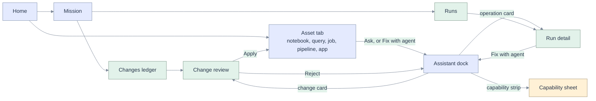

# 04 · UX: navigation and wireframes

[Map](README.md) · requirements: [03](03-requirements.md) · states: [07](07-sequences-statecharts.md) · edge cases: [user interface](09-edge-cases.md#user-interface)

## Design position

The shell built by specs [001](../001-perfect-shell/README.md), [006](../006-databricks/README.md),
[010](../010-tab-management/README.md), [011](../011-ux-coding-mission/README.md) and
[012](../012-panel-interaction/README.md) stays: a rail, one editor group with tabs, an assistant dock
bound to a focus, a mission view. This spec adds **four objects** to it and nothing else:

| Object | What the user learns from it | Requirement |
|---|---|---|
| **Change** | What the agent wants to alter, against which revision, and whether it is inside the fence. | [AG-12](03-requirements.md#ag-12), [AG-15](03-requirements.md#ag-15) |
| **Operation** | What is running in the workspace, as whom, and what happens when it ends. | [AG-22](03-requirements.md#ag-22), [AG-23](03-requirements.md#ag-23) |
| **Capability** | What this session can and cannot do as this person, and why. | [AG-31](03-requirements.md#ag-31) |
| **Mode and meter** | How much freedom the agent has, and what it has cost. | [AG-13](03-requirements.md#ag-13), [AG-56](03-requirements.md#ag-56) |

Three rules carried over from earlier specs: the open asset is the centre of the screen; a state is
never shown by colour alone; a decision is asked once, in one place
([spec 010](../010-long-running/07-edge-cases-tests.md) found and removed a duplicated permission
surface).

## Navigation map

```text
OpenGenie
|
+-- WORK
|   +-- Missions ............ #/session/<id>          existing (spec 011)
|   |   +-- Plan | Outputs | Proof | Changes (new) | Runs (new)
|   +-- Runs ................ #/runs                  new: operations across my sessions
|   +-- Changes ............. #/changes               new: ledger across my sessions
|
+-- ASSETS
|   +-- Files ............... #/notebook/<path>  #/file/<path>     existing
|   +-- Queries ............. #/queries  #/query/<id>              existing (spec 013)
|   +-- Jobs ................ #/jobs     #/job/<id>                new
|   |   +-- run ............. #/job/<id>/run/<run_id>              new
|   +-- Pipelines ........... #/pipelines  #/pipeline/<id>         new
|   +-- Apps ................ #/apps     #/app/<name>              new
|   +-- Catalog ............. #/table/<catalog.schema.table>       existing
|
+-- ASSISTANT DOCK (bound to the focused asset)                    existing (spec 006)
|   +-- Transcript: text, tool rows, change cards, operation cards, question cards
|   +-- Composer: mode, slash commands, mentions, meter
|
+-- SETTINGS
    +-- Models, Providers ... #/settings/models  #/settings/providers   existing (spec 005)
    +-- This session ........ capability sheet, fence, budget          new
```

Every new route follows the grammar of [route.ts](../../apps/coding-agent/web/src/domain/route.ts): a
kind, then an identifier. A job, a pipeline and an app open as tabs in the same editor group as a
notebook, so "Fix with agent" binds the dock to them in the same way it binds to a cell.



## W1 Shell

The rail gains a WORK group and three asset kinds. The bottom strip is the capability summary; it is one
line, always present, and opens [W8](#w8-capability-sheet).

```text
┌──────────────────────────────────────────────────────────────────────────────────────────────┐
│ OpenGenie    [ Search or run a command   Ctrl K ]       Model: gemini-3.8-flash v     (RM)   │
├─────────────┬────────────────────────────────────────────────────┬───────────────────────────┤
│ WORK        │ taxi_hours x | daily_revenue.sql x | job nightly x │ ASSISTANT                 │
│ > Missions  │ -------------------------------------------------- │ bound to: taxi_hours      │
│   Runs    2 │                                                    │                           │
│   Changes 3 │   The open asset: a notebook, a file, a query,     │  transcript               │
│ ASSETS      │   a job, a pipeline or an app. One editor group,   │  change cards             │
│   Files     │   one tab strip (spec 010 tab management).         │  operation cards          │
│   Queries   │                                                    │  question cards           │
│   Jobs      │                                                    │                           │
│   Pipelines │                                                    │ ------------------------- │
│   Apps      │                                                    │ Mode  Plan [Review] Auto  │
│   Catalog   │                                                    │ [ Ask, or type / or @  ]  │
│             │                                                    │ ctx 26%  $0.04     Send   │
├─────────────┴────────────────────────────────────────────────────┴───────────────────────────┤
│ As you:  SQL ok | Notebooks ok | Apps ok | Jobs, pipelines: as code, seen via SQL   Details >│
└──────────────────────────────────────────────────────────────────────────────────────────────┘
```

The counts beside Runs and Changes are "running now" and "waiting for me". They are the only badges.
The strip states the tier of each kind, not only whether it is available: on an app deployment jobs and
pipelines are defined as code and seen through SQL ([identity tiers](05-architecture.md#identity-tiers)).

## W2 Composer

```text
┌──────────────────────────────────────────────────────────────┐
│ bound to: /Users/me/agent/taxi_hours - cell 4            [x] │
├──────────────────────────────────────────────────────────────┤
│ Mode   ( ) Plan    (*) Review    ( ) Auto inside the fence   │
├──────────────────────────────────────────────────────────────┤
│ Fix the join in this cell and prove the row count.           │
│                                                              │
│ /   commands from the agent and your skills                  │
│ @   notebook, file, table, query, job, pipeline, run         │
├──────────────────────────────────────────────────────────────┤
│ Context 26% of 200k   Turn $0.04   Session $0.31 of $2.00    │
│ Model gemini-3.8-flash v                    [ Stop ] [ Send ]│
└──────────────────────────────────────────────────────────────┘
```

| Mode | What the user is told | Server behaviour ([policy](05-architecture.md#policy)) |
|---|---|---|
| Plan | "The agent can read and propose. It cannot change or run anything." | Mutating and running tools are not registered. |
| Review | "Each change waits for you." | Every change is `ask`. Reads and read-only runs proceed. |
| Auto inside the fence | "Changes in your folder and schema apply at once. Anything destructive still waits. Anything outside is refused." | Fence verdict decides; destructive is always `ask`. |

The mode is a radio group. A new session starts in Review (decision D19 in
[12](12-decisions-open-questions.md#decisions)) and the choice is remembered. It can change between
turns; a change during a turn applies to the next tool call and is recorded as an event. In Review the
agent waits inside the protocol while the card is open, which costs nothing
([14](14-live-investigation.md#agent-facts)). The meter shows context first because that is what
predicts the next failure; money is shown when the agent reports it, which the pinned agent does in US
dollars ([AG-56](03-requirements.md#ag-56)).

## W3 Change review card

Appears in the transcript at the tool call that produced it, and in the Changes tab.

```text
┌────────────────────────────────────────────────────────────────┐
│ CHANGE c_7f2a   notebook  /Users/me/agent/taxi_hours           │
│ Proposed by the agent in turn 6. Base revision r41. In fence.  │
├────────────────────────────────────────────────────────────────┤
│ Cell 4 (sql)                                        modified   │
│  - JOIN zones z ON t.pickup_zip = z.zip                        │
│  + JOIN zones z ON t.pickup_zip = z.zip_code                   │
│ Cell 5 (python)                                          new   │
│  + assert df.count() == 21932, df.count()                      │
│ Cells 1-3, 6-9 unchanged.                                      │
├────────────────────────────────────────────────────────────────┤
│ [ Apply ]  [ Apply and run ]  [ Reject ]      Open full diff > │
│ Applying checks the notebook is still at r41.                  │
└────────────────────────────────────────────────────────────────┘
```

| State | Card shows | Actions |
|---|---|---|
| Proposed, waiting | The diff, the verdict, "waiting for you". | Apply, Apply and run, Reject |
| Applied (Auto) | The diff collapsed, "applied at 10:42". | Undo, Open |
| Verified | "Verified by run op_91c". | Undo, Open |
| Conflicted | "The notebook changed since r41." Theirs, the agent's, current. | Use current and ask again, Apply anyway (needs confirm), Discard |
| Rejected | "You rejected this." The agent was told. | none |
| Outside the fence | "Refused: outside /Users/me/agent/." No apply button. | Copy as a suggestion |

A job, pipeline or app definition uses the same card with a definition diff instead of cells. The full
diff opens the existing diff viewer ([editor/diff](../../apps/coding-agent/web/src/editor)) in a tab.

## W4 Changes ledger

```text
┌────────────────────────────────────────────────────────────────┐
│ CHANGES in this mission                        Filter: all v   │
├────────────────────────────────────────────────────────────────┤
│ When   Asset                    What          State            │
│ 10:42  notebook taxi_hours      2 cells       Verified   Undo  │
│ 10:44  job agent_3fa9_nightly   created       Applied    Undo  │
│ 10:51  table main.agent.daily   CTAS          Applied    -     │
│ 10:55  notebook taxi_hours      1 cell        Conflict   Open  │
├────────────────────────────────────────────────────────────────┤
│ Undo restores the stored previous revision if the asset is     │
│ still at the revision this change produced. Tables: no undo.   │
└────────────────────────────────────────────────────────────────┘
```

The same list, filtered to "created and still present", is what the archive dialog shows before a
session is closed ([AG-16](03-requirements.md#ag-16)).

## W5 Operation card

```text
┌────────────────────────────────────────────────────────────────┐
│ RUN op_91c  job agent_3fa9_nightly        Running  04:12       │
│ Ran as: you        Started 10:44        Native run 88213       │
├────────────────────────────────────────────────────────────────┤
│  bronze   Succeeded   0:41                                     │
│  silver   Running     3:31                                     │
│  gold     Waiting                                              │
├────────────────────────────────────────────────────────────────┤
│ When it finishes:  (*) Continue the mission   ( ) Tell me      │
│ Observed 6 s ago.  Observation stops if your sign-in expires.  │
│ [ Cancel run ]                         Open in Databricks >    │
└────────────────────────────────────────────────────────────────┘
```

"Ran as" is never omitted. The agent's runs are as you, or not at all: it does not run code as the app's
service principal ([AG-34](03-requirements.md#ag-34)). Where a deployment has declared a separate run
identity, the line names it and the time you consented. When the state comes from system tables the
card says "seen through system tables at 10:47" in place of "Observed 6 s ago". "Observed … ago" is the
honest half of durability: the run continues in Databricks whether or not the app can see it, and on
the reference workspace the app itself stops 24 hours after its last start
([operation states](07-sequences-statecharts.md#operation-states)).

## W6 Job view

Drawn for an app deployment, where the platform gives no user scope for Jobs: the definition is a file
the agent wrote, and the runs are read from system tables.

```text
┌────────────────────────────────────────────────────────────────┐
│ JOB  agent_3fa9_nightly                     Defined by this    │
│ Schedule: 0 0 6 * * ?  UTC  (paused)        session at 10:44   │
├────────────────────────────────────────────────────────────────┤
│ DEFINITION  /Users/me/agent/bundle/resources/nightly.yml       │
│  bronze  notebook  /Users/me/agent/bronze                      │
│  silver  notebook  /Users/me/agent/silver   after bronze       │
│  gold    notebook  /Users/me/agent/gold     after silver       │
├────────────────────────────────────────────────────────────────┤
│ LAST RUNS   seen through system tables, may lag by minutes     │
│  10:44  Failed   silver                       Fix with agent   │
│  10:31  Succeeded                              3 tasks  2:10   │
├────────────────────────────────────────────────────────────────┤
│ [ Ask the agent to change it ]   [ How to deploy this ]        │
│ This deployment cannot run or change jobs as you.              │
└────────────────────────────────────────────────────────────────┘
```

The view is read-mostly on purpose. A definition is changed by asking, so the change goes through the
same review and ledger as any other. "Fix with agent" attaches the run and the failed task's state
([AG-37](03-requirements.md#ag-37)). "How to deploy this" shows the one command the user runs under
their own identity. Where the session's identity may call the Jobs API, the same view gains Run now,
Repair and Delete, the last line disappears, and the runs are live.

## W7 Pipeline view

```text
┌────────────────────────────────────────────────────────────────┐
│ PIPELINE  agent-3fa9-orders                 Serverless, UC     │
│ Target: main.agent          Last update: Failed 10:58          │
├────────────────────────────────────────────────────────────────┤
│ SOURCE FILES                  DATASETS                         │
│  bronze_orders.sql             bronze_orders   streaming       │
│  silver_orders.sql             silver_orders   materialized    │
│  gold_daily.sql                gold_daily      materialized    │
├────────────────────────────────────────────────────────────────┤
│ EVENT LOG (errors first)                                       │
│  silver_orders: UNRESOLVED_COLUMN order_ts     Fix with agent  │
├────────────────────────────────────────────────────────────────┤
│ [ Validate ]  [ Run update ]  [ Full refresh needs approval ]  │
└────────────────────────────────────────────────────────────────┘
```

Source files open in the ordinary file editor. The three buttons exist where the session's identity may
call the Pipelines API; on an app deployment the view shows the definition file, the datasets and the
updates read from system tables, as the job view does. The app view follows the same template: definition,
deployments, status, a tail of logs, and Deploy, Stop, Delete.

## W8 Capability sheet

```text
┌──────────────────────────────────────────────────────────────────┐
│ WHAT THIS SESSION CAN DO                 Checked 10:40 as you    │
├──────────────────────────────────────────────────────────────────┤
│ Asset      Read     Change    Run   Why                          │
│ Tables     yes      in fence  yes   SQL warehouse, as you        │
│ Notebooks  yes      in fence  SQL   Python runs: not as you here │
│ Queries    yes      drafts    yes   saving is gated (spec 013)   │
│ Apps       yes      prefix    yes   apps scope granted           │
│ Lakebase   yes      prefix    yes   postgres scope granted       │
│ Jobs       via SQL  as code   no    no user scope exists for apps│
│ Pipelines  via SQL  as code   no    no user scope exists for apps│
├──────────────────────────────────────────────────────────────────┤
│ Fence: /Users/me/agent/   schema main.agent   prefix agent_3fa9_ │
│ Unavailable tools are not offered to the model.                  │
│ [ Re-check ]                  What 'as code' means here >        │
└──────────────────────────────────────────────────────────────────┘
```

This replaces the single "19 tools" number ([F-26](02-code-grounding.md#f-26)) with the thing the user
needs: which sentences they can type and expect to work. The rows are the ones observed for the
development app ([14](14-live-investigation.md#workspace-facts)). The "Why" column tells apart three
things a user must not confuse: a scope that was not granted (an administrator can fix it), a scope the
platform does not offer to apps (nobody can, today), and a rule of this product (the fence, spec 013's
gates).

## W9 Question card

```text
┌──────────────────────────────────────────────────────────┐
│ THE AGENT NEEDS AN ANSWER                         turn 6 │
├──────────────────────────────────────────────────────────┤
│ Which column is the order date?                          │
│  ( ) order_ts      timestamp, 0 nulls                    │
│  ( ) created_at    timestamp, 412 nulls                  │
│  ( ) Other: [                         ]                  │
├──────────────────────────────────────────────────────────┤
│ [ Answer ]   [ Skip, let it decide and say so ]          │
└──────────────────────────────────────────────────────────┘
```

Shown only when the agent supports elicitation ([AG-46](03-requirements.md#ag-46)). Skipping is a
decline, and the agent must list the assumption under "Assumptions and unverified".

## W10 Narrow layout

Below the existing drawer breakpoint the dock is a drawer and the two new lists are reachable from one
bar. Nothing is hidden: the mode and the meter stay beside the input.

```text
┌────────────────────────────────────┐
│ = OpenGenie      gemini v   (RM)   │
├────────────────────────────────────┤
│ taxi_hours x | job nightly x   >   │
│                                    │
│   open asset, full width           │
│                                    │
├────────────────────────────────────┤
│ Runs 2 | Changes 3 | Assistant ^   │
├────────────────────────────────────┤
│ Mode Review v   ctx 26%   $0.04    │
│ [ Ask, or type / or @      ] >     │
└────────────────────────────────────┘
```

## Copy for the states that matter

| Situation | Words | Never |
|---|---|---|
| Change refused by the fence | "Refused: this path is outside your working folder `/Users/me/agent/`." | "Permission denied" (it is not a permission) |
| Change conflicted | "The notebook changed after the agent read it. Nothing was written." | "Merge failed" |
| Run not observable | "Last seen running at 11:02. Sign in again to refresh." | "Running" with a stale time |
| Run as the app refused | "I can't run this as you from here, and I won't run it as the app. Run the SQL cells, or open the notebook in Databricks." | Running it under another identity without saying so |
| Tool unavailable | "Jobs can't be run from this app: Databricks gives apps no way to act as you on jobs. I can define it as code for you to deploy." | Offering the tool and failing; "permission denied" |
| Defined as code | "Defined, not deployed. The definition is in `bundle/resources/nightly.yml`. Deploy it with `databricks bundle deploy`." | "Created the job" |
| Seen through system tables | "Last run failed at 10:44 (seen at 10:47, may lag)." | A live-looking state with no time |
| You rejected a change | "Stopped: you rejected the change to `taxi_hours`. Nothing was written." | Asking again; "the agent stopped without an answer" |
| Budget reached | "Stopped at the $2.00 budget. 2 of 3 steps are done; see Changes." | Silent stop |
| Evidence contradicted | "The agent reported 1,240,000 rows. The query returned 3." | "Blocked" with no cause |
| Agent refused | "The model declined to continue." | "Completed" |

## Accessibility and interaction

| Concern | Rule | Check |
|---|---|---|
| Keyboard | Each card is a group with its actions in tab order; `Enter` on a change opens the diff; `Escape` returns focus to where it came from (spec 012 rules). | `e2e:dock-focus`, new change-review script |
| Announcements | Change state, operation state and budget use a polite live region; a conflict uses assertive. | `audit:a11y` |
| Non-colour state | Every state has a word. Diff lines carry `+` and `-`. | visual review |
| Motion | Operation progress does not animate layout; elapsed time updates in place. | `audit:cls` |
| Density | Cards collapse to two lines once decided; the transcript stays readable at 320 px. | `audit:overflow` |
| Reduced trust in titles | A tool's title is agent-authored text and is shown as such; the asset, kind and fence verdict come from the server. | [EC-22](09-edge-cases.md#acp-and-agent-process) |
