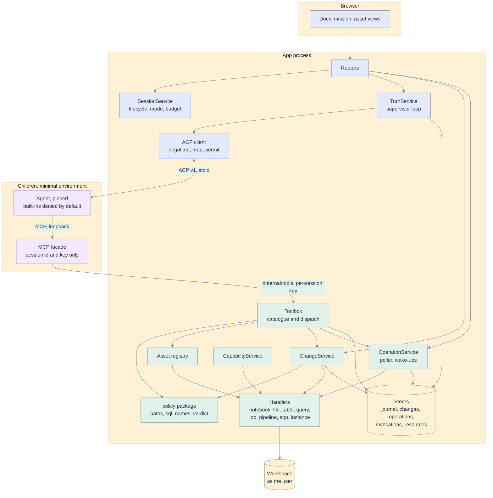
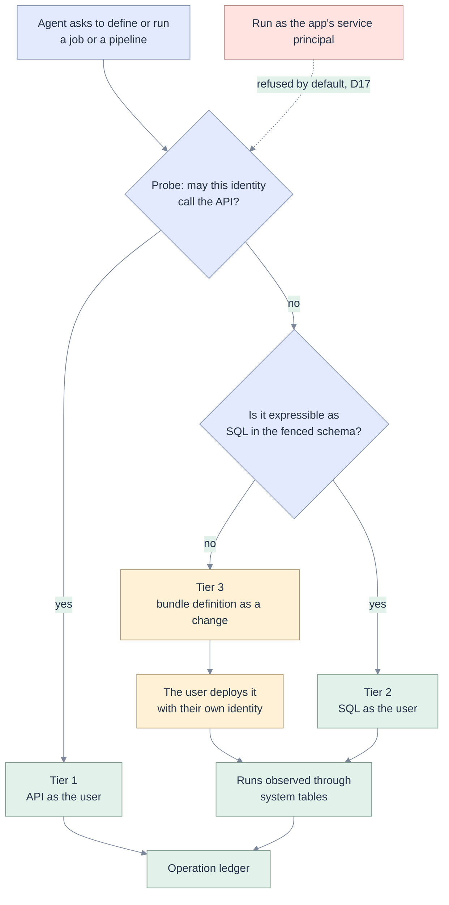
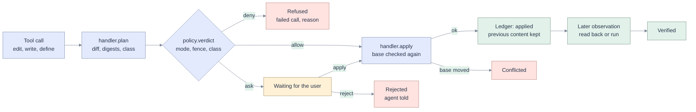

# 05 · Target architecture

[Map](README.md) · requirements: [03](03-requirements.md) · data: [06](06-data-model.md) · behaviour: [07](07-sequences-statecharts.md) · plan: [10](10-implementation-plan.md)

## The one structural move

Today the tool server is a second application: it has its own Databricks client, its own fence, its own
SQL rule, and the user's token in a file ([02](02-code-grounding.md#the-agent-path-as-built)). The app
enforces nothing on the agent's path; it watches.

The target makes **the app the single place where a tool call is decided, performed and recorded**, and
reduces the tool server to a protocol adapter.



What this buys, in the terms of the [findings](02-code-grounding.md#findings-register):

| Before | After | Closes |
|---|---|---|
| Fence configured by environment variables in a child | Fence evaluated in the app from the session row | F-01, F-02 |
| Two Databricks clients (sync in the tool file, async in `adapters/databricks`) | One, the async adapters the routes already use | F-31, F-34 |
| Three SQL rules | `policy.sql`, imported everywhere | F-05 |
| User token written to a file for a child | Token stays in the app; the facade holds a session key | F-03 |
| Evidence from the agent's description of its tools | Evidence from the app's own invocation record | F-07, F-13 |
| Writes observed after the fact | Writes are changes: planned, decided, applied, recorded | F-20 |
| Waits inside a child | Operations owned by the app | F-19, F-21 |

The facade stays a separate process in this spec. Mounting it in-process is a later, optional step
([D9](12-decisions-open-questions.md#decisions)).

## The asset contract

One vocabulary for "a thing in the workspace the agent can work on" ([AG-30](03-requirements.md#ag-30)).

```python
# domain/asset.py  (pure)
@dataclass(frozen=True, slots=True)
class AssetRef:
    kind: str   # notebook | file | table | query | job | job_run | pipeline | pipeline_update | app | instance
    id: str     # workspace path, three-part name, or native id

@dataclass(frozen=True, slots=True)
class Revision:
    token: str  # opaque: object version, definition hash, or table version. "" means "does not exist"

# ports  (interface segregation: a handler implements only what its kind supports)
class Readable(Protocol):
    async def describe(self, ref: AssetRef, who: Actor) -> Description: ...          # bounded
    async def read(self, ref: AssetRef, who: Actor, window: Window) -> Page: ...      # paged, with Revision

class Listable(Protocol):
    async def find(self, query: str, who: Actor, limit: int) -> list[Hit]: ...

class Changeable(Protocol):
    async def plan(self, ref: AssetRef, base: Revision, ops: list[Op], who: Actor) -> Plan: ...  # no write
    async def apply(self, plan: Plan, who: Actor) -> Applied: ...                    # checks base again
    async def restore(self, ref: AssetRef, expect: Revision, content: bytes, who: Actor) -> Applied: ...

class Runnable(Protocol):
    async def submit(self, ref: AssetRef, params: dict, who: Actor) -> Submitted: ...  # returns native id fast
    async def observe(self, native_id: str, who: Actor) -> Observation: ...
    async def cancel(self, native_id: str, who: Actor) -> None: ...

class Removable(Protocol):
    async def remove(self, ref: AssetRef, expect: Revision, who: Actor) -> None: ...
```

`Plan` is the value everything else is built on: the asset, the base revision, the operations, the
before and after digests, a structured diff, and an **action class** (below). A handler never decides
policy and never writes outside `apply`, `restore`, `submit`, `cancel`, `remove`.

| Kind | Readable | Listable | Changeable | Runnable | Removable | Revision is |
|---|---|---|---|---|---|---|
| notebook | yes | yes | cell operations, create | SQL cells as the user; Python by tier | yes | `object_id` and `modified_at` |
| file | yes | yes | range replace, create | no | yes | `object_id` and `modified_at` |
| table | yes (schema, sample) | yes (one catalogue query) | through SQL only | no | through SQL only | Delta version when readable |
| query | yes | yes | draft, save copy (spec 013 gates) | run statement | gated | spec 013 revision |
| job | by tier | by tier | by tier | by tier | by tier | hash of settings |
| job_run | by tier | no | no | cancel, by tier | no | state version |
| pipeline | by tier | by tier | by tier | by tier | by tier | `last_modified`, with a native conditional write |
| app | yes (status, logs) | yes | scaffold, definition | deploy, stop | yes | deployment id |
| instance | yes | no | create | SQL | yes | state |

**One registry, four consumers.** `registry.handler(kind)` is used by the Toolbox (tool catalogue), the
context resolver (attachments, replacing the `if` chain in
[services/context.py](../../apps/coding-agent/api/services/context.py)), the asset routes (views), and
the CapabilityService (probe). Adding a kind is one handler module and one registration.

## Identity tiers

"By tier" above is decision D16 in [12](12-decisions-open-questions.md#decisions). The platform gives a
Databricks App no user scope for Jobs or Pipelines (L-04 in
[14](14-live-investigation.md#workspace-facts)), so the same handler has more than one way to honour
its interface, chosen by the capability probe and never by the model.

| Tier | When | Read | Change | Run | Shown to the user as |
|---|---|---|---|---|---|
| **1. As the user, through the API** | The session's identity may call the API: every kind locally with a user token; on an app, everything except jobs and pipelines. | API | API, as a change | API, as an operation | "as you" |
| **2. As the user, through SQL** | The API is closed and the `sql` scope is open. | System tables ([AG-39](03-requirements.md#ag-39)) | SQL-defined tables in the fenced schema | Statements on the warehouse | "as you, seen through system tables" with the refresh time |
| **3. As code** | The API is closed for change and run. | Tier 2 | A bundle definition written inside the fence ([AG-38](03-requirements.md#ag-38)) | Not run: the user deploys it with their own identity | "defined, not deployed" |
| **4. As a declared run identity** | A deployment has configured a separate identity that cannot read the app's secrets ([AG-34](03-requirements.md#ag-34)). Off by default. | n/a | n/a | Run, with consent | "ran as" that identity |



Three properties make this honest and not a workaround. The tier is **shown** on the capability sheet
and on every card. The agent is **told** its tier in `dbx_capabilities`, so it reports "defined, not
deployed" and never "created". And the handler's **interface does not change**: when the platform opens
a scope, the probe moves the kind to tier 1 with no change to the Toolbox, the policy or the interface.

## The change contract



`ChangeService` is the only caller of `Changeable.apply`. It owns five rules:

1. **No base, no write** ([AG-10](03-requirements.md#ag-10)). A create is a change whose base is the empty
   revision; it fails if the asset exists. Where the workspace offers no conditional write, the revision
   is checked immediately before the write and the content is read back after it; the window that
   remains is risk R2 in [12](12-decisions-open-questions.md#risks).
2. **Decide, then perform.** The verdict is computed from the plan, never from the tool's name or the
   model's description.
3. **Keep the way back.** Before `apply`, the previous content is stored (bounded, encrypted at rest with
   the existing envelope) so `restore` is possible ([AG-17](03-requirements.md#ag-17)).
4. **One row per change**, written before the write and updated after, so a crash between them is a
   visible "unknown" and not a silent one ([state chart](07-sequences-statecharts.md#change-states)).
5. **Created resources are ledgered** at the same moment ([AG-16](03-requirements.md#ag-16)).

### How the human's answer is collected

Two channels, one decision point. Both were chosen after running the pinned agent (A-09, A-10 in
[14](14-live-investigation.md#agent-facts)).

| Channel | When | How |
|---|---|---|
| **In the protocol** (Review mode, the default) | The tool always changes something: edit, create, define, run with effect, cleanup. | The agent is configured to ask before these tools. It sends `session/request_permission` and waits, spending no tokens. The request carries the call id and an empty input; the arguments arrive on the tool-call update for the same id, so the app builds the plan from that update and shows the diff. Allow records a grant keyed by session, tool and argument digest; the tool call that follows finds the grant and applies. Reject selects the agent's `reject_once` option; the turn then ends, and the supervisor does not prompt again ([AG-18](03-requirements.md#ag-18)). |
| **By the server** (every mode) | Whether to ask depends on the arguments: a SQL statement's class, an irreversible action in Auto, a change whose previous content cannot be kept. | The tool reply is `awaiting_review` with a change id, within the 30 s bound. The agent may wait once more through `dbx_change(id, wait_seconds)`. If still undecided, the tool tells it to end the turn; the turn is *paused*, and the decision later wakes the mission ([sequence](07-sequences-statecharts.md#sequence-2-change-with-review)). |

The server is the enforcement in both: a mutating tool call with no grant and a verdict of `ask` is
never applied, whatever the agent was configured to do
([FP-4](00-five-whys-first-principles.md#first-principles)). The protocol channel exists because it is
the better experience, not because it is trusted.

## Policy

One package, pure, imported by the Toolbox, the save route, the SQL service and the UI's preview route.

```python
# domain/policy/verdict.py
class ActionClass(str, Enum):
    READ = "read"                 # no effect
    RUN_READ = "run_read"         # SELECT, validate, dry run
    CHANGE = "change"             # reversible through the ledger
    RUN_EFFECT = "run_effect"     # notebook, job, pipeline update, deploy
    IRREVERSIBLE = "irreversible" # cannot be undone by the ledger, or starts a cost that outlives the turn
    UNKNOWN = "unknown"           # could not be classified

def verdict(mode: Mode, inside_fence: bool, cls: ActionClass) -> Verdict: ...
```

| Action class | Plan | Review | Auto |
|---|---|---|---|
| read, run_read | allow | allow | allow |
| change, inside the fence | not offered | ask | allow |
| run_effect, inside the fence | not offered | ask | allow |
| irreversible, inside the fence | not offered | ask | **ask** |
| anything outside the fence | not offered | deny | deny |
| unknown | deny | deny | deny |

**Irreversible** is defined by consequence, not by keyword: `DROP`, `TRUNCATE`, `DELETE` without a
predicate, replacing a table the session did not create, `ALTER … RENAME` or `DROP COLUMN`, a pipeline
full refresh, deleting any asset the session did not create, unpausing a schedule, creating a billed
instance. The SQL part is decided on the parsed statement by `policy.sql`, which is spec 013's
[sqlpolicy.py](../../apps/coding-agent/api/domain/sqlpolicy.py) moved, not rewritten.

`policy.paths.inside(path, folder)` is today's `scope._inside`, which already rejects traversal and an
empty folder. `policy.names` holds the session prefixes. `domain/scope.py` keeps only the `Scope` value.

## Operations

`OperationService` is the only caller of `Runnable.submit`.

- **Submit** writes the ledger row in state `submitting` before the call and stores the native id after
  it. A lost response leaves `unknown` ([AG-26](03-requirements.md#ag-26)). Job runs carry an
  idempotency token and statements a comment tag derived from the operation id; both were verified on
  the workspace (L-09, L-11).
- **Repeat** is not a second run. A submit with the same session, turn, tool and argument digest as an
  unsettled operation returns that operation ([AG-27](03-requirements.md#ag-27)). This is what makes
  the agent's own timeout harmless: the model's retry finds the run it could not see.
- **Observe** is a server task per running operation: poll with backoff from 2 s to 30 s, as the user,
  while the delegated credential is valid. When it is not, the row becomes `unobserved` with the time it
  was last seen; it is not a failure.
- **Settle** writes the result digest, emits `operation.settled`, and fires at most one wake-up.
- **Wake-up** queues a system-authored turn whose context is the operation's result, through the same
  `submit` path as a user message, with a retry key derived from the operation id so it cannot fire
  twice ([AG-23](03-requirements.md#ag-23)).
- **Cancel** calls the handler and records the native confirmation.

**Thirty seconds.** The pinned agent fails any tool call at 60 s, in silence, while the tool keeps
running (A-12). Every tool therefore replies within 30 s, measured in the Toolbox with a deadline that
includes the workspace calls inside it, not by trusting each handler. The idle guard in the ACP client
keeps two limits, a tool limit while a call is in progress and the model limit otherwise
([AG-21](03-requirements.md#ag-21)); with every tool bounded it is a backstop, not the mechanism.

## The Toolbox

The catalogue the agent sees is computed, not written by hand:

`tools = registry capabilities ∩ session capability matrix ∩ mode`

A session in Plan mode with no jobs scope is offered reads and nothing else
([AG-13](03-requirements.md#ag-13), [AG-31](03-requirements.md#ag-31)). The count shown to the user is
the length of that list.

| Today | Target | Notes |
|---|---|---|
| `dbx_whoami` | `dbx_capabilities` | Identity, fence, mode, what is available and why not. |
| `dbx_list_tables`, `dbx_search_tables`, `dbx_list_notebooks` | `dbx_find(kind, query)` | One bounded query per kind. |
| `dbx_describe_table` | `dbx_describe(kind, id)` | Table schema, job definition, pipeline spec, app status. Old name kept as an alias for one release: the working agreement and the exams name it. |
| `dbx_read_notebook`, `dbx_grep_notebook` | `dbx_read`, `dbx_grep` | Return the revision with every page. |
| `dbx_write_notebook`, `dbx_write_file` | `dbx_edit(kind, id, base, ops)` and `dbx_create(kind, id, content)` | Cell and range operations. |
| `dbx_create_job` | `dbx_define(kind, name, spec, base)` | Declarative upsert for job, pipeline, app, instance. At tier 3 it writes a bundle definition inside the fence and says so. |
| `dbx_run_sql` | `dbx_run_sql` | Through spec 013's service; returns an operation when it outlasts the wait. |
| `dbx_run_notebook`, `dbx_run_job` | `dbx_run(kind, id, params)` | Always an operation. Offered only at a tier that can run. |
| `dbx_run_notebook_status`, `dbx_job_run_status` | `dbx_operation(id, wait_seconds, cancel)` | Clamped to 30 s. Reads system tables at tier 2. |
| none | `dbx_change(id, wait_seconds, undo)` | Status of a waiting change; undo. |
| none | `dbx_cleanup()` | Lists and removes what this session created. |
| `dbx_lakebase_sql`, `dbx_skill` | unchanged | |

Fifteen names instead of twenty, covering nine asset kinds. Tool descriptions are generated from the
handler docstrings, which are also the source of the capability sheet rows, so the three cannot drift.

**Evidence source.** Every dispatch writes an *invocation*: session, turn, tool, argument digest, asset,
action class, status, and a bounded digest of the real result (a hash, and the numeric and quoted tokens
of the first 64 KB). The supervisor grades claims against invocations
([AG-50](03-requirements.md#ag-50)). The agent's `tool_call` events remain what the transcript shows.

## The ACP client

| Concern | Rule | Requirement |
|---|---|---|
| Capabilities | A `Negotiated` value built once from `initialize`; every optional feature asks it. The client advertises `elicitation.form` and `session.compaction` only when their handlers exist. | [AG-40](03-requirements.md#ag-40) |
| Mapping | `MAPPERS: dict[str, Callable]` keyed by `sessionUpdate`. Unknown kinds are counted. Fields absent from an update are absent from the event: the pinned agent's completed update has no title, no kind and no input (A-05). Tool identity is `name` when sent, else `title`. An error is read from `rawOutput.error`. | [AG-42](03-requirements.md#ag-42), [AG-43](03-requirements.md#ag-43) |
| Permissions | Built from `toolCall.toolCallId` and the tool-call update that carries the arguments. Deny selects the offered `reject_once`; `cancelled` only from `cancel`. After a reject the turn is closed as declined, with no further prompt. | [AG-41](03-requirements.md#ag-41), [AG-18](03-requirements.md#ag-18) |
| Transport | `readline` errors are caught per line; the over-limit message is reported as a notice. `close` removes every map entry for the session. | [AG-47](03-requirements.md#ag-47) |
| Restore | `resume` if advertised (the pinned agent does, A-01), else `load` with the replay discarded as today. | [AG-44](03-requirements.md#ag-44) |
| Environment | Built from an allow list: `PATH`, locale, Node flags, the session's variables, and a `HOME` and configuration folders the app created. Verified to work with the pinned agent (A-13). | [AG-04](03-requirements.md#ag-04) |
| Configuration | `"*": "deny"`, `todowrite` allowed, the facade's tools allowed or asked per mode with a wildcard; verified on the pinned agent (A-08). The working folder is under an app-owned root with nothing above it to discover (A-04). In Plan mode the agent's own `mode` option is set to `plan` as well. Version read at boot and compared to a supported list. | [AG-03](03-requirements.md#ag-03), [AG-13](03-requirements.md#ag-13) |
| Fixtures | Conformance fixtures are built from the published schema and from frames recorded from the pinned agent with [tools/acp_spike_client.py](tools/acp_spike_client.py). The fake agent replays those, not a private shape. | [F-10](02-code-grounding.md#f-10) |

## Event vocabulary

Additive. The parity test between [events.py](../../apps/coding-agent/api/domain/events.py) and
[events.ts](../../apps/coding-agent/web/src/domain/events.ts) keeps both sides in step.

| New event | Payload | Emitted by |
|---|---|---|
| `capabilities.reported` | matrix, fence, tool count | CapabilityService |
| `mode.changed` | mode, by | SessionService |
| `change.proposed` | id, asset, base, class, verdict, diff summary | ChangeService |
| `change.decided` | id, decision, by | ChangeService |
| `change.applied` | id, new revision | ChangeService |
| `change.settled` | id, state (verified, reverted, conflicted, rejected, failed, unknown) | ChangeService |
| `operation.started` | id, kind, asset, ran as, native id | OperationService |
| `operation.progress` | id, state version, tasks | OperationService (coalesced) |
| `operation.settled` | id, state, result summary | OperationService |
| `question.asked`, `question.answered` | id, form, answer | ACP client |
| `commands.updated`, `config.updated`, `session.info`, `agent.notice` | as mapped | ACP client |
| `usage.updated` | used, size, cost | ACP client (corrected) |
| `budget.reached` | limit, used | TurnService |
| `turn.paused` | waiting on change or operation ids | TurnService |
| `turn.declined` | the change or tool call the owner rejected | TurnService |

`turn.retrying`, which today is emitted at the start of every turn
([orchestrator.py](../../apps/coding-agent/api/services/orchestrator.py) line 842), is renamed
`turn.running`; the old name is accepted by the reducer for stored journals.

## HTTP surface

All under the existing owner gate, which is widened to every route that takes a session id
([AG-07](03-requirements.md#ag-07)).

| Route | Purpose |
|---|---|
| `GET /api/sessions/{sid}/capabilities`, `POST …/capabilities/recheck` | Matrix |
| `POST /api/sessions/{sid}/mode` | Plan, Review, Auto |
| `GET /api/sessions/{sid}/changes?after=&limit=` | Ledger, paged |
| `GET /api/sessions/{sid}/changes/{cid}` | Plan and diff |
| `POST /api/sessions/{sid}/changes/{cid}/decision` | apply, apply_and_run, reject; idempotent by key |
| `POST /api/sessions/{sid}/changes/{cid}/undo` | Restore |
| `GET /api/sessions/{sid}/operations`, `GET …/operations/{oid}` | Runs |
| `POST …/operations/{oid}/cancel`, `POST …/operations/{oid}/wakeup` | Cancel; continue, notify or none |
| `POST /api/sessions/{sid}/questions/{qid}` | Answer or decline |
| `POST /api/sessions/{sid}/keepalive` | Refresh the delegated credential ([AG-24](03-requirements.md#ag-24)) |
| `GET /api/changes`, `GET /api/operations` | Mine, across sessions, paged |
| `GET /api/assets/{kind}`, `GET /api/assets/{kind}/{id}` | Lists and views through the handlers |
| `POST /internal/tools/{name}` | Facade to Toolbox; session id and per-session key, as `/internal/run-notebook` today |

## Module layout

```text
api/
  domain/
    asset.py  change.py  operation.py  capability.py     pure values and state machines
    policy/   paths.py  sql.py  names.py  verdict.py      the only policy
    evidence.py  supervisor.py                            grade from invocations; add PAUSE
  ports/
    assets.py  stores.py  agent.py                        split from ports/__init__.py
  services/
    sessions.py  turns.py  provisioning.py                the orchestrator, by responsibility
    toolbox.py  changes.py  operations.py  capabilities.py
  adapters/
    acp/        client.py  negotiate.py  mapper.py  permissions.py  jsonrpc.py  agent_config.py
    mcp/        facade.py  registry.py                    thin MCP process
    databricks/ handlers/ notebook.py file.py table.py query.py job.py pipeline.py app.py instance.py
    durable/    sqlite.py  postgres.py                    one contract suite for both
tools/          removed; the shell kit in /mcp stays for the tutorial and imports the vendored policy
```

## SOLID and DRY as rules

Each is a test, not a sentiment ([AG-81](03-requirements.md#ag-81), [AG-82](03-requirements.md#ag-82)).

| Principle | Rule in this codebase | Enforced by |
|---|---|---|
| Single responsibility | The orchestrator becomes `SessionService`, `TurnService`, `Provisioning`. No module above 400 lines in `services/`. | size check in `make check` |
| Open/closed | A new asset kind adds a handler; a new ACP update adds a table row; neither edits a conditional. | architecture test: no `kind ==` outside `registry` and handlers |
| Liskov | Every store and every handler passes its port's contract suite. | parametrised contract tests, as [spec 009](../009-attach-file-clipboard-support/README.md) does for blobs |
| Interface segregation | Five small handler protocols; `AgentRuntime` split into lifecycle, prompting and permission protocols. | type check |
| Dependency inversion | `services/` imports `ports/` and `domain/` only. | import-graph test |
| DRY: policy | One `inside`, one SQL classifier, one verdict table. | mutation tests: flipping each to deny makes every caller refuse |
| DRY: client | One Databricks HTTP client with retry rules. | no `httpx.Client(` outside the adapter |
| DRY: vocabulary | Tool descriptions, capability rows and the working agreement's tool names come from the registry. | generated-file check |
| DRY: tool server | One source; the shell kit vendors the policy with a drift check. | `scripts/source-drift.sh` |

## Compatibility

| Constraint | Consequence |
|---|---|
| `tests/test_llm_agent_config.py` asserts the bytes of `opencode.json` for a Databricks model, because the published scores ran on that file. | Changing permissions changes the file. The golden file is updated in the same change that re-runs the exams through the app ([AG-54](03-requirements.md#ag-54)); the two numbers are published side by side. |
| Stored journals contain today's events. | The reducer and the restore path accept every existing event type. New tables are filled forward; no backfill is required for correctness ([06](06-data-model.md#migration)). |
| The working agreement names tools. | Old names are aliases for one release, then removed with a rule update. |
| Spec 013's SQL service and gates. | Consumed as is. `dbx_run_sql` becomes a caller of it. |
