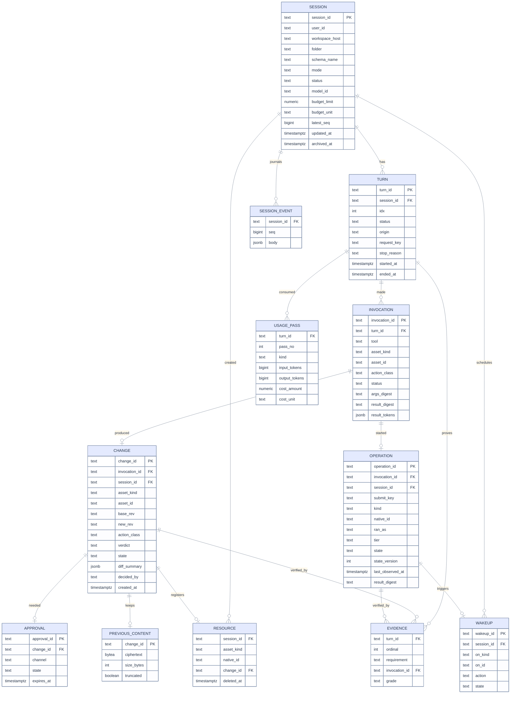

# 06 · Data model and persistence

[Map](README.md) · architecture: [05](05-architecture.md) · states: [07](07-sequences-statecharts.md) · complexity: [08](08-lenses-complexity.md#the-on-lens) · edge cases: [scale and persistence](09-edge-cases.md#scale-and-persistence)

## What exists

Two tables hold everything about a session
([004_session_journal.sql](../../apps/coding-agent/api/adapters/llm/store/migrations/004_session_journal.sql)):

| Table | Grain | Columns |
|---|---|---|
| `agent.session_snapshot` | one row per session | `session_id`, `body jsonb` (session, every turn, every call, approvals), `latest_seq` |
| `agent.session_event` | one row per event | `session_id`, `seq`, `body jsonb` |

Three properties follow, each a finding:

- The snapshot has no user column, so "my sessions" cannot be an indexed query
  ([F-29](02-code-grounding.md#f-29)).
- The snapshot is rewritten with every event ([F-28](02-code-grounding.md#f-28)).
- Changes, runs and evidence exist only as text inside events, so none can be listed, joined or undone.

The store is single-owner: one connection holds an advisory lock, and a second server refuses to start
([postgres.py](../../apps/coding-agent/api/adapters/durable/postgres.py) line 43). That is a decision of
[spec 010](../010-long-running/README.md) and stays.

On the reference workspace the store is the account's one Lakebase project, with scale-to-zero compute,
and the app itself stops 24 hours after its last start (L-13 in
[14](14-live-investigation.md#workspace-facts)). Two consequences for this model: nothing may be held
only in memory between a commit and a restart, and the first commit after an idle period may be slow
without being a failure.

## Principles for the schema

1. **The event journal is the history; tables are the state.** Events are append-only and never
   rewritten. Each table below is the current value of something the user can act on.
2. **State the grain.** Every table says what one row is.
3. **A natural key where the workspace has one.** An operation is unique by `(kind, native_id)`, so a
   resubmission cannot create a second row.
4. **Nothing secret, nothing unbounded.** Tokens are never stored. Diffs, digests and previous content
   are capped, and the cap is recorded when hit.
5. **Monotonic observation.** A row that mirrors remote state carries a `state_version`; an older
   observation never overwrites a newer one.

## Entity relationships

## Tables

All in the existing `agent` schema, added by migration `005_agent_ledgers.sql` through the existing
runner ([migrate.py](../../apps/coding-agent/api/adapters/llm/store/migrate.py)).

| Table | Grain: one row is | Keys and constraints | Indexes | Bound |
|---|---|---|---|---|
| `session` | a conversation | PK `session_id`; `mode` in (plan, review, auto) | `(user_id, updated_at desc) where archived_at is null` | title 200 chars |
| `turn` | an accepted request, from a user or a wake-up | PK `turn_id`; unique `(session_id, idx)`; unique `(session_id, request_key) where request_key <> ''` | `(session_id, idx)` | prompt stored redacted, 20,000 chars as today |
| `usage_pass` | one model pass of a turn (first, continuation, audit) | PK `(turn_id, pass_no)` | none | 8 per turn (5 continuations, 2 audits, 1 first) |
| `invocation` | one tool dispatch by the Toolbox | PK `invocation_id`; FK `turn_id` | `(turn_id)`, `(asset_kind, asset_id, started_at)` | `result_tokens` 512 entries; digest of the first 64 KB |
| `change` | one planned change to one asset | PK `change_id`; unique `invocation_id`; `state` constrained to the [state chart](07-sequences-statecharts.md#change-states) | `(session_id, created_at)`, `(asset_kind, asset_id, created_at)`, partial on `state = 'awaiting_review'` | `diff_summary` 64 KB |
| `previous_content` | what a change replaced | PK `change_id` | none | 2 MB, else `truncated` and undo is unavailable |
| `approval` | one request for a human decision | PK `approval_id`; FK `change_id` | partial on `state = 'pending'` | expires with the turn or on restart |
| `operation` | one run in the workspace | PK `operation_id`; unique `(kind, native_id) where native_id <> ''`; unique `(session_id, submit_key) where state is not terminal`, so a repeated submit finds the first ([AG-27](03-requirements.md#ag-27)) | partial on `state in ('submitting','running','unobserved')` | task list 200 entries |
| `resource` | one thing a session created | PK `(session_id, asset_kind, native_id)` | `(session_id) where deleted_at is null` | none |
| `wakeup` | one "when this settles, do that" | PK `wakeup_id`; unique `(on_kind, on_id)` | partial on `state = 'armed'` | one per change or operation |
| `evidence` | one graded claim of a turn | PK `(turn_id, ordinal)` | none | 16 per turn |
| `session_event` | one journal entry | existing PK `(session_id, seq)` | existing | deltas coalesced before insert ([AG-60](03-requirements.md#ag-60)) |

`session_snapshot` remains during migration as a cache, written on transitions only
([AG-61](03-requirements.md#ag-61)), and is no longer read at boot. `change` and `operation` carry
`session_id` as well as their invocation, so each list in the interface is a single index read.

Three columns come from the live investigation ([14](14-live-investigation.md)). `operation.submit_key`
is the digest of turn, tool and arguments. `operation.tier` records how the run was performed or
observed (API, SQL, system tables), because a state read from a system table is minutes old and the
interface must say so. A workspace object's `base_rev` and `new_rev` are the pair `object_id` and
`modified_at`, which is all the platform exposes (L-07).

### Why each index

| Query | Path | Cost |
|---|---|---|
| My sessions, newest first, page of 50 | `session (user_id, updated_at desc)` partial | index range, 50 rows |
| Stream replay after sequence n | `session_event` PK | range from n |
| Changes waiting for me | `change` partial on awaiting, joined to `session.user_id` | number waiting |
| What is running now (poller at boot) | `operation` partial on active states | number active |
| Has this asset been observed after change c | `invocation (asset_kind, asset_id, started_at)` | rows for one asset |
| What will this session leave behind | `resource (session_id)` partial | rows for one session |
| Armed wake-ups for a settled operation | `wakeup` unique `(on_kind, on_id)` | one row |

## Transactions

| Step | In one transaction | Why |
|---|---|---|
| Accept a message | `turn` insert, event insert, `session.latest_seq` | Already true today as snapshot plus event; the retry key stays atomic with acceptance. |
| Plan a change | `invocation`, `change` (state `planned`), event | The row exists before any write. |
| Apply | **two** transactions around the remote write: `applying` before, `applied` or `conflicted` or `unknown` after | The workspace is not transactional with the database. The intermediate state is what makes a crash visible. |
| Submit an operation | `submitting` before the remote call, `running` with the native id after | Same reason. |
| Decide | `approval`, `change`, event, optional `wakeup` | A decision and its consequence cannot diverge. |
| Settle an operation | `operation` (guarded by `state_version`), event, `wakeup` to `fired`, queued `turn` | A wake-up fires exactly once. |

There is no distributed transaction and none is pretended. The rule from spec 010 is kept and extended:
**an uncertain remote effect is recorded as uncertain and is never repeated automatically.**

## Retention and size

| Data | Kept | Rationale |
|---|---|---|
| Events | For the life of the session; deleted with it | The transcript is the product. |
| Previous content | 30 days or until the session is deleted | Undo is a short-term safety net, not version control. |
| Invocation result tokens | With the turn | Needed to explain a grade later. |
| Operations, changes, resources | With the session; `resource` rows outlive archive until cleaned or acknowledged | An archived session can still own a running job. |
| Wake-ups | Deleted when fired or cancelled | No value afterwards. |

Session deletion is a cascade from `session`. Archive is a flag. A size report per session (events,
previous content) feeds the operator page of [spec 010](../010-long-running/08-operations.md).

## SQLite and memory

The development and test stores implement the same store ports. The contract suite that today covers
the journal ([test_long_running.py](../../apps/coding-agent/tests/test_long_running.py)) is extended so
that every statement in the transactions table above is asserted against memory, SQLite and Postgres.
Partial indexes and `jsonb` have SQLite equivalents (`WHERE` indexes, `TEXT` with JSON functions); the
port hides the difference.

## Migration

| Step | Change | Reversible |
|---|---|---|
| 1 | Create the new tables. Nothing reads them. | Drop them. |
| 2 | Dual write: `session`, `turn` filled from the same commit that writes the snapshot. New ledgers written by the new services. | Stop writing. |
| 3 | Backfill `session` and `turn` from existing snapshots, once, idempotently by primary key. | Truncate and re-run. |
| 4 | Read the session list and boot state from `session`; hydrate a session on first use. | Flag back to snapshot reads. |
| 5 | Write the snapshot on transitions only. | Flag back to every event. |

Old sessions have no changes, operations or invocations. They show an empty ledger and their evidence as
recorded at the time; nothing is inferred after the fact.

## What stays single-owner

One server owns execution. This spec does not change that. Two choices keep the door open without
walking through it: every mutable row carries a version or a state guard, so a future per-session lease
could replace the global lock; and no table assumes that an in-memory object is the source of truth.
