# 07 · Sequences and state charts

[Map](README.md) · architecture: [05](05-architecture.md) · data: [06](06-data-model.md) · edge cases: [09](09-edge-cases.md) · tests: [11](11-test-e2e-plan.md)

Every state below is a stored value. Every transition names what causes it. A state chart is complete
when each edge case in [09](09-edge-cases.md) lands on a state drawn here; the last column of that
matrix says which.

Colour key, the same in every chart: blue is in progress, green is a good end, amber is waiting for a
person or for the workspace, red is an end that needs attention.

## Sequence 1 Session start and capability probe

The agent process is not started until the first prompt ([AG-67](03-requirements.md#ag-67)). The probe
runs first, because it decides which tools exist ([AG-31](03-requirements.md#ag-31)).

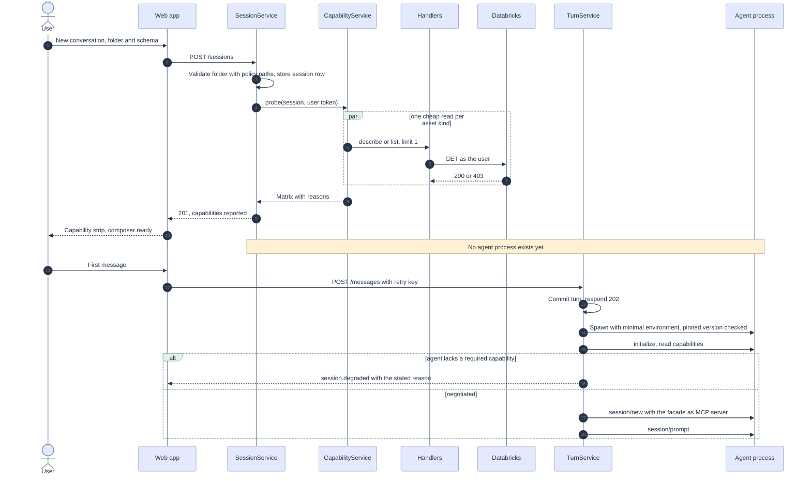

## Sequence 2 Change with review

The server channel ([05](05-architecture.md#how-the-humans-answer-is-collected)), used when the need for
a review depends on the arguments, and by any agent that does not ask in the protocol. The tool never
blocks longer than the bound; the turn pauses instead of timing out. In Review mode with the pinned
agent the ordinary path is [sequence 4](#sequence-4-permission-as-the-protocol-defines-it), which
reaches the same ChangeService.

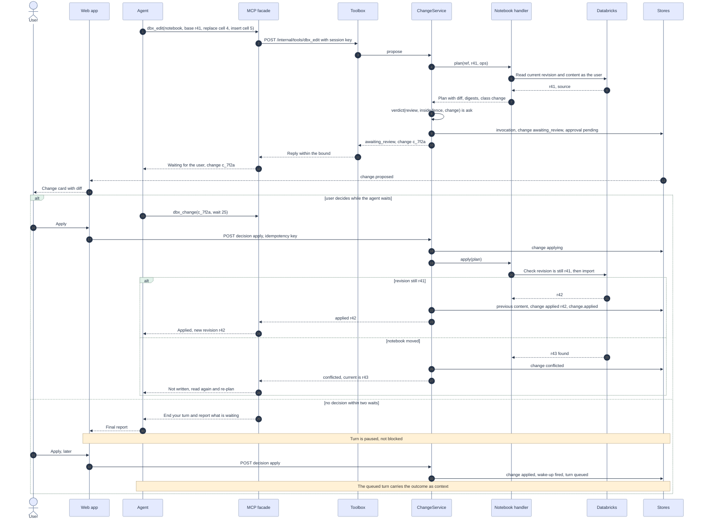

Reject is the mirror image: the change becomes `rejected`, nothing is read or written again, and the
agent is told once.

## Sequence 3 Long run with continuation

Drawn at tier 1, where the session's identity may call the Jobs API (a local token). On an app
deployment the agent cannot start the run ([identity tiers](05-architecture.md#identity-tiers)); the
observation loop is the same with one substitution: the handler reads `system.lakeflow` through the
warehouse instead of `runs/get`, and the card shows the refresh time.

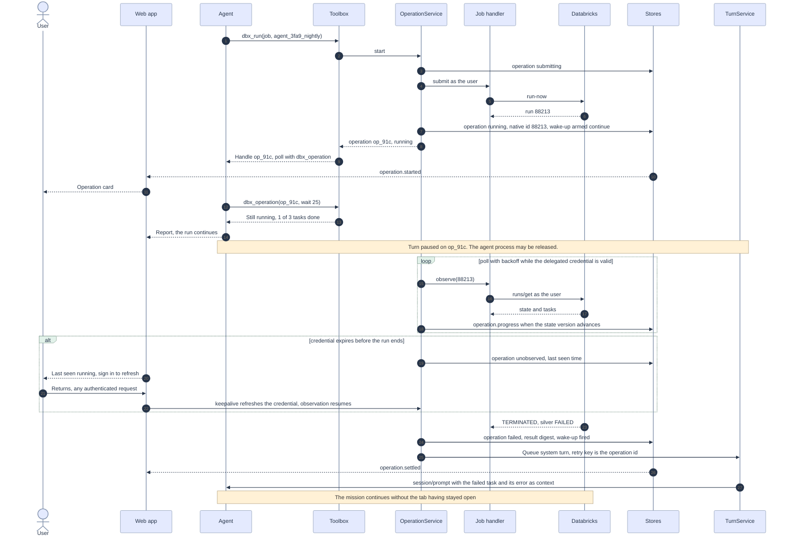

## Sequence 4 Permission as the protocol defines it

The frames are the ones the pinned agent sent (A-09, A-10 in
[14](14-live-investigation.md#agent-facts)). Two details decide the design: the request's own input is
empty and the arguments come on the tool-call update for the same id; and after a rejection the agent
ends the turn without a word.

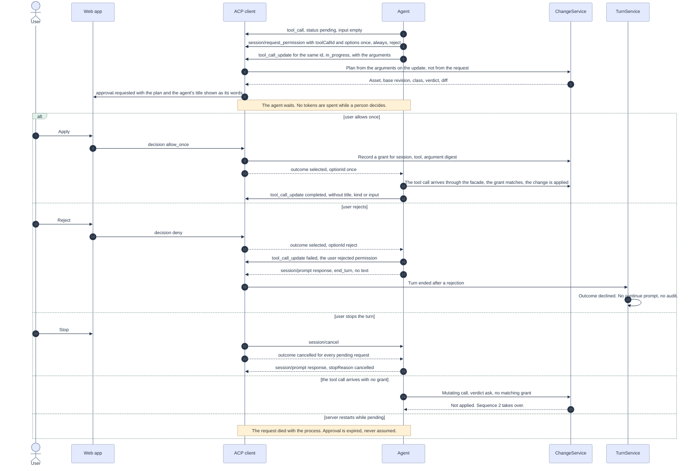

## Sequence 5 Settling a turn

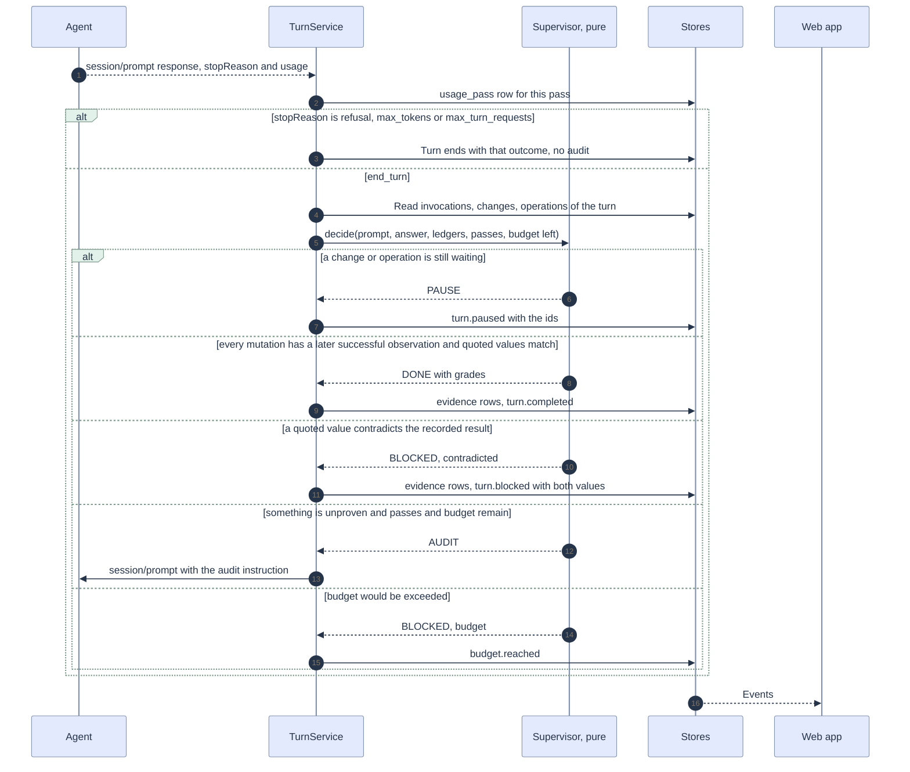

## Session and agent process states

The session outlives its agent process. Two charts, because conflating them is what made idle sessions
hold processes ([reaper.py](../../apps/coding-agent/api/domain/reaper.py)).

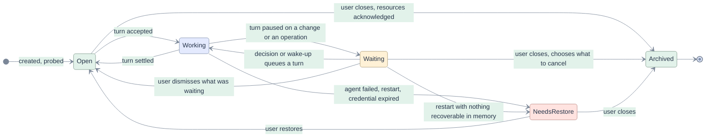

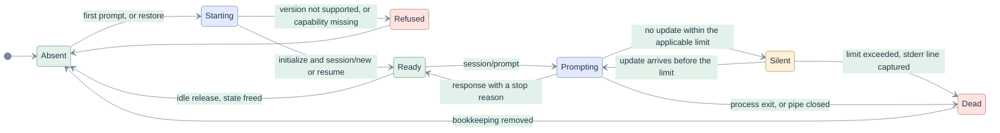

"The applicable limit" is the tool limit while a tool call is in progress, the model limit otherwise,
and unlimited while a human decision is pending ([AG-21](03-requirements.md#ag-21)).

## Turn states

Three additions to today's machine in [session.py](../../apps/coding-agent/api/domain/session.py):
`Paused`, stop reasons as distinct ends, and `Declined` for a turn the owner ended by rejecting a change.

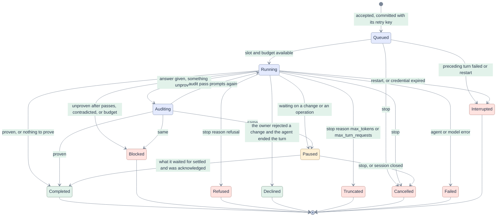

A wake-up does not resume a paused turn; it creates the next one, whose `origin` is the change or
operation. The paused turn completes when that next turn is accepted. This keeps "one prompt, one turn"
and the retry-key rule intact.

## Change states

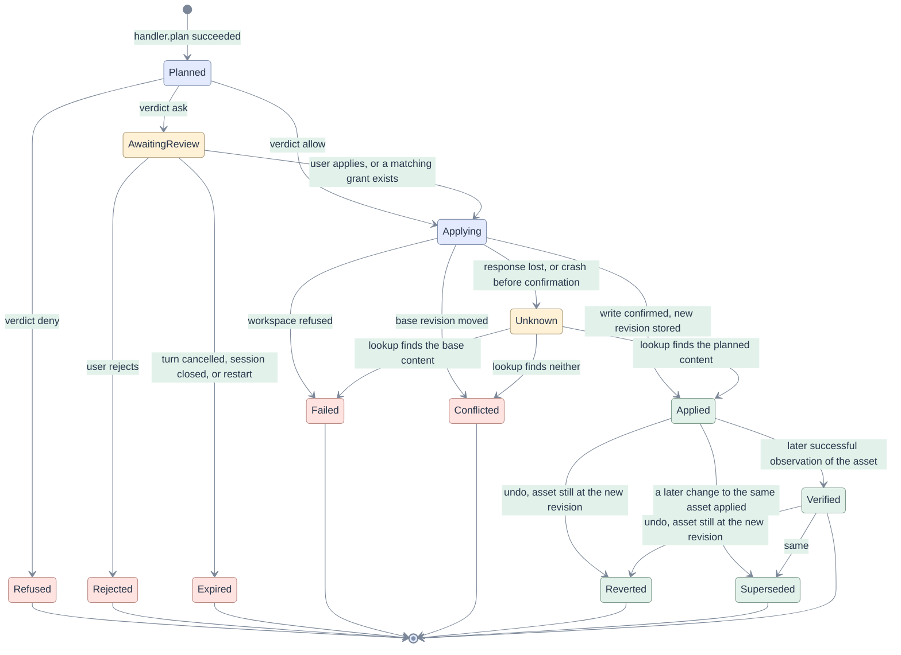

Invariants, each a test:

- Nothing is written in `Planned`, `AwaitingReview`, `Refused`, `Rejected` or `Expired`.
- `Applying` is entered at most once per change.
- `Unknown` is left only by a read, never by a second write.
- Undo from `Superseded` is refused: the asset is no longer at this change's revision.

## Operation states

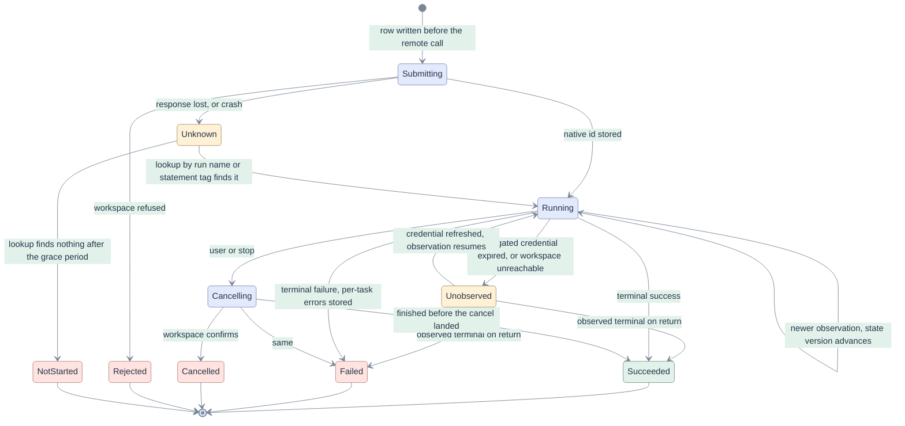

Invariants:

- A row never returns to `Submitting`. There is no automatic resubmission from any state.
- `Unobserved` is not an outcome. The interface shows the last seen state and time.
- A wake-up fires on entry to `Succeeded`, `Failed` or `Cancelled`, once.
- An observation with a lower `state_version` is dropped.

## Approval states

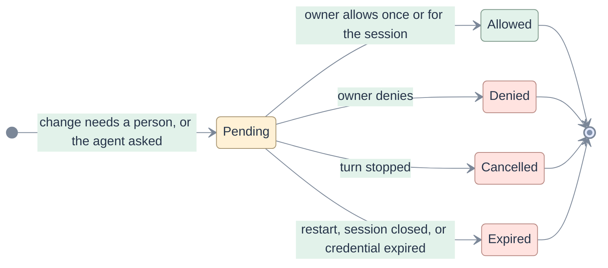

A second decision on a decided approval is a 409, as today. "For the session" is stored as a grant with
a scope the user can read (tool and asset), and it never covers the irreversible class.

## Mode and budget

| From | To | When | Effect |
|---|---|---|---|
| new session | Review | At creation | The default (D19). Sessions created before this change keep Auto, which is what they do today. |
| any mode | any mode | Between tool calls, by the owner | Tool catalogue recomputed; the agent's permission configuration regenerated and, for Plan, its own `mode` option set; the agent is told in the next tool reply; `mode.changed` recorded |
| Auto | Review | Automatically, when a change conflicts twice on the same asset in one turn | The agent is fighting a human edit; stop applying and show both |
| within budget | reached | The next pass would exceed the limit | No new pass starts; turn ends `Blocked` with reason budget; waiting changes and running operations are untouched |
| reached | within budget | Owner raises the limit | A continuation may be sent |
