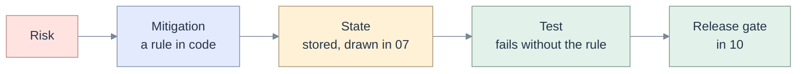

# 09 · Edge cases, mitigations and tests

[Map](README.md) · requirements: [03](03-requirements.md) · states: [07](07-sequences-statecharts.md) · tests: [11](11-test-e2e-plan.md)

## How this matrix is used

Each row is a situation that will happen, the rule that handles it, the **stored state** it must land on
(drawn in [07](07-sequences-statecharts.md)), and the test that fails without the rule. A row with no
state or no test is not finished. Test names are the names to create; the files are listed in
[11](11-test-e2e-plan.md#test-files).

Rows marked **today** reproduce a defect that exists now, with the probe from
[13](13-validation-record.md#probes). Rows marked **live** rest on an observation of the workspace
(`L-nn`) or of the pinned agent (`A-nn`) recorded in [14](14-live-investigation.md).

## Trust boundary and policy

| ID | Edge case | Mitigation | Lands on | Test |
|---|---|---|---|---|
| EC-01 | **today, P2.** The session has no schema and the agent sends `DROP TABLE main.prod.orders`. | Empty scope denies every write, in the Toolbox, from the session row ([AG-01](03-requirements.md#ag-01)). | change `Refused` | `test_policy::empty_schema_denies_each_write_verb` |
| EC-02 | **today, P1.** A path with `..`, doubled slashes, a sibling prefix (`/agentX`), or a trailing slash variant. | `policy.paths.inside` normalises and rejects traversal; one function, three callers ([AG-02](03-requirements.md#ag-02)). | change `Refused` | `test_policy::path_variants`; mutation test over the three callers |
| EC-03 | The folder chosen at session creation is `/`, `/Users`, another user's home, or a shared root. | Creation refuses anything shallower than the owner's home; a shared folder needs an explicit confirmation that is stored with the session. | session not created (422) | `test_sessions::folder_must_be_inside_owner_home` |
| EC-04 | SQL the parser cannot parse (new syntax, vendor extension). | Class `unknown`, refused with the reason and a pointer to the SQL editor. A false refusal is accepted; a false allow is not. | invocation `failed` | `test_policy::unparseable_is_refused` |
| EC-05 | A write behind a read verb: `EXECUTE IMMEDIATE`, `CALL`, a function with side effects, `COPY INTO`, `REFRESH`. | Decided on the parsed tree; anything outside the reviewed read vocabulary is `unknown` (spec 013's rule). | invocation `failed` | shared statement table, every caller |
| EC-06 | **today, P2.** `ALTER TABLE fenced.t RENAME TO other.t`, or a clone into another schema. | Every target in the statement is checked, including the destination; rename is class `irreversible`. | change `Refused` or `AwaitingReview` | `test_policy::rename_target_is_checked` |
| EC-07 | **today, P9.** A notebook body, a table comment or a file name contains the context delimiter. | A 128-bit nonce per turn in the delimiter; references escaped; the nonce pattern is stripped from data ([AG-06](03-requirements.md#ag-06)). | none (prompt assembly) | `test_context::delimiter_cannot_be_closed_by_data` |
| EC-08 | A deploy picks up an agent version outside the supported list, or one whose configuration format or tool names changed. | Exact pin with a lockfile; version read at boot; deny by default. The app serves, and says the agent is unavailable and why ([AG-03](03-requirements.md#ag-03)). | agent `Refused`, session `NeedsRestore` | `test_packaging::agent_version_is_pinned`; `test_acp::unsupported_version_is_refused` |
| EC-09 | **today.** A user sends another user's session id in a request body. | One ownership function for any session id, path or body ([AG-07](03-requirements.md#ag-07)). | 404, journal unchanged | `test_api::foreign_session_id_in_body` |

## Changes and concurrency

| ID | Edge case | Mitigation | Lands on | Test |
|---|---|---|---|---|
| EC-10 | A person saves the notebook between the agent's read and its write. | Base revision checked in `plan` and again in `apply` ([AG-10](03-requirements.md#ag-10)). Nothing is merged. | change `Conflicted` | `test_changes::stale_base_is_a_conflict` |
| EC-11 | The user has unsaved edits in the editor when an agent change applies. | The editor's existing "incoming" path: the buffer is never replaced; the user sees theirs and the new version ([EditorSurface.tsx](../../apps/coding-agent/web/src/components/EditorSurface.tsx)). | change `Applied`; editor `incoming` | `change-review-e2e::unsaved_edit_survives_agent_change` |
| EC-12 | Two changes to one asset in one turn; the second was planned against the first's base. | The second must carry the new revision or it conflicts. The first becomes `Superseded` when the second applies. | `Conflicted`, or `Superseded` then `Applied` | `test_changes::second_change_needs_new_base` |
| EC-13 | The app stops after the write was sent and before the result was stored. | The row is `Applying` before the write. At boot it becomes `Unknown`, resolved by reading the asset and comparing digests. Never by writing again. | `Unknown` then `Applied`, `Failed` or `Conflicted` | `test_changes::crash_between_write_and_record` |
| EC-14 | The decision arrives twice, or two tabs decide differently. | Idempotency key on the decision; the first committed decision wins; the other receives 409 with the decision that stands. | one of `Applying`, `Rejected` | `test_changes::concurrent_decisions_one_wins` |
| EC-15 | Apply is clicked after the turn was cancelled, the session archived, or the server restarted. | The approval is `Expired`; apply is refused with the reason; the card offers "ask again". | change `Expired` | `test_changes::expired_cannot_apply` |
| EC-16 | Undo after a person edited the asset, or after a later change. | Undo requires the asset to be at this change's new revision. | `Conflicted` (undo refused) or `Reverted` | `test_changes::undo_requires_own_revision` |
| EC-17 | The asset is deleted or renamed between plan and apply; or a create finds the name taken. | A missing base is a conflict that says "no longer exists"; a create on an existing asset fails. | `Conflicted`, `Failed` | `test_changes::deleted_or_taken` |
| EC-18 | The content to keep for undo exceeds 2 MB, or is binary. | The plan says undo is unavailable. The class becomes `irreversible`, so it asks in every mode. | `AwaitingReview` | `test_changes::no_undo_means_ask` |
| EC-19 | Cell operations address cells that moved since the read. | An operation names a cell by index **and** content hash; a mismatch is a conflict. Source-format quirks (magic lines, Jupyter JSON) are normalised by the handler and covered by the existing round-trip test. | `Conflicted` | `test_handlers_contract::cell_ops_hash_guard` |

## ACP and agent process

| ID | Edge case | Mitigation | Lands on | Test |
|---|---|---|---|---|
| EC-20 | **today, P3; live A-09.** A permission request carries only a tool call id and options; the pinned agent's request has an empty input, and the arguments are on the tool-call update for the same id. | Build the card from that update and from the server's plan; label what came from the agent ([AG-41](03-requirements.md#ag-41)). If the arguments never arrive, show the card as "arguments unknown" and offer only reject. | approval `Pending` | `test_acp_conformance::permission_as_the_pinned_agent_sends_it` |
| EC-21 | **today.** The user denies, and the agent offered no reject option. | Prefer `reject_once`. If none was offered, cancel the turn and say that the agent gave no way to refuse one action. | approval `Denied` or turn `Cancelled` | `test_acp_conformance::deny_selects_reject_or_cancels` |
| EC-22 | The agent's title says "Read file" for a call that deletes. | Asset, class and verdict are computed by the server from the input. The title is shown as the agent's words. | approval `Pending` | `test_acp_conformance::title_is_not_trusted` |
| EC-23 | Updates from a cancelled turn arrive after the next prompt was sent. | Each prompt has an epoch; an update is attributed to the epoch that was open when its tool call id first appeared; orphans are dropped and counted. | none (dropped) | `test_acp::late_update_not_attributed_to_next_turn` |
| EC-24 | **today, P5.** An update has no status, or a status the client does not know. | Absent means unchanged. Unknown is kept verbatim, treated as in progress, counted ([AG-42](03-requirements.md#ag-42)). | invocation status unchanged | `test_acp_conformance::partial_update_keeps_status` |
| EC-25 | **today, P10.** A line over the limit, a line that is not JSON, or a partial line at exit. | Each is skipped with a notice; the reader continues ([AG-47](03-requirements.md#ag-47)). | agent `Prompting` | `test_acp::oversize_line_is_survivable` |
| EC-26 | The agent sends more notifications than the queue holds while nothing is consuming. | The reader never blocks: responses are routed first; the oldest non-terminal notifications are dropped with a counter. | agent `Ready` | `test_acp::reader_never_blocks_on_full_queue` |
| EC-27 | **today.** The turn ends with `refusal`, `max_tokens` or `max_turn_requests`. | Each is its own turn outcome; none is audited or nudged ([AG-47](03-requirements.md#ag-47)). | turn `Refused` or `Truncated` | `test_turns::stop_reasons_are_distinct` |
| EC-28 | On restore, the agent has no memory of the session, or cannot resume or load. | The app's transcript stays readable; restore fails with the reason; a fresh agent session can be started on the same conversation, and the transcript says where the agent's memory restarted. | session `NeedsRestore` or `Open` | existing restore tests, plus `test_sessions::fresh_agent_on_lost_history` |
| EC-29 | The agent does not advertise `mcpCapabilities.http`. | The facade is offered over stdio instead; if neither works the session says the agent cannot reach tools ([AG-40](03-requirements.md#ag-40)). | agent `Ready` or `Refused` | `test_acp::mcp_transport_negotiated` |
| EC-30 | The model is switched across providers (agent restart) while a change is waiting. | Server-mediated changes are app-side and survive. Protocol-native requests died with the process and are `Expired`. | change `AwaitingReview`; approval `Expired` | `test_changes::waiting_change_survives_agent_restart` |
| EC-31 | **today; live A-07.** The parent process holds secrets; and built-in tools the deny list does not name are callable (`skill`, `task` on the pinned agent). | Children start from an allow-listed environment; configuration denies by default ([AG-03](03-requirements.md#ag-03), [AG-04](03-requirements.md#ag-04)). | none | `test_child_env::no_parent_secret_reaches_a_child`; `test_packaging::only_allowed_tools_are_callable` |
| EC-73 | **today, P11; live A-10.** The owner rejects a tool call. The agent marks it failed and ends the turn with no text, which today makes the supervisor send "continue the task". | A rejection in the turn closes it as declined: no continue prompt, no audit, the same call is not asked again ([AG-18](03-requirements.md#ag-18)). | turn `Declined` | `test_turns::rejection_is_not_nudged` |
| EC-74 | **live A-04.** The agent's working folder sits under a directory that holds skills, commands or an `AGENTS.md`, or its home holds a personal agent configuration. | The working folder is created under a root the app owns; the home is created by the app; a boot check walks the ancestors and refuses to start if it finds an instruction or skill file it did not write ([AG-03](03-requirements.md#ag-03)). | agent `Refused` | `test_child_env::nothing_inherited_from_ancestors_or_home` |
| EC-79 | The model call fails and the agent says nothing: a provider refusal, a quota, an unknown model id (seen in the spike as an immediate "Not Found"). | The model idle limit applies when no tool is in progress and no person is being waited for; the turn fails with the agent's own error line, as today ([AG-21](03-requirements.md#ag-21)). | agent `Silent` then `Dead`; turn `Failed` | existing idle-guard tests; `test_acp::model_error_is_named` |

## Operations and long-running work

| ID | Edge case | Mitigation | Lands on | Test |
|---|---|---|---|---|
| EC-32 | **today; live A-12.** The agent asks a tool to wait 300 s because a skill told it to. The pinned agent fails the call at 60 s while the run continues, unseen. | The wait is clamped to 30 s and the reply says so; skills and tool replies say "poll"; a lint test scans them ([AG-20](03-requirements.md#ag-20)). | operation `Running` | `test_toolbox::wait_is_clamped`; `test_packaging::no_long_wait_in_skills` |
| EC-33 | **live A-12.** The agent times out a call that the server is still performing, and the model repeats it. | The operation was recorded before the remote call. An identical submit in the same turn returns that operation, not a second run ([AG-27](03-requirements.md#ag-27)). The idle guard treats the timeout as a failed call with an unknown effect ([AG-21](03-requirements.md#ag-21)). | operation `Running`, one native run | `test_operations::repeat_after_agent_timeout` |
| EC-34 | The response to a submit is lost. | Row is `Submitting` first. Jobs carry an idempotency token; statements and runs carry a tag derived from the operation id. Lookup resolves it; nothing is resubmitted ([AG-26](03-requirements.md#ag-26)). | `Unknown` then `Running` or `NotStarted` | `test_operations::lost_submit_response` |
| EC-35 | The delegated credential expires during a run. | Observation stops, the last seen state and time are shown, and any authenticated request from the owner resumes it ([AG-24](03-requirements.md#ag-24)). | `Unobserved` | `test_operations::expiry_is_unobserved_not_failed` |
| EC-36 | The run ends while the user is away and the credential has expired. | The settle is recorded when next observed. The wake-up becomes ready, and its turn starts only when the owner is back with a valid credential; until then the mission says "waiting for you to return". | wake-up `armed`; session `Waiting` | `operations-e2e::continue_after_return` |
| EC-37 | The same settlement is seen twice (restart during settle, two observations). | State change guarded by `state_version`; wake-up unique per operation; the queued turn's retry key is the operation id. | one turn `Queued` | `test_operations::wakeup_fires_once` |
| EC-38 | Continuation loops: run fails, agent reruns, fails again. | A mission allows five automatic continuations, then pauses for a person; the budget applies throughout. | session `Waiting` | `test_operations::continuation_cap` |
| EC-39 | The user stops a turn that started runs. | Stop asks: keep them running and tracked (default), or cancel them natively ([AG-25](03-requirements.md#ag-25)). | `Running` or `Cancelling` | `operations-e2e::stop_offers_cancel` |
| EC-40 | Cancel races with completion; an older observation arrives after a newer one. | `Cancelling` may end in any terminal state; observations with a lower version are dropped. | `Cancelled`, `Succeeded` or `Failed` | `test_operations::cancel_race_and_stale_observation` |
| EC-41 | A run was started as the app and consent is withdrawn. | The run continues and stays labelled; no new run starts as the app. | `Running`, `ran_as` kept | `test_operations::consent_withdrawal` |
| EC-42 | The warehouse is stopped, or the statement is queued for minutes. | "Queued" and "starting compute" are states to show, not failures; the handle is returned at once. | `Running` (sub-state queued) | `test_operations::queued_is_not_failed` |
| EC-75 | **live L-13.** The platform stops the app (24 hours after its last start on Free Edition, or a quota) while runs are in flight and wake-ups are armed. | Nothing is held only in memory. On the next start, active operations are reconciled by native id, or through system tables at tier 2; a settled one fires its wake-up once; turns that were running are interrupted as today. | `Unobserved` then terminal; turn `Interrupted` | `test_operations::reconcile_after_app_stop` |

## Identity and capability

| ID | Edge case | Mitigation | Lands on | Test |
|---|---|---|---|---|
| EC-43 | **today; live L-04.** The agent is offered job tools on an app deployment, where no user scope for Jobs exists. | The probe finds it; the tools are not registered; the sheet says "no user scope exists for apps", which is different from "not granted" ([AG-31](03-requirements.md#ag-31)). The job kind moves to the as-code tier ([AG-38](03-requirements.md#ag-38)). | capability `as code` | `test_capabilities::missing_scope_hides_tools`; `test_capabilities::tier_is_chosen_by_probe` |
| EC-44 | A scope is granted, or revoked, during a session. | Re-check adds tools. A 403 on a tool that was available downgrades the capability once, removes the tool and tells the user. | capability updated | `test_capabilities::recheck_and_downgrade` |
| EC-45 | The user lacks a Unity Catalog privilege on a table inside the fenced schema. | The workspace's refusal is final and is shown as a permission, not as the fence. The existing rule "do not retry" stays. | invocation `failed` | `test_toolbox::permission_is_not_fence` |
| EC-46 | **today.** The agent asks to run a notebook and the only identity that can is the app's. | Refused by default, with the reason and what to do: run the SQL cells as you, or run the notebook in Databricks ([AG-34](03-requirements.md#ag-34)). Allowed only with a declared run identity. | operation `Rejected` | `test_operations::no_agent_run_as_the_app_by_default` |
| EC-47 | **live L-06.** The identity that would run model-written code can read the app's secret scope and database. | A deployment check fails the release when a declared run identity has that access. The app's own service principal is never a run identity for the agent. | deploy blocked | `verify-deployed` addition |
| EC-48 | Two users work in one shared folder. | Each session has its own fence, prefix and ledger; base revisions catch collisions; cleanup touches only its own ledger rows. | `Conflicted` on collision | `test_changes::two_sessions_one_asset` |
| EC-49 | The browser signs in as a different user. | Session routes return 404 for the other owner; the working set is already isolated by account ([workingset.ts](../../apps/coding-agent/web/src/domain/workingset.ts)). | none | existing owner tests |
| EC-76 | **live L-03.** A bundle deployment replaces the app's scopes with the shorter list in the file, removing two the agent depends on. | The file is the source of truth and is corrected; a deployment check fails when the file and the live app differ; a capability that disappears is shown on the next probe ([AG-31](03-requirements.md#ag-31)). | capability downgraded | `verify-deployed` addition; `test_capabilities::recheck_and_downgrade` |
| EC-77 | **live L-12.** Job state read from system tables is minutes old, or the user has no grant on them. | Every row shows when it was refreshed; no grant is "not readable by you", never an empty list ([AG-39](03-requirements.md#ag-39)). | operation `Unobserved` with a reason | `test_handlers_contract::system_table_tier` |
| EC-78 | The agent defines a job or pipeline as code that names a notebook, a schema or a schedule outside the fence, for the user to deploy under their own identity. | The definition is checked by the same policy before it is written: every path inside the folder, every target in the schema, names with the session prefix, schedules paused. The report says "defined, not deployed" ([AG-38](03-requirements.md#ag-38)). | change `Refused` or `AwaitingReview` | `test_changes::bundle_definition_is_fenced` |

## Evidence and cost

| ID | Edge case | Mitigation | Lands on | Test |
|---|---|---|---|---|
| EC-50 | **today, P7.** The report quotes a number that the cited call did not return. | Graded against the invocation's result tokens ([AG-50](03-requirements.md#ag-50)). | evidence `contradicted`; turn `Blocked` | `test_evidence::fabricated_value_is_contradicted` |
| EC-51 | The number is the same, written differently: separators, rounding, a percentage, a unit. | Normalise digits and separators; allow stated rounding. When equivalence cannot be decided the grade is `supported`, never `contradicted`. | evidence `supported` | `test_evidence::format_variants` |
| EC-52 | **today.** A refused or failed tool call is cited as proof. | A refusal is a failed invocation ([AG-51](03-requirements.md#ag-51)). | evidence `unverified` | `test_evidence::failed_call_proves_nothing` |
| EC-53 | **today, P7b.** The prompt is not in English, or yields no requirement. | The ledger floor applies regardless of wording ([AG-52](03-requirements.md#ag-52)). | turn `Auditing` | `test_evidence::language_independent_floor` |
| EC-54 | The result is larger than the digest window. | The grade is `supported` with "result truncated"; the tool reply suggests a narrower query. | evidence `supported` | `test_evidence::truncated_result` |
| EC-55 | Audit passes repeat the same evidence. | Existing de-duplication; pass cap; budget check before each pass. | turn `Blocked` or `Completed` | existing supervisor tests, plus budget |
| EC-56 | The agent reports no usage, or no cost. | Tokens only, cost "unknown"; a money budget cannot be set, a token budget can ([AG-56](03-requirements.md#ag-56)). | none | `test_usage::missing_cost` |
| EC-57 | The budget is crossed in the middle of a pass. | Checked before each pass and each dispatch; a pass that exceeds the limit by a tenth is cancelled ([AG-58](03-requirements.md#ag-58)). | turn `Blocked`, reason budget | `test_turns::budget_stops_before_and_during` |

## Scale and persistence

| ID | Edge case | Mitigation | Lands on | Test |
|---|---|---|---|---|
| EC-58 | The app stops inside a coalescing window. | Up to 100 ms or 2 KB of streamed text is lost; the turn is interrupted as today; tool, change and operation events are never coalesced ([AG-60](03-requirements.md#ag-60)). | turn `Interrupted` | `test_journal::coalescing_loss_is_bounded` |
| EC-59 | A 200-turn session with wide result grids. | Existing caps on rows and columns; events paged at 2,000; snapshot on transitions. | none | existing stress scenario |
| EC-60 | Ten thousand stored sessions. | Boot reads none of them; the list is an index range ([AG-62](03-requirements.md#ag-62)). | none | `test_journal::boot_is_independent_of_history` |
| EC-61 | A viewer falls behind, or misses an event on the fast path. | A gap in sequence forces a read from the journal, as the overflow rule does today ([AG-63](03-requirements.md#ag-63)). | none | existing overflow contract test, plus gap |
| EC-62 | Migration meets an old session, an unknown snapshot version, or is interrupted. | Backfill is idempotent by key; unknown versions stop the migration, not the app's other sessions; old sessions have empty ledgers. | none | `test_migrations_pg` additions |
| EC-63 | A notebook with thousands of cells. | Cell reconcile falls back to hash matching above 400 cells; the stored diff is a summary; the full diff is computed on demand and windowed. | change `Planned` | `reconcile.test.ts::large_notebook`; `test_changes::diff_summary_cap` |
| EC-64 | A metastore with a hundred thousand tables. | Search is one statement with a limit and says when it is capped ([AG-64](03-requirements.md#ag-64)). | none | `test_handlers_contract::find_is_bounded` |
| EC-65 | The journal connection is lost. | Fail closed, as today: no commit, no acceptance, running turns interrupted; a stale owner never writes. | turn `Interrupted` | existing owner-lock tests |

## User interface

| ID | Edge case | Mitigation | Lands on | Test |
|---|---|---|---|---|
| EC-66 | Two tabs show the same waiting change. | Cards update from events; the losing tab's click gets "already decided" with the outcome. | per EC-14 | `change-review-e2e::two_tabs` |
| EC-67 | The browser is offline while a change waits or a run is observed. | Remote actions are disabled with the reason; nothing is applied optimistically (the offline rule of [spec 010](../010-long-running/README.md)). | unchanged | `change-review-e2e::offline` |
| EC-68 | Reload during review or during a run. | Cards are rebuilt from the ledger routes, not parsed from transcript text. | unchanged | `operations-e2e::reload` |
| EC-69 | Long paths, long diffs, 320 px width. | Middle truncation with the full value on focus; the diff is windowed; cards collapse once decided. | none | `audit:overflow` on the new cards |
| EC-70 | A screen reader during a busy run. | Announce state changes, not progress ticks. | none | `audit:a11y` |
| EC-71 | The user opens a full diff while holding unsaved edits. | The existing draft store keeps them; the diff opens in its own tab. | none | `change-review-e2e::draft_kept` |
| EC-72 | The mode changes to Auto while a card is waiting. | A change presented for review is never applied because the mode changed; it waits for its own decision. | `AwaitingReview` | `test_changes::mode_change_does_not_apply_waiting` |

## Coverage of the state charts

Every non-terminal state must be reachable by at least one row, and every "bad" end by at least one
mitigation.

| Chart | States exercised by this matrix |
|---|---|
| [Session](07-sequences-statecharts.md#session-and-agent-process-states) | Open, Working, Waiting (EC-36, EC-38), NeedsRestore (EC-08, EC-28), Archived (EC-15) |
| [Agent process](07-sequences-statecharts.md#session-and-agent-process-states) | Refused (EC-08, EC-29, EC-74), Silent (EC-79), Dead (EC-28, EC-79), Prompting (EC-25) |
| [Turn](07-sequences-statecharts.md#turn-states) | Paused (EC-36), Refused and Truncated (EC-27), Declined (EC-73), Blocked (EC-50, EC-57), Interrupted (EC-58, EC-65, EC-75), Cancelled (EC-21) |
| [Change](07-sequences-statecharts.md#change-states) | Refused (EC-01, EC-02), AwaitingReview (EC-18, EC-72), Conflicted (EC-10, EC-17, EC-19), Unknown (EC-13), Expired (EC-15), Superseded (EC-12), Reverted (EC-16) |
| [Operation](07-sequences-statecharts.md#operation-states) | Unknown and NotStarted (EC-34), Unobserved (EC-35, EC-75, EC-77), Cancelling (EC-40), Rejected (EC-46) |
| [Approval](07-sequences-statecharts.md#approval-states) | Denied (EC-21), Cancelled (EC-21), Expired (EC-15, EC-30) |
