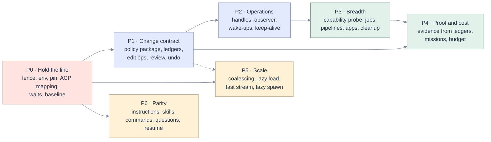

# 10 · Implementation plan

[Map](README.md) · requirements: [03](03-requirements.md) · architecture: [05](05-architecture.md) · tests: [11](11-test-e2e-plan.md) · decisions and spikes: [12](12-decisions-open-questions.md)

## Rules of the plan

1. **Measure before changing what the agent sees.** The first task produces a baseline score through the
   app. Every later change to tools, rules or agent configuration is compared against it
   ([FP-11](00-five-whys-first-principles.md#first-principles)).
2. **Trust before breadth.** No new asset kind ships on the present fence.
3. **Each task is a vertical slice with its test.** A task is done when its test fails on the parent
   commit and passes on the task's commit.
4. **Each phase is behind a setting**, in the style of the existing `sql_run` and `sql_create`
   ([config.py](../../apps/coding-agent/api/config.py)), default off until its gate passes.
5. **No behaviour is removed without an alias or a migration**, and the alias has a removal task.

Sizes are relative: **S** a day or two for one person, **M** about a week, **L** more than a week. They
are judgements from reading the code, not measurements.

**Revised after the live investigation** ([14](14-live-investigation.md)). Spikes S1, S2 and S3 are
answered, so tasks 0.3, 1.4 and 3.1 no longer wait on them. Four small tasks joined P0 (0.10 to 0.12,
and more in 0.3), and the jobs and pipelines work in P3 is now built around the identity tiers of
[05](05-architecture.md#identity-tiers).

## Phases and dependencies

Three tracks can run in parallel after P0: **trust and change** (P1 → P4), **capability** (P2 → P3),
**scale and parity** (P5, P6). P5's journal work touches the same commit path as P1's ledgers, so its
first task waits for P1's store ports.

## P0 Hold the line

No new capability. Every task closes a defect that exists today. Setting: none; these are fixes.

| # | Task | Where | Size | Closes | Test |
|---|---|---|---|---|---|
| 0.0 | **Baseline through the app.** A driver that runs a mission by `POST /sessions`, `POST /messages`, and reads `/events`, reusing the missions and graders. Run it once on the current tree with the default model and store the result. | `exams/run_exam.py` (new `--via app`), `exams/lib.py` | M | [F-27](02-code-grounding.md#f-27) | the stored run file; grader self-checks unchanged |
| 0.1 | Fence fails closed in the tool file, as an interim patch: empty schema denies writes; paths are normalised, traversal rejected; `/` is no folder. | [tools](../../apps/coding-agent/tools/databricks_notebook_mcp.py) lines 213 to 243; [registry.py](../../apps/coding-agent/api/adapters/mcp/registry.py) | S | [F-01](02-code-grounding.md#f-01), [F-02](02-code-grounding.md#f-02) | `test_tool_fence.py` (probes P1, P2 as tests) |
| 0.2 | Children start from an allow-listed environment, with a `HOME` and configuration folders the app created. Verified feasible on the pinned agent (A-13). | [runtime.py](../../apps/coding-agent/api/adapters/acp/runtime.py) line 45; registry line 52 | S | [F-03](02-code-grounding.md#f-03), part of [F-40](02-code-grounding.md#f-40) | `test_child_env.py` |
| 0.3 | Pin the agent: exact version, lockfile, build fails without it; version checked at start. Configuration becomes `"*": "deny"` with `todowrite` and the tool server's tools allowed by wildcard, verified on the pinned agent (A-08). Every session gets its own folder under an app-owned root, even when `APP_AGENT_CWD` is set, and a boot check refuses a root with instruction or skill files above it. | [package.json](../../apps/coding-agent/package.json), [prepare-app.sh](../../apps/coding-agent/scripts/prepare-app.sh), [agent_config.py](../../apps/coding-agent/api/adapters/acp/agent_config.py), runtime `start`, orchestrator `_provision` | M | [F-04](02-code-grounding.md#f-04), [F-36](02-code-grounding.md#f-36), [F-40](02-code-grounding.md#f-40) | `test_packaging.py`, `test_llm_agent_config.py` (golden file updated with the baseline, see [compatibility](05-architecture.md#compatibility)); a real-agent check that `skill` and `task` are not callable |
| 0.4 | ACP mapping as specified and as the pinned agent sends it: a table of mappers; permission from `toolCall.toolCallId` and the tool-call update that carries the arguments; deny selects the reject option; `usage_update` shape; partial updates; `name` else `title`; error from `rawOutput`; structured `diff`; unknown kinds counted. Conformance fixtures from the published schema and from frames recorded with [the spike client](tools/acp_spike_client.py); the fake agent replays them. | [mapper.py](../../apps/coding-agent/api/adapters/acp/mapper.py), runtime `_on_permission`, orchestrator `approve`, [fake agent](../../apps/coding-agent/api/adapters/fake/agent.py), `scenarios/approval.json` | M | [F-10](02-code-grounding.md#f-10), [F-11](02-code-grounding.md#f-11), [F-12](02-code-grounding.md#f-12), [F-13](02-code-grounding.md#f-13), [F-14](02-code-grounding.md#f-14), [F-41](02-code-grounding.md#f-41) | `test_acp_conformance.py` (probes P3 to P6b, P12, P13 as tests) |
| 0.5 | Transport survives bad lines; `close` frees every map; dead code removed; stop reasons become distinct turn outcomes. | [jsonrpc.py](../../apps/coding-agent/api/adapters/acp/jsonrpc.py), runtime `close`, [session.py](../../apps/coding-agent/api/domain/session.py), [events.py](../../apps/coding-agent/api/domain/events.py), [events.ts](../../apps/coding-agent/web/src/domain/events.ts) | M | [F-15](02-code-grounding.md#f-15), [F-17](02-code-grounding.md#f-17), [F-37](02-code-grounding.md#f-37) | `test_acp.py` (probe P10); `test_event_parity.py` |
| 0.6 | Waits clamped to 30 s, half the agent's own 60 s limit (A-12); `dbx_run_sql` waits 20 s and returns the statement id it now discards; skill and tool replies say "poll"; idle guard uses a tool limit while a call is in progress; a refusal raises, so the call is failed. | tools `_wait_run`, `dbx_run_sql`, `dbx_create_job` reply; [etl-pipelines.md](../../apps/coding-agent/tools/skills/etl-pipelines.md); runtime `events` | S | [F-19](02-code-grounding.md#f-19), part of [F-07](02-code-grounding.md#f-07), part of [F-21](02-code-grounding.md#f-21) | `test_tool_waits.py`; scripted `slow-tool` scenario |
| 0.7 | Nonce delimiters and escaped references in attached context. | [context.py](../../apps/coding-agent/api/domain/context.py) `render` | S | [F-06](02-code-grounding.md#f-06) | `test_context.py` (probe P9) |
| 0.8 | One ownership function for any session id; used by save and materialise. | [main.py](../../apps/coding-agent/api/main.py), [api.py](../../apps/coding-agent/api/routers/api.py) `_save_scope` | S | [F-09](02-code-grounding.md#f-09) | `test_api.py` addition |
| 0.9 | Usage is the sum of a turn's passes; tool count comes from the server's list. | orchestrator `_settle`, `_nudge`, `TOOL_COUNT_CORE` | S | part of [F-12](02-code-grounding.md#f-12), [F-26](02-code-grounding.md#f-26) | `test_usage.py` |
| 0.10 | The agent no longer runs code as the app's service principal: the run bridge is not offered to the tool server unless a separate run identity is declared. The administrators' Run button is unchanged. | [run_bridge.py](../../apps/coding-agent/api/services/run_bridge.py), [registry.py](../../apps/coding-agent/api/adapters/mcp/registry.py), [config.py](../../apps/coding-agent/api/config.py), tools `dbx_run_notebook` | S | [F-08](02-code-grounding.md#f-08) | `test_operations.py::no_agent_run_as_the_app_by_default`; deployment check |
| 0.11 | A rejection ends the turn: when a permission was rejected in the turn and the agent stopped without text, the turn closes as declined and the supervisor is not consulted. | orchestrator `_settle`, [supervisor.py](../../apps/coding-agent/api/domain/supervisor.py), [session.py](../../apps/coding-agent/api/domain/session.py) | S | [F-38](02-code-grounding.md#f-38) | `test_turns.py::rejection_is_not_nudged` (probe P11) |
| 0.12 | The bundle declares the scopes the app holds (`postgres`, `apps` added); the deployment check compares the file with the live app. | [databricks.yml](../../databricks.yml), `scripts/verify-deployed.sh` | S | [F-39](02-code-grounding.md#f-39) | deployment check |

**Gate P0.** `make check` green. Every probe in [13](13-validation-record.md#probes) now has a test
asserting the corrected behaviour. The scripted browser run of a permission shaped as the pinned agent
sends it shows the tool, its target and its input. The spike in [tools](tools) is re-run against the
new configuration: `skill` and `task` are not callable, a 30 s wait returns, and a rejected call is not
asked again. The baseline (0.0) is re-run after 0.3 and 0.6; a drop beyond the measured noise blocks
the phase.

## P1 The change contract

Setting: `APP_CHANGES`. Off: the agent keeps the present write tools, on the patched fence.

| # | Task | Where | Size | Closes | Test |
|---|---|---|---|---|---|
| 1.1 | `domain/policy/`: move `sqlpolicy`, move `scope._inside`, add `names` and the verdict table; delete the unused SQL rules in `scope.py`; the tool file imports the policy. | `api/domain/policy/`, [scope.py](../../apps/coding-agent/api/domain/scope.py), [sqlpolicy.py](../../apps/coding-agent/api/domain/sqlpolicy.py) | M | [F-05](02-code-grounding.md#f-05) | `test_policy.py`; mutation tests across callers |
| 1.2 | Store ports and migration 005: `session`, `turn`, `invocation`, `change`, `previous_content`, `approval`, `resource`. Dual write from the existing commit. | `api/ports/stores.py`, `api/adapters/durable/`, `migrations/005_agent_ledgers.sql` | L | groundwork | `test_stores_contract.py` on memory, SQLite, Postgres |
| 1.3 | Asset contract; notebook and file handlers (read, plan, apply, restore) on the existing workspace adapter. | `api/domain/asset.py`, `api/ports/assets.py`, `api/adapters/databricks/handlers/` | L | part of [F-20](02-code-grounding.md#f-20) | `test_handlers_contract.py` |
| 1.4 | `ChangeService`, the Toolbox, `POST /internal/tools/{name}`; tools `dbx_edit`, `dbx_create`, `dbx_change`; mode on the session and `POST /mode`, default Review for new sessions. In Review the generated agent configuration asks before each mutating tool, an approval records a grant, and the Toolbox applies only with a grant (decision D3, verified possible in A-09). | `api/services/changes.py`, `toolbox.py`, `routers/internal.py`, `agent_config.py` | L | [F-20](02-code-grounding.md#f-20) | `test_changes.py`, `test_toolbox.py`; real-agent check with `opencode.ask.json` |
| 1.5 | MCP facade process: forwards the new tools to the app; still hosts the legacy read tools until P3. | `api/adapters/mcp/facade.py`, registry | M | part of [F-34](02-code-grounding.md#f-34) | `test_facade.py` |
| 1.6 | Interface: change card, diff, Changes tab, mode control, undo; events and reducer. | `web/src/components/changes/`, `domain/events.ts`, `Composer.tsx`, `MissionScreen.tsx` | L | [AG-12](03-requirements.md#ag-12) to [AG-17](03-requirements.md#ag-17) | `change-review-e2e.mjs`; unit tests for the reducer |
| 1.7 | Split the orchestrator: `Provisioning`, `SessionService`, `TurnService`, with no behaviour change; import-graph test. | [orchestrator.py](../../apps/coding-agent/api/services/orchestrator.py) | M | [F-35](02-code-grounding.md#f-35) | existing suite unchanged; `test_architecture.py` |
| 1.8 | Working agreement and slash templates: edit by operations with a base revision; remove "write a copy". | `agent_config.py`, [commands.ts](../../apps/coding-agent/web/src/domain/commands.ts), skills | S | [F-24](02-code-grounding.md#f-24) in part | exam M4 through the app |

**Gate P1.** In Review mode nothing is written before a decision (asserted on the workspace double). A
60-cell notebook edit sends one cell. Conflict, undo, expiry and crash-between rows of
[09](09-edge-cases.md#changes-and-concurrency) pass. Exams M3 and M4 through the app are within noise of
the baseline. With the real agent, a rejected change is not asked again and an approved one is applied
once.

## P2 Operations

Setting: `APP_OPERATIONS`.

| # | Task | Where | Size | Closes | Test |
|---|---|---|---|---|---|
| 2.1 | `operation` and `wakeup` tables; `OperationService` with submit, observe, settle, cancel; observer task with backoff; a repeated submit returns the existing operation; idempotency token on job runs and a comment tag on statements (both verified, L-09, L-11). | `api/services/operations.py`, `domain/operation.py`, stores | L | [F-19](02-code-grounding.md#f-19) | `test_operations.py` |
| 2.2 | `dbx_run_sql` through spec 013's service: handle, total rows, cancel, paged result. | [sql_service.py](../../apps/coding-agent/api/services/sql_service.py), Toolbox | M | [F-21](02-code-grounding.md#f-21) | `test_toolbox.py`; `sql-query-e2e.mjs` addition |
| 2.3 | Notebook and job runs as operations: `dbx_run`, `dbx_operation`. | handlers `notebook.py`, `job.py` (run only) | M | [AG-22](03-requirements.md#ag-22) | `test_handlers_contract.py` |
| 2.4 | Keep-alive route; the turn deadline follows the credential; `Unobserved`. | `routers/api.py`, `TurnService`, web stream hook | M | [F-33](02-code-grounding.md#f-33) | `test_long_running.py` additions with a controlled clock |
| 2.5 | Wake-ups, `Paused` turns, the supervisor's `PAUSE` verdict, the continuation cap. | [supervisor.py](../../apps/coding-agent/api/domain/supervisor.py), `TurnService` | M | [AG-23](03-requirements.md#ag-23) | `test_operations.py`, `test_domain.py` |
| 2.6 | A declared run identity (off by default): a `Runnable` adapter for an identity that is not the app's service principal, with consent per session, `ran_as` on the operation, and a deployment check that it cannot read the app's secret scope or database. Needs spike S13; without it this task ships only the port and the check. | [run_bridge.py](../../apps/coding-agent/api/services/run_bridge.py), `verify-deployed.sh` | M | [AG-34](03-requirements.md#ag-34) | `test_operations.py`; deploy check |
| 2.7 | Interface: operation card, Runs list, stop dialog, "last seen". | `web/src/components/operations/` | M | [AG-22](03-requirements.md#ag-22), [AG-25](03-requirements.md#ag-25) | `operations-e2e.mjs` |

**Gate P2.** A scripted ten-minute job completes with every tab closed, the result is present on return,
and the mission continues when asked to. A restart during the run loses nothing and resubmits nothing.
Token expiry yields `Unobserved`, not failure.

## P3 Breadth

Setting: `APP_ASSETS` with one sub-setting per kind, so a kind ships when its handler passes.

| # | Task | Where | Size | Closes | Test |
|---|---|---|---|---|---|
| 3.1 | `CapabilityService`: probe, matrix with a tier per kind, computed catalogue, re-check, downgrade on 403; capability sheet that tells "not granted" from "no such scope for apps". The scope list is known (L-04). | `api/services/capabilities.py`, `domain/capability.py`, web sheet | M | [F-18](02-code-grounding.md#f-18) | `test_capabilities.py`, `capability-e2e.mjs` |
| 3.2 | Job handler at three tiers behind one interface: the Jobs API where the identity allows it (definition, declarative upsert, task types, repair, pause, delete); a bundle definition inside the fence where it does not; runs read from `system.lakeflow` in either case when the API is closed. Job and run views; attach a run. | `handlers/job.py`, `handlers/bundle.py`, `web/src/components/assets/JobView.tsx` | L | [F-22](02-code-grounding.md#f-22), [AG-38](03-requirements.md#ag-38), [AG-39](03-requirements.md#ag-39) | contract suite at each tier; exam X2 through the app locally (API tier) and with the API closed (as-code tier) |
| 3.3 | Pipeline handler at the same tiers: definition, source files, validate, update with `expected_last_modified`, event log; or source files and definition as code, updates read from `system.lakeflow`. View. If spike S9 passes, add SQL-defined scheduled tables as the as-you tier. | `handlers/pipeline.py`, `PipelineView.tsx` | L | [F-22](02-code-grounding.md#f-22) | contract suite; new mission |
| 3.4 | App handler: scaffold, deploy, status, logs, stop, delete; view. | `handlers/app.py`, `AppView.tsx` | M | [F-22](02-code-grounding.md#f-22) | contract suite; exam M6 through the app |
| 3.5 | Table handler with one-query search; query handler over spec 013. | `handlers/table.py`, `handlers/query.py` | M | [F-31](02-code-grounding.md#f-31) | contract suite |
| 3.6 | Attachments resolved by the registry; resource ledger; cleanup tool and archive dialog. | [services/context.py](../../apps/coding-agent/api/services/context.py), `ChangeService`, web | M | [F-23](02-code-grounding.md#f-23), [AG-16](03-requirements.md#ag-16) | `test_context.py`, `test_changes.py`, `assets-e2e.mjs` |
| 3.7 | Remove the legacy tool file from the app and the token file; old tool names become aliases with a removal date. | `tools/`, registry, orchestrator `_write_token` | M | [F-34](02-code-grounding.md#f-34) | `test_packaging.py`; full exam run |

**Gate P3.** Adding the last kind touched no file in `services/`, `policy/` or the reducer (checked in
review against the [vertical slice](08-lenses-complexity.md#full-stack-developer)). With the Jobs API
closed, no job tool that needs it is advertised, a job definition is delivered as a bundle that
validates, the report says "defined, not deployed", and the job view shows runs from system tables with
their refresh time. Exams M5, M6 and X2 pass through the app at the tier each deployment has.

## P4 Proof and cost

Setting: `APP_EVIDENCE_V2`.

| # | Task | Where | Size | Closes | Test |
|---|---|---|---|---|---|
| 4.1 | Evidence from invocations: result digests at dispatch, four grades, the language-independent floor. | [evidence.py](../../apps/coding-agent/api/domain/evidence.py), supervisor, Toolbox | L | [F-07](02-code-grounding.md#f-07), [F-25](02-code-grounding.md#f-25) | `test_evidence.py` (probes P7, P7b as tests) |
| 4.2 | New missions: long-notebook edit, job repair, pipeline fix, long run with continuation, saved query, cleanup. | `exams/missions/` | L | [AG-55](03-requirements.md#ag-55) | each grader's reference and do-nothing checks |
| 4.3 | Meter and budget: context, tokens, money; pre-pass and pre-dispatch checks. | `TurnService`, Composer, mission header | M | [F-12](02-code-grounding.md#f-12) | `test_turns.py`, `test_usage.py`, browser check |
| 4.4 | Publish both numbers, kit and app, with the path named; the site's claim checker reads the new run files. | `exams/make_tables.py`, `site/claims.py` | S | [F-27](02-code-grounding.md#f-27) | `site/check.py` |

**Gate P4.** A fabricated value is shown as contradicted with both numbers. A non-English mutating
request cannot complete unproven. The full suite through the app is recorded for at least two models.

## P5 Scale

Setting: `APP_JOURNAL_V2` for the commit path; the rest are safe to ship directly.

| # | Task | Where | Size | Closes | Test |
|---|---|---|---|---|---|
| 5.1 | Coalesce message and thought deltas before commit; snapshot on transitions only. | `TurnService._emit`, stores | M | [F-28](02-code-grounding.md#f-28) | `test_journal.py`; `stream-stress.mjs` with a commit counter |
| 5.2 | Lazy hydration; session list from the `session` table; archived sessions evicted from memory. | `SessionService`, routers | M | [F-29](02-code-grounding.md#f-29) | `test_journal.py` |
| 5.3 | Stream fast path with gap detection; a read connection separate from the owner connection. | `routers/api.py` `stream`, [postgres.py](../../apps/coding-agent/api/adapters/durable/postgres.py) | M | [F-30](02-code-grounding.md#f-30) | existing overflow contract plus gap |
| 5.4 | Agent process on first prompt. | `Provisioning`, `SessionService` | S | [AG-67](03-requirements.md#ag-67) | `test_reaper.py`, `test_sessions.py` |
| 5.5 | Browser: index maps in the reducer; windowed transcript and ledgers; reconcile cap. | `events.ts`, `Transcript.tsx`, `reconcile.ts` | M | [F-32](02-code-grounding.md#f-32) | unit tests; `stream-stress.mjs` |
| 5.6 | Export cache per revision per turn in the notebook handler. | `handlers/notebook.py` | S | part of [F-31](02-code-grounding.md#f-31) | `test_handlers_contract.py` |

**Gate P5.** Commits per second during a long answer stay under the target at turn 1 and at turn 150.
Boot time is flat across three orders of magnitude of stored sessions. Spec 010's recovery suite is
unchanged and green.

## P6 Parity

| # | Task | Where | Size | Closes | Test |
|---|---|---|---|---|---|
| 6.1 | Instruction files and `AGENTS.md` discovery, capped, placed below the safety rules. | `Provisioning`, file handler | M | [AG-70](03-requirements.md#ag-70) | `test_instructions.py` including an instruction to ignore the fence |
| 6.2 | Skills from the standard folders through `dbx_skill`. | Toolbox, file handler | S | [AG-71](03-requirements.md#ag-71) | `test_toolbox.py` |
| 6.3 | Commands from the agent and from skills in the slash menu. | mapper, `commands.ts`, Composer | S | [F-24](02-code-grounding.md#f-24) | reducer and Composer tests |
| 6.4 | Elicitation: advertise, render, answer, decline, expire. | ACP client, question card | M | [AG-46](03-requirements.md#ag-46) | `test_acp_conformance.py`; browser check |
| 6.5 | `session/resume` when advertised; session information, compaction and notices shown. | ACP client, transcript | S | [F-16](02-code-grounding.md#f-16) | `test_acp.py` |

## Definition of done, for any task

- A test that fails without the change, named in the edge-case matrix or the traceability table.
- No new module in `services/` that imports from `adapters/`.
- No second implementation of a rule that exists in `policy/`.
- New events added on both sides, parity test green.
- Copy reviewed against the [state copy table](04-ux-wireframes.md#copy-for-the-states-that-matter).
- `make check` green; the relevant browser script green; for agent-facing changes, the affected exams
  re-run through the app and compared with the baseline.

## What not to do

| Temptation | Why not |
|---|---|
| Add jobs and pipelines to the present tool file first | It multiplies [F-01](02-code-grounding.md#f-01), [F-05](02-code-grounding.md#f-05) and [F-19](02-code-grounding.md#f-19) across new verbs. |
| Rely on the agent's permission configuration for review | Safety would depend on a floating third-party format ([F-04](02-code-grounding.md#f-04)). |
| Use a model to judge "done" | A deterministic floor exists and is cheaper; a judge can be added above it, never instead of it. |
| Retry a submit that timed out | The repository's own rule: an uncertain effect is never repeated ([spec 010](../010-long-running/README.md)). |
| Backfill changes from old transcripts | It would invent a ledger from text the agent wrote. |
| Pool agent processes across users | It trades a measured-zero risk for an unmeasured gain ([D9](12-decisions-open-questions.md#decisions)). |
| Run the agent's code, or create its jobs, as the app's service principal because no user scope exists | That identity reads the key that protects every user's credentials, and every user would share its data access ([D16, D17](12-decisions-open-questions.md#decisions)). |
| Raise a tool's wait because the app's guard allows it | The agent's own limit is 60 s and is not ours to move ([A-12](14-live-investigation.md#agent-facts)). |
