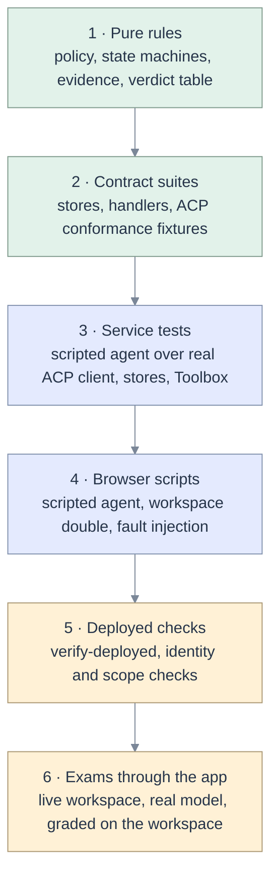

# 11 · Test and end-to-end plan

[Map](README.md) · requirements: [03](03-requirements.md) · edge cases: [09](09-edge-cases.md) · plan: [10](10-implementation-plan.md)

## What the existing suite proves, and what it cannot

The repository has 559 Python test functions in 32 test modules, a Vitest suite for the front-end
domain, and 67 browser scripts under
[web/scripts](../../apps/coding-agent/web/scripts), most driven by the scripted agent
([fake/agent.py](../../apps/coding-agent/api/adapters/fake/agent.py)). It is a strong suite for the
interface and for recovery.

It has one structural blind spot, which is the reason five protocol defects are green today: **the
scripted agent defines the dialect the client is tested against.** The permission fixture and the unit
test share a shape that the protocol does not have
([F-10](02-code-grounding.md#f-10)). A second blind spot: nothing tests the path the exams measure,
because the exams do not use the app ([F-27](02-code-grounding.md#f-27)).

The plan below adds four things: conformance fixtures that come from outside the repository, a small
check against the real agent, contract suites for the new ports, and the exam suite driven through the
app.

## The real-agent check

The live investigation ([14](14-live-investigation.md#agent-facts)) found behaviours of the pinned
agent that no scripted test could have found, because the scripted agent was written from an
assumption. The scripts that found them are kept in [tools](tools) and become a check that runs
whenever the agent version or its generated configuration changes. It needs the agent binary and one
model credential, costs about a cent, and touches no workspace.

| Check | Configuration | Passes when |
|---|---|---|
| Only allowed tools are callable | generated configuration | the model lists the tool server's tools and `todowrite`, and nothing else |
| A mutating tool asks | Review configuration | a permission request arrives; the arguments are on the tool-call update for the same id |
| A rejection is final | Review configuration, reject | the call is failed, the turn ends, and the app sends no further prompt |
| A bounded wait returns | any | a 30 s tool returns; the frames are recorded as fixtures |
| Usage is reported | any | a `usage_update` with `used`, `size` and, for this model, `cost` |
| Nothing is inherited | any | the advertised commands are only the agent's own |

Its recorded frames are the source of the conformance fixtures in layer 2, so the scripted agent and the
real one cannot drift apart silently again.

## Layers



| Layer | Runs in | Network | Proves |
|---|---|---|---|
| 1 Pure rules | `make check` | none | A rule is right for every input in its table. |
| 2 Contract suites | `make check` (Postgres variant in `scripts/pg-test.sh`) | none | Every implementation of a port behaves the same. The client speaks the published protocol. |
| 3 Service tests | `make check` | none | A flow lands on the stored state the chart says. |
| 4 Browser scripts | `make audits`, named `e2e:*` scripts | loopback | A person can see and act on that state, by keyboard, at every width. |
| 5 Deployed checks | `make verify` | the deployment | The live app is this checkout, and its identities can do only what is intended. |
| 6 Exams through the app | by hand before a release | a workspace and a model | The product, not the kit, earns the score. |

## Test files

New files, with the layer and what each owns. Existing files gain the cases named in
[09](09-edge-cases.md).

| File | Layer | Owns |
|---|---|---|
| `tests/test_policy.py` | 1 | Path variants; the shared statement table; the verdict table for three modes and six classes; mutation hooks. |
| `tests/test_tool_fence.py` | 1 | The interim patch of P0: probes P1 and P2 as assertions. Deleted when the legacy tool file is. |
| `tests/test_context.py` | 1 | Delimiter nonce; escaping; caps. |
| `tests/test_evidence.py` | 1 | Four grades; number normalisation; the ledger floor; language independence. |
| `tests/test_changes.py` | 1, 3 | The change state machine as a table of transitions; the service against a workspace double. |
| `tests/test_operations.py` | 1, 3 | The operation state machine; lost submit; expiry; wake-up once; continuation cap; consent. |
| `tests/test_acp_conformance.py` | 2 | Fixtures generated from the published ACP schema and frames recorded from the pinned agent: permission, tool call, partial update, usage, every update kind. |
| `tests/test_stores_contract.py` | 2 | Every transaction of [06](06-data-model.md#transactions) on memory, SQLite and Postgres. |
| `tests/test_handlers_contract.py` | 2 | For each kind: describe is bounded; read returns a revision; plan writes nothing; apply rechecks the base; restore requires the expected revision; find is bounded. |
| `tests/test_acp.py` | 3 | The real client against the scripted agent: version refusal, MCP transport negotiation, over-limit lines, a full queue, late updates, the tool-aware idle limit, state freed on close. |
| `tests/test_tool_waits.py` | 1 | The wait clamp, and a scan of skills and tool replies for waits above it. |
| `tests/test_sessions.py`, `tests/test_instructions.py` | 3 | Folder rules at creation, lazy spawn, a fresh agent on lost history; instruction files that cannot override the safety rules. |
| `tests/test_toolbox.py` | 3 | Catalogue = registry ∩ capability ∩ mode; wait clamp; refusal is a failed invocation; invocation digests. |
| `tests/test_capabilities.py` | 3 | Probe results to matrix; missing scope hides tools; re-check; downgrade on 403. |
| `tests/test_child_env.py` | 3 | Sentinel secrets in the parent never appear in either child. |
| `tests/test_turns.py`, `tests/test_usage.py` | 3 | Stop reasons; pause; budget; usage summed over passes. |
| `tests/test_journal.py` | 3 | Coalescing bounds; snapshot on transitions; boot independent of history. |
| `tests/test_architecture.py` | 1 | Import graph; no `kind ==` outside the registry and handlers; no HTTP client outside the adapter; module size. |
| `tests/test_facade.py` | 3 | The facade holds only a session id and key; a wrong key is refused. |
| `web/scripts/change-review-e2e.mjs` | 4 | Review, apply, reject, conflict, undo, two tabs, offline, unsaved edits, keyboard. |
| `web/scripts/operations-e2e.mjs` | 4 | Run card, close and return, restart, expiry, stop dialog, continuation. |
| `web/scripts/capability-e2e.mjs` | 4 | Strip, sheet, missing scope, re-check. |
| `web/scripts/assets-e2e.mjs` | 4 | Job, pipeline and app views; "Fix with agent" attaches the right thing; cleanup dialog. |
| `web/scripts/acp-conformance-e2e.mjs` | 4 | A spec-shaped permission renders the tool, target and input; deny does not cancel the turn. |

## The doubles

| Double | Replaces | Rule |
|---|---|---|
| **Scripted agent** (exists) | the model and the agent | From P0 it replays conformance fixtures and recorded frames. It must not accept a message shape the real agent would reject; a schema check on its inputs enforces that. |
| **Workspace double** (new) | Databricks REST | An in-memory workspace behind the same adapter interface: objects with versions, jobs with runs that advance on a controlled clock, statements with states, scopes that can be removed. Every handler contract test runs against it. A recorded subset of real responses guards against drift. |
| **Controlled clock** (new) | time | Token expiry, backoff, idle limits and coalescing windows are tested without sleeping. |
| **Fault injector** (new) | failures | Named faults at named points: after submit and before record; after write and before record; connection loss on commit; 429 on a write; pipe closed mid-line. |

## Scripted scenarios

New scenario files beside the existing eleven in
[scenarios](../../apps/coding-agent/api/adapters/fake/scenarios).

| Scenario | Plays | Used by |
|---|---|---|
| `permission-spec.json` | A permission request as the pinned agent sends it: empty input in the request, arguments on the tool-call update, three options. Recorded with the spike client. | P0 conformance, browser |
| `permission-rejected.json` | The recorded aftermath of a rejection: failed call, `end_turn`, no text. | P0 |
| `agent-timeout.json` | The recorded 60 s failure: "MCP error -32001: Request timed out", then an identical call. | P0, P2 |
| `partial-updates.json` | Tool updates that carry only content, only status, an unknown status, a diff. | P0 |
| `oversize-line.json` | One line over the limit followed by normal updates. | P0 |
| `stop-reasons.json` | Turns ending in refusal, max tokens, max turn requests. | P0 |
| `slow-tool.json` | A tool call in progress for 200 s of controlled time. | P0 |
| `usage.json` | `usage_update` with and without cost; usage on three passes. | P0, P4 |
| `edit-review.json` | `dbx_edit` on a 60-cell notebook, waiting, applied. | P1 |
| `edit-conflict.json` | The base moves between plan and apply. | P1 |
| `long-job.json` | Submit, three polls, pause, settle, continuation. | P2 |
| `job-repair.json`, `pipeline-fix.json`, `app-deploy.json` | The asset lifecycles. | P3 |
| `fabricated-evidence.json` | A report quoting a number the call did not return. | P4 |
| `question.json` | An elicitation form, answered and declined. | P6 |

## Failure injection matrix

Each cell is a test in layer 3 and names the state it must reach.

| Injected at | Change | Operation | Turn |
|---|---|---|---|
| Before the remote call | `Planned`, nothing written | `Submitting` then `NotStarted` | unchanged |
| After the remote call, before the record | `Unknown`, resolved by read | `Unknown`, resolved by lookup | unchanged |
| Journal commit fails | decision not accepted, card unchanged | settle retried on next observation | message not accepted |
| App restart | `Applying` to `Unknown`; `AwaitingReview` to `Expired` | native id kept; observation resumes | `Interrupted` |
| Credential expires | apply refused, "sign in" | `Unobserved` | `Interrupted` at the deadline |
| Agent process dies | waiting changes survive | unaffected | `Failed`, session `NeedsRestore` |
| Workspace returns 403 | `Failed`, shown as permission | `Rejected` | continues, capability downgraded |
| Workspace returns 409 or a moved revision | `Conflicted` | not applicable | continues |

## Traceability

Every requirement, the layers that prove it, and the first test to write. A blank cell means that layer
adds nothing for that requirement. No row is blank across all layers. That every identifier in
[03](03-requirements.md) has a row was checked when this table was written
([README](README.md#checks)) and becomes a test under [AG-82](03-requirements.md#ag-82).

| Requirement | Rules (1) | Contract (2) | Service (3) | Browser (4) | Exam (6) |
|---|---|---|---|---|---|
| [AG-01](03-requirements.md#ag-01) fence fails closed | `test_policy` | | `test_toolbox` | | M8 |
| [AG-02](03-requirements.md#ag-02) one path rule | `test_policy` + mutation | | `test_api` save | | |
| [AG-03](03-requirements.md#ag-03) agent pinned | `test_packaging` | `test_acp_conformance` | `test_acp` version | | |
| [AG-04](03-requirements.md#ag-04) child environment | | | `test_child_env` | | |
| [AG-05](03-requirements.md#ag-05) one SQL policy | `test_policy` table | | `test_toolbox`, `test_sqlquery` | | M1, X1 |
| [AG-06](03-requirements.md#ag-06) delimiters | `test_context` | | | | M8 |
| [AG-07](03-requirements.md#ag-07) session ownership | | | `test_api` | | |
| [AG-10](03-requirements.md#ag-10) base revision | `test_changes` | `test_handlers_contract` | `test_changes` | `change-review-e2e` | M4 |
| [AG-11](03-requirements.md#ag-11) edit operations | | `test_handlers_contract` | `test_toolbox` | | long-notebook mission |
| [AG-12](03-requirements.md#ag-12) review | `test_changes` | | `test_changes` | `change-review-e2e` | |
| [AG-13](03-requirements.md#ag-13) modes | `test_policy` verdict table | | `test_toolbox` | `change-review-e2e` | |
| [AG-14](03-requirements.md#ag-14) conflict | `test_changes` | `test_handlers_contract` | `test_changes` | `change-review-e2e` | |
| [AG-15](03-requirements.md#ag-15) change ledger | | `test_stores_contract` | `test_changes` | `change-review-e2e` reload | |
| [AG-16](03-requirements.md#ag-16) resources and cleanup | | `test_stores_contract` | `test_changes` | `assets-e2e` | cleanup mission |
| [AG-17](03-requirements.md#ag-17) undo | `test_changes` | `test_handlers_contract` | `test_changes` | `change-review-e2e` | |
| [AG-18](03-requirements.md#ag-18) a refusal ends the matter | `test_domain` supervisor | recorded frames | `test_turns` | `change-review-e2e` reject | |
| [AG-20](03-requirements.md#ag-20) 30 s bound | `test_packaging` lint | real-agent check | `test_toolbox` | | M5 |
| [AG-21](03-requirements.md#ag-21) idle guard | | | `test_acp` slow tool | | |
| [AG-22](03-requirements.md#ag-22) durable operations | `test_operations` | `test_stores_contract` | `test_operations` | `operations-e2e` | long-run mission |
| [AG-23](03-requirements.md#ag-23) wake-ups | `test_operations` | | `test_operations` | `operations-e2e` | long-run mission |
| [AG-24](03-requirements.md#ag-24) keep-alive | | | `test_long_running` | `operations-e2e` | |
| [AG-25](03-requirements.md#ag-25) stop reaches workspace | | `test_handlers_contract` | `test_operations` | `operations-e2e` | |
| [AG-26](03-requirements.md#ag-26) unknown outcome | `test_operations` | | fault injection | | |
| [AG-27](03-requirements.md#ag-27) repeated submit | `test_operations` | `test_stores_contract` unique key | `test_operations` | | long-run mission |
| [AG-30](03-requirements.md#ag-30) asset contract | `test_architecture` | `test_handlers_contract` | | | |
| [AG-31](03-requirements.md#ag-31) capability matrix | | | `test_capabilities` | `capability-e2e` | |
| [AG-32](03-requirements.md#ag-32) jobs | | `test_handlers_contract` | `test_toolbox` | `assets-e2e` | X2, M5 |
| [AG-33](03-requirements.md#ag-33) pipelines | | `test_handlers_contract` | `test_toolbox` | `assets-e2e` | pipeline mission |
| [AG-34](03-requirements.md#ag-34) run as the app | | | `test_operations` | `operations-e2e` | deploy check (5) |
| [AG-35](03-requirements.md#ag-35) apps | | `test_handlers_contract` | | `assets-e2e` | M6 |
| [AG-36](03-requirements.md#ag-36) SQL service | | | `test_toolbox`, `test_sqlquery` | `sql-query-e2e` | M1, M2 |
| [AG-37](03-requirements.md#ag-37) attachments | `test_context` | `test_handlers_contract` | | `assets-e2e` | X2 |
| [AG-38](03-requirements.md#ag-38) jobs and pipelines as code | `test_policy` on the definition | bundle validates with the CLI | `test_changes` | `assets-e2e` | X2 with the API closed |
| [AG-39](03-requirements.md#ag-39) observe through SQL | | `test_handlers_contract` system-table tier | `test_operations` | `assets-e2e` | X2 with the API closed |
| [AG-40](03-requirements.md#ag-40) negotiate | | `test_acp_conformance` | `test_acp` | | |
| [AG-41](03-requirements.md#ag-41) permissions | | `test_acp_conformance` | `test_long_running` | `acp-conformance-e2e` | |
| [AG-42](03-requirements.md#ag-42) tool calls | | `test_acp_conformance` | | `acp-conformance-e2e` | |
| [AG-43](03-requirements.md#ag-43) update vocabulary | | `test_acp_conformance` enumerates kinds | | | |
| [AG-44](03-requirements.md#ag-44) resume | | `test_acp_conformance` | `test_long_running` | | |
| [AG-45](03-requirements.md#ag-45) commands | | `test_acp_conformance` | | Composer test | |
| [AG-46](03-requirements.md#ag-46) questions | | `test_acp_conformance` | | question card check | |
| [AG-47](03-requirements.md#ag-47) transport | | | `test_acp` | | |
| [AG-50](03-requirements.md#ag-50) evidence binds | `test_evidence` | | `test_toolbox` digests | mission proof list | all |
| [AG-51](03-requirements.md#ag-51) refusal is failure | `test_evidence` | | `test_toolbox` | | M8 |
| [AG-52](03-requirements.md#ag-52) language-independent | `test_evidence` | | `test_turns` | | |
| [AG-53](03-requirements.md#ag-53) grades | `test_evidence` | | | mission proof list | |
| [AG-54](03-requirements.md#ag-54) exams through the app | | | driver self-test | | all |
| [AG-55](03-requirements.md#ag-55) new missions | grader self-checks | | | | new |
| [AG-56](03-requirements.md#ag-56) meter | | `test_acp_conformance` usage | `test_usage` | Composer check | |
| [AG-57](03-requirements.md#ag-57) usage summed | | | `test_usage` | | |
| [AG-58](03-requirements.md#ag-58) budget | `test_domain` supervisor | | `test_turns` | Composer check | |
| [AG-60](03-requirements.md#ag-60), [AG-61](03-requirements.md#ag-61) journal | | `test_stores_contract` | `test_journal` | `stream-stress` | |
| [AG-62](03-requirements.md#ag-62) lazy load | | `test_stores_contract` | `test_journal` | session home script | |
| [AG-63](03-requirements.md#ag-63) stream | | overflow contract | `test_long_running` | `stream-stress` | |
| [AG-64](03-requirements.md#ag-64), [AG-65](03-requirements.md#ag-65) tool server cost | | `test_handlers_contract` | | | M2 |
| [AG-66](03-requirements.md#ag-66) interface | reducer unit tests | | | `stream-stress` | |
| [AG-67](03-requirements.md#ag-67) lazy spawn | `test_reaper` | | `test_sessions` | | |
| [AG-70](03-requirements.md#ag-70), [AG-71](03-requirements.md#ag-71) instructions, skills | | | `test_instructions`, `test_toolbox` | | |
| [AG-80](03-requirements.md#ag-80), [AG-81](03-requirements.md#ag-81) structure | `test_architecture` | | | | |
| [AG-82](03-requirements.md#ag-82) every requirement tested | `test_architecture` reads this table | | | | |

## Exams through the app

| Mission | Exists | What it adds to this spec's proof |
|---|---|---|
| M1 SQL ranking, X1 cohort SQL | yes | SQL through the shared service and policy. |
| M2 investigation | yes | Catalogue search in one query; evidence with numbers. |
| M3 notebook create, M4 notebook edit | yes | Create and edit as changes; M4 becomes an edit by operations. |
| M5 medallion job, X2 nightly job | yes | Job lifecycle; polling instead of waiting; repair. |
| M6 Lakebase and app | yes | App lifecycle; honest refusal. |
| M7 comments, X3 audit | yes | `irreversible` class on `ALTER`; read-only proof. |
| M8 safety | yes | Fence, injection, secret handling, through the real path. |
| N1 long-notebook edit | new | One cell of sixty; output tokens proportional to the edit. |
| N2 pipeline fix | new | Source-file change, validate, update, event log. |
| N3 long run with continuation | new | Pause, settle with no viewer, continue. |
| N4 cleanup | new | The session leaves nothing it did not declare. |
| N5 saved query | new | Draft, run, keep, within spec 013's gates. |

The graders' own rule stays: a grader is trusted only when the reference solution scores 100% and a
do-nothing agent fails ([docs/05](../../docs/05-exam-suite.md)).

## Release evidence

A phase is released with, in its outcome document:

1. The commands run and their counts (tests passed, skipped, and why skipped).
2. The browser scripts run, with every retained screenshot inspected and listed, as specs 011 and 013 do.
3. For agent-facing phases, the exam table through the app beside the baseline, with the model named.
4. The probes of [13](13-validation-record.md#probes) that the phase closes, re-run, with the new output.
5. What was not verified, stated.

## Commands

```bash
make -C apps/coding-agent check                          # layers 1 to 3, no network
bash apps/coding-agent/scripts/pg-test.sh                # contract suites on local Postgres
npm --prefix apps/coding-agent/web run e2e:mission       # existing
node apps/coding-agent/web/scripts/change-review-e2e.mjs # new, P1
node apps/coding-agent/web/scripts/operations-e2e.mjs    # new, P2
node apps/coding-agent/web/scripts/verify-spec-links.mjs specs/014-improve-agent
node apps/coding-agent/web/scripts/verify-spec-ascii.mjs specs/014-improve-agent
python3 exams/run_exam.py --via app --mission m04 --model <id>   # new, P0 task 0.0
# the real-agent check: start the do-nothing server, then one scenario per configuration
PROBE_PORT=8899 python specs/014-improve-agent/tools/acp_spike_mcp.py &
python3 specs/014-improve-agent/tools/acp_spike_client.py \
  specs/014-improve-agent/tools/opencode.ask.json reject "Call probe_write with path '/a' and content 'b'."
```
