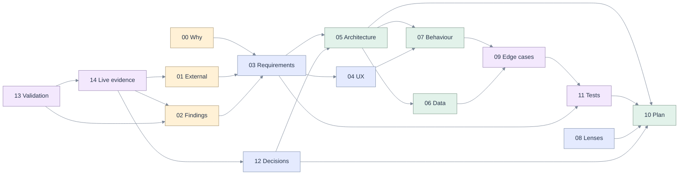

# 014 · From a notebook agent to the data engineering agent for Databricks

**Status:** implementation spans P0–P6 with local, PostgreSQL, browser and live-fixture evidence.
The full plan and live release gates are unfinished. See [implementation status and evidence](15-implementation-status.md).
The specification below was **revised after a live investigation** of the development workspace and
of the pinned agent.
13 November 2026.
**Scope:** the agent path of [`apps/coding-agent`](../../apps/coding-agent): the ACP client, the
orchestrator, the tool server and its policy, the session journal, and the assistant, mission and asset
surfaces of the web app.
**Builds on:** [001](../001-databricks-coding-agents/README.md) (the app),
[005](../005-llm-models/README.md) (models), [006](../006-databricks/README.md) (the dock),
[010](../010-long-running/README.md) (durable turns), [011](../011-ux-coding-mission/README.md)
(missions), [013](../013-sql-query-support/README.md) (SQL as an asset and its policy). It replaces none
of them.

## The finding in one paragraph

OpenGenie's promise is a coding agent that sees the workspace, runs on the model the team chose, writes
only inside a fence the server enforces, and proves what it says it did. Reading the agent path end to
end shows the promise is kept for one notebook and short SQL, and that the mechanisms behind it are
weaker than they are described: the fence the agent actually passes through allows every write when a
session has no schema, and accepts `..` in a path; "proven" means a tool of that name completed, so a
fabricated number passes; an approval card for the real agent reads "write … an object"; cost never
reaches the user; the ETL playbook tells the agent to wait five times longer than the agent itself
allows; and the code the agent writes can be run under an identity that reads every user's stored
credentials. Each of these was read in the code; twenty-two findings were then confirmed by calling the
repository's own functions, by running the real agent, or by reading the live workspace
([13](13-validation-record.md)).

They share one cause. **There is no typed change contract between the agent and the workspace.** The
app does not hold, as a value, what the agent is about to change, on which revision of which asset, on
whose authority, and what was observed afterwards. So the fence, the approval, the evidence and the
review are each rebuilt from strings, in more than one place.

## What the live investigation changed

The first version of this spec was written from code and documentation. The owner then gave access to
the workspace and to a model, and the second pass ([14](14-live-investigation.md)) changed four things
that matter.

| Learned | From | Consequence |
|---|---|---|
| **A Databricks App is given no user scope for Jobs or Pipelines.** Not a missing grant: the platform does not offer one. | The platform's list of supported scopes, and the live app's configuration | The agent cannot run a job as its user from an app. It does not borrow the app's identity: it defines jobs and pipelines as code for the user to deploy, runs what SQL can express, and observes the rest through system tables, which are readable ([identity tiers](05-architecture.md#identity-tiers)). |
| **The app's own identity can read the key that protects every user's stored credentials**, and cannot be narrowed. | The secret scope's access list | The agent never runs code as the app. This is now a High finding with a one-task fix in phase 0. |
| **The pinned agent fails any tool call at 60 seconds**, in silence, while the tool keeps running. | A 100-second tool, timed | The bound on a tool is 30 s, not 45; and a repeated call must find the first run instead of starting a second. The first version blamed the wrong component. |
| **The pinned agent asks for permission in the protocol, then goes silent if refused.** With deny by default it sees only the tools it is given. | Eleven recorded turns with the real agent | Review can be collected in the protocol at no token cost, and is now the default mode. A refusal must end the turn: today the app's supervisor would tell the agent to carry on. |

Six of eight spikes are answered and all eight open questions are decided, each from a stated principle
and an observation ([12](12-decisions-open-questions.md)).

## What this spec proposes

1. **Hold the line first.** A baseline score measured through the app instead of the shell kit, then
   twelve small fixes that close seven of the ten High findings without adding a feature. The eighth
   closes with the change contract.
2. **Make a change a value.** Every agent write carries a base revision, is planned before it is
   performed, gets one verdict from one policy, can be reviewed as a diff, is recorded in a ledger, and
   can be undone. Review is the default.
3. **Make a run a value.** Every statement, notebook run, job run and pipeline update is an operation
   with a handle, observed by the server, that can wake the mission when it ends. Genie Code's
   documentation says its multi-step work needs the tab open; OpenGenie's does not, and this extends
   that from turns to runs.
4. **One asset contract, honest about identity.** Notebook, file, table, query, job, pipeline, app and
   database instance behind one small set of interfaces. Each kind is served at the tier the session's
   identity allows: the API as the user, SQL as the user, or as code for the user to deploy.
5. **Offer only what can work.** The session probes what its identity can do, registers only those
   tools, and tells apart "not granted" from "the platform does not offer this to apps".
6. **Ground proof in what the server did.** Evidence is graded against the app's own record of each tool
   call, in any language, with four honest grades.
7. **Speak ACP as written and as the pinned agent speaks it**, from a clean environment and a folder
   the app owns, to an agent version that is locked and checked.

## Read this set as a graph

| Document | Purpose | Start here if you are |
|---|---|---|
| [00 Five whys and first principles](00-five-whys-first-principles.md) | The problem, the root cause, eleven principles, scope, the platform's boundary | anyone |
| [01 Genie Code, ACP, opencode and the platform](01-genie-code-acp-assessment.md) | What the product competes with, the protocol it speaks, the agent it runs, the platform under it; each statement labelled live, read, reported or unknown | product, AI |
| [02 Code grounding](02-code-grounding.md) | How the agent path works today; 41 findings with file and line, 22 confirmed by probe or live observation | engineering |
| [03 Requirements](03-requirements.md) | 64 requirements with acceptance criteria | product, QA |
| [04 UX: navigation and wireframes](04-ux-wireframes.md) | Navigation map, ten ASCII wireframes, state copy, accessibility | design, front end |
| [05 Target architecture](05-architecture.md) | The asset, change and operation contracts; identity tiers; policy; Toolbox; ACP client; SOLID and DRY as tests | engineering |
| [06 Data model and persistence](06-data-model.md) | Entity diagram, tables with grain and bounds, transactions, migration | database |
| [07 Sequences and state charts](07-sequences-statecharts.md) | Five sequences; session, agent, turn, change, operation and approval states | engineering, QA |
| [08 Seven lenses and complexity](08-lenses-complexity.md) | Product, full stack, database, UX, AI, system design, O(n); where they disagree; measured token costs | reviewers |
| [09 Edge cases, mitigations and tests](09-edge-cases.md) | 79 cases, each with a rule, a stored state and a test | QA |
| [10 Implementation plan](10-implementation-plan.md) | Seven phases, tasks by file, gates, what not to do | engineering lead |
| [11 Test and end-to-end plan](11-test-e2e-plan.md) | Layers, the real-agent check, doubles, scenarios, fault injection, traceability | QA |
| [12 Decisions, spikes, questions, risks](12-decisions-open-questions.md) | 21 decisions, 13 spikes (6 answered, 2 partly), 12 questions (8 decided), 16 risks | owner |
| [13 Validation record](13-validation-record.md) | Every file read, probe run, page fetched and call made; what was not verified | anyone checking this |
| [14 Live investigation](14-live-investigation.md) | 18 workspace facts, 13 agent facts, the corrections they forced, what still needs permission | anyone; the owner for the last section |
| [tools](tools) | The agent spike: a client, a do-nothing MCP server, three configurations | whoever re-runs it |

## Identifier schemes

| Prefix | Meaning | Defined in |
|---|---|---|
| `FP-n` | First principle | [00](00-five-whys-first-principles.md#first-principles) |
| `F-nn` | Finding in the present code | [02](02-code-grounding.md#findings-register) |
| `AG-nn` | Requirement | [03](03-requirements.md) |
| `Wn` | Wireframe | [04](04-ux-wireframes.md) |
| `EC-nn` | Edge case | [09](09-edge-cases.md) |
| `n.n` | Plan task (phase, task) | [10](10-implementation-plan.md) |
| `Dn`, `Sn`, `Qn`, `Rn` | Decision, spike, open question, risk | [12](12-decisions-open-questions.md) |
| `Pn` | Probe run for this spec | [13](13-validation-record.md#probes) |
| `L-nn`, `A-nn` | Fact observed on the workspace, or from the pinned agent | [14](14-live-investigation.md) |

## The ten High findings

| Finding | In one line | Evidence | Closed in |
|---|---|---|---|
| [F-01](02-code-grounding.md#f-01) | No schema means every SQL write is allowed. | probe | P0 |
| [F-02](02-code-grounding.md#f-02) | The agent's path fence accepts `..`. | probe | P0 |
| [F-03](02-code-grounding.md#f-03) | Children inherit the app's secrets in their environment. | code, platform documentation | P0 |
| [F-04](02-code-grounding.md#f-04) | Built-in agent tools are denied by a list, against a floating version; two are callable today. | live | P0 |
| [F-08](02-code-grounding.md#f-08) | Model-written code can run under the identity that reads every user's stored key. | live | P0 |
| [F-10](02-code-grounding.md#f-10) | Approvals are built from fields the protocol does not have. | probe, live | P0 |
| [F-19](02-code-grounding.md#f-19) | The ETL playbook's wait is cut off by the agent at 60 s, leaving a run nobody holds. | live | P0 |
| [F-20](02-code-grounding.md#f-20) | An agent edit is an unreviewed whole-document overwrite. | code | P1 |
| [F-18](02-code-grounding.md#f-18) | From an app the agent cannot run or read a job or a pipeline as the user, and is still offered the tools. | platform documentation, live configuration | P3 |
| [F-28](02-code-grounding.md#f-28) | Every streamed token rewrites the whole session. | code | P5 |

## How to review

Product review starts at [00](00-five-whys-first-principles.md) and the
[product lens](08-lenses-complexity.md#product-owner), then the requirements. Engineering starts at
[02](02-code-grounding.md) and [05](05-architecture.md). QA starts at the
[edge-case matrix](09-edge-cases.md) and the [traceability table](11-test-e2e-plan.md#traceability).
The owner should read [what the evidence decides](14-live-investigation.md#what-the-evidence-decides),
overrule any decision in [12](12-decisions-open-questions.md#decisions) that the evidence does not
justify, and answer the four new [questions](12-decisions-open-questions.md#open-questions), the first
of which is whether the remaining write tests may be run. Anyone doubting a claim should start at the
[validation record](13-validation-record.md).

## What the initial assessment did not claim

This section records the original investigation. Subsequent implementation and live checks are in
[15](15-implementation-status.md) and the current [64-requirement gap assessment](16-gap-assessment.md).

- **What the app's forwarded user token is answered was not observed.** The investigation used an
  identity with every API scope and did not start the app. That jobs are closed to an app's user rests
  on the platform's documented list of scopes.
- **Nothing that needs a write on the workspace was tested.** In particular, whether scheduled
  materialized views can deliver incremental ETL as the user through SQL alone is open, and it is the
  result that would most improve the product on an app deployment.
- Every agent fact is from one version (1.18.19) and one model (Gemini 3.8 Flash).
- The Genie Code statements, and the opencode statements still labelled R in
  [01](01-genie-code-acp-assessment.md), are reported from documentation and were not re-read.
- No test suite was run. Complexity is derived from the code path; the only measurements are the token
  counts and timings of the agent spike.
- Sizes in the plan are judgements. The decisions in [12](12-decisions-open-questions.md) are this
  spec's, made from stated principles; they are proposals to the owner, not instructions.

## Checks

Run on this folder on 13 November 2026, after the revision.

| Check | Command | Result |
|---|---|---|
| Internal links and anchors | `node apps/coding-agent/web/scripts/verify-spec-links.mjs specs/014-improve-agent` | 16 documents, 0 problems |
| ASCII wireframes | `node apps/coding-agent/web/scripts/verify-spec-ascii.mjs specs/014-improve-agent` | 12 blocks, 10 boxes, 0 problems |
| Mermaid blocks | `verify-spec-mermaid.mjs` with `MERMAID_PATH` and `JSDOM_PATH` set (Mermaid 12.3.0) | 23 diagrams, 0 failing to parse |
| Reference-style code links in 02 | path check | 31 definitions, all resolve, all used |
| Identifiers | count and cross-reference check | 41 findings, 64 requirements, 79 edge cases, 18 workspace facts, 13 agent facts; none referenced but undefined; every finding cited by a requirement and by the plan; every requirement in the traceability table |
| Spike scripts | re-run from [tools](tools) | reproduced the permission request, the rejection and the silent end of turn |

The Mermaid check proves that each diagram parses. The rendered diagrams were not looked at. `NODE_PATH`
is not honoured by the script's ES module imports, so the two path variables are needed.

Latest reassessment: [17 · First-principles gap closure](17-first-principles-closure.md) supersedes the
earlier log-authentication diagnosis and records additional protocol, liveness and benchmark fixes.
