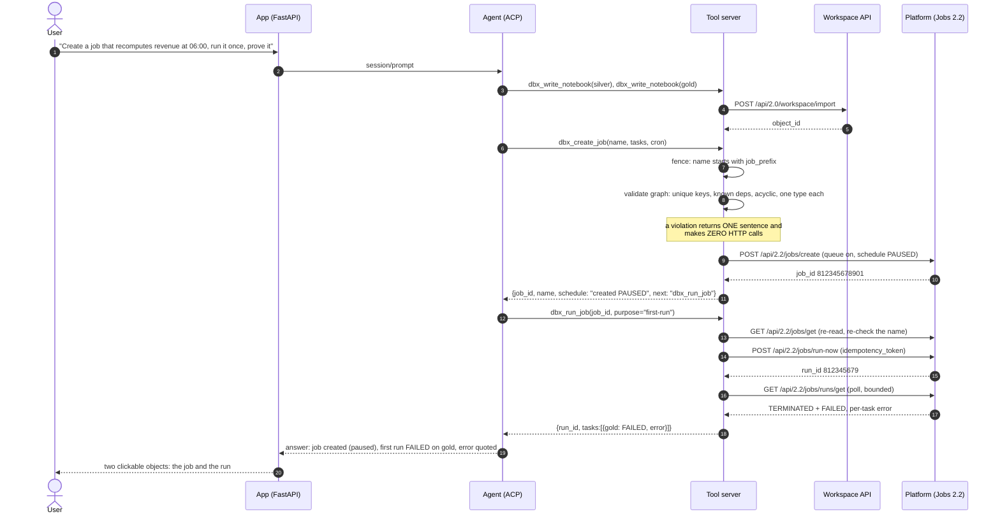
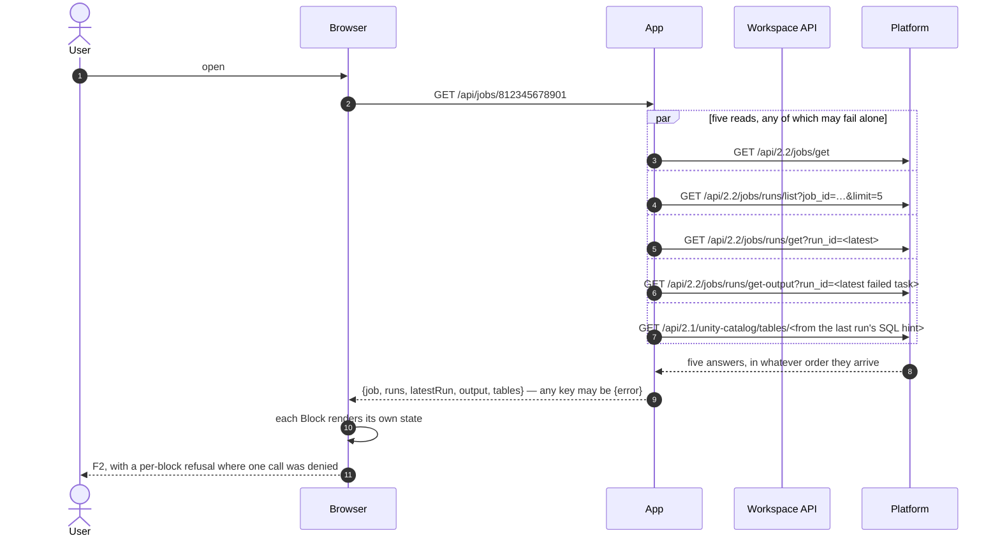
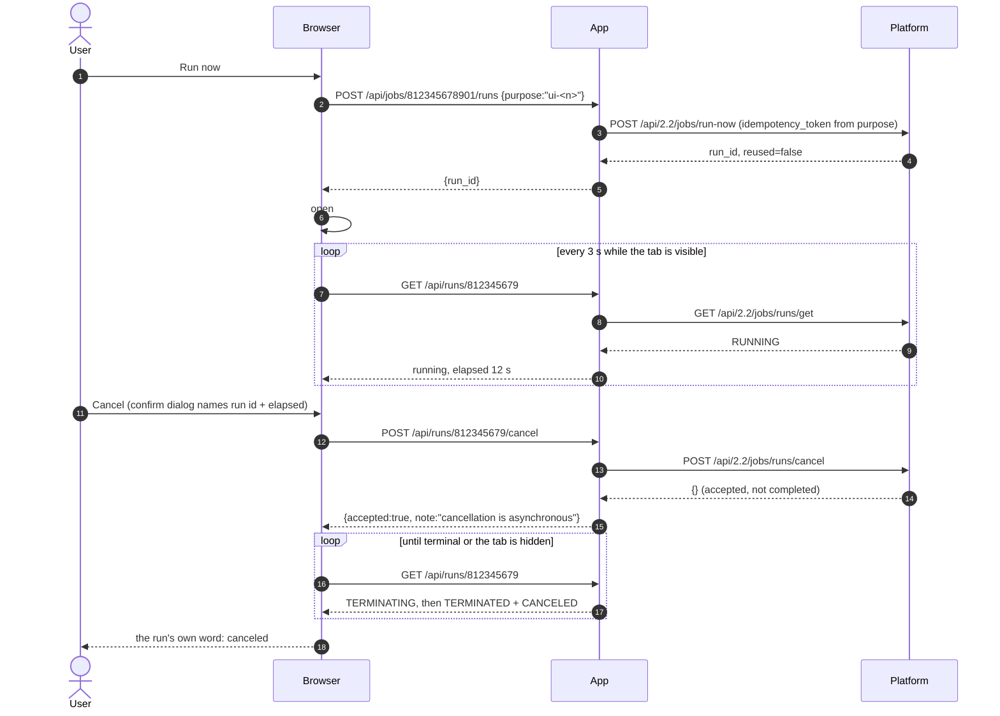
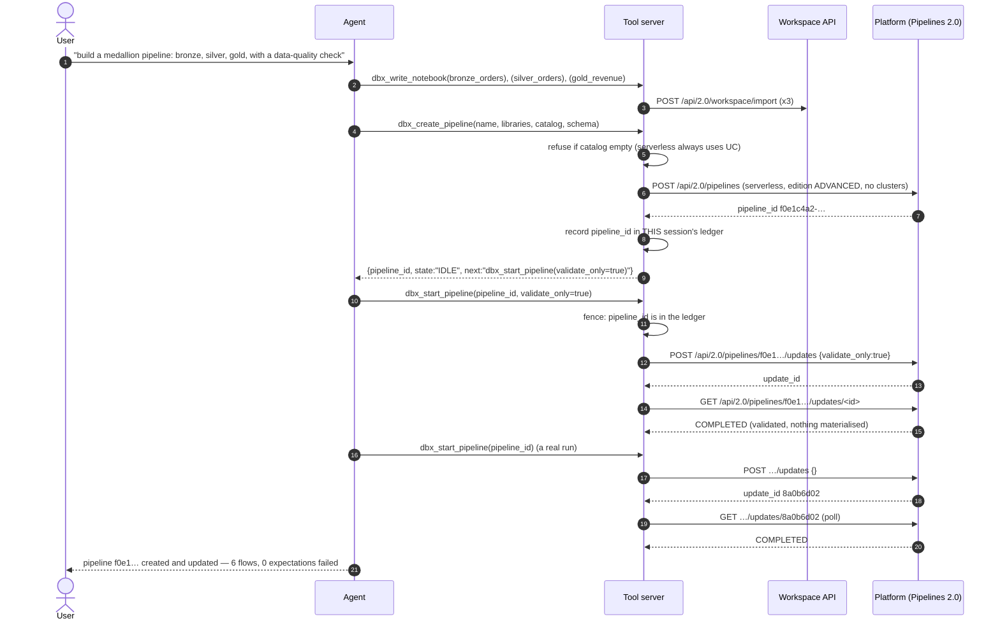
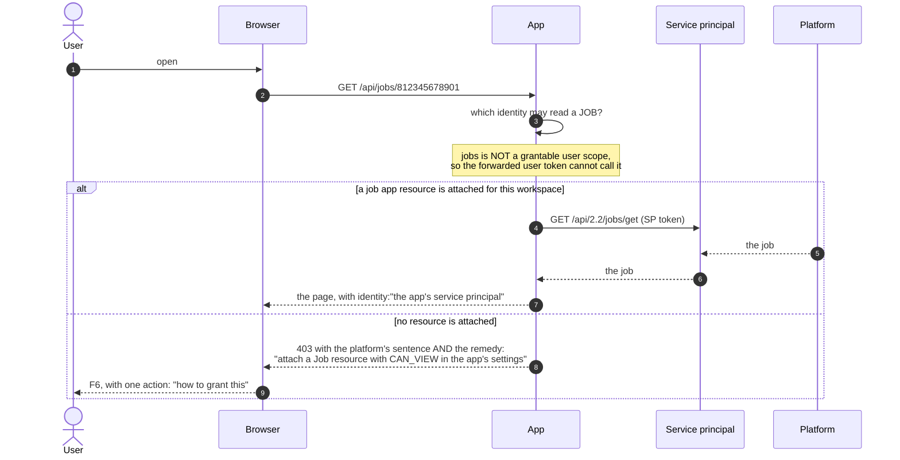
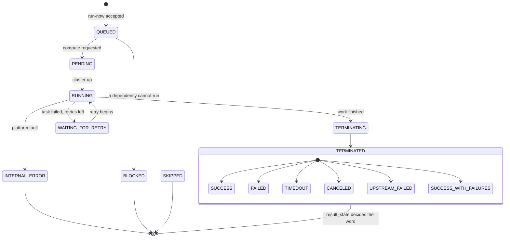
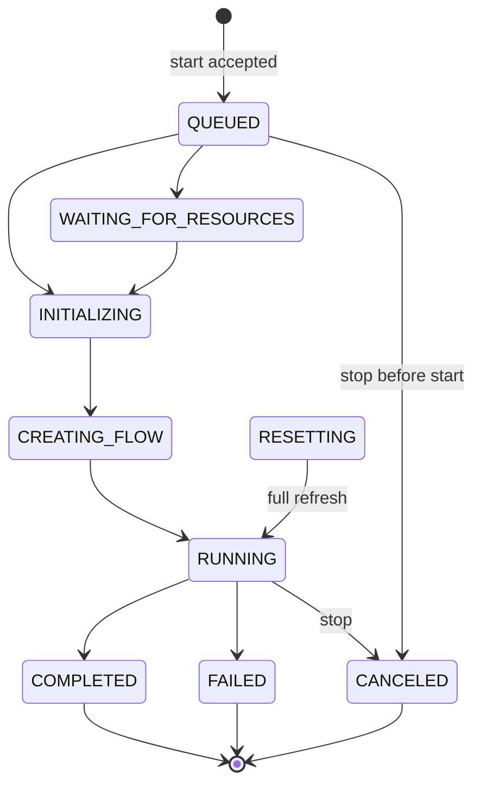
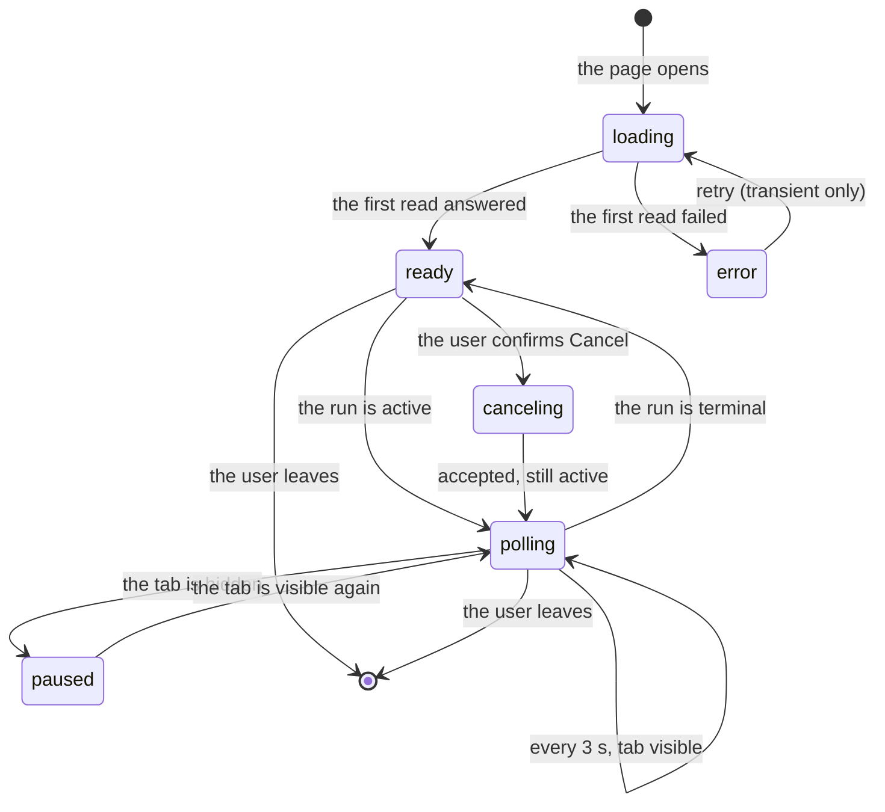
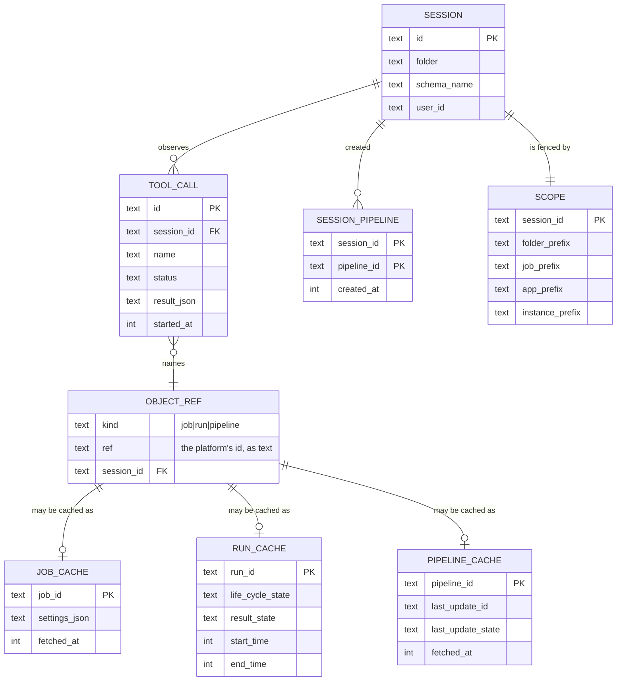
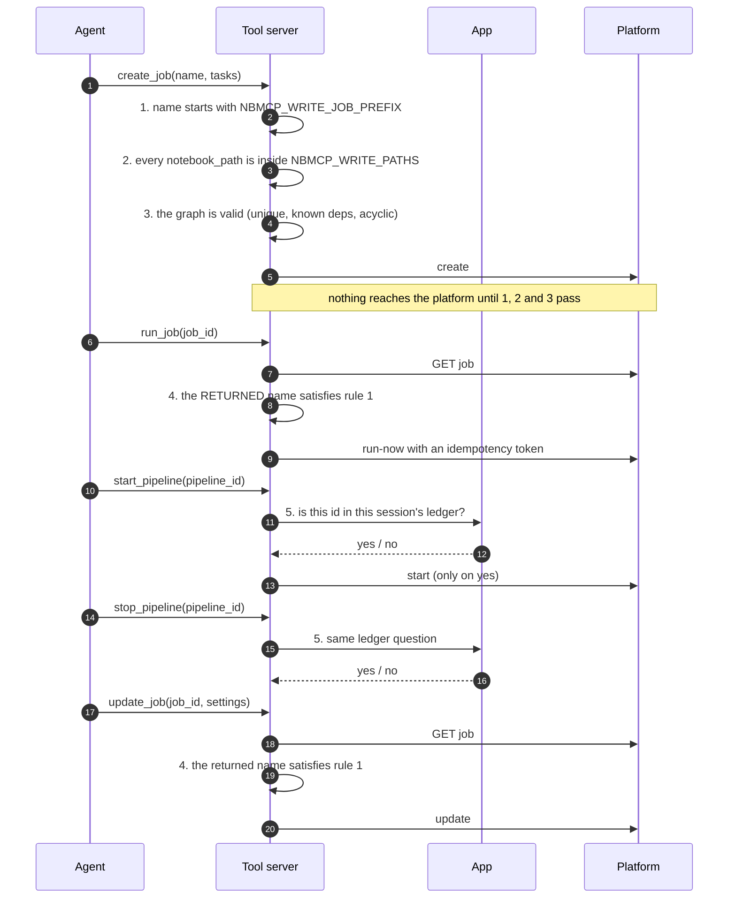

[Index](README.md) · prev: [04 Wireframes](04-wireframes.md) · next: [06 Lenses](06-lenses.md)

# 05 · Diagrams

Five sequence diagrams, three state machines, one E/R model. Every one is checked to *parse* by
`node scripts/verify-spec-mermaid.mjs`, because a diagram that renders as a red error box is worse than
none at all.

The states and the fields are the platform's, quoted in [02](02-assessment.md#what-the-platform-says-in-the-places-this-spec-depends-on-it).
Where this spec adds a state of its own it says so, and the state is in `api/domain/jobs.py` — not in a
component.

---

## 1 · Sequence: "create a daily job and prove the first run"

The turn the product's own card promises. The point of the diagram is the **number of round trips**
and **where the fence is re-checked**.

**What the diagram asserts.** Six platform calls for a job that gets created, run and read back. No
call is made to validate the graph. The fence is checked **twice** on the write path and **once more**
on the run path, from the object the platform returned.

---

## 2 · Sequence: "read a job page"

Five independent reads, because one slow or denied call must not blank the other four — 013's
`page_blocks` decision, applied to a job.

**What the diagram asserts.** The response is a **record of outcomes**, not a success or a throw. The
browser never sees one error replace four facts.

---

## 3 · Sequence: "run in flight, cancelled by the user"

Cancellation is asynchronous in the platform's own words: *"The run is canceled asynchronously, so it
may still be running when this request completes."* The diagram is the reason the page keeps polling.

**What the diagram asserts.** The UI opens the run **before** it is finished — a run page that only
exists after completion is not a way to watch a run. And `accepted: true` is never rendered as
`canceled`.

---

## 4 · Sequence: "build a pipeline and start an update"

The object this product could not create at all before this spec.

**What the diagram asserts.** `validate_only` first. It is free, it answers the question an edit
creates, and it turns a five-minute debugging loop into a twenty-second one. And the fence for a
pipeline is the **session ledger**, because a UUID has no prefix.

---

## 5 · Sequence: "the app reads a job the user may not"

The roadblock, drawn. `[RB-1]` and `[RB-2]` are defined in [10](10-roadblocks.md).

**What the diagram asserts.** The page never claims to be showing what the *user* can see when it is
showing what the *app* can see. The identity is on the page, in words — the rule 013's `infra.py`
header established for Lakebase, extended to jobs.

---

## 6 · State: a job run

The platform's two fields, drawn as one machine. `life_cycle_state` is the position;
`result_state` is the colour of the terminal node.

Three consequences for the code, each a test:

1. **`TERMINATED` is not success.** `lifeCycle === "TERMINATED" && result === "SUCCESS"` is the only
   success. This is the defect class 013's [RB-12] recorded.
2. **Active means six words, not one.** `PENDING`, `QUEUED`, `RUNNING`, `TERMINATING`, `BLOCKED`,
   `WAITING_FOR_RETRY`. "Cancel" must appear for all six, and "Repair" only after a terminal
   `FAILED`/`TIMEDOUT`.
3. **`result_state` is absent while running.** A page that reads it during a run gets `undefined`, so
   the state word must be derived from `life_cycle_state` in that case — and `undefined` must render
   as `running`, not as `unknown`.

---

## 7 · State: a pipeline update

The pipeline's **own** state (`IDLE`, `RUNNING`, `FAILED`, …) is a different axis and is shown beside
the update, never instead of it. A pipeline is `IDLE` both when it has never run and when its last
update failed; `pipelineWord()` reads the update. That is `[PIPE-5]`.

---

## 8 · State: what the pages do while a run is in flight

The client-side machine, which is not the platform's. Its point is that polling has an end.

`paused` exists because a background tab that keeps polling a job costs the platform money in API
calls and buys nothing — nobody is looking. `document.visibilityState` is the signal, and one test
asserts that no interval survives the tab being hidden.

---

## 9 · E/R: what the product stores, and what it only reads

The point of this diagram is the **left half vs the right half**. Everything inside the app's database
is durable; everything outside it is a cache of a platform fact and must never be the only copy.

| Table | Written by | Read by | Loss means |
|---|---|---|---|
| `SESSION`, `TOOL_CALL` | the orchestrator, every event | the transcript, the mission, the evidence check | the conversation is gone (it is durable, 010) |
| `SCOPE` | derived, never stored as state | the fence, both runtimes | nothing: it is a function of the session id |
| `OBJECT_REF` | the transcript reducer | `touched()`'s server twin, the "recent" list | a tool row's object stops being clickable |
| `SESSION_PIPELINE` | `dbx_create_pipeline` | the pipeline fence `[TOOL-6]` | a restart forgets which pipelines this session may stop |
| `JOB_CACHE`, `RUN_CACHE`, `PIPELINE_CACHE` | the adapters, with a TTL | the pages, to avoid a re-read | a slower page, never a wrong one |

**Why the caches are separate tables and not columns on `OBJECT_REF`.** A job and a run have different
lifetimes and different cache keys: a run is immutable once terminal and can be cached forever, a job's
`settings` change. Putting both in one row means one TTL for two facts, which is how a page ends up
showing a stale schedule beside a fresh run.

**Why `SESSION_PIPELINE` is durable and not in process memory.** `[TOOL-6]` says the fence for a
pipeline is the ledger of what this session created. If the ledger lives in the tool-server process, a
session that resumes after an app restart (010's whole point) can no longer stop the pipeline it made an
hour ago — and the refusal would read as a permission problem. So the ledger is a table, and the tool
server asks the app for it.

---

## 10 · Sequence: the fence, end to end

The one diagram a security reviewer wants: every rule applied to the action it governs.

Rules 1–4 are the prefix-and-path fence the repository already had; rule 5 is new and is the reason
`SESSION_PIPELINE` exists. **A rule with no call site is a comment**, which was 013's [F4]; so
`test_fence_parity.py` gains a row per rule and each row fails if the call is removed.
