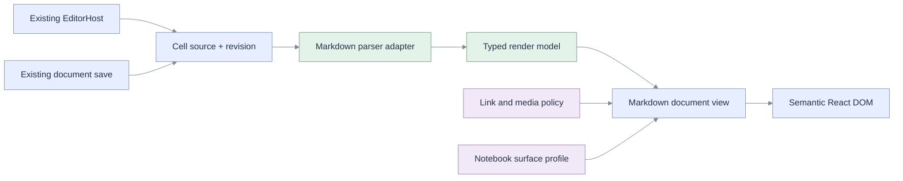
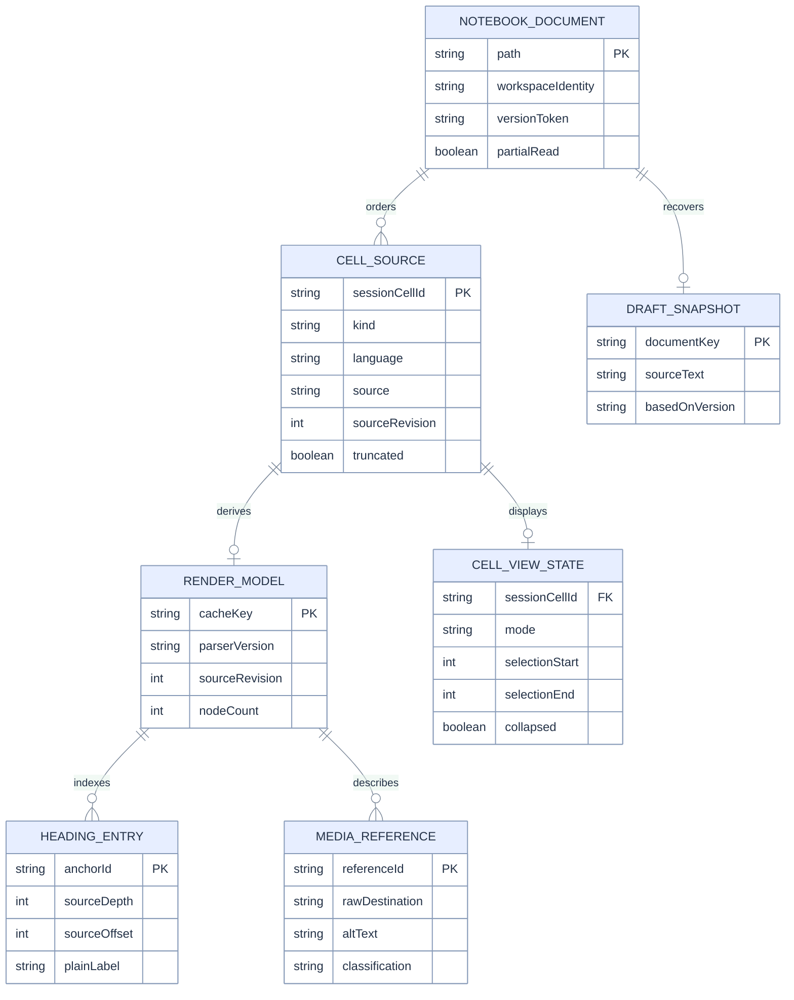
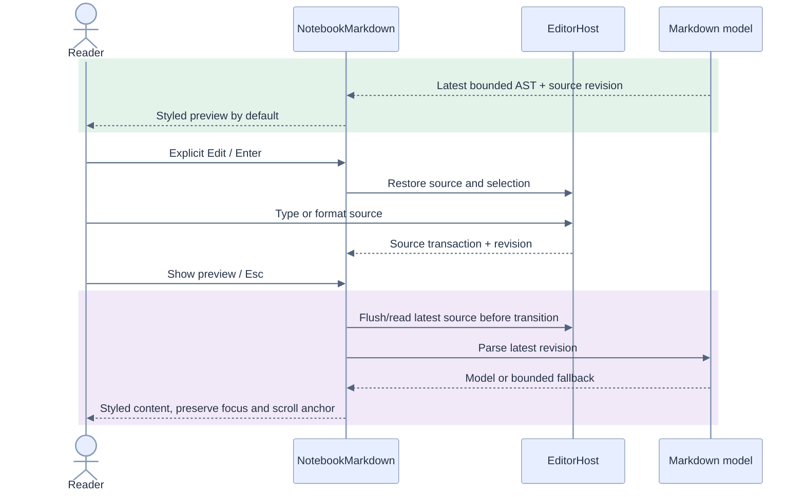
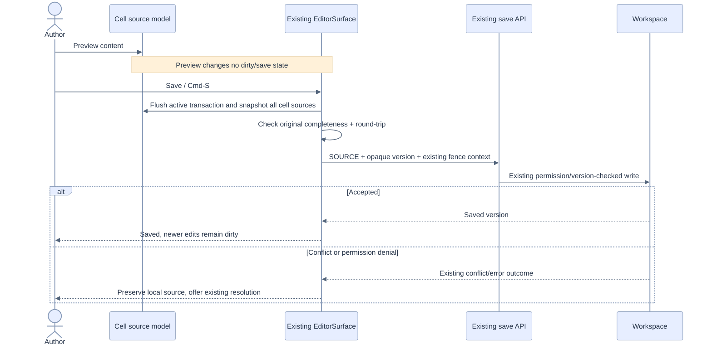

# 05 — Architecture, entities, and sequences

[Index](README.md) · Contracts: [03](03-requirements.md) · States: [06](06-statecharts.md)
· Security: [07](07-rendering-security.md) · Plan: [10](10-implementation-plan.md)

## Component boundaries

Proposed modules below are new unless identified as existing. Names are implementation targets,
not a claim that those files already exist. Keep `Markdown.tsx` as the public compatibility adapter
while moving grammar and React node construction behind explicit interfaces.

| Boundary | Responsibility | Explicitly excludes |
|---|---|---|
| `domain/markdown/parse.ts` | Source to bounded typed AST, positions, headings and diagnostics | DOM, React, storage, requests |
| `domain/markdown/policy.ts` | Pure URL/media classification and canonicalization | Fetching, app permissions decisions |
| `components/MarkdownDocument.tsx` | AST to allowlisted React nodes using a surface profile | Saving, running tools, HTML injection |
| `components/NotebookMarkdown.tsx` | Notebook reading surface, mode controls, empty/failure states | Alternate parser or serializer |
| `domain/markdown/format.ts` | Selected source + command to bounded edit operations | Direct DOM selection mutation |
| `editor/host.ts` / `codemirror.ts` | One atomic formatting transaction and undo/selection mapping | Markdown interpretation or network |
| `hooks/useMarkdownModel.ts` | Revision-scoped parsing cache/cancellation and diagnostics | Durable content storage |
| P1 `MarkdownImage` + resolver adapter | Request lifecycle under policy and caller identity | Privileged generic URL proxy |
| Existing `EditorSurface` and save service | Draft, dirty state, version token, fence, conflict, write | Preview rendering as persistence |

## Logical ER model

This is an **in-memory logical model**, not a proposed SQL schema. `NotebookDocument` and cell
source already exist conceptually. The render model, heading entries and view state are derived.
Do not add a Lakebase table, migration, full-text index or saved HTML column for this feature.

IDs are session-stable cell identities, not new durable metadata. The SOURCE format does not
persist a cell ID. Reopening reparses and reconciles; anchors use a document namespace plus
cell identity and source heading ordinal during the current session. Duplicate heading text
does not become a DOM-ID collision. External links remain the existing cell-index route until
a durable anchor scheme is separately specified. Outline requests map to the current revision.

Cache key: `(workspace identity, document key, cell id, source revision, parser profile/version)`.
Store the source reference or a checked revision too; an unchecked hash alone cannot prove equality.
Discard derived state on workspace/user change, cell deletion/conversion and document close.
The existing draft store is reused, with its current security scope audited in [phase P1](10-implementation-plan.md#phases).

## Reading and editing sequence

No server request is required to switch modes. Preserve the active editor state/history in a
document-scoped host/state cache while previewing; do not keep hundreds of hidden live editors.
The adapter chooses remount-with-restored-state versus retained active host in [phase P3](10-implementation-plan.md#phases).
Either must meet the same undo/selection/history tests and memory budget.

## Save and external edit sequence

An agent write on a clean document follows existing adoption/reconciliation. A dirty document
retains local source and shows incoming changes. Parsing or media completion never settles a
write conflict. See [state dimensions](06-statecharts.md#state-vector) and [T11](11-tests-traceability.md#test-groups).

## DRY and SOLID contracts

- **Single responsibility:** parsing, policy, rendering, source transactions and persistence have
  separate owners. `CellBlock` orchestrates rather than implementing grammar.
- **Open/closed:** typed node handlers and surface profiles extend behavior; avoid forked parsers
  for notebook/chat/read-only/file surfaces.
- **Liskov:** legacy `Markdown({text,streaming})` callers retain source escaping, workspace paths,
  code Copy and streaming fallbacks. Contract tests cover every adapter.
- **Interface segregation:** add an optional `MarkdownEditHost` capability for formatting/state
  snapshots; plain code-editor consumers do not implement irrelevant toolbar APIs.
- **Dependency inversion:** formatting and rendering depend on small editor/media interfaces,
  not CodeMirror internals, Fetch globals, workspace SDKs or database credentials.
- **DRY:** one heading traversal feeds DOM IDs and P1 outline; one URL policy handles all rich
  destinations; one SOURCE authority with a checked client mirror. Existing helpers are reused
  where their contracts match; a navigation URL helper is not repurposed as an image API.

