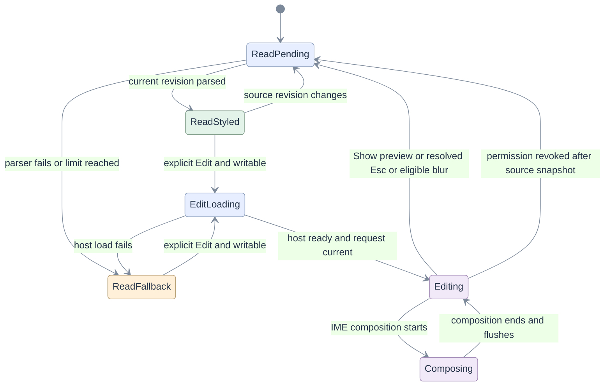
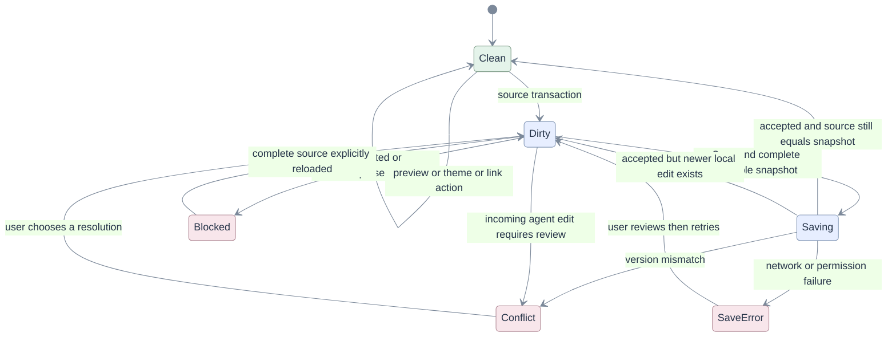
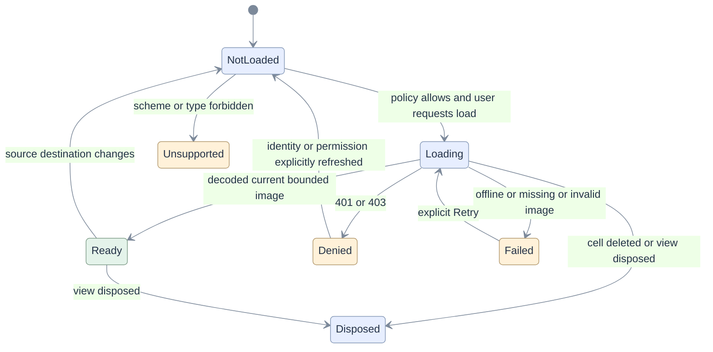

# 06 — Statecharts and transition guards

[Index](README.md) · Requirements: [03](03-requirements.md) · Screens: [04](04-ux-wireframes.md)
· Risks: [09](09-edge-cases.md) · Tests: [11](11-tests-traceability.md)

## State vector

Do not replace the current local boolean with a larger boolean soup. Use a pure transition
function over an explicit view state, and keep independent facts separate:

`{cellId, documentKey, sourceRevision, mode, editorStatus, permission, composition, renderRevision}`.

`mode = read | edit`; collapse is orthogonal. Dirty/saving/conflict belongs to `EditorSurface`.
Media has its own request state. Focus identifies a target/control; it is not equivalent to mode.
All async messages carry document key + cell ID + source revision + request generation.
Accept a result only if its complete identity tuple still matches the live model.

## Interaction state

Outside Edit, the surface always interprets and styles Markdown. A short loading surface reserves
space while parsing; raw source is shown only in the labeled fallback after a render/load failure.
That fallback does not pretend to be a successful preview. Empty source is a styled empty state.

The diagram is the primary lifecycle. Structural deletion/navigation disposes every state;
reopening begins a new generation. Conversion to code exits this machine and uses the code-cell
surface. A newly inserted writable + Text cell may take the explicit Edit transition immediately.

| Event/guard | Required behavior | Risks/tests |
|---|---|---|
| Enter on command-focused writable cell | Edit, restore last caret; consume no run request | E01, E05 / T01, T09 |
| Enter on child link/button, or modified shortcut | Let that control handle it; no parent edit | E05, E08 / T06, T09 |
| Double-click preview | Optional Edit shortcut only outside interactive children and active text selection | E05 / T01 |
| Show preview | Flush latest source once, snapshot selection/history, then parse | E04 / T02 |
| Esc with completion/search/dialog open | Close the innermost overlay first; remain Edit | E06 / T09 |
| Esc/preview during IME | Defer mode change until compositionend; never commit partial composition | E06 / T02 |
| Focus moves to formatting toolbar | Keep Edit and saved selection; never let blur discard host state | E03 / T02 |
| Focus moves outside the entire cell while document has focus | After composition/transaction settles, transition to read mode; do not save | E04 / T01 |
| Browser/window loses focus | Preserve Edit/selection; no synthetic preview or save | E07 / T12 |
| Read-only or permission revoked | Disable mutation commands at invocation time; retain unsaved source and offer Copy | E02, E35 / T10, T14 |
| Collapse current edit cell | Flush source first, keep undo state; next Expand opens styled read mode | E23 / T12 |
| Delete/reorder/external change while loading | Match identity, not array index; cancel obsolete work | E24, E25, E36 / T11, T12 |

## Save state

This is a model of the **existing document save owner**, not a second save implementation.
Source changes, not display transitions, mark Dirty. The representation checks run against the
original completeness metadata before serialization and then against the snapshot's round-trip.

Save error does not authorize overwriting a conflict or repeating an unknown write automatically.
Preview must not say Saved. Existing approval/fence outcomes stay with the document UI.
See [MD-12](03-requirements.md#requirements), [E26–E35](09-edge-cases.md#register).

## Media state

P0 renders the `NotLoaded` placeholder. P1 enables the guarded loading transitions. A denied
workspace read is final for that request; it is never retried under another principal.

Every transition preserves alt text, source destination and layout bounds. Abort listeners,
disconnect observers and revoke object URLs on disposal. Test state transitions as a generated
event sequence in addition to the selected E2E stories ([T07/T12](11-tests-traceability.md#test-groups)).

