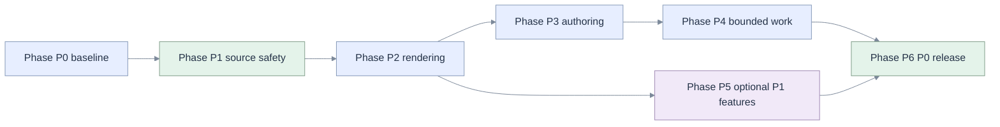

# 10 — Implementation plan grounded in the current tree

[Index](README.md) · Why: [01](01-five-whys.md) · Design: [05](05-architecture.md)
· Risks: [09](09-edge-cases.md) · Gates: [11](11-tests-traceability.md) · Release: [12](12-decisions-rollout.md)

This plan is executable work breakdown, not evidence that application changes exist. File names
marked **new** are targets. Preserve the current save authority and public renderer adapter.
Do not implement all concerns inside `CellBlock` or create another notebook serializer.

## Phases

### Phase P0 — Baseline and executable contracts

Targets: existing `Markdown.test.tsx`, `Markdown.long.test.tsx`, `domain/notebook.test.ts`,
`tests/test_notebook.py`, `tests/test_notebook_roundtrip.py`; new fixture manifest and E2E harness.

1. Add a synthetic Bakehouse Markdown fixture containing the screenshot title/prose without its
   business SQL, plus paired SOURCE notebooks for PYTHON/SQL/R/SCALA.
2. Capture current editable/read-only typography, modes and source round-trips. Write focused
   failing tests for unsupported grammar, empty resting mode, PUA markers, limits and toolbar transitions.
3. Implement an isolated parser-adapter spike using `remark-parse` + selected `remark-gfm`
   capabilities or a smaller equivalent AST adapter. Lock exact dependency versions in the existing
   lockfile; record license/browser bundle compatibility and measured adversarial costs.
4. Record baseline parser/run-plan counts, bundle sizes, and the reference machine/browser.
   Do not choose a parser solely because a README describes CommonMark support.

Exit: T01/T03/T04/T05/T14/T17 failure expectations documented; adapter decision D1 confirmed or
updated with evidence. No production flag enabled. Covers MD-01, MD-04–MD-07, MD-10, MD-15, MD-17.

### Phase P1 — Preserve complete source before improving presentation

Targets: `api/domain/notebook.py`, `api/adapters/databricks/workspace.py`,
`api/domain/notebook_write.py`, `web/src/domain/notebook.ts`, `api/client.ts`,
`components/Viewer.tsx`, `components/EditorSurface.tsx`, `domain/drafts.ts`.

1. Add an additive, backward-compatible read completeness field with explicit reasons:
   byte truncation, cell truncation and cell-count overflow. Keep existing booleans for old clients.
   Detect the 401st nonempty cell using bounded lookahead; do not infer completeness from exactly 400.
2. Derive document read-only from **any** unsafe completeness reason before serializing server cells.
   Carry original source integrity into save eligibility. Rechecking only a reparsed serialized prefix
   cannot recover a discarded truncation flag. At the server boundary, check incoming raw limits
   before a capped parser can hide overflow, and reject ordinary editor saves against a current
   notebook whose original read is incomplete. Do not trust a client-supplied completeness claim.
3. Keep server SOURCE parsing/serialization authoritative. Add shared golden fixtures consumed by
   TS and Python tests rather than expanding two independent manually duplicated corpora. Resolve
   Python code-point vs JS UTF-16 counting without changing editor offsets or raising limits.
4. Audit draft/cache identity keys. Namespace new derived caches by workspace/user/document. If
   existing path-only drafts need migration, never auto-adopt a legacy draft into another identity;
   offer explicit recovery only with matching provenance. Storage failure keeps the active buffer
   readable and announces that reload recovery is unavailable; it must not falsely promise durability.

Exit: T10/T14/T15 pass for 399/400/401 cells; exact limits ±1; astral characters; partial byte reads;
clean/conflict/permission paths. A complete notebook's save payload is unchanged in meaning.
Covers MD-02, MD-12, MD-14, MD-16, MD-17. No database migration or new privilege is required.

### Phase P2 — One bounded render model and notebook reading profile

Targets: new `domain/markdown/{parse,types,policy}.ts`, `components/MarkdownDocument.tsx`,
`components/NotebookMarkdown.tsx`, existing `Markdown.tsx`, `Math.tsx`, `domain/math.ts`,
`Viewer.tsx`, `NotebookEditor.tsx`, `styles.css` or a scoped `notebook-markdown.css`.

1. Implement the AST adapter and typed allowlist from [07](07-rendering-security.md#dialect).
   Retain source ranges; represent math as typed nodes, not forgeable sentinels.
2. Keep `Markdown({text,streaming})` as a compatibility adapter into the same renderer. Notebook
   gets an explicit surface profile and heading context; do not fork grammar for chat and notebook.
3. Route both editable-cell read mode and read-only viewer through `NotebookMarkdown`. Style
   headings/prose/lists/quotes/tables/code using notebook tokens. Resting empty cells get a real empty state.
4. Centralize URL classification, disabled task previews and image placeholders. Hide chat-only
   SQL promotion controls in notebook reading. Render HTML/unsupported nodes inertly.
5. Preserve lazy KaTeX and isolated DOM ownership; add MathML/accessible fallback and hard budgets.
   Add a per-cell render boundary and bounded fallback for unknown/failed nodes.

Exit: T01/T03–T08/T13/T15/T19 pass; no page errors or unexpected fetch/write/execute; notebook
headings no longer inherit answer sizing. Covers MD-01, MD-04–MD-10, MD-13, MD-16, MD-18.

### Phase P3 — Explicit mode and atomic authoring controls

Targets: `NotebookEditor.tsx`, `editor/host.ts`, `editor/codemirror.ts`, `editor/Editor.tsx`,
new `domain/markdown/{viewstate,format}.ts` and `components/MarkdownToolbar.tsx`.

1. Add pure state transitions matching [06](06-statecharts.md#interaction-state). Reading is the
   default; + Text is an intentional Edit entry. Empty content does not force an editor outside Edit.
2. Add explicit Edit/Show preview, roving formatting controls and validated link/reference dialogs.
   Guard selection, interactive descendants, completion, IME, read-only and real window blur.
3. Extend an optional host capability for one atomic formatting transaction plus selection/state
   snapshot. Keep CodeMirror details in its adapter. Restore undo/history/caret across preview without
   mounting a hidden editor per cell. Never emulate source edits by manipulating rendered DOM.
4. Flush/read the active host before Preview, Save, collapse, conversion, navigation and draft
   snapshot. UI mode never silently commits a document write. Preserve existing run chords for code.

Exit: T01/T02/T09/T10/T12 pass with immediate last-character preview, toolbar clicks, source Undo,
lazy load failure and permission revocation. Covers MD-01–MD-03, MD-11, MD-12, MD-14, MD-18.

### Phase P4 — Incremental work and bounded resources

Targets: `NotebookEditor.tsx`, `domain/cellrun.ts`, `EditorSurface.tsx`,
new `hooks/useMarkdownModel.ts`, cache/host lifecycle adapters and profiling fixtures.

1. Compute runnable metadata once per relevant source/policy revision; build index maps and
   prefix/suffix counts. Above/below availability becomes constant-time per cell. Build run-ID arrays
   only on user action, reusing the same domain decision as Run all.
2. Cache parsed Markdown per cell/revision; unchanged cell views get stable handlers/props. Do not
   parse Markdown again for the outline or for an unrelated run-progress/caret update.
3. Replace full-document serialization/localStorage writes on each notebook keystroke with a
   coalesced snapshot pipeline. Keep source authoritative in memory and flush before all boundary
   actions. Draft recovery degradation is visible, not swallowed as a false guarantee.
4. Enforce node/depth/memory/time budgets and cancel obsolete work. If a worker is needed, send
   typed source/revision data; never carry permissions or DOM objects into it. Prove profiling need first.

Exit: T12/T17/T19 meet [08 budgets](08-lenses-performance.md#budgets); no change to run ordering,
save semantics or typing fidelity. Covers MD-02, MD-12, MD-14, MD-15. Optional micro-optimizations
without evidence are deferred; removing the existing repeated run-plan scans is an explicit target.

### Phase P5 — P1 image resolution and heading navigation

Targets: new scoped media resolver/UI adapters and outline component; existing API workspace/file
service boundaries only after verifying their permissions and binary-content contracts.

1. Collect headings during parsing and derive the outline from that result. Define current-session
   IDs separately from external cell-index links; test duplicate/reordered/changed headings.
2. Implement authenticated workspace/volume image reads without a generic URL proxy. Follow
   [media policy](07-rendering-security.md#images-and-privacy), enforce limits before decode and bind
   requests to identity + document/cell/revision. External loading remains explicit and origin-scoped.
3. Do not add image upload, broaden OAuth scopes or persist content/AST/media by default.
   If platform capabilities cannot enforce the limits, retain the P0 placeholder and document why.

Exit: T07/T12/T15/T16/T17 pass. Covers MD-04 P1, MD-09 P1, MD-14–MD-16, MD-18.
This phase is not required to ship P0; it has its own release gate and cannot weaken P0 fallbacks.

### Phase P6 — E2E, accessibility and release evidence

Targets: new `web/scripts/notebook-markdown-e2e.mjs`, existing notebook/editor/agent regression
suites and `specs/015-notebook-md/e2e/` evidence (created during implementation, not prefilled).

Run the [T01–T20 matrix](11-tests-traceability.md#test-groups). Record assertions before screenshots,
production-build metrics, failures/skips, browser versions and tested commit. Stage by surface/capability,
verify the live served bundle and the no-save Preview flow, then follow [rollback](12-decisions-rollout.md#release-and-rollback).
Exit: every enabled requirement/risk has passing evidence; P1 remains off if its tests are incomplete.

## Dependency graph

The P5-to-P6 edge applies to a release enabling P1; a P0-only release gates P0–P4 through P6.
Source-safety fixes are reviewed separately from visual/parser changes so a regression is attributable.

